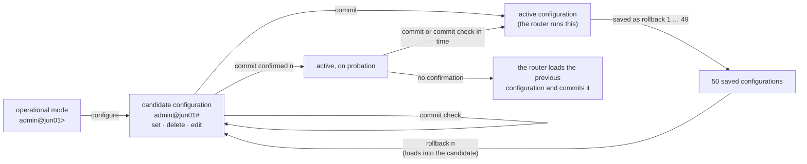

# J0 — The parts of Junos and how a change flows

This unit is for an engineer who works on IOS and IOS XE, and has met IOS XR, and is now sitting in front of Junos.
It explains how Junos is written and how a change reaches the router, and compares each step with IOS and IOS XR.
The routing itself (addresses, OSPF, static routes) is CCNA material, and the lab uses it to practise the Junos way.
The unit has three pages and an appendix.

| Page | What it covers | Tasks |
|---|---|---|
| This page | The parts of Junos and the flow of a change: operational and configuration mode, the candidate and the active configuration, commit, rollback, the routing table | — |
| Writing configuration: the tree and the interfaces | The configuration hierarchy, `set` and `edit`, `display set`, physical interfaces and logical units | J0-1, J0-2 |
| Commit: check, confirm, roll back | The candidate configuration, `commit check`, `commit confirmed`, the 50 saved configurations, several people editing at once | J0-3 |
| The routing table and the default policies | `inet.0` and the other tables, reading `show route`, route preference, static routes, why a protocol does not advertise everything | J0-4 |
| Appendix | Junos OS and Junos OS Evolved, the virtual router used in this lab, quick IOS and IOS XR translations | — |

The lab is JNT-01. JUN01 and JUN02 are Junos routers (vJunos-Evolved) that start empty. FRR1 is an FRRouting router that is
already configured: it plays a router from another vendor that you cannot change, with a server network behind it.

:::topo
nodes:
  JUN01: {at: [0, 0], label: "JUN01 (Junos)"}
  JUN02: {at: [2.4, 0], label: "JUN02 (Junos)"}
  FRR1: {at: [4.8, 0], label: "FRR1 (FRRouting)"}
  SRV: {at: [4.8, 1.2], kind: host, label: "servers 198.51.100.0/24"}
links:
  - {a: JUN01, b: JUN02, la: "et-0/0/0 .1", lb: "et-0/0/0 .2", label: "10.0.12.0/30"}
  - {a: JUN02, b: FRR1, la: "et-0/0/1 .1", lb: "eth1 .2", label: "10.0.23.0/30"}
  - {a: FRR1, b: SRV, label: "behind FRR1"}
:::

## 1. Why it is worth learning the Junos way

### 1.1 The trouble: a change in flight

On IOS every line you type is live. A change of five lines passes through four half-finished states on its way, and the network
sees each of them. If you paste a block and line three is rejected, lines four and five still go in. If the change cuts you off,
you wait for `reload in` to bring the router back, with everything else that a reload brings. To undo a change, you type the
reverse of each line, from memory or from a saved copy.

### 1.2 What you did before

IOS gives you tools around the problem: `reload in` before a risky change, `archive` and `configure replace` to return to a saved
file. IOS XR solves it in the configuration itself, as you saw in M1 of the IOS XR track: you edit a private target configuration
and nothing reaches the router until you commit.

### 1.3 The Junos answer

Junos was built around the same idea as IOS XR, and adds a few habits of its own:

- You edit a **candidate configuration**, a working copy. Nothing reaches the router until you **commit** it.
- `commit check` checks the whole candidate before anything changes.
- `commit confirmed` applies a change on probation. If you do not confirm it in time, the router goes back by itself.
- The router keeps the **50 most recently committed configurations**. Any of them can be loaded back as the candidate.
- The configuration is one **tree**. Every line in it can be written as one `set` command that names its full path.

The rest of this page puts the parts side by side before the next pages go into each one.

## 2. How it fits together: the parts and the flow

### 2.1 The flow of a change



You log in to **operational mode** (the `>` prompt), where you look at the router. `configure` takes you to **configuration mode**
(the `#` prompt), where you change the candidate. A commit turns the candidate into the **active configuration**, and the previous
active configuration becomes rollback 1.

### 2.2 The terms side by side

| Junos term | What it is | In plain words | On IOS | On IOS XR |
|---|---|---|---|---|
| operational mode (`>`) | Where you run `show`, `ping`, `request` | the dashboard | EXEC mode | EXEC mode |
| configuration mode (`#`) | Where you edit the candidate | the workbench | global configuration mode, but nothing is live yet | configuration mode |
| candidate configuration | The working copy you edit | a draft | — (every line is live) | the target configuration |
| active configuration | What the router runs | the published version | running-config | running configuration |
| commit | Check the candidate and make it active | publishing the draft | — | commit |
| rollback n | Load saved configuration n into the candidate | taking out an old copy | `configure replace` with an archived file | `rollback configuration`, `load rollback changes` |
| statement and hierarchy level | One node of the configuration tree, and where you are in it | a folder path | a line, and the configuration mode you are in | the same, with submodes |
| logical unit (`et-0/0/0.0`) | The part of an interface that carries addresses. Always there, even without VLANs | a lane on a road | the interface itself, or a subinterface for a VLAN | the interface itself, or a subinterface |
| routing table `inet.0` | The IPv4 table that all protocols share | the shared register | the global routing table | the default VRF table |
| route preference | Which source of a route wins | a ranking | administrative distance | administrative distance |

### 2.3 Easy to mix up

- `show configuration` in operational mode shows the **active** configuration. `show` in configuration mode shows the
  **candidate** where you stand. They differ while you have changes that are not committed.
- A plain `configure` **shares** one candidate with everyone else in plain `configure`. Their uncommitted changes are yours too,
  and a commit by either of you commits both. IOS XR gives every session its own target configuration. Junos does that only with
  `configure private`.
- An address goes on the **logical unit** (`et-0/0/0 unit 0`), not on the physical interface. Protocols name the unit too:
  `et-0/0/0.0`.
- Preference values are not the administrative distances you know: OSPF internal routes are 10, static routes 5, BGP 170.
- A static route's next hop must be on a directly connected network unless you say otherwise.

### 2.4 On the lab board

| Device | Role in JNT-01 | What you practise |
|---|---|---|
| JUN01 | Empty Junos router at one end | Writing the tree: addresses, OSPF |
| JUN02 | Empty Junos router in the middle | The same, a change on probation (J0-3), a static route (J0-4) |
| FRR1 | Configured router of another vendor, with servers behind it | Nothing to configure. It is the neighbour you cannot change |

FRR1 is the reason J0-3 exists: a change on your side can break a neighbour you cannot touch, and `commit confirmed` is how you
try it without staying broken.

### 2.5 What to hold on to

- Look in operational mode, change in configuration mode, and nothing changes until you commit.
- Before a risky commit, `commit check`, then `commit confirmed` with a short time.
- The router keeps the last 50 configurations. `rollback n` loads one into the candidate. You still commit it.

## 3. What it looks like

The whole of what J0-1 and J0-2 ask of JUN01 fits in a few lines. Shown here in the `set` form that Junos prints with
`show configuration | display set`:

:::config fold JUN01 — addresses and OSPF
set interfaces et-0/0/0 unit 0 family inet address 10.0.12.1/30   ## the link address, on logical unit 0 of et-0/0/0
set interfaces lo0 unit 0 family inet address 192.168.0.1/32       ## the loopback, also on a unit
set protocols ospf area 0.0.0.0 interface et-0/0/0.0               ## OSPF names the unit, not the physical interface
set protocols ospf area 0.0.0.0 interface lo0.0 passive            ## advertise the loopback, form no adjacency on it
:::

After the commit, `show system commit` lists who committed what, newest first. The numbers on the left are the rollback numbers:

```console
admin@jun01> show system commit
0   2026-11-14 10:57:11 UTC by admin via cli
    J0 PoC: addresses
1   2026-11-14 09:53:56 UTC by root via other
```

Entry 1 is the configuration the router started with. Entry 0 is the active configuration.

## Practice

The tasks of this unit are in lab **JNT-01**. Each page ends with the tasks that belong to it.

<p class="tolab"><a href="/_learn?id=JNT-01">Open lab JNT-01 in the workspace</a></p>

:::note
Sources: Juniper Networks, *CLI User Guide for Junos OS* (published 2026-06-18), sections on the commit model, the forms of the
configure command and returning to a previous configuration; *Junos OS Routing Protocols Overview* (2026-06-23), table of default
route preferences. The outputs on these pages were taken on vJunos-Evolved, Junos OS Evolved 26.2R1.7, in containerlab.
:::
