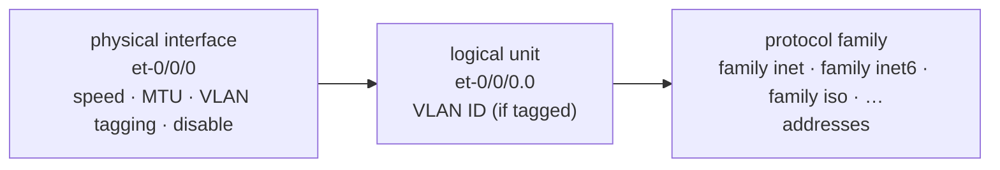

# J0 — Writing configuration: the tree and the interfaces

## 1. Why a tree

### 1.1 The trouble: where does that line live?

On IOS the configuration is a list of lines, and the meaning of a line depends on the mode above it. `ip address` means one thing
under `interface Gi0/1` and nothing at all in global configuration mode. To copy a piece of configuration to another router you
copy the mode lines with it, and to find everything that touches an interface you read several sections of the running
configuration.

### 1.2 What you did before

You filtered: `show running-config | section ospf`, `| include`. IOS XR goes further and lets you show one part of the
configuration by its path, as in `show running-config router ospf`.

### 1.3 The Junos answer

The Junos configuration is one **tree** of statements. Every statement has a full path from the top, and every leaf can be
written as one `set` command that spells out that path. The router prints the configuration either as a tree in braces or as
those `set` lines, and the `set` lines can be pasted into another router as they are. Every feature (interfaces, routing
protocols, system settings) is a branch of the same tree, so you find and write it the same way.

## 2. How it works

### 2.1 Where you stand in the tree

`configure` takes you to the top of the tree. The line above the prompt, `[edit]`, says where you are. `edit` moves you down,
`up` one level up, `top` back to the top, and `exit` out of configuration mode:

```console
admin@jun01> configure
Entering configuration mode

[edit]
admin@jun01# edit interfaces et-0/0/0 unit 0

[edit interfaces et-0/0/0 unit 0]
admin@jun01# set family inet address 10.0.14.1/30

[edit interfaces et-0/0/0 unit 0]
admin@jun01# show
family inet {
    address 10.0.14.1/30;
}

[edit interfaces et-0/0/0 unit 0]
admin@jun01# up

[edit interfaces et-0/0/0]
admin@jun01# show
unit 0 {
    family inet {
        address 10.0.14.1/30;
    }
}
```

`show` in configuration mode shows the candidate from where you stand down. Nothing here is live yet: the next page is about
the commit.

`edit` is only a shortcut. Typed at the top, `set interfaces et-0/0/0 unit 0 family inet address 10.0.14.1/30` does the same
thing in one line, and that is how most people write Junos: one `set` per leaf, with the full path.

To run an operational command without leaving configuration mode, put `run` in front of it, as in
`run show interfaces terse`. It is the Junos form of `do` on IOS.

### 2.2 set, delete, and what the CLI refuses

`set` adds a statement, or replaces the value of one that is there. `delete` removes a statement and everything below it.
The CLI knows the shape of the tree, and refuses a line that does not fit it as soon as you press Enter:

```console
admin@jun01# set routing-options static route 198.51.100.0/24
                                                              ^
missing argument.
```

A static route needs something after the prefix (a next hop, or `discard`), so the line never enters the candidate.

Some mistakes fit the tree but not the rest of the configuration. Those are found when the whole candidate is checked, at
`commit check` or `commit`. An example from the next section:

```console
admin@jun01# commit check
[edit interfaces et-0/0/0 unit 1 vlan-id]
  'vlan-id 10'
    VLAN-ID can only be specified on tagged ethernet interfaces
error: configuration check-out failed: (validation hook evaluation failed)
```

### 2.3 Two ways to print the same configuration

In braces, the tree is easy to read. With `| display set`, every leaf becomes the `set` line that would create it:

```console
admin@jun01# show interfaces | display set
set interfaces et-0/0/0 unit 0 family inet address 10.0.14.1/30
set interfaces lo0 unit 0 family inet address 192.168.0.1/32
set interfaces re0:mgmt-0 unit 0 family inet address 10.0.0.15/24
set interfaces re0:mgmt-0 unit 0 family inet6 address 2001:db8::2/64
```

The same pipe works on the active configuration in operational mode, and combines with `match`:

```console
admin@jun01> show configuration | display set | match "interfaces (et|lo0)"
set interfaces et-0/0/0 unit 0 family inet address 10.0.14.1/30
set interfaces lo0 unit 0 family inet address 192.168.0.1/32
```

### 2.4 Asking the CLI what comes next

`?` lists what can follow, as on IOS. Two marks matter. A `>` in front of a word means a container: there are more statements
below it. A `+` means the statement takes a set of values. A word with neither is a leaf.

```console
admin@jun01# set interfaces et-0/0/0 ?
Possible completions:
+ apply-groups         Groups from which to inherit configuration data
  description          Text description of interface
  disable              Disable this interface
> ether-options        Ethernet interface-specific options
  mtu                  Maximum transmit packet size (288..16000)
> unit                 Logical interface
  vlan-tagging         802.1q VLAN tagging support
```

(Output shortened.) When you do not know the name of an operational command, `help apropos <word>` lists the commands that
contain the word.

### 2.5 Interfaces: the physical port, the logical unit, the family

A Junos interface has three layers, and an address sits at the bottom of them:



- The **physical interface** is the port. Its name is the media type and the position: `et` is Ethernet from 10 to 400 Gbit/s,
  `ge` is Gigabit Ethernet, `xe` is 10-Gigabit Ethernet. This lab's routers have `et` ports, `et-0/0/0` and up.
- The **logical unit** carries the traffic. Every interface that carries IP has at least one, even with no VLANs:
  untagged traffic uses unit 0. With VLANs, each unit takes one VLAN ID.
- The **protocol family** decides what the unit carries. `family inet` is IPv4, `family inet6` IPv6. A unit without
  `family inet` does not carry IPv4, whatever else it has.

Everything that runs over an interface names the unit, not the port. OSPF is enabled on `et-0/0/0.0`, the loopback is `lo0.0`.

Interfaces are enabled until you say otherwise. An empty port is up as soon as it has a link, and `disable` turns it off:

```console
admin@jun01# run show interfaces terse et-0/0/0
Interface               Admin Link Proto    Local                 Remote
et-0/0/0                down  down
et-0/0/0.0              up    down inet     10.0.14.1/30
                                   multiservice
```

On IOS XR a physical interface that was never configured starts shut down (M0 of the IOS XR track), and so do the ports of
most IOS routers. Junos starts them enabled.

### 2.6 Reading `show interfaces terse`

```console
admin@jun01> show interfaces terse et-0/0/0
Interface               Admin Link Proto    Local                 Remote
et-0/0/0                up    up
et-0/0/0.0              up    up   inet     10.0.14.1/30
                                   multiservice
```

Each interface prints twice: the physical port, then each logical unit under it. **Admin** is what the configuration asks for
(`disable` makes it `down`), **Link** what the port sees. The unit's line shows its families (`inet`) and addresses.
The `multiservice` family belongs to the router itself (see the appendix). On the line of a port that has no unit configured
yet, there is no `inet`: the port is up, but nothing can be addressed to it.

## 3. Configuration examples

### 3.1 Two VLANs on one port, and IPv6 next to IPv4

This is not on the lab board. It was written on a spare port, `et-0/0/2`, to show how units and families combine:

:::config A VLAN-tagged port with two units
set interfaces et-0/0/2 vlan-tagging                                     ## the port carries 802.1Q tags
set interfaces et-0/0/2 unit 10 vlan-id 10                               ## unit 10 is VLAN 10
set interfaces et-0/0/2 unit 10 family inet address 10.0.110.1/24        ## IPv4 on unit 10
set interfaces et-0/0/2 unit 10 family inet6 address 2001:db8:110::1/64  ## IPv6 on the same unit, next to IPv4
set interfaces et-0/0/2 unit 20 vlan-id 20                               ## unit 20 is VLAN 20
set interfaces et-0/0/2 unit 20 family inet address 10.0.120.1/24        ## IPv4 only on unit 20
:::

```console
admin@jun01# run show interfaces terse et-0/0/2
Interface               Admin Link Proto    Local                 Remote
et-0/0/2                up    up
et-0/0/2.10             up    up   inet     10.0.110.1/24
                                   inet6    2001:db8:110::1/64
                                            fe80::66ec:3800:a16:13/64
                                   multiservice
et-0/0/2.20             up    up   inet     10.0.120.1/24
                                   multiservice
et-0/0/2.32767          up    up   multiservice
```

The IPv6 link-local address appears by itself. Unit 32767 is the router's own and is not configured.

Tagging is a property of the whole port, and the check holds both ways. Once a port has `vlan-tagging`, every unit needs a VLAN
ID:

```console
admin@jun01# set interfaces et-0/0/2 unit 0 family inet address 10.0.130.1/24

admin@jun01# commit check
  'unit 0'
    VLAN-ID must be specified on tagged ethernet interfaces
error: configuration check-out failed: (validation hook evaluation failed)
```

And a port without it takes no VLAN ID, as the example in section 2.2 showed.

### 3.2 From IOS to Junos

| On IOS you would write | On Junos |
|---|---|
| `interface Gi0/1` / `ip address 10.0.12.1 255.255.255.252` | `set interfaces et-0/0/0 unit 0 family inet address 10.0.12.1/30` |
| `interface Gi0/1.10` / `encapsulation dot1Q 10` / `ip address …` | `set interfaces et-0/0/2 vlan-tagging`, then `unit 10 vlan-id 10 family inet address …` |
| `interface Loopback0` / `ip address 192.168.0.1 255.255.255.255` | `set interfaces lo0 unit 0 family inet address 192.168.0.1/32` |
| `shutdown` / `no shutdown` | `set … disable` / `delete … disable` |
| `do show ip interface brief` | `run show interfaces terse` |
| `router ospf 1` / `network 10.0.12.0 0.0.0.3 area 0` | `set protocols ospf area 0.0.0.0 interface et-0/0/0.0` |
| `passive-interface Loopback0` | `set protocols ospf area 0.0.0.0 interface lo0.0 passive` |

The last two lines show another habit: Junos OSPF has no `network` statement. You name the interfaces (the units) that run it.

## Practice

Go to lab **JNT-01** and do tasks J0-1 and J0-2.

<p class="tolab"><a href="/_learn?id=JNT-01">Open lab JNT-01 in the workspace</a> — <a href="02-j0-practice.html">the tasks</a></p>

:::note
Sources: Juniper Networks, *CLI User Guide for Junos OS* (2026-06-18), on configuration mode, the `?` marks and `run`;
*Interfaces Fundamentals for Junos OS* (2026-06-17), on interface names, logical units and protocol families. Outputs from
vJunos-Evolved, Junos OS Evolved 26.2R1.7.
:::
