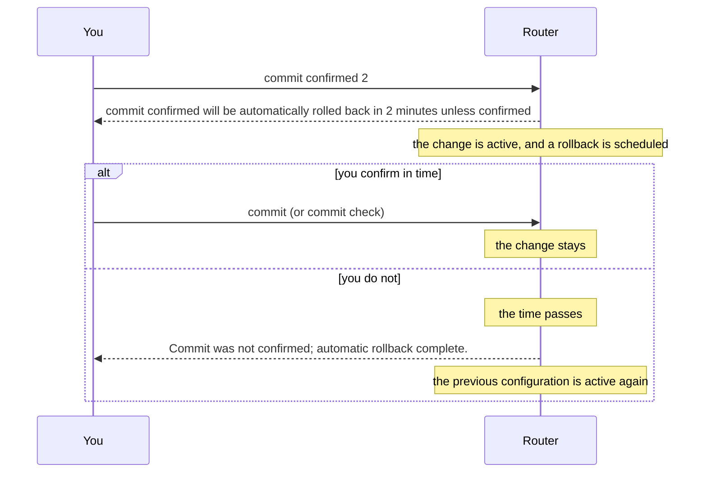

# J0 — Commit: check, confirm, roll back

## 1. Why a commit

### 1.1 The trouble: the network sees every step

A change of several lines on IOS goes live one line at a time. Halfway through renumbering a link, the two ends disagree.
A pasted block can be accepted in part. And when a change cuts off your own access, the only way back is a reload you
scheduled in advance.

### 1.2 What you did before

On IOS: type carefully, schedule `reload in 10` before anything risky, and keep a copy of the configuration to return to with
`configure replace`. On IOS XR (M1 of the IOS XR track): stage the change in a target configuration, look at it, commit it as a
whole, and use `commit confirmed` for a change that might cut you off.

### 1.3 The Junos answer

Junos uses the same commit model as IOS XR. The parts have different names and a few different habits, which matter the first
time you rely on them: how a confirmed commit is confirmed, what a rollback does, and what happens when two people edit at once.

## 2. How it works

### 2.1 Candidate, check, commit

Everything you `set` or `delete` goes into the **candidate configuration**. `show | compare` shows how the candidate differs
from the active configuration, as a diff:

```console
admin@jun01# show | compare
[edit interfaces]
+   et-0/0/0 {
+       unit 0 {
+           family inet {
+               address 10.0.14.1/30;
+           }
+       }
+   }
```

`commit check` checks the whole candidate and changes nothing. The port has no address yet:

```console
admin@jun01# commit check
configuration check succeeds

admin@jun01# run show interfaces terse et-0/0/0
Interface               Admin Link Proto    Local                 Remote
et-0/0/0                up    up
et-0/0/0.16386          up    up   multiservice
```

`commit` checks it again and makes it active. `commit comment "…"` stores a note with the commit, and `commit and-quit` leaves
configuration mode afterwards:

```console
admin@jun01# commit comment "J0 PoC: addresses"
commit complete

admin@jun01# run show interfaces terse et-0/0/0
Interface               Admin Link Proto    Local                 Remote
et-0/0/0                up    up
et-0/0/0.0              up    up   inet     10.0.14.1/30
                                   multiservice
```

If the check fails, nothing is committed and the candidate stays as it was, for you to correct.

### 2.2 The 50 saved configurations

Each commit pushes the previous active configuration down a list. The router keeps the 50 most recent: number 0 is the active
configuration, 1 to 49 are the ones before it. `show system commit` lists them with who committed and how:

```console
admin@jun01> show system commit
0   2026-11-14 10:57:19 UTC by admin via cli
    J0 PoC: remove lo0
1   2026-11-14 10:57:11 UTC by admin via cli
    J0 PoC: addresses
2   2026-11-14 09:53:56 UTC by root via other
```

`rollback n`, in configuration mode, loads saved configuration n **into the candidate**. It does not change the router.
You look at the result with `show | compare`, and commit it like any other change:

```console
admin@jun01# rollback 1
load complete

admin@jun01# show | compare
[edit interfaces]
+   lo0 {
+       unit 0 {
+           family inet {
+               address 192.168.0.1/32;
+           }
+       }
+   }

admin@jun01# commit comment "J0 PoC: back to rollback 1"
commit complete
```

The rollback is a new commit at the top of the list. Nothing is erased from the history. `rollback 0` (or plain `rollback`)
throws away your uncommitted changes, because it loads the active configuration back into the candidate.

To compare two saved configurations without touching the candidate, use `show system rollback compare 1 0` in operational mode.

### 2.3 A commit on probation

`commit confirmed n` commits the candidate for n minutes (10 if you give no number). If you do not confirm it in time, the router
loads the previous configuration and commits that, and tells everyone logged in:



While the rollback is pending, `show system commit` says so. (The change in this example was the host name, which is why the
prompt reads `jun01-test` until the rollback.)

```console
admin@jun01-test# run show system commit
0   2026-11-14 10:58:02 UTC by admin via cli commit confirmed, rollback in 1mins
    J0 PoC: confirmed, not confirmed
    rollback pending
1   2026-11-14 10:57:22 UTC by admin via cli
    J0 PoC: back to rollback 1
```

And after an automatic rollback, the history shows it as a commit by the router itself, `by root via other`, directly above the
commit it took back:

```console
Broadcast message from root@jun01 (somewhere) (Sat Nov 14 10:59:03 2026):

Commit was not confirmed; automatic rollback complete.
run show system commit
0   2026-11-14 10:59:03 UTC by root via other
1   2026-11-14 10:58:02 UTC by admin via cli commit confirmed, rollback in 1mins
    J0 PoC: confirmed, not confirmed
2   2026-11-14 10:57:22 UTC by admin via cli
    J0 PoC: back to rollback 1
```

To confirm, enter `commit` or `commit check` before the time is up. Two habits differ from IOS XR:

- **You may leave configuration mode.** The pending rollback stays scheduled, and its reminder follows you to the operational
  prompt (`# commit confirmed will be rolled back in 1 minute`). On IOS XR, leaving configuration mode cancels a pending
  confirmed commit at once.
- **Any session can confirm.** A `commit check` from another login confirmed the change in the lab.

So the Junos way to try a risky change is: `commit check`, `commit confirmed` with a few minutes, leave if you like, test, and
confirm only if the test passes.

### 2.4 More than one person

Plain `configure` gives everyone **one shared candidate**. When you enter, the CLI tells you who else is there and whether the
candidate already holds changes:

```console
admin@jun01> configure
Entering configuration mode
Users currently editing the configuration:
  admin terminal pts/1 (pid 31322) on since 2026-11-14 11:08:31 UTC
      [edit]
The configuration has been changed but not committed

admin@jun01# show | compare
[edit interfaces lo0 unit 0]
+    description "edit by a";
```

That `description` was typed by the other user and is not committed. It is in your candidate too, and whoever commits first
commits it. This is the main difference from IOS XR, where each session has its own target configuration. Junos has two other
forms of `configure` for that:

| You enter with | You get | Others |
|---|---|---|
| `configure` | the shared candidate | see your changes, and can commit them |
| `configure private` | your own candidate, discarded when you leave without committing | in plain `configure` they cannot change anything while you edit (`error: private edits in use`) |
| `configure exclusive` | the shared candidate, locked for you | can enter, but cannot change or commit (`error: configuration database locked by: …`) |

`configure private` is refused while the shared candidate holds uncommitted changes:

```console
admin@jun01> configure private
Users currently editing the configuration:
  admin terminal pts/1 (pid 31322) on since 2026-11-14 11:08:31 UTC
      [edit]
error: shared configuration database modified
```

When you leave configuration mode with uncommitted changes in the shared candidate, the CLI asks first:

```console
admin@jun01# exit
The configuration has been changed but not committed
Exit with uncommitted changes? [yes,no] (yes)
```

Leaving does not throw the changes away. They stay in the shared candidate for the next person, or for you. That is why
`rollback 0` before you leave is a good habit when you have abandoned a change.

## 3. Examples

### 3.1 A risky change, the Junos way

The steps below are the whole method. The change here, a new description, is harmless. Task J0-3 uses the method on a change
that is not:

```console
admin@jun01> configure
admin@jun01# set interfaces lo0 unit 0 description "confirm-exit test 2"
admin@jun01# commit confirmed 1 comment "confirm from another session"
commit confirmed will be automatically rolled back in 1 minutes unless confirmed
commit complete
# commit confirmed will be rolled back in 1 minute

admin@jun01# exit
Exiting configuration mode
# commit confirmed will be rolled back in 1 minute
```

Then, from another login, after the test passed:

```console
admin@jun01> configure
admin@jun01# commit check
configuration check succeeds
```

The description was still there after the time had passed: the change was confirmed.

### 3.2 From IOS and IOS XR to Junos

| You want to | On IOS | On IOS XR | On Junos |
|---|---|---|---|
| see what you are about to change | — | `show configuration` | `show \| compare` |
| check without changing | — | — (the commit checks) | `commit check` |
| apply | each line, as you type | `commit` | `commit` |
| apply on probation | `reload in 10` | `commit confirmed 30` (seconds) | `commit confirmed 2` (minutes) |
| list past changes | — | `show configuration commit list` | `show system commit` |
| go back | `configure replace` an archived file | `rollback configuration last 1` | `rollback 1`, then `commit` |
| work alone | — | every session is private; `configure exclusive` to lock | `configure private`, or `configure exclusive` to lock |

## Practice

Go to lab **JNT-01** and do task J0-3.

<p class="tolab"><a href="/_learn?id=JNT-01">Open lab JNT-01 in the workspace</a> — <a href="04-j0-practice-2.html">the task</a></p>

:::note
Sources: Juniper Networks, *CLI User Guide for Junos OS* (2026-06-18): the commit model, forms of the configure command,
activating a configuration with confirmation (10 minutes by default; confirmed by `commit` or `commit check`), the 50 saved
configurations. The IOS XR column is from M1 of the IOS XR track. Outputs from vJunos-Evolved, Junos OS Evolved 26.2R1.7.
In the lab, the automatic rollback came up to about a minute after the time given to `commit confirmed`.
:::
