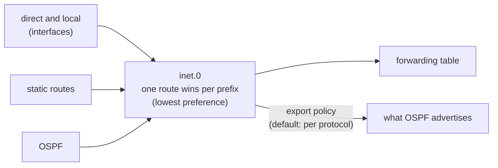

# J0 — The routing table and the default policies

## 1. Why it is worth a page

### 1.1 The trouble: the same route, different rules

You know how a router picks a route: the longest match, then the source it trusts most. On Junos that logic is the same, but
the numbers and some defaults are not, and they catch IOS engineers in three places: a static route that does not appear,
a backup route that wins when it should not, and a route that a protocol refuses to advertise.

### 1.2 What you did before

On IOS you read `show ip route`, compared administrative distances (static 1, OSPF 110), raised a static route's distance to make
it a backup, and wrote `redistribute static` when OSPF had to carry it.

### 1.3 The Junos answer

Junos keeps every route in one place, the **routing table**, and every protocol reads from it and writes into it. Which route
wins is decided by its **preference**. What a protocol takes from the table and offers to its neighbours is decided by
**policies**, and every protocol has a default one that applies until you write your own.

## 2. How it works

### 2.1 The tables

Junos has more than one routing table, named by what they hold. `inet.0` is the IPv4 unicast table, the one you mean when you
say "the routing table". `inet6.0` is its IPv6 twin. Others appear as features need them: `inet.3` for MPLS paths (unit M8 of the
IOS XR track covers the idea), `mgmt_junos.inet.0` for the management network of this lab (see the appendix).



`show route` prints all tables, and `show route table inet.0` one of them. `show route summary` counts routes per table and per
source.

### 2.2 Reading `show route`

```console
admin@jun01> show route table inet.0

inet.0: 6 destinations, 6 routes (6 active, 0 holddown, 0 hidden)
+ = Active Route, - = Last Active, * = Both

10.0.14.0/30       *[Direct/0] 00:12:53
                    >  via et-0/0/0.0
10.0.14.1/32       *[Local/0] 00:12:53
                       Local via et-0/0/0.0
192.168.0.1/32     *[Direct/0] 00:12:42
                    >  via lo0.0
192.168.0.4/32     *[OSPF/10] 00:00:35, metric 1
                    >  to 10.0.14.2 via et-0/0/0.0
198.51.100.0/24    *[Static/5] 00:00:45
                       Discard
224.0.0.5/32       *[OSPF/10] 00:00:45, metric 1
                       MultiRecv
```

- In brackets: the source of the route and its preference. `Direct` is a connected network, `Local` the router's own address on
  it (IOS shows that as `L`).
- `*` marks the active route, the one used for forwarding. `>` marks the next hop in use.
- `224.0.0.5/32` is the OSPF multicast group, which the router adds for itself.

`show route 192.168.0.4/32 exact detail` adds the reasons: the preference as a number, the protocol, and the next hop chosen.

### 2.3 Preference

Preference plays the part of administrative distance, and a lower number wins. The values are not the ones IOS uses:

| Source | Junos preference | IOS administrative distance |
|---|---|---|
| directly connected | 0 | 0 |
| static | 5 | 1 |
| OSPF, internal | 10 | 110 |
| IS-IS level 1 / level 2, internal | 15 / 18 | 115 |
| RIP | 100 | 120 |
| aggregate | 130 | — |
| OSPF, external | 150 | 110 |
| IS-IS level 1 / level 2, external | 160 / 165 | 115 |
| BGP (external and internal) | 170 | 20 external, 200 internal |

Three consequences:

- A static route beats an OSPF route by default on both, with different numbers: 5 against 10 on Junos, 1 against 110 on IOS.
- OSPF internal and external routes are far apart on Junos (10 and 150). On IOS both are 110.
- A backup static route must have a preference above the route it backs up. Above OSPF internal means above 10. Above an OSPF
  external route means above 150.

When two routes to the same prefix are present, both are listed and the `*` shows the winner:

```console
admin@jun01> show route 192.168.0.4/32 exact

inet.0: 6 destinations, 7 routes (6 active, 0 holddown, 0 hidden)
+ = Active Route, - = Last Active, * = Both

192.168.0.4/32     *[OSPF/10] 00:00:44, metric 1
                    >  to 10.0.14.2 via et-0/0/0.0
                    [Static/200] 00:00:00
                    >  to 10.0.14.2 via et-0/0/0.0
```

The static route there has `preference 200`, so OSPF wins and the static waits. Without the preference, the same output showed
`*[Static/5]` on top.

### 2.4 Static routes: the next hop must be connected

On IOS, a static route may point at any address the router can reach, and the router looks up the way to that address
(a recursive lookup). On Junos, a `next-hop` must be on a directly connected network. A route whose next hop is not, is not
installed at all:

```console
admin@jun01> show route 203.0.113.0/24

admin@jun01>
```

Nothing, not even as a hidden route. The route points at `192.168.0.4`, a loopback that is reachable through OSPF but not
connected. `resolve` tells Junos to look the next hop up in the routing table, as IOS does:

```console
admin@jun01> show route 203.0.113.0/24

inet.0: 7 destinations, 8 routes (7 active, 0 holddown, 0 hidden)
+ = Active Route, - = Last Active, * = Both

203.0.113.0/24     *[Static/5] 00:00:01, metric2 1
                    >  to 10.0.14.2 via et-0/0/0.0
```

The forwarding next hop is the one on the way to the loopback. In `detail`, the route also shows `Protocol next hop:
192.168.0.4`, the address you wrote.

`discard` instead of a next hop makes the route drop the traffic (the route shows `Discard`), like a route to `Null0` on IOS.

### 2.5 The default policies: why OSPF does not advertise your static route

On IOS, a protocol advertises a route from another source when you write `redistribute`. On Junos the same decision is made by an
**export policy**, and every protocol has a **default policy** that applies until you write one. The defaults, from Juniper's
table, for the protocols in this track so far:

| Protocol | Takes into the table by default | Advertises by default |
|---|---|---|
| OSPF | all OSPF routes | nothing from the table. OSPF announces its own interfaces and what it learned by flooding, not by export |
| IS-IS | all IS-IS routes | nothing from the table, the same way |
| RIP | all RIP routes from configured neighbours | nothing |
| BGP | all received routes | the active BGP routes (the rules of IBGP still apply) |
| direct and static routes | all of them | they are not a protocol: other protocols export them |

So OSPF never advertises a static route by default. The lab showed it: JUN01 had `198.51.100.0/24` as a static route, active in
`inet.0`, and FRR1 had no trace of it, not even an external LSA:

```console
frr1# show ip ospf database external

       OSPF Router with ID (192.168.0.4)

                AS External Link States

frr1#
```

The Junos way to advertise it is an export policy (`policy-statement`) applied to OSPF. That is the subject of a later unit. For
now it is enough to know that the default exists and that it is not an error.

Juniper notes that on PTX routers the default BGP policy is not the same as on other Junos routers. The router of this lab
emulates a PTX (see the appendix), so the BGP default is left to the BGP unit.

## 3. Configuration examples

### 3.1 A backup static route and a recursive one

On the board of the previous pages (JUN01 with OSPF to a neighbour whose loopback is 192.168.0.4):

:::config Static routes: a floating backup, a recursive next hop, a discard
set routing-options static route 192.168.0.4/32 next-hop 10.0.14.2   ## connected next hop: installed as Static/5
set routing-options static route 192.168.0.4/32 preference 200       ## floating: OSPF (10) wins until it loses the route
set routing-options static route 203.0.113.0/24 next-hop 192.168.0.4 ## not connected: not installed on its own
set routing-options static route 203.0.113.0/24 resolve              ## look the next hop up in inet.0 (as IOS does)
set routing-options static route 198.51.100.0/24 discard             ## drop the traffic (Null0 on IOS)
:::

The router ID is written in the same branch: `set routing-options router-id 192.168.0.1`. Without it, Junos uses an address of
its own. On the routers of this lab it took the lo0 address.

### 3.2 From IOS to Junos

| On IOS | On Junos |
|---|---|
| `show ip route` | `show route table inet.0` (or `show route`) |
| `show ip route 192.168.0.4` | `show route 192.168.0.4` (`exact` for that prefix only, `detail` for the reasons) |
| `ip route 203.0.113.0 255.255.255.0 192.168.0.4` | `set routing-options static route 203.0.113.0/24 next-hop 192.168.0.4` and `… resolve` |
| `ip route … 10.0.14.2 200` | `set routing-options static route … next-hop 10.0.14.2 preference 200` |
| `ip route 198.51.100.0 255.255.255.0 Null0` | `set routing-options static route 198.51.100.0/24 discard` |
| `router ospf 1` / `redistribute static subnets` | an export policy on OSPF (a later unit) |

## Practice

Go to lab **JNT-01** and do task J0-4.

<p class="tolab"><a href="/_learn?id=JNT-01">Open lab JNT-01 in the workspace</a> — <a href="06-j0-practice-3.html">the task</a></p>

:::note
Sources: Juniper Networks, *Junos OS Routing Protocols Overview* (2026-06-23), table of default route preference values;
*Routing Policies, Firewall Filters, and Traffic Policers User Guide* (2026-06-23), "Default Routing Policies" (table of default
import and export policies, and the note on PTX routers). IOS administrative distances are the documented defaults. Outputs
from vJunos-Evolved, Junos OS Evolved 26.2R1.7.
:::
