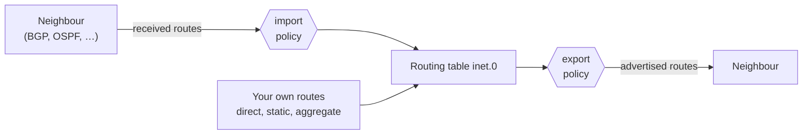

# J1 — The parts of routing policy, and the path a route takes

At the end of J0 we saw that OSPF does not advertise a static route, and that this is not a mistake: a **default policy** decides it.
This unit is about changing those decisions with policies of your own. Which routes to take in, which routes to advertise, and what to
rewrite on the way are all written with one mechanism in Junos: routing policy. The unit has three pages and an appendix.

| Page | Contents | Tasks |
|---|---|---|
| This page | Where policies act, the default policies, the path one route takes through policies, terms | — |
| policy-statement: terms and the order of evaluation | The shape of a policy, `from` and `then`, the order of evaluation, the order of terms, exporting into OSPF, `test policy` | J1-1, J1-2 |
| route-filter: choosing by prefix and length | Match types, the longest match within a term, prefix lists | J1-3 |
| Applying policy to BGP | The minimal BGP configuration and its default policies, where rejected routes go, the levels to write at, changing attributes, aggregate routes | J1-4, J1-5 |
| Appendix | Quick reference, the quirks of this virtual router | — |

The lab is JNT-02. JUN01 and JUN02 are Junos routers (vJunos-Evolved) with everything from J0 (addresses, OSPF, static routes) and the
BGP session between JUN02 and FRR1. There is no policy yet. FRR1 is an FRRouting router in the role of the ISP; you cannot change it.
SRV1 plays a server and has the server network 172.16.20.0/24 behind it.

:::topo
nodes:
  SRV1: {at: [0, 0], kind: host, label: "SRV1 (server)"}
  JUN01: {at: [2.2, 0], label: "JUN01 (Junos)"}
  JUN02: {at: [4.4, 0], label: "JUN02 (Junos)"}
  FRR1: {at: [6.6, 0], label: "FRR1 (ISP, AS 64500)"}
links:
  - {a: SRV1, b: JUN01, la: "eth1 .10", lb: "et-0/0/1 .1", label: "172.16.10.0/24"}
  - {a: JUN01, b: JUN02, la: "et-0/0/0 .1", lb: "et-0/0/0 .2", label: "10.0.12.0/30"}
  - {a: JUN02, b: FRR1, la: "et-0/0/1 .1", lb: "eth1 .2", label: "10.0.23.0/30 eBGP"}
frames:
  - {label: "AS 65000 (OSPF area 0)", nodes: [JUN01, JUN02]}
:::

## 1. What routing policy gives you

### 1.1 The problem: choosing what goes in and out

The topology has three choices to make. JUN01 wants to tell the inside about the server networks through OSPF, but not about the test
network. The ISP sends private addresses and over-specific routes mixed in with the rest. Towards the ISP, you want to send the inside
as one summary route.

Left alone, none of this happens the way you want. OSPF advertises nothing from the routing table. BGP accepts every route it receives.
You need a mechanism to choose.

### 1.2 What came before

In IOS the tools differ by protocol and direction. To put routes into OSPF you attach a route map to `redistribute`. For routes from
a BGP neighbour you use `neighbor … route-map … in`, a `prefix-list` or a `distribute-list`. A route map is checked in sequence-number
order, and a route that matches no entry is dropped by the implicit deny at the end.

In IOS XR, as seen in M5 of the IOS XR track, you attach RPL (`route-policy`) at an attach point. A route that no statement passes and
nothing rewrites is dropped at the end of the policy. With an eBGP neighbour that has no policy, nothing is exchanged at all.

### 1.3 The Junos answer

Junos uses the same mechanism for every protocol.

- You write a policy once, as a `policy-statement` under `policy-options`.
- You apply it to a protocol as **import** (protocol → routing table) or **export** (routing table → protocol).
- Every protocol has a **default policy** that takes, at the end, any route that your own policies did not decide.

The last point is the big difference from IOS and IOS XR. A route that matched nothing in your policy is not necessarily dropped there.
It goes on to the default policy of that protocol.

## 2. How it works: the parts and the flow

### 2.1 The two places where policies act, and the default policies



**Import** acts on routes that a protocol received, before they go into the routing table. **Export** acts on routes in the routing
table, before a protocol advertises them. So export chooses from what is in the routing table. An export into OSPF can choose a static
route or a BGP route alike, as long as it is in the routing table.

OSPF and IS-IS are link-state protocols, so import cannot stop the LSAs they receive. An OSPF import policy can only choose which
external routes go into the routing table. In this unit import is used with BGP.

Whatever your policies leave undecided, the default policy decides. Here is the J0 table, with the directions used in this unit.

| Protocol | Default import | Default export |
|---|---|---|
| OSPF | Accept all OSPF routes | Reject everything (its own interfaces and learned routes go out by flooding, not by export) |
| BGP | Accept every route received from neighbours | Advertise the active BGP routes. Not back to an eBGP neighbour in the same AS as the one it came from. The IBGP rules apply as well |

Just as the table says, JUN02 without any policy accepts all ten routes from the ISP and advertises nothing to it.

```console
admin@jun02> show bgp summary
Threading mode: BGP I/O
Default eBGP mode: advertise - accept, receive - accept
Groups: 1 Peers: 1 Down peers: 0
Table          Tot Paths  Act Paths Suppressed    History Damp State    Pending
inet.0
                      10         10          0          0          0          0
Peer                     AS      InPkt     OutPkt    OutQ   Flaps Last Up/Dwn State|#Active/Received/Accepted/Damped...
10.0.23.2             64500         46         46       0       0       19:40 Establ
  inet.0: 10/10/10/0

admin@jun02> show route advertising-protocol bgp 10.0.23.2

admin@jun02>
```

`inet.0: 10/10/10/0` under the peer counts the routes that are active, received, accepted and damped. The advertised list is empty.

### 2.2 Following one route: an import chain

You can apply policies **in a list** to an import or an export. Such a list is a **policy chain**. Here we follow 198.51.100.128/25
from the ISP through JUN02's import `[ TAG-198 FILTER-IN ]`. Rest the pointer on a number in the drawing (tap it on a phone) to see that
block of configuration in a pop-up, and its lines are highlighted in the configuration example below.

:::walk
legend: The line carries routes arriving over BGP. Policies are evaluated from left to right, and evaluation ends at an accept or a reject.
rows:
  - {node: FRR1, say: ["~The ISP sends the route in an UPDATE"]}
  - {wire: "[[route 198.51.100.128/25]] _AS path 64500"}
  - panel: JUN02
    sub: the border with the ISP
    items:
      - ref: 1
        head: "**Import of group ISP** `import [ TAG-198 FILTER-IN ]`"
        say: ["Evaluated in the order listed. TAG-198 first"]
      - ref: 2
        head: "**TAG-198** marks 198.51.100.0/24"
        match:
          - ["term t  from route-filter 198.51.100.0/24 exact", false, "no match (a /25 is not the /24 itself)"]
        then: ["→ TAG-198 ends with no term matched → on to the next policy, FILTER-IN"]
      - ref: 3
        head: "**FILTER-IN** narrows what is accepted"
        match:
          - ["term PRIVATE  from route-filter 10.0.0.0/8 orlonger …", false, "no match"]
          - ["term LEN  from route-filter 0.0.0.0/0 prefix-length-range /16-/24", false, "no match (length /25)"]
          - ["term REST  (no from) then reject", true, "match → `reject`"]
      - {say: ["~It stays in the routing table but is not used (hidden, Rejected by import policy)"]}
  - {aside: "For 198.51.100.0/24", say: ["Matches ② → gets local-preference 150 and community 65000:200. There is no accept, so evaluation goes on → `accept` in LEN of ③"]}
  - {aside: "Without REST in ③", say: ["~Nothing in FILTER-IN matches → the end of the chain → BGP's default (accept) → the /25 is used"]}
:::

:::config JUN02 — mark routes as they come in, then narrow them down (an import chain)
set policy-options community CUST members 65000:200                                  ## ② Name the community to add
set policy-options policy-statement TAG-198 term t from route-filter 198.51.100.0/24 exact   ## ② Only 198.51.100.0/24 itself
set policy-options policy-statement TAG-198 term t then local-preference 150          ## ② Only change attributes. No accept
set policy-options policy-statement TAG-198 term t then community add CUST            ## ② 
set policy-options policy-statement FILTER-IN term PRIVATE from route-filter 10.0.0.0/8 orlonger     ## ③ Two of the private ranges
set policy-options policy-statement FILTER-IN term PRIVATE from route-filter 192.168.0.0/16 orlonger ## ③ 
set policy-options policy-statement FILTER-IN term PRIVATE then reject                ## ③ On a match, reject and end the evaluation
set policy-options policy-statement FILTER-IN term LEN from route-filter 0.0.0.0/0 prefix-length-range /16-/24 ## ③ Lengths from /16 to /24
set policy-options policy-statement FILTER-IN term LEN then accept                    ## ③ On a match, accept and end the evaluation
set policy-options policy-statement FILTER-IN term REST then reject                   ## ③ Reject everything else. Without it, BGP's default (accept)
set protocols bgp group ISP import [ TAG-198 FILTER-IN ]                              ## ① Evaluated in the order listed
:::

Result: four routes are accepted, and the other six are hidden.

```console
admin@jun02> show route receive-protocol bgp 10.0.23.2 table inet.0

inet.0: 19 destinations, 19 routes (13 active, 0 holddown, 6 hidden)
  Prefix                  Nexthop              MED     Lclpref    AS path
* 172.31.0.0/16           10.0.23.2            0                  64500 I
* 192.0.2.0/24            10.0.23.2            0                  64500 I
* 198.51.100.0/24         10.0.23.2            0                  64500 I
* 203.0.113.0/24          10.0.23.2            0                  64500 I

admin@jun02> show route receive-protocol bgp 10.0.23.2 hidden table inet.0

inet.0: 19 destinations, 19 routes (13 active, 0 holddown, 6 hidden)
  Prefix                  Nexthop              MED     Lclpref    AS path
  0.0.0.0/0               10.0.23.2            0                  64500 I
  10.200.0.0/16           10.0.23.2            0                  64500 I
  100.64.0.0/10           10.0.23.2            0                  64500 I
  192.168.50.0/24         10.0.23.2            0                  64500 I
  198.18.0.0/15           10.0.23.2            0                  64500 I
  198.51.100.128/25       10.0.23.2            0                  64500 I
```

The default route (/0) is outside LEN's length range, so REST rejected it. 172.31.0.0/16 is a private address, but PRIVATE does not
list 172.16.0.0/12, so it is accepted. A policy does exactly what it says, and nothing more.

### 2.3 The terms side by side

| Junos term | What it is | Everyday picture | In IOS | In IOS XR |
|---|---|---|---|---|
| policy-statement | A named policy, written under `policy-options` | A procedure | route-map | route-policy |
| term | One rule in a policy. Checked from the top | One step of the procedure | One sequence of a route map | One clause of an `if` |
| from | The conditions to match | "If …" | `match` | The condition of an `if` |
| then | What to do on a match | "… then do this" | `set` and permit or deny | The statements in `then` |
| accept, reject | Actions that end the evaluation (terminating actions) | Stamping the form | permit, deny | `done`, `drop` |
| Actions that change attributes | Rewrite metric, local-preference, community and so on. Evaluation does not end | Adding a sticky note | `set` | `set` |
| next term, next policy | Move on to the next term or the next policy (flow control) | "Go to the next step" | Close to `continue` | — (statements simply continue) |
| import, export | The direction a policy is applied in | Checkpoints at the way in and the way out | `neighbor … in`, `redistribute` | `route-policy … in`, `out` |
| policy chain | Several policies listed in one import or export | A row of checkpoints | — (one per place) | — (one per place; call others with `apply`) |
| default policy | The per-protocol rule waiting at the end of the chain | The last desk | The implicit deny (this is where it differs) | Dropped at the end (this is where it differs) |
| route-filter | A condition on prefix and length | A range of addresses | `ge`, `le` in a prefix list | prefix-set |

### 2.4 Easy to mix up

- **A route that matches nothing is not necessarily dropped at the end of the policy.** At the end of the chain it goes to the
  protocol's default policy: accept for BGP import, reject for OSPF export. To reject, end with a term that has only `then reject`.
- **Changing attributes does not end the evaluation.** A route that matches a term with a metric or a local preference goes on to the
  next term and the next policy until an `accept` or a `reject`.
- **When an earlier policy in a chain accepts, the later policies never see the route.** Put a policy that marks routes before the
  policy that accepts them.
- **A term added with `set` goes to the end.** If a term with only `then reject` is already there, a term added later is never reached.
  Use `insert` to reorder.
- **`test policy` can disagree with the real result.** It always counts the default action as accept (section 2.8 of the next page).

### 2.5 Who does what in the topology

| Device | Role in JNT-02 | What you practise |
|---|---|---|
| JUN01 | Holds the server networks (direct 172.16.10.0/24, static 172.16.20.0/24) and the test network (static 172.16.99.0/24, discard) | Export into OSPF (J1-1) |
| JUN02 | The border with the ISP | Export into OSPF (J1-2), BGP import (J1-3, J1-5), BGP export and aggregation (J1-4) |
| FRR1 | The ISP. You cannot change it | Sends ten routes: a default route, public addresses, private addresses and a /25 |
| SRV1 | A server | Checking that traffic gets all the way through (J1-4) |

### 2.6 Takeaways

- Write a policy once and apply it as an import or an export. The same way for every protocol.
- Evaluation follows the order of terms, then the order of the chain, and stops at `accept` or `reject`. Otherwise, the default policy.
- Default policies differ by protocol. Spell out what to reject and what to accept, all the way to the end.

## Practice

The tasks of this unit are in lab **JNT-02**. Each page ends with the tasks that go with it.

<p class="tolab"><a href="/_learn?id=JNT-02">Open lab JNT-02 in the workspace</a></p>

:::note
Sources: Juniper Networks, *Routing Policies, Firewall Filters, and Traffic Policers User Guide* (published 2026-06-23), "Default
Routing Policies" (the table of default import and export policies) and the sections on how a policy chain is evaluated.
*OSPF User Guide* (2026-06-18), the import and export sections (the default export rejects; a chain ends at an accept or a reject).
*BGP User Guide* (2026-07-09), the default for eBGP without policies (receive and advertise are both allowed) and the rule that a route
is not advertised back to an eBGP neighbour in the same AS. IOS XR behaviour is from M5 of the IOS XR track. The output was captured on
vJunos-Evolved (Junos OS Evolved 26.2R1.7) in containerlab.
:::
