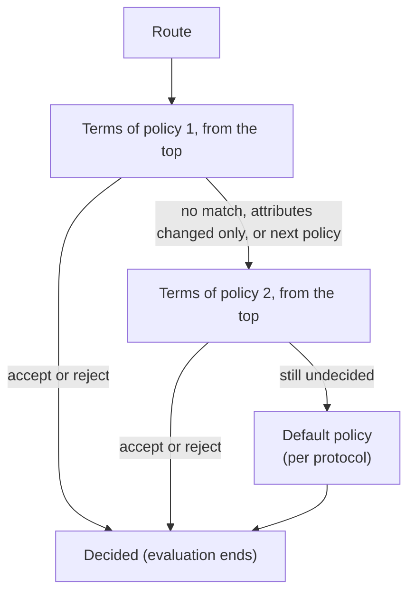

# J1 — policy-statement: terms and the order of evaluation

## 1. Why write in terms

### 1.1 The problem: one way out, different handling per route

Here is what JUN01 wants to send into OSPF: the direct network as it is, the static network with a different metric, and not the test
network. Routes with different sources and different handling should all pass through one way out, OSPF, with one policy.

### 1.2 What came before

In IOS you write one line per source: `redistribute connected route-map …` and `redistribute static route-map …`. Inside a route map
you write `match` and `set` in sequence-number order and decide with `permit` or `deny`. A route that matches no sequence hits the
implicit deny.

In IOS XR's RPL you write `if` … `elseif` … `else` from the top and decide with `pass`, `done` or `drop`. A route that is neither
accepted nor rewritten by the end is dropped.

### 1.3 The Junos answer

In Junos you line up named **terms**. Each term is a pair: the conditions to match (`from`) and what to do on a match (`then`).
The source of a route (`protocol direct`, `protocol static`) is just one more condition, so one policy can handle the direct network
and the static routes together. Terms are checked from the top, and evaluation stops at an `accept` or a `reject`.

## 2. How it works

### 2.1 The shape of a policy-statement

In the configuration tree a policy looks like this (the form that `show policy-options` uses).

```
policy-options {
    policy-statement name {
        term name {
            from {
                condition;
                condition;
            }
            then {
                action;
                action;
            }
        }
        term name { … }
        then action;          ← a then after the terms is an unnamed last term
    }
}
```

- Term names are free (`LAN`, `SRV`, `REST` and so on). The name plays no part in evaluation; only the order does.
- `from` is optional. A term without `from` matches every route.
- A `then` outside any term is an unnamed term placed last. It acts on routes that matched no term.

You can look at a policy in two ways. `show policy-options policy-statement name` in configuration mode shows it as configuration;
`show policy name` in operational mode shows it as the router has loaded it. The latter says `[RESOLVED]` when the policy is in use.

### 2.2 from: OR within a kind, AND across kinds

When you list conditions under `from`, **conditions of different kinds must all match (AND)**, and **for values of the same kind,
one match is enough (OR)**. This term matches routes whose source is static **or** aggregate **and** that lie within 172.16.0.0/12.

```
term t {
    from {
        protocol [ static aggregate ];
        route-filter 172.16.0.0/12 orlonger;
    }
    then accept;
}
```

Tried on JUN02 in this topology, it matched only one route: the aggregate 172.16.0.0/16. JUN02 has no static route within
172.16.0.0/12, and the source of 172.16.10.0/24 and 172.16.20.0/24 is OSPF.

These are the conditions used most in this unit.

| Condition | What it matches |
|---|---|
| `protocol direct`, `static`, `ospf`, `bgp`, `aggregate` | The source of the route. The name in `[Direct/0]` and the like in `show route` |
| `route-filter prefix match-type` | Prefix and length (next page) |
| `prefix-list name` | A named list of prefixes (next page) |
| `neighbor address` | Routes received from that neighbour |
| `community name` | Routes that carry that community |

Juniper warns that leaving out `from` in an export policy can give unexpected results. A policy with nothing but `then accept`,
applied to OSPF on JUN01, sent out all three as external routes: the direct 172.16.10.0/24 and the static 172.16.20.0/24 and
172.16.99.0/24.

### 2.3 then: three kinds of action

| Kind | Actions | Evaluation |
|---|---|---|
| Terminating actions | `accept`, `reject` | Ends here (neither this policy nor any later policy looks further) |
| Flow control | `next term`, `next policy` | Goes on to the next term or the next policy |
| Actions that change attributes | `metric`, `external type`, `local-preference`, `community add`, `as-path-prepend` and others | Rewrites, then **goes on to the next term** |

The third kind is the key. A term with nothing but attribute changes does not end the evaluation, even on a match. With the following
policy on OSPF on JUN01, 172.16.20.0/24 got metric 77 from the first term and was accepted by the second.

```
term SET {
    from {
        route-filter 172.16.20.0/24 exact;
    }
    then metric 77;           ← no accept. Evaluation goes on to the next term
}
term ACCEPT {
    from {
        protocol static;
    }
    then accept;
}
```

```console
admin@jun02> show ospf database external extensive
    OSPF AS SCOPE link state database
 Type       ID               Adv Rtr           Seq      Age  Opt  Cksum  Len
Extern   172.16.20.0      192.168.0.1      0x80000003    10  0x22 0x8d9a  36
  mask 255.255.255.0
  Topology default (ID 0)
    Type: 2, Metric: 77, Fwd addr: 0.0.0.0, Tag: 0.0.0.0
  Aging timer 00:59:49
  Installed 00:00:07 ago, expires in 00:59:50
  Last changed 00:00:07 ago, Change count: 3
Extern   172.16.99.0      192.168.0.1      0x80000001    10  0x22 0x2404  36
  mask 255.255.255.0
  Topology default (ID 0)
    Type: 2, Metric: 0, Fwd addr: 0.0.0.0, Tag: 0.0.0.0
```

The test network 172.16.99.0/24 matched the second term too (its source is static) and went out with metric 0.

### 2.4 The order of evaluation: terms → the next policy → the default policy

One route is checked in this order.



In Juniper's words, "as soon as an accept or reject action is executed, the policy chain evaluation ends". So if an earlier policy ends
with `then accept`, nothing reaches the later policies. With JUN02's BGP import set to `[ A B2 ]`, and B2 written to reject
10.200.0.0/16, 10.200.0.0/16 was still used as long as A ended with `then accept`. With A's `then accept` removed, B2 rejected
10.200.0.0/16 and it became hidden.

A route that neither policy decides goes to the default policy. For an OSPF export it is rejected; for a BGP import it is accepted.

`next policy` skips the remaining terms and moves on to the next policy. `next term` moves on to the next term, which is also what
happens when you write nothing, so use it when you want to make that explicit.

### 2.5 The order of terms, and insert

A term added with `set` goes to the **end** of its policy. If you first create a term with nothing but `then reject` and then add a term
that accepts, the accepting term sits behind the reject and accepts nothing.

```console
admin@jun01# show policy-options policy-statement ORDER
term REST {
    then reject;
}
term LAN {
    from {
        route-filter 172.16.10.0/24 exact;
    }
    then accept;
}

admin@jun01# run test policy ORDER 172.16.0.0/16
Policy ORDER: 0 prefix accepted, 8 prefix rejected
```

To reorder, use `insert`. `insert policy-options policy-statement ORDER term LAN before term REST` moved LAN in front of REST, and the
same test then gave three accepted (172.16.10.0/24 is in three tables, inet.0, inet.2 and inet.3; see section 2.8).

A policy chain has an order too. `set protocols ospf export name` **adds to the end** of the list that is already there. Typing
`set protocols ospf export WIDE` after `export LAN-TO-OSPF` gave `export [ LAN-TO-OSPF WIDE ];`. To write the list from scratch,
`delete protocols ospf export` and then `set protocols ospf export [ X Y ]`. In `show configuration | display set`, the list comes out
one line per policy, in the order of evaluation.

### 2.6 Exporting into OSPF: the external type and metric

Routes that a policy applied with `set protocols ospf export name` accepts are advertised as OSPF external routes (type 5 LSAs).
By default they are **type 2 with metric 0**. On the receiving side they enter the routing table with 150, the preference of external
routes.

```console
admin@jun02> show ospf database external extensive
    OSPF AS SCOPE link state database
 Type       ID               Adv Rtr           Seq      Age  Opt  Cksum  Len
Extern   172.16.10.0      192.168.0.1      0x80000001    11  0x22 0xfa86  36
  mask 255.255.255.0
  Topology default (ID 0)
    Type: 2, Metric: 0, Fwd addr: 0.0.0.0, Tag: 0.0.0.0
```

Change the type and the metric in `then`. With `then metric 50` and `then external type 1` the route became type 1 with metric 50, and
JUN02 shows metric 51, adding the internal cost of 1 to reach JUN01 (the example in section 3.1).

```console
admin@jun02> show route 172.16.20.0/24

inet.0: 19 destinations, 19 routes (19 active, 0 holddown, 0 hidden)
+ = Active Route, - = Last Active, * = Both

172.16.20.0/24     *[OSPF/150] 00:00:09, metric 51, tag 0
                    >  to 10.0.12.1 via et-0/0/0.0
```

OSPF itself announces the networks of the interfaces it runs on (the link and lo0 that J0 put into area 0) without any export. You need
an export when you send any other route out as an external route.

### 2.7 BGP routes into OSPF

Since an OSPF export chooses from the routing table, it can choose routes learned by BGP too. Narrow it to one route with
`from protocol bgp` and a route filter, and that route goes into OSPF only while BGP has it in the routing table. This policy has JUN02
send only the ISP's network 203.0.113.0/24 into OSPF.

:::config JUN02 — one route learned by BGP, into OSPF
set policy-options policy-statement ISPNET-TO-OSPF term t from protocol bgp                   ## Routes whose source is BGP
set policy-options policy-statement ISPNET-TO-OSPF term t from route-filter 203.0.113.0/24 exact ## Of those, only 203.0.113.0/24 (AND)
set policy-options policy-statement ISPNET-TO-OSPF term t then accept                          ## 
set protocols ospf export ISPNET-TO-OSPF                                                       ## Other BGP routes go to OSPF's default (reject)
:::

JUN01 learns it as an OSPF external route.

```console
admin@jun01> show route 203.0.113.0/24

inet.0: 10 destinations, 10 routes (10 active, 0 holddown, 0 hidden)
+ = Active Route, - = Last Active, * = Both

203.0.113.0/24     *[OSPF/150] 00:00:09, metric 0, tag 0
                    >  to 10.0.12.2 via et-0/0/0.0
```

When the ISP group is deactivated and committed, the BGP route disappears from JUN02 and JUN02 withdraws the external route
(its Age becomes 3600 in `show ospf database external`). It went from JUN01's routing table too, and came back when the group was
activated. Because the route sent out is the BGP route itself, it follows the session with the ISP.

With only `from protocol bgp` and no route filter, every route received from the ISP goes into OSPF.

### 2.8 Reading test policy, and its traps

`test policy name prefix` runs the routes in the routing table that fall within the prefix through the policy and shows them. It is
a handy way to try a policy before applying it, but watch three things.

- **It always counts the default action as accept.** Juniper's documentation says too that the test policy command always uses accept
  as the default policy. Routes that an OSPF export would reject are counted as accepted.
- **It counts tables other than inet.0.** Routes in inet.2, inet.3 and mgmt_junos.inet.0 are evaluated as well.
- **It does not evaluate routes that are not in use (hidden).** To try routes that an import rejects, take the import off first.

Tried on JUN01, the policy of section 3.1 (which sends out only the static route 172.16.20.0/24) gives eight accepted. Only one goes
into OSPF.

```console
admin@jun01> test policy SRV-TO-OSPF 172.16.0.0/16

inet.0: 9 destinations, 9 routes (9 active, 0 holddown, 0 hidden)
+ = Active Route, - = Last Active, * = Both

172.16.10.0/24     *[Direct/0] 00:20:06
                    >  via et-0/0/1.0
172.16.10.1/32     *[Local/0] 00:20:06
                       Local via et-0/0/1.0
172.16.20.0/24     *[Static/5] 00:20:06
                    >  to 172.16.10.10 via et-0/0/1.0
172.16.99.0/24     *[Static/5] 00:21:12
                       Discard

inet.2: 5 destinations, 5 routes (5 active, 0 holddown, 0 hidden)
+ = Active Route, - = Last Active, * = Both

172.16.10.0/24     *[Direct/0] 00:20:06
                    >  via et-0/0/1.0
172.16.10.1/32     *[Local/0] 00:20:06
                       Local via et-0/0/1.0

inet.3: 5 destinations, 5 routes (5 active, 0 holddown, 0 hidden)
+ = Active Route, - = Last Active, * = Both

172.16.10.0/24     *[Direct/0] 00:20:06
                    >  via et-0/0/1.0
172.16.10.1/32     *[Local/0] 00:20:06
                       Local via et-0/0/1.0

Policy SRV-TO-OSPF: 8 prefix accepted, 0 prefix rejected
```

To check the result, look at the way out after applying the policy: for an export into OSPF, `show ospf database external` on the
neighbour; for a BGP export, `show route advertising-protocol bgp neighbour`; for a BGP import, `show route receive-protocol bgp neighbour`
and the same with `hidden`.

### 2.9 Mistakes that commit catches

Naming a policy or a prefix list that does not exist yet is refused at commit (and at `commit check`).

```console
admin@jun01# set protocols ospf export NO-SUCH-POLICY

admin@jun01# commit check
[edit protocols]
  'ospf'
    warning: requires 'OSPF' license
  'policy-options'
    Policy error: Policy NO-SUCH-POLICY referenced but not defined
error: configuration check-out failed
```

`from prefix-list NO-SUCH-LIST` stops with `Policy error: NO-SUCH-LIST prefix-list referenced (in term t) but not defined` as well.
A mistyped name shows up at commit time, not after it is running.

## 3. Configuration examples

### 3.1 One static route into OSPF, as type 1

Of JUN01's static routes, send only the server network 172.16.20.0/24 into OSPF, as a type 1 external route with metric 50.

:::config JUN01 — choose one static route and send it into OSPF
set policy-options policy-statement SRV-TO-OSPF term SRV from protocol static                  ## Routes whose source is static
set policy-options policy-statement SRV-TO-OSPF term SRV from route-filter 172.16.20.0/24 exact ## Of those, only 172.16.20.0/24 (AND)
set policy-options policy-statement SRV-TO-OSPF term SRV then metric 50                        ## The metric of the external route
set policy-options policy-statement SRV-TO-OSPF term SRV then external type 1                  ## Type 1 (compared with the internal cost added)
set policy-options policy-statement SRV-TO-OSPF term SRV then accept                           ## Decide here. Everything else goes to OSPF's default (reject)
set protocols ospf export SRV-TO-OSPF                                                          ## Apply at OSPF's way out
:::

```console
admin@jun02> show ospf database external extensive
    OSPF AS SCOPE link state database
 Type       ID               Adv Rtr           Seq      Age  Opt  Cksum  Len
Extern   172.16.20.0      192.168.0.1      0x80000001     9  0x22 0xfec6  36
  mask 255.255.255.0
  Topology default (ID 0)
    Type: 1, Metric: 50, Fwd addr: 0.0.0.0, Tag: 0.0.0.0
  Aging timer 00:59:50
  Installed 00:00:08 ago, expires in 00:59:51
  Last changed 00:00:08 ago, Change count: 1
```

### 3.2 From IOS and IOS XR to Junos

| In IOS | In IOS XR | In Junos |
|---|---|---|
| `route-map name permit 10` | `route-policy name` | `policy-statement name term name` |
| `match ip address prefix-list P` | `if destination in P then` | `from route-filter …`, `from prefix-list P` |
| No source in `match`. Split by source with `redistribute static route-map …` | Split by attach point | `from protocol static` |
| `set metric 50`, `set metric-type type-1` | `set …` | `then metric 50`, `then external type 1` |
| permit, deny | `done`, `drop` | `then accept`, `then reject` |
| No sequence matches: implicit deny | Not accepted by the end: dropped | End of the chain: the protocol's default policy |
| `redistribute static subnets route-map name` under `router ospf 1` | `redistribute static route-policy name` under `router ospf` | `set protocols ospf export name` |

## Practice

Move to lab **JNT-02** and work on tasks J1-1 and J1-2.

<p class="tolab"><a href="/_learn?id=JNT-02">Open lab JNT-02 in the workspace</a> — <a href="12-j1-practice.html">Tasks</a></p>

:::note
Sources: Juniper Networks, *Routing Policies, Firewall Filters, and Traffic Policers User Guide* (2026-06-23), the sections on policy
structure, terms, terminating actions and flow control, and policy chain evaluation; "Testing a Routing Policy" (test policy always uses
accept as the default). *OSPF User Guide* (2026-06-18), the import and export sections (the default export rejects; leaving out `from`
in an export policy can give unexpected results; the default is the type 2 external metric). IOS XR behaviour is from M5 of the IOS XR
track. The output was captured on vJunos-Evolved (Junos OS Evolved 26.2R1.7) in containerlab.
:::
