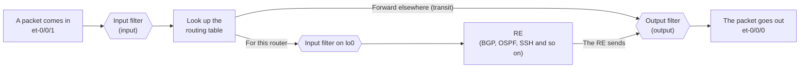

# J2 — The parts of a firewall filter, and the path a packet takes

In J1 you chose which **routes** come in and go out with routing policy. In this unit you choose **packets**: which packets pass,
which are dropped, and how the dropped ones are counted and recorded. Junos does this with firewall filters. Their shape is close to
the policies of J1: you line up terms, match with `from` and decide with `then`. The unit has three pages and an appendix.

| Page | Contents | Tasks |
|---|---|---|
| This page | Where filters act, the path one packet takes through a filter, the terms | — |
| Firewall filters: terms and actions | Match conditions, actions, the implicit discard at the end, discard versus reject, the order of terms, replies, applying a filter to an interface | J2-1, J2-2 |
| Protecting the RE: the lo0 filter | What the RE receives, applying a filter to lo0, apply-path, replies to connections the router starts, the management port | J2-3 |
| Lists and logging | Filter lists, prefix lists and except, counters, log and syslog, policers | J2-4, J2-5 |
| Appendix | Quick reference, quirks of this virtual router | — |

The lab is JNT-03. JUN01 and JUN02 are Junos routers (vJunos-Evolved) and start where J1 ended. No firewall filter is configured.
FRR1 plays the ISP, and NET1 plays a host on the Internet, beyond the ISP. SRV1 plays a server: it serves the web on TCP ports 80 and
443, and SSH on port 22. NET1 serves the web on port 8080.

:::topo
nodes:
  SRV1: {at: [0, 0], kind: host, label: "SRV1 (server)"}
  JUN01: {at: [2.2, 0], label: "JUN01 (Junos)"}
  JUN02: {at: [4.4, 0], label: "JUN02 (Junos)"}
  FRR1: {at: [6.6, 0], label: "FRR1 (ISP, AS 64500)"}
  NET1: {at: [8.8, 0], kind: host, label: "NET1 (Internet)"}
links:
  - {a: SRV1, b: JUN01, la: "eth1 .10", lb: "et-0/0/1 .1", label: "172.16.10.0/24"}
  - {a: JUN01, b: JUN02, la: "et-0/0/0 .1", lb: "et-0/0/0 .2", label: "10.0.12.0/30"}
  - {a: JUN02, b: FRR1, la: "et-0/0/1 .1", lb: "eth1 .2", label: "10.0.23.0/30 eBGP"}
  - {a: FRR1, b: NET1, la: "eth2 .1", lb: "eth1 .2", label: "192.0.2.0/30"}
frames:
  - {label: "AS 65000 (OSPF area 0)", nodes: [JUN01, JUN02]}
:::

## 1. What firewall filters give you

### 1.1 The problem: choosing which traffic may pass

J1 put the routes in order, so NET1 can now reach anything inside. It reaches too much. In the starting topology, TCP from NET1
connects not only to the web server, but also to SSH on the server, and to SSH on JUN01 and JUN02.

| From NET1 | To | Result |
|---|---|---|
| 198.51.100.10 | The web on SRV1 (port 80 on 172.16.20.1) | connects |
| 198.51.100.10 | SSH on SRV1 (port 22 on 172.16.20.1) | connects |
| 198.51.100.10 | SSH on JUN01 (port 22 on 172.16.10.1) | connects |
| 198.51.100.10 | SSH on JUN02 (port 22 on 10.0.23.1) | connects |

You need a way to choose the traffic that may come in from outside, and a way to protect the routers themselves.

### 1.2 What came before

IOS uses ACLs. You line up permit and deny lines in an extended ACL and apply it to an interface with `ip access-group name in`.
The lines are checked from the top, and a packet that matches none of them is dropped by the implicit deny at the end. Traffic to the
router itself is narrowed separately, with `access-class` on the vty lines or with CoPP (a policy-map applied to the control plane).

IOS XR also applies an ACL (`ipv4 access-list`) to an interface with `ipv4 access-group`. Traffic to the router itself is handled by
LPTS and Management Plane Protection (MPP), which you saw in M2 of the IOS XR track.

### 1.3 The Junos answer

Junos narrows both the packets passing through an interface and the packets coming to the router itself with the same firewall filters.

- You write a filter once, under `firewall family inet filter name`, as a list of terms. A term has the same shape as in the policies of J1.
- You apply it to the family of an interface's logical unit, as **input** (the incoming direction) or **output** (the outgoing direction).
- To protect the router itself (its RE), you apply a filter to **lo0**. Packets for the RE pass through it before they reach the RE,
  whichever interface they came in on.

Firewall filters are **stateless**. Each packet is judged on its own contents. Letting a packet out does not let its reply back in by itself.

## 2. How it works: the parts and the flow

### 2.1 Where filters act



A packet that comes in on an interface first passes the input filter of that interface. If the routing table says to forward it, it
passes the output filter of the interface it leaves through. If it is for this router, it passes the input filter on lo0 and reaches the RE.

So a packet for the RE passes **both** the input filter of the interface it arrived on and the filter on lo0. Transit packets do not pass
the lo0 filter. Packets that the RE sends also pass the output filter of the interface they leave through.

### 2.2 Following one packet

In this example, filter TO-SERVERS is applied to JUN01 in the direction toward the server network. We follow a packet from NET1 to
port 443 on SRV1. Rest the pointer on a number in the drawing (tap it on a phone) to see that block of configuration in a pop-up, and
its lines are highlighted in the configuration example below.

:::walk
legend: The line carries IP packets. The terms of a filter are checked from the top, and evaluation ends at a terminating action (accept, discard and so on).
rows:
  - {node: NET1, say: ["~Sends a TCP SYN from 198.51.100.10 to the web on SRV1"]}
  - {wire: "[[TCP 198.51.100.10 → 172.16.20.1:443]] _SYN"}
  - {node: JUN02, say: ["~No filter. Looks up the routing table and sends it to JUN01"]}
  - panel: JUN01
    sub: the way out to the server network
    items:
      - ref: 1
        head: "**Output of et-0/0/1** `filter output TO-SERVERS`"
        say: ["The routing table says et-0/0/1. Before it leaves, it passes TO-SERVERS"]
      - ref: 2
        head: "**TO-SERVERS** terms from the top"
        match:
          - ["term ICMP  from protocol icmp", false, "no match (TCP)"]
          - ["term WEB  from destination-address 172.16.20.0/24, protocol tcp, destination-port http", false, "no match (443 is not http)"]
          - ["term LAST  (no from)", true, "match → `count TO-SERVERS-DROP`, `discard`"]
      - {say: ["~The packet is dropped, and nothing goes back to NET1 (it waits 3 seconds and times out)"]}
  - {aside: "For port 80", say: ["Matches WEB in ② → `count WEB-IN`, `accept` → reaches SRV1"]}
  - {aside: "Without LAST in ③", say: ["~No term matches → the implicit discard at the end. The result is the same, but nothing is counted"]}
:::

:::config JUN01 — narrow the traffic going out to the server network (an output filter)
set firewall family inet filter TO-SERVERS term ICMP from protocol icmp                       ## ② Let all ICMP through
set firewall family inet filter TO-SERVERS term ICMP then accept                              ## ② 
set firewall family inet filter TO-SERVERS term WEB from destination-address 172.16.20.0/24   ## ② To the server network,
set firewall family inet filter TO-SERVERS term WEB from protocol tcp                         ## ② TCP,
set firewall family inet filter TO-SERVERS term WEB from destination-port http                ## ② port 80 only (different kinds of condition are ANDed)
set firewall family inet filter TO-SERVERS term WEB then count WEB-IN                         ## ② Count it,
set firewall family inet filter TO-SERVERS term WEB then accept                               ## ② then let it through
set firewall family inet filter TO-SERVERS term LAST then count TO-SERVERS-DROP               ## ③ Count everything else,
set firewall family inet filter TO-SERVERS term LAST then discard                             ## ③ and drop it silently
set interfaces et-0/0/1 unit 0 family inet filter output TO-SERVERS                           ## ① Apply it to packets leaving et-0/0/1
:::

Result: port 80 connects, and port 443 waits 3 seconds and times out. Ping gets through.

```console
net1:/# probe 172.16.20.1 80 -s 198.51.100.10
open  tcp 172.16.20.1:80 from 198.51.100.10  0.00s
net1:/# probe 172.16.20.1 443 -s 198.51.100.10
timeout  tcp 172.16.20.1:443 from 198.51.100.10  3.00s

admin@jun01> show firewall filter TO-SERVERS
Filter: TO-SERVERS
Counters:
Name                                                                            Bytes              Packets
TO-SERVERS-DROP                                                                   480                    8
WEB-IN                                                                            320                    6
```

`probe` is a tool on SRV1 and NET1 in this topology. It tries a TCP connection and says in one word what came back.
`timeout` means the packet was silently dropped on the way, and `refused` means it reached the device at the other end (section 2.5 of the next page).

### 2.3 The terms side by side

| Junos term | What it is | Everyday picture | In IOS | In IOS XR |
|---|---|---|---|---|
| firewall filter | A named set of packet rules, written under `firewall family inet` | the rules at a gate | extended ACL | ACL (`ipv4 access-list`) |
| term | One rule in a filter. Checked from the top | one item of the rules | one line of an ACL | one line of an ACL |
| from | The conditions to match (addresses, protocol, ports and so on) | "for packets that..." | the conditions in a line | the conditions in a line |
| then | What to do on a match | "do this" | permit, deny | permit, deny |
| accept, discard, reject | Actions that end the evaluation (terminating actions): pass, drop silently, drop and send ICMP | let through, stop, stop and say so | permit, deny | permit, deny |
| count, log, syslog | Actions that count or record. They do not end the evaluation | keep a record of who passed | per-line ACL counters, `log` | the same |
| implicit discard at the end | The rule that drops packets matching no term | not on the list, not let in | implicit deny | implicit deny |
| input, output | The direction a filter is applied in | the entrance gate, the exit gate | `ip access-group … in`, `out` | `ipv4 access-group … ingress`, `egress` |
| lo0 filter | A filter on the packets that reach the RE | the reception desk at head office | CoPP, `access-class` on the vty | LPTS, MPP |
| filter list | Several filters listed in one direction (`input-list`) | two gates one after the other | — (one per place) | — (one per place) |

### 2.4 Easy to mix up

- **Routing policy and firewall filters are different things.** A policy chooses routes; a filter chooses packets. Both have terms,
  from and then, but they are written in different places (`policy-options` and `firewall`) and applied in different places. Even
  `reject` differs: in a policy it means "do not accept the route", in a filter it means "drop and send ICMP".
- **Packets that match nothing are dropped.** Unlike the default policies of J1, the end of a filter is an implicit discard whatever
  the protocol. To count what is dropped, write a last term with `count` and `discard` yourself.
- **Replies do not pass by themselves.** Filters are stateless, so the reply (SYN and ACK) to a TCP connection started from the inside
  is judged by the filter in the incoming direction, too.
- **Packets for the RE pass both the interface filter and the lo0 filter.** If one lets them through and the other drops them, they do not arrive.
- **A term added with `set` goes to the end.** If a term that drops "everything else" is already there, a term added later is never
  reached. Reorder with `insert`, as with the policies of J1.

### 2.5 Who does what in the topology

| Device | Role in JNT-03 | What you practise |
|---|---|---|
| JUN01 | An inside router, connected to the server network (172.16.10.0/24) | The configuration examples of these pages are built here |
| JUN02 | The border with the ISP | The entrance from the ISP (J2-1, J2-2, J2-4), protecting the RE (J2-3), recording (J2-5) |
| FRR1 | The ISP. You cannot change it | Runs BGP with JUN02. Forwards to NET1 |
| NET1 | A host on the Internet. You cannot change it | Sends traffic from outside, using four different sources. Serves the web on port 8080 |
| SRV1 | A server. You cannot change it | Serves the web on ports 80 and 443 and SSH on port 22. Sends traffic from the inside out |

### 2.6 Takeaways

- Write a filter once and apply it as input or output of an interface. To protect the RE, apply it to lo0.
- Terms are checked from the top and stop at a terminating action. A packet that matches none is dropped.
- Filters are stateless. Replies and traffic to the router itself pass only if you write them in.

## Practice

The tasks of this unit are in lab **JNT-03**. The end of each page shows the tasks that go with it.

<p class="tolab"><a href="/_learn?id=JNT-03">Open lab JNT-03 in the workspace</a></p>

:::note
Sources: Juniper Networks, *Routing Policies, Firewall Filters, and Traffic Policers User Guide* (published 2026-06-23), the sections on
the components of a stateless firewall filter, the order of evaluation (an implicit accept when a term has no action, an implicit discard
at the end) and applying a filter to an interface and to lo0. IOS XR behaviour is from M2 and M12 of the IOS XR track.
The output was captured on vJunos-Evolved (Junos OS Evolved 26.2R1.7) in containerlab.
:::
