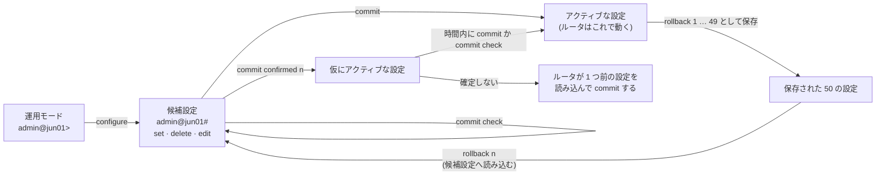

# J0 — Junos の部品と、変更が流れる道

この単元は、IOS と IOS XE で仕事をしていて、IOS XR にも触れ、いま Junos の前に座っているエンジニアのためのものです。
Junos での設定の書き方と、変更がルータに届くまでの道を説明し、各段階を IOS・IOS XR と比べます。
ルーティングそのもの(アドレス・OSPF・スタティック ルート)は CCNA の範囲で、ラボではそれを Junos の作法で組む練習に使います。
単元は 3 つのページと付録に分かれています。

| ページ | 中身 | 課題 |
|---|---|---|
| このページ | Junos の部品と変更の流れ: 運用モードと設定モード、候補設定とアクティブな設定、commit、rollback、ルーティング テーブル | — |
| 設定の書き方: ツリーとインターフェース | 設定の階層、`set` と `edit`、`display set`、物理インターフェースと論理ユニット | J0-1、J0-2 |
| commit: 検査・確定・巻き戻し | 候補設定、`commit check`、`commit confirmed`、保存される 50 世代、複数の人が同時に編集する時 | J0-3 |
| ルーティング テーブルとデフォルト ポリシー | `inet.0` などのテーブル、`show route` の読み方、preference、スタティック ルート、プロトコルが何でも広告するわけではない理由 | J0-4 |
| 付録 | Junos OS と Junos OS Evolved、このラボの仮想ルータ、IOS・IOS XR との早見表 | — |

ラボは JNT-01 です。JUN01 と JUN02 は、空の状態で始まる Junos のルータ(vJunos-Evolved)です。FRR1 は設定済みの
FRRouting のルータで、あなたが変更できない他社のルータの役です。後ろにサーバのネットワークがあります。

:::topo
nodes:
  JUN01: {at: [0, 0], label: "JUN01 (Junos)"}
  JUN02: {at: [2.4, 0], label: "JUN02 (Junos)"}
  FRR1: {at: [4.8, 0], label: "FRR1 (FRRouting)"}
  SRV: {at: [4.8, 1.2], kind: host, label: "サーバ 198.51.100.0/24"}
links:
  - {a: JUN01, b: JUN02, la: "et-0/0/0 .1", lb: "et-0/0/0 .2", label: "10.0.12.0/30"}
  - {a: JUN02, b: FRR1, la: "et-0/0/1 .1", lb: "eth1 .2", label: "10.0.23.0/30"}
  - {a: FRR1, b: SRV, label: "FRR1 の後ろ"}
:::

## 1. Junos の作法を覚えると何が嬉しいか

### 1.1 困りごと: 途中の状態がネットワークに出る

IOS では、打った行がその場で効きます。5 行の変更は、途中で 4 つの中途半端な状態を通り、ネットワークはそのどれも目にします。
まとめて貼り付けて 3 行目がはじかれても、4 行目と 5 行目は入ります。変更で自分の接続が切れたら、仕込んでおいた `reload in` で
ルータが戻るのを待つしかなく、再起動に伴うほかのことも一緒に起きます。変更を取り消すには、各行の逆を、記憶か控えから打ち直します。

### 1.2 それ以前の手

IOS には、この問題の周りを固める道具があります。危ない変更の前の `reload in`、保存したファイルへ戻す `archive` と
`configure replace` です。IOS XR は、IOS XR トラックの M1 で見たとおり、設定の仕組みそのもので解決しています。自分専用の
ターゲット設定を編集し、commit するまでルータには何も届きません。

### 1.3 Junos の答え

Junos は IOS XR と同じ考え方で作られていて、そこに独自の習慣がいくつか加わります。

- 編集するのは**候補設定**(candidate configuration)という作業用の写しです。**commit** するまでルータには何も届きません。
- `commit check` は、何かを変える前に候補設定の全体を検査します。
- `commit confirmed` は、変更を仮で入れます。時間内に確定しなければ、ルータが自分で元に戻します。
- ルータは、**直近に commit した 50 の設定**を保存しています。どれでも候補設定へ読み戻せます。
- 設定は 1 つの**ツリー**です。ツリーの中のどの行も、そのパスをすべて書いた 1 つの `set` コマンドで表せます。

このページの残りでは、次のページから 1 つずつ細部に入る前に、部品を並べて見せます。

## 2. 仕組み: 部品と流れ

### 2.1 変更が流れる道



ログインすると**運用モード**(`>` のプロンプト)にいて、ここでルータの様子を見ます。`configure` で**設定モード**
(`#` のプロンプト)に入り、候補設定を変えます。commit すると候補設定が**アクティブな設定**(active configuration)になり、
それまで動いていた設定は rollback 1 になります。

### 2.2 用語を並べる

| Junos の用語 | 何か | 身近なたとえ | IOS では | IOS XR では |
|---|---|---|---|---|
| 運用モード(`>`) | `show`・`ping`・`request` を打つ所 | 計器盤 | EXEC モード | EXEC モード |
| 設定モード(`#`) | 候補設定を編集する所 | 作業台 | グローバル設定モード。ただしまだ何も効かない | 設定モード |
| 候補設定 | 編集する作業用の写し | 下書き | —(打った行がすぐ効く) | ターゲット設定 |
| アクティブな設定 | ルータが使っている設定 | 清書 | running-config | アクティブな設定(running configuration) |
| commit | 候補設定を検査し、アクティブな設定にする | 下書きを清書にする | — | commit |
| rollback n | 保存された設定 n を候補設定へ読み込む | 控えを取り出す | 保存したファイルへの `configure replace` | `rollback configuration`・`load rollback changes` |
| ステートメントと階層 | 設定のツリーの 1 つのノードと、ツリーの中の今いる場所 | フォルダのパス | 1 行と、今いる設定のモード | 同じ(サブモードあり) |
| 論理ユニット(`et-0/0/0.0`) | インターフェースのうち、アドレスを持つ部分。VLAN が無くても必ずある | 道路の車線 | インターフェースそのもの、VLAN ならサブインターフェース | インターフェースそのもの、またはサブインターフェース |
| ルーティング テーブル `inet.0` | すべてのプロトコルが共有する IPv4 のテーブル | 共有の台帳 | グローバルのルーティング テーブル | デフォルト VRF のテーブル |
| preference | どの出どころの経路を採るかの順位 | 序列 | アドミニストレーティブ ディスタンス | アドミニストレーティブ ディスタンス |

### 2.3 取り違えやすい点

- 運用モードの `show configuration` は**アクティブな設定**を、設定モードの `show` は今いる場所から下の**候補設定**を見せます。
  commit していない変更がある間は、2 つは違います。
- ただの `configure` は、同じくただの `configure` で入った全員と、1 つの候補設定を**共有**します。相手の未確定の変更は
  あなたの候補設定にも入っていて、どちらかが commit すれば両方の変更が入ります。IOS XR はセッションごとに別のターゲット設定を
  持ちます。Junos でそうなるのは `configure private` の時だけです。
- アドレスを付けるのは**論理ユニット**(`et-0/0/0 unit 0`)で、物理インターフェースではありません。プロトコルもユニットを
  指定します。`et-0/0/0.0` です。
- preference の値は、知っているアドミニストレーティブ ディスタンスと違います。OSPF の内部経路は 10、スタティック ルートは 5、BGP は 170 です。
- スタティック ルートのネクスト ホップは、指定しない限り、直接つながっているネットワークの上になければなりません。

### 2.4 盤面の上での分担

| 機器 | JNT-01 での役 | 練習すること |
|---|---|---|
| JUN01 | 片端の空の Junos ルータ | ツリーを書く: アドレスと OSPF |
| JUN02 | 真ん中の空の Junos ルータ | 同じことに加え、仮の変更(J0-3)とスタティック ルート(J0-4) |
| FRR1 | 設定済みの他社のルータ。後ろにサーバ | 設定することはない。変えられない隣接ルータ |

J0-3 は FRR1 のためにあります。こちら側の変更が、触れない隣接ルータとの間を壊すことがあります。壊れたままにならずに試す方法が
`commit confirmed` です。

### 2.5 押さえどころ

- 見るのは運用モード、変えるのは設定モード。commit するまで何も変わらない。
- 危ない commit の前に `commit check`、続けて短い時間の `commit confirmed`。
- ルータは直近の 50 の設定を持っている。`rollback n` は候補設定へ読み込むだけ。そのあと commit する。

## 3. どう見えるか

J0-1 と J0-2 で JUN01 に求めることは、数行に収まります。`show configuration | display set` で Junos が出す `set` の形で示します。

:::config fold JUN01 — アドレスと OSPF
set interfaces et-0/0/0 unit 0 family inet address 10.0.12.1/30   ## リンクのアドレス。et-0/0/0 の論理ユニット 0 に付ける
set interfaces lo0 unit 0 family inet address 192.168.0.1/32       ## ループバックも、ユニットに付ける
set protocols ospf area 0.0.0.0 interface et-0/0/0.0               ## OSPF が指定するのはユニット。物理インターフェースではない
set protocols ospf area 0.0.0.0 interface lo0.0 passive            ## ループバックを広告し、隣接は作らない
:::

commit のあと、`show system commit` は、誰が何を commit したかを新しい順に並べます。左の番号が rollback の番号です。

```console
admin@jun01> show system commit
0   2026-11-14 10:57:11 UTC by admin via cli
    J0 PoC: addresses
1   2026-11-14 09:53:56 UTC by root via other
```

1 番はルータが起動した時の設定です。0 番がアクティブな設定です。

## 実践

この単元の課題はラボ **JNT-01** にあります。各ページの最後に、そのページに対応する課題を示します。

<p class="tolab"><a href="/_learn?id=JNT-01">ワークスペースでラボ JNT-01 を開く</a></p>

:::note
出典: Juniper Networks『CLI User Guide for Junos OS』(2026-06-18 発行)の commit の仕組み・configure の形・以前の設定へ戻す節、
『Junos OS Routing Protocols Overview』(2026-06-23)の既定の route preference の表。各ページの出力は、containerlab の
vJunos-Evolved(Junos OS Evolved 26.2R1.7)で取ったものです。
:::
