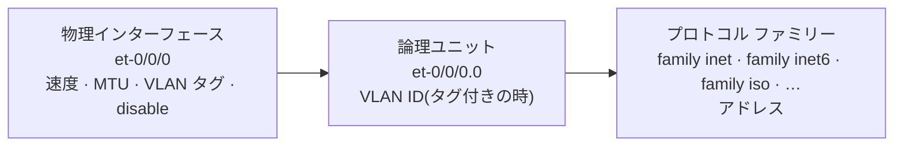

# J0 — 設定の書き方: 木とインターフェース

## 1. なぜ木なのか

### 1.1 困りごと: その行はどこにあるのか

IOS の設定は行の並びで、1 行の意味はその上にあるモードで決まります。`ip address` は `interface Gi0/1` の下では意味を持ち、
グローバル設定モードでは何も意味しません。設定の一部を別のルータへ写すにはモードの行も一緒に写し、あるインターフェースに
関わる設定をすべて見つけるには running-config のいくつもの節を読みます。

### 1.2 それ以前の手

フィルタしていました。`show running-config | section ospf` や `| include` です。IOS XR はもう一歩進んで、
`show running-config router ospf` のように、道筋を指定して設定の一部だけを見せられます。

### 1.3 Junos の答え

Junos の設定は、ステートメントの 1 本の**木**です。どのステートメントにも頂上からの道筋があり、木のどの葉も、その道筋を
書き切った 1 つの `set` コマンドで表せます。ルータは設定を、波かっこの木としても、その `set` の行としても出せます。
`set` の行は、そのまま別のルータへ貼り付けられます。インターフェース・ルーティング プロトコル・システムの設定など、
どの機能も同じ木の枝なので、どれも同じやり方で探して書けます。

## 2. 仕組み

### 2.1 木の中の今いる場所

`configure` で木の頂上に入ります。プロンプトの上の `[edit]` の行が、今いる場所を示します。`edit` で下へ、`up` で 1 段上へ、
`top` で頂上へ移り、`exit` で設定モードを出ます。

```console
admin@jun01> configure
Entering configuration mode

[edit]
admin@jun01# edit interfaces et-0/0/0 unit 0

[edit interfaces et-0/0/0 unit 0]
admin@jun01# set family inet address 10.0.14.1/30

[edit interfaces et-0/0/0 unit 0]
admin@jun01# show
family inet {
    address 10.0.14.1/30;
}

[edit interfaces et-0/0/0 unit 0]
admin@jun01# up

[edit interfaces et-0/0/0]
admin@jun01# show
unit 0 {
    family inet {
        address 10.0.14.1/30;
    }
}
```

設定モードの `show` は、今いる場所から下の候補設定を見せます。ここではまだ何も効いていません。commit は次のページで扱います。

`edit` は近道にすぎません。頂上で `set interfaces et-0/0/0 unit 0 family inet address 10.0.14.1/30` と打っても、1 行で
同じことになります。Junos はたいていこう書きます。葉ごとに 1 つの `set` を、道筋を全部書いて打ちます。

設定モードを出ずに運用モードのコマンドを打つには、`run show interfaces terse` のように頭に `run` を付けます。
IOS の `do` にあたります。

### 2.2 set・delete と、CLI がはじくもの

`set` はステートメントを足すか、すでにあるステートメントの値を置き換えます。`delete` はステートメントを、その下の全部と
一緒に消します。CLI は木の形を知っていて、形に合わない行は Enter を押した時点ではじきます。

```console
admin@jun01# set routing-options static route 198.51.100.0/24
                                                              ^
missing argument.
```

静的経路にはプレフィックスの後ろに何か(次ホップか `discard`)が要るので、この行は候補設定に入りません。

木の形には合っていても、設定のほかの部分と合わない誤りもあります。そうした誤りは、候補設定の全体を検査する
`commit check` か `commit` の時に見つかります。次の節の例です。

```console
admin@jun01# commit check
[edit interfaces et-0/0/0 unit 1 vlan-id]
  'vlan-id 10'
    VLAN-ID can only be specified on tagged ethernet interfaces
error: configuration check-out failed: (validation hook evaluation failed)
```

### 2.3 同じ設定の 2 つの出し方

波かっこの木は読みやすく、`| display set` を付けると、どの葉もそれを作る `set` の行になります。

```console
admin@jun01# show interfaces | display set
set interfaces et-0/0/0 unit 0 family inet address 10.0.14.1/30
set interfaces lo0 unit 0 family inet address 192.168.0.1/32
set interfaces re0:mgmt-0 unit 0 family inet address 10.0.0.15/24
set interfaces re0:mgmt-0 unit 0 family inet6 address 2001:db8::2/64
```

同じパイプは運用モードで動いている設定にも使え、`match` と組み合わせられます。

```console
admin@jun01> show configuration | display set | match "interfaces (et|lo0)"
set interfaces et-0/0/0 unit 0 family inet address 10.0.14.1/30
set interfaces lo0 unit 0 family inet address 192.168.0.1/32
```

### 2.4 次に何を書けるかを CLI に聞く

`?` で次に書けるものの一覧が出るのは IOS と同じです。2 つの印が大事です。語の前の `>` は入れ物で、その下にまだ
ステートメントがあります。`+` は値の集まりを取るステートメントです。どちらも無い語は葉です。

```console
admin@jun01# set interfaces et-0/0/0 ?
Possible completions:
+ apply-groups         Groups from which to inherit configuration data
  description          Text description of interface
  disable              Disable this interface
> ether-options        Ethernet interface-specific options
  mtu                  Maximum transmit packet size (288..16000)
> unit                 Logical interface
  vlan-tagging         802.1q VLAN tagging support
```

(出力は抜粋です。)運用モードのコマンドの名前が分からない時は、`help apropos <語>` でその語を含むコマンドの一覧が出ます。

### 2.5 インターフェース: 物理ポート、論理ユニット、ファミリー

Junos のインターフェースは 3 つの層からなり、アドレスはいちばん下に付きます。



- **物理インターフェース**はポートです。名前は媒体の種類と位置です。`et` は 10〜400 Gbit/s の Ethernet、`ge` は
  Gigabit Ethernet、`xe` は 10 Gigabit Ethernet です。このラボのルータのポートは `et` で、`et-0/0/0` から始まります。
- **論理ユニット**が通信を運びます。IP を運ぶインターフェースには、VLAN が無くても必ず 1 つ以上あります。
  タグの無い通信はユニット 0 を使います。VLAN を使う時は、ユニットごとに 1 つの VLAN ID を持ちます。
- **プロトコル ファミリー**が、そのユニットが何を運ぶかを決めます。`family inet` は IPv4、`family inet6` は IPv6 です。
  `family inet` の無いユニットは、ほかに何があっても IPv4 を運びません。

インターフェースの上で動くものは、ポートでなくユニットを名指しします。OSPF を動かすのは `et-0/0/0.0`、ループバックは `lo0.0` です。

インターフェースは、止めない限り有効です。設定の無いポートも、リンクがあれば up になります。止めるのは `disable` です。

```console
admin@jun01# run show interfaces terse et-0/0/0
Interface               Admin Link Proto    Local                 Remote
et-0/0/0                down  down
et-0/0/0.0              up    down inet     10.0.14.1/30
                                   multiservice
```

IOS XR では、一度も設定していない物理インターフェースは shutdown の状態で始まります(IOS XR トラックの M0)。
多くの IOS ルータのポートも同じです。Junos は有効な状態で始まります。

### 2.6 `show interfaces terse` の読み方

```console
admin@jun01> show interfaces terse et-0/0/0
Interface               Admin Link Proto    Local                 Remote
et-0/0/0                up    up
et-0/0/0.0              up    up   inet     10.0.14.1/30
                                   multiservice
```

インターフェースは 2 段に出ます。物理ポートの行と、その下の論理ユニットごとの行です。**Admin** は設定が求める状態
(`disable` で `down`)、**Link** はポートが見ている状態です。ユニットの行には、そのファミリー(`inet`)とアドレスが出ます。
`multiservice` のファミリーはルータ自身のものです(付録を参照)。ユニットをまだ設定していないポートの行には `inet` がありません。
ポートは up でも、そこへ宛てて送れるものはまだありません。

## 3. 設定例

### 3.1 1 つのポートに 2 つの VLAN、IPv4 の隣に IPv6

ラボの盤面にはない例です。ユニットとファミリーの組み合わせ方を見せるために、空いているポート `et-0/0/2` に書きました。

:::config VLAN タグ付きのポートに 2 つのユニット
set interfaces et-0/0/2 vlan-tagging                                     ## このポートは 802.1Q のタグを運ぶ
set interfaces et-0/0/2 unit 10 vlan-id 10                               ## ユニット 10 は VLAN 10
set interfaces et-0/0/2 unit 10 family inet address 10.0.110.1/24        ## ユニット 10 に IPv4
set interfaces et-0/0/2 unit 10 family inet6 address 2001:db8:110::1/64  ## 同じユニットに、IPv4 と並べて IPv6
set interfaces et-0/0/2 unit 20 vlan-id 20                               ## ユニット 20 は VLAN 20
set interfaces et-0/0/2 unit 20 family inet address 10.0.120.1/24        ## ユニット 20 は IPv4 だけ
:::

```console
admin@jun01# run show interfaces terse et-0/0/2
Interface               Admin Link Proto    Local                 Remote
et-0/0/2                up    up
et-0/0/2.10             up    up   inet     10.0.110.1/24
                                   inet6    2001:db8:110::1/64
                                            fe80::66ec:3800:a16:13/64
                                   multiservice
et-0/0/2.20             up    up   inet     10.0.120.1/24
                                   multiservice
et-0/0/2.32767          up    up   multiservice
```

IPv6 のリンクローカル アドレスはひとりでに付きます。ユニット 32767 はルータ自身のもので、設定するものではありません。

タグはポート全体の性質で、検査はどちらの向きにも効きます。`vlan-tagging` を付けたポートでは、どのユニットにも VLAN ID が要ります。

```console
admin@jun01# set interfaces et-0/0/2 unit 0 family inet address 10.0.130.1/24

admin@jun01# commit check
  'unit 0'
    VLAN-ID must be specified on tagged ethernet interfaces
error: configuration check-out failed: (validation hook evaluation failed)
```

そして、2.2 節の例のとおり、`vlan-tagging` の無いポートは VLAN ID を受け付けません。

### 3.2 IOS から Junos へ

| IOS で書くなら | Junos では |
|---|---|
| `interface Gi0/1` / `ip address 10.0.12.1 255.255.255.252` | `set interfaces et-0/0/0 unit 0 family inet address 10.0.12.1/30` |
| `interface Gi0/1.10` / `encapsulation dot1Q 10` / `ip address …` | `set interfaces et-0/0/2 vlan-tagging` と、`unit 10 vlan-id 10 family inet address …` |
| `interface Loopback0` / `ip address 192.168.0.1 255.255.255.255` | `set interfaces lo0 unit 0 family inet address 192.168.0.1/32` |
| `shutdown` / `no shutdown` | `set … disable` / `delete … disable` |
| `do show ip interface brief` | `run show interfaces terse` |
| `router ospf 1` / `network 10.0.12.0 0.0.0.3 area 0` | `set protocols ospf area 0.0.0.0 interface et-0/0/0.0` |
| `passive-interface Loopback0` | `set protocols ospf area 0.0.0.0 interface lo0.0 passive` |

最後の 2 行は、もう 1 つの習慣を示しています。Junos の OSPF に `network` 文はありません。OSPF を動かすインターフェース
(ユニット)を名指しします。

## 実践

ラボ **JNT-01** に移り、課題 J0-1 と J0-2 に取り組みます。

<p class="tolab"><a href="/_learn?id=JNT-01">ワークスペースでラボ JNT-01 を開く</a> — <a href="02-j0-practice.html">課題の一覧</a></p>

:::note
出典: Juniper Networks『CLI User Guide for Junos OS』(2026-06-18)の設定モード・`?` の印・`run`、
『Interfaces Fundamentals for Junos OS』(2026-06-17)のインターフェース名・論理ユニット・プロトコル ファミリー。
出力は vJunos-Evolved(Junos OS Evolved 26.2R1.7)で取ったものです。
:::
