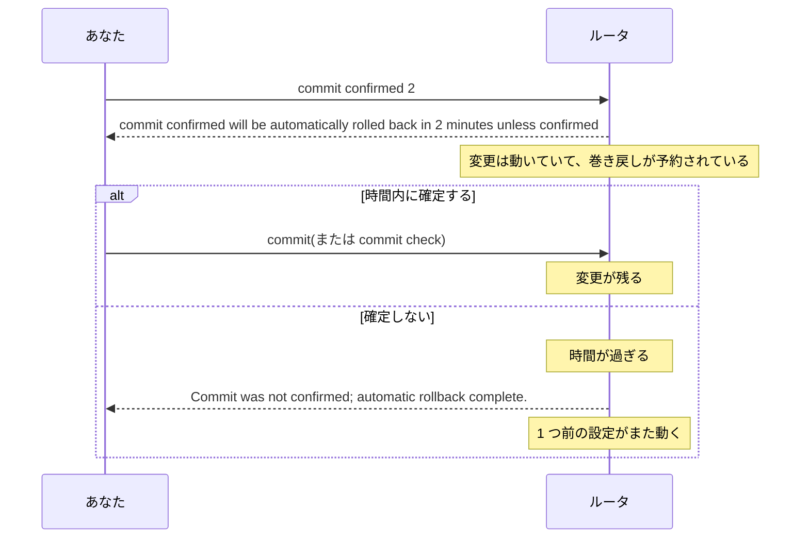

# J0 — commit: 検査・確定・巻き戻し

## 1. なぜ commit なのか

### 1.1 困りごと: 網がすべての段階を見る

IOS で何行かの変更を入れると、1 行ずつ効いていきます。リンクのアドレスの付け直しの途中では、両端の言い分が食い違います。
貼り付けたまとまりは、一部だけ受け付けられることがあります。そして変更で自分の接続が切れたら、戻る道は前もって仕込んだ
再起動だけです。

### 1.2 それ以前の手

IOS では、慎重に打ち、危ない変更の前に `reload in 10` を仕込み、`configure replace` で戻れるよう設定の控えを持っておきます。
IOS XR(IOS XR トラックの M1)では、ターゲット設定に変更を用意し、見て、まとめて commit し、接続が切れうる変更には
`commit confirmed` を使います。

### 1.3 Junos の答え

Junos の commit の仕組みは IOS XR と同じです。部品の名前と、いくつかの習慣が違います。違いが効いてくるのは、初めてそれに
頼る時です。仮の commit をどう確定するか、rollback が何をするか、2 人が同時に編集すると何が起きるか、の 3 つです。

## 2. 仕組み

### 2.1 候補設定・検査・commit

`set` や `delete` した内容は、すべて**候補設定**に入ります。`show | compare` で、候補設定が動いている設定とどう違うかが
差分の形で見えます。

```console
admin@jun01# show | compare
[edit interfaces]
+   et-0/0/0 {
+       unit 0 {
+           family inet {
+               address 10.0.14.1/30;
+           }
+       }
+   }
```

`commit check` は候補設定の全体を検査し、何も変えません。ポートにはまだアドレスがありません。

```console
admin@jun01# commit check
configuration check succeeds

admin@jun01# run show interfaces terse et-0/0/0
Interface               Admin Link Proto    Local                 Remote
et-0/0/0                up    up
et-0/0/0.16386          up    up   multiservice
```

`commit` はもう一度検査して、候補設定を動いている設定にします。`commit comment "…"` は commit にメモを残し、
`commit and-quit` は commit の後に設定モードを出ます。

```console
admin@jun01# commit comment "J0 PoC: addresses"
commit complete

admin@jun01# run show interfaces terse et-0/0/0
Interface               Admin Link Proto    Local                 Remote
et-0/0/0                up    up
et-0/0/0.0              up    up   inet     10.0.14.1/30
                                   multiservice
```

検査で誤りが見つかると、何も commit されず、候補設定はそのまま残ります。直すのはあなたです。

### 2.2 保存される 50 の設定

commit のたびに、それまで動いていた設定が一覧を 1 つ下がります。ルータは直近の 50 を持っています。0 番が動いている設定、
1〜49 番がそれより前の設定です。`show system commit` は、誰がどの経路で commit したかと一緒に一覧を出します。

```console
admin@jun01> show system commit
0   2026-11-14 10:57:19 UTC by admin via cli
    J0 PoC: remove lo0
1   2026-11-14 10:57:11 UTC by admin via cli
    J0 PoC: addresses
2   2026-11-14 09:53:56 UTC by root via other
```

設定モードの `rollback n` は、保存された設定 n を**候補設定へ**読み込みます。ルータは変わりません。結果を `show | compare` で見て、
ほかの変更と同じように commit します。

```console
admin@jun01# rollback 1
load complete

admin@jun01# show | compare
[edit interfaces]
+   lo0 {
+       unit 0 {
+           family inet {
+               address 192.168.0.1/32;
+           }
+       }
+   }

admin@jun01# commit comment "J0 PoC: back to rollback 1"
commit complete
```

巻き戻しは、一覧のいちばん上に乗る新しい commit です。履歴から消えるものはありません。`rollback 0`(または `rollback` だけ)は、
動いている設定を候補設定へ読み戻すので、commit していない変更を捨てることになります。

候補設定に触れずに 2 つの保存された設定を比べるには、運用モードで `show system rollback compare 1 0` を使います。

### 2.3 仮の commit

`commit confirmed n` は、候補設定を n 分間だけ commit します(数字を省くと 10 分)。時間内に確定しなければ、ルータが 1 つ前の
設定を読み込んで commit し、ログインしている全員に知らせます。



巻き戻しが予約されている間は、`show system commit` にそう出ます。(この例の変更はホスト名だったので、巻き戻るまで
プロンプトが `jun01-test` になっています。)

```console
admin@jun01-test# run show system commit
0   2026-11-14 10:58:02 UTC by admin via cli commit confirmed, rollback in 1mins
    J0 PoC: confirmed, not confirmed
    rollback pending
1   2026-11-14 10:57:22 UTC by admin via cli
    J0 PoC: back to rollback 1
```

自動で巻き戻った後の履歴では、ルータ自身による commit(`by root via other`)として、取り消した commit のすぐ上に出ます。

```console
Broadcast message from root@jun01 (somewhere) (Sat Nov 14 10:59:03 2026):

Commit was not confirmed; automatic rollback complete.
run show system commit
0   2026-11-14 10:59:03 UTC by root via other
1   2026-11-14 10:58:02 UTC by admin via cli commit confirmed, rollback in 1mins
    J0 PoC: confirmed, not confirmed
2   2026-11-14 10:57:22 UTC by admin via cli
    J0 PoC: back to rollback 1
```

確定するには、時間切れの前に `commit` か `commit check` を打ちます。IOS XR と違う習慣が 2 つあります。

- **設定モードを出てもよい。** 巻き戻しの予約は残り、その知らせは運用モードのプロンプトにもついてきます
  (`# commit confirmed will be rolled back in 1 minute`)。IOS XR では、設定モードを出ると仮の commit はその場で取り消されます。
- **どのセッションからでも確定できる。** ラボでは、別のログインからの `commit check` で確定しました。

つまり Junos で危ない変更を試す手順は、`commit check`、数分の `commit confirmed`、必要なら設定モードを出て、試し、試しが
通った時だけ確定する、です。

### 2.4 2 人以上で触る時

ただの `configure` では、全員が**1 つの候補設定を共有**します。入る時に、CLI は誰がいるかと、候補設定に変更がすでに
入っているかを知らせます。

```console
admin@jun01> configure
Entering configuration mode
Users currently editing the configuration:
  admin terminal pts/1 (pid 31322) on since 2026-11-14 11:08:31 UTC
      [edit]
The configuration has been changed but not committed

admin@jun01# show | compare
[edit interfaces lo0 unit 0]
+    description "edit by a";
```

この `description` はもう 1 人が打ったもので、commit されていません。それがあなたの候補設定にも入っていて、先に commit した人が
それも commit します。セッションごとにターゲット設定を持つ IOS XR との、いちばん大きな違いです。そのために Junos には
`configure` のほかの形が 2 つあります。

| 入り方 | 得られるもの | ほかの人は |
|---|---|---|
| `configure` | 共有の候補設定 | あなたの変更が見え、それを commit できる |
| `configure private` | 自分だけの候補設定。commit せずに出ると捨てられる | ただの `configure` からは、あなたが編集している間は何も変えられない(`error: private edits in use`) |
| `configure exclusive` | 共有の候補設定を、あなたが錠をかけて使う | 入れはするが、変更も commit もできない(`error: configuration database locked by: …`) |

共有の候補設定に未確定の変更がある間は、`configure private` は断られます。

```console
admin@jun01> configure private
Users currently editing the configuration:
  admin terminal pts/1 (pid 31322) on since 2026-11-14 11:08:31 UTC
      [edit]
error: shared configuration database modified
```

共有の候補設定に未確定の変更を残したまま設定モードを出ようとすると、CLI は先に確かめます。

```console
admin@jun01# exit
The configuration has been changed but not committed
Exit with uncommitted changes? [yes,no] (yes)
```

出ても変更は捨てられません。共有の候補設定に残り、次の人か、次のあなたに引き継がれます。やめた変更があるなら、出る前の
`rollback 0` を習慣にするとよいのはこのためです。

## 3. 例

### 3.1 Junos の作法で危ない変更を入れる

手順の全体は次のとおりです。ここでの変更は説明文で、害はありません。課題 J0-3 では、害のある変更にこの手順を使います。

```console
admin@jun01> configure
admin@jun01# set interfaces lo0 unit 0 description "confirm-exit test 2"
admin@jun01# commit confirmed 1 comment "confirm from another session"
commit confirmed will be automatically rolled back in 1 minutes unless confirmed
commit complete
# commit confirmed will be rolled back in 1 minute

admin@jun01# exit
Exiting configuration mode
# commit confirmed will be rolled back in 1 minute
```

続けて、試しが通った後に、別のログインから:

```console
admin@jun01> configure
admin@jun01# commit check
configuration check succeeds
```

時間が過ぎた後も説明文は残っていました。変更は確定しました。

### 3.2 IOS・IOS XR から Junos へ

| したいこと | IOS | IOS XR | Junos |
|---|---|---|---|
| これから変える内容を見る | — | `show configuration` | `show \| compare` |
| 変えずに検査する | — | —(commit が検査する) | `commit check` |
| 入れる | 打つたびに | `commit` | `commit` |
| 仮で入れる | `reload in 10` | `commit confirmed 30`(秒) | `commit confirmed 2`(分) |
| 過去の変更を並べる | — | `show configuration commit list` | `show system commit` |
| 戻す | 保存したファイルへ `configure replace` | `rollback configuration last 1` | `rollback 1` のあと `commit` |
| 1 人で触る | — | どのセッションも自分専用。錠は `configure exclusive` | `configure private`。錠は `configure exclusive` |

## 実践

ラボ **JNT-01** に移り、課題 J0-3 に取り組みます。

<p class="tolab"><a href="/_learn?id=JNT-01">ワークスペースでラボ JNT-01 を開く</a> — <a href="04-j0-practice-2.html">課題</a></p>

:::note
出典: Juniper Networks『CLI User Guide for Junos OS』(2026-06-18)の commit の仕組み・configure の形・確認つきの有効化
(既定は 10 分。`commit` か `commit check` で確定)・保存される 50 の設定。IOS XR の列は IOS XR トラックの M1 による。
出力は vJunos-Evolved(Junos OS Evolved 26.2R1.7)で取ったものです。ラボでは、自動の巻き戻しが `commit confirmed` に渡した
時間より最大 1 分ほど遅れて起きました。
:::
