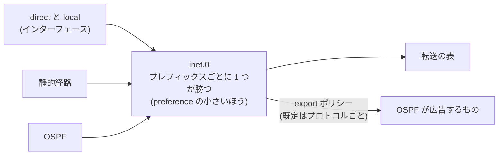

# J0 — 経路表と既定のポリシー

## 1. 1 ページを割く理由

### 1.1 困りごと: 同じ経路、違う決まり

ルータが経路を選ぶ手順は知っているはずです。最長一致、次に最も信頼する出どころ。Junos でも考え方は同じですが、数値と
いくつかの既定が違い、IOS のエンジニアは 3 つの場面でつまずきます。現れない静的経路、勝ってはいけない時に勝つ予備の経路、
プロトコルが広告を拒む経路です。

### 1.2 それ以前の手

IOS では `show ip route` を読み、アドミニストレーティブ ディスタンス(静的 1・OSPF 110)を比べ、静的経路のディスタンスを
上げて予備にし、OSPF に載せる必要があれば `redistribute static` を書きました。

### 1.3 Junos の答え

Junos は、すべての経路を 1 か所、**経路表**に置き、どのプロトコルもそこから読み、そこへ書きます。どの経路が勝つかは
**preference** で決まります。プロトコルが表から何を取り、隣に何を差し出すかは**ポリシー**で決まり、どのプロトコルにも、
自分で書くまで効く既定のポリシーがあります。

## 2. 仕組み

### 2.1 表

Junos の経路表は 1 つではなく、持つものの名前で呼ばれます。`inet.0` は IPv4 のユニキャストの表で、「経路表」と言えばこれです。
`inet6.0` はその IPv6 版です。ほかの表は機能が必要とする時に現れます。MPLS の経路の `inet.3`(考え方は IOS XR トラックの M8)、
このラボの管理網の `mgmt_junos.inet.0`(付録を参照)などです。



`show route` はすべての表を、`show route table inet.0` はその 1 つを出します。`show route summary` は、表ごと・出どころごとに
経路を数えます。

### 2.2 `show route` の読み方

```console
admin@jun01> show route table inet.0

inet.0: 6 destinations, 6 routes (6 active, 0 holddown, 0 hidden)
+ = Active Route, - = Last Active, * = Both

10.0.14.0/30       *[Direct/0] 00:12:53
                    >  via et-0/0/0.0
10.0.14.1/32       *[Local/0] 00:12:53
                       Local via et-0/0/0.0
192.168.0.1/32     *[Direct/0] 00:12:42
                    >  via lo0.0
192.168.0.4/32     *[OSPF/10] 00:00:35, metric 1
                    >  to 10.0.14.2 via et-0/0/0.0
198.51.100.0/24    *[Static/5] 00:00:45
                       Discard
224.0.0.5/32       *[OSPF/10] 00:00:45, metric 1
                       MultiRecv
```

- かっこの中は、経路の出どころと preference です。`Direct` は直接つながる網、`Local` はその網の上のルータ自身のアドレス
  (IOS の `L` にあたる)です。
- `*` は使っている経路(転送に使うもの)、`>` は使っている次ホップの印です。
- `224.0.0.5/32` は OSPF のマルチキャスト グループで、ルータが自分で足したものです。

`show route 192.168.0.4/32 exact detail` は理由を足します。数値の preference、プロトコル、選んだ次ホップです。

### 2.3 preference

preference はアドミニストレーティブ ディスタンスの役を担い、小さいほうが勝ちます。値は IOS と違います。

| 出どころ | Junos の preference | IOS のアドミニストレーティブ ディスタンス |
|---|---|---|
| 直接接続 | 0 | 0 |
| 静的 | 5 | 1 |
| OSPF の内部経路 | 10 | 110 |
| IS-IS のレベル 1 / レベル 2 の内部経路 | 15 / 18 | 115 |
| RIP | 100 | 120 |
| 集約(aggregate) | 130 | — |
| OSPF の外部経路 | 150 | 110 |
| IS-IS のレベル 1 / レベル 2 の外部経路 | 160 / 165 | 115 |
| BGP(外部・内部) | 170 | 外部 20、内部 200 |

ここから 3 つのことが言えます。

- 既定では、どちらでも静的経路が OSPF の経路に勝ちます。数値は違い、Junos は 5 と 10、IOS は 1 と 110 です。
- Junos では、OSPF の内部経路と外部経路が大きく離れています(10 と 150)。IOS ではどちらも 110 です。
- 予備の静的経路の preference は、守る経路より大きくしなければなりません。OSPF の内部経路より大きいとは 10 より大きいこと、
  OSPF の外部経路より大きいとは 150 より大きいことです。

同じプレフィックスへの経路が 2 つあれば両方が並び、`*` が勝ったほうを示します。

```console
admin@jun01> show route 192.168.0.4/32 exact

inet.0: 6 destinations, 7 routes (6 active, 0 holddown, 0 hidden)
+ = Active Route, - = Last Active, * = Both

192.168.0.4/32     *[OSPF/10] 00:00:44, metric 1
                    >  to 10.0.14.2 via et-0/0/0.0
                    [Static/200] 00:00:00
                    >  to 10.0.14.2 via et-0/0/0.0
```

この静的経路には `preference 200` が付いているので、OSPF が勝ち、静的経路は控えに回ります。preference を付ける前は、
同じ出力の上に `*[Static/5]` が出ていました。

### 2.4 静的経路: 次ホップは直接つながっている必要がある

IOS の静的経路は、ルータが届く任意のアドレスを指せて、ルータはそのアドレスへの道を調べます(再帰の検索)。Junos の `next-hop` は、
直接つながっている網の上になければなりません。次ホップがそうでない経路は、まったく入りません。

```console
admin@jun01> show route 203.0.113.0/24

admin@jun01>
```

何も出ません。隠れた経路(hidden)にもいません。この経路は `192.168.0.4` を指しています。OSPF で届くループバックですが、
直接はつながっていません。`resolve` を付けると、Junos は IOS と同じように、次ホップを経路表で調べます。

```console
admin@jun01> show route 203.0.113.0/24

inet.0: 7 destinations, 8 routes (7 active, 0 holddown, 0 hidden)
+ = Active Route, - = Last Active, * = Both

203.0.113.0/24     *[Static/5] 00:00:01, metric2 1
                    >  to 10.0.14.2 via et-0/0/0.0
```

転送の次ホップは、ループバックへ向かう道のものになります。`detail` では、あなたが書いたアドレスが
`Protocol next hop: 192.168.0.4` としても出ます。

次ホップの代わりに `discard` を書くと、その経路は通信を捨てます(経路には `Discard` と出る)。IOS の `Null0` への経路にあたります。

### 2.5 既定のポリシー: OSPF が静的経路を広告しない理由

IOS では、ほかの出どころの経路をプロトコルが広告するのは、`redistribute` を書いた時です。Junos では同じ判断を
**export ポリシー**がし、どのプロトコルにも、自分で書くまで効く**既定のポリシー**があります。Juniper の表から、このトラックで
これまでに出てきたプロトコルの既定を挙げます。

| プロトコル | 既定で表に取り込むもの | 既定で広告するもの |
|---|---|---|
| OSPF | OSPF の経路すべて | 表からは何も出さない。自分のインターフェースと学んだものは、export でなくフラッディングで伝える |
| IS-IS | IS-IS の経路すべて | 表からは何も出さない(同じ理由) |
| RIP | 設定した隣から来た RIP の経路すべて | 何も出さない |
| BGP | 受け取った経路すべて | 使っている BGP の経路(IBGP の決まりは守る) |
| direct と静的経路 | すべて | これらはプロトコルではない。ほかのプロトコルが export する |

ですから、既定では OSPF は静的経路を広告しません。ラボでもそうでした。JUN01 は `198.51.100.0/24` を静的経路として `inet.0` に
持っていましたが、FRR1 にはその跡がまったくなく、外部 LSA もありませんでした。

```console
frr1# show ip ospf database external

       OSPF Router with ID (192.168.0.4)

                AS External Link States

frr1#
```

Junos でこれを広告するには、OSPF に export ポリシー(`policy-statement`)を当てます。それは後の単元で扱います。
今は、既定のポリシーがあること、そしてこれが誤りではないことを知っていれば十分です。

Juniper は、PTX のルータでは既定の BGP ポリシーがほかの Junos のルータと違うと注記しています。このラボのルータは PTX を
まねたものなので(付録を参照)、BGP の既定は BGP の単元に回します。

## 3. 設定例

### 3.1 予備の静的経路と、再帰の静的経路

前のページまでの盤面(JUN01 が、ループバック 192.168.0.4 の隣と OSPF を組んでいる)で:

:::config 静的経路: 浮動の予備・再帰の次ホップ・discard
set routing-options static route 192.168.0.4/32 next-hop 10.0.14.2   ## 直接つながる次ホップ: Static/5 で入る
set routing-options static route 192.168.0.4/32 preference 200       ## 浮動: OSPF(10)が経路を失うまで OSPF が勝つ
set routing-options static route 203.0.113.0/24 next-hop 192.168.0.4 ## 直接つながっていない: このままでは入らない
set routing-options static route 203.0.113.0/24 resolve              ## 次ホップを inet.0 で調べる(IOS と同じ)
set routing-options static route 198.51.100.0/24 discard             ## 通信を捨てる(IOS の Null0)
:::

ルータ ID も同じ枝に書きます。`set routing-options router-id 192.168.0.1` です。書かなければ Junos は自分のアドレスの 1 つを
使います。このラボのルータでは lo0 のアドレスになりました。

### 3.2 IOS から Junos へ

| IOS では | Junos では |
|---|---|
| `show ip route` | `show route table inet.0`(または `show route`) |
| `show ip route 192.168.0.4` | `show route 192.168.0.4`(そのプレフィックスだけなら `exact`、理由まで見るなら `detail`) |
| `ip route 203.0.113.0 255.255.255.0 192.168.0.4` | `set routing-options static route 203.0.113.0/24 next-hop 192.168.0.4` と `… resolve` |
| `ip route … 10.0.14.2 200` | `set routing-options static route … next-hop 10.0.14.2 preference 200` |
| `ip route 198.51.100.0 255.255.255.0 Null0` | `set routing-options static route 198.51.100.0/24 discard` |
| `router ospf 1` / `redistribute static subnets` | OSPF への export ポリシー(後の単元) |

## 実践

ラボ **JNT-01** に移り、課題 J0-4 に取り組みます。

<p class="tolab"><a href="/_learn?id=JNT-01">ワークスペースでラボ JNT-01 を開く</a> — <a href="06-j0-practice-3.html">課題</a></p>

:::note
出典: Juniper Networks『Junos OS Routing Protocols Overview』(2026-06-23)の既定の route preference の表、
『Routing Policies, Firewall Filters, and Traffic Policers User Guide』(2026-06-23)の「Default Routing Policies」
(既定の import と export の表、PTX のルータについての注記)。IOS のアドミニストレーティブ ディスタンスは文書にある既定値。
出力は vJunos-Evolved(Junos OS Evolved 26.2R1.7)で取ったものです。
:::
