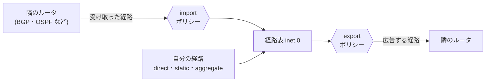

# J1 — ルーティング ポリシーの部品と、経路が通る道

J0 の最後に、OSPF が静的経路を広告しないのは誤りではなく、**既定のポリシー**がそう決めているからだと見ました。
この単元は、その決まりを自分のポリシーで変える方法です。どの経路を受け取り、どの経路を広告し、そのとき何を書き換えるかを、
Junos では 1 つの仕組み(ルーティング ポリシー)で書きます。単元は 3 つのページと付録に分かれています。

| ページ | 中身 | 課題 |
|---|---|---|
| このページ | ポリシーが効く場所、既定のポリシー、1 つの経路がポリシーを通る道、用語 | — |
| policy-statement: term と評価の順 | ポリシーの形、`from` と `then`、評価の順、term の順、OSPF への export、`test policy` | J1-1、J1-2 |
| route-filter: プレフィックスと長さで選ぶ | 一致の型、同じ term の中の最長一致、prefix-list | J1-3 |
| BGP にポリシーを当てる | BGP の最小の設定と既定のポリシー、拒んだ経路の行方、書く階層、属性の変更、集約経路 | J1-4、J1-5 |
| 付録 | 早見表、この仮想ルータの事情 | — |

ラボは JNT-02 です。JUN01 と JUN02 は Junos のルータ(vJunos-Evolved)で、J0 の範囲(アドレス・OSPF・静的経路)と、
JUN02 と FRR1 の間の BGP のセッションが組んであります。ポリシーは何もありません。FRR1 は ISP の役の FRRouting のルータで、
あなたは変更できません。SRV1 はサーバの役で、後ろにサーバの網 172.16.20.0/24 を持ちます。

:::topo
nodes:
  SRV1: {at: [0, 0], kind: host, label: "SRV1 (サーバ)"}
  JUN01: {at: [2.2, 0], label: "JUN01 (Junos)"}
  JUN02: {at: [4.4, 0], label: "JUN02 (Junos)"}
  FRR1: {at: [6.6, 0], label: "FRR1 (ISP・AS 64500)"}
links:
  - {a: SRV1, b: JUN01, la: "eth1 .10", lb: "et-0/0/1 .1", label: "172.16.10.0/24"}
  - {a: JUN01, b: JUN02, la: "et-0/0/0 .1", lb: "et-0/0/0 .2", label: "10.0.12.0/30"}
  - {a: JUN02, b: FRR1, la: "et-0/0/1 .1", lb: "eth1 .2", label: "10.0.23.0/30 eBGP"}
frames:
  - {label: "AS 65000 (OSPF area 0)", nodes: [JUN01, JUN02]}
:::

## 1. ルーティング ポリシーを覚えると何が嬉しいか

### 1.1 困りごと: 経路の出入りを選びたい

盤面には、選びたいことが 3 つあります。JUN01 は、サーバの網を OSPF で社内に伝えたいけれど、検証用の網は伝えたくありません。
ISP は、私的アドレスや細かすぎる経路を混ぜて送ってきます。ISP へは、社内の網を 1 本にまとめて送りたい。

何もしなければ、どれも思いどおりになりません。OSPF は経路表から何も広告しません。BGP は受け取った経路をすべて受け入れます。
選ぶ仕組みが要ります。

### 1.2 それ以前の手

IOS では、出入りを選ぶ道具がプロトコルと向きによって違います。OSPF へ入れるなら `redistribute` に route-map を付け、
BGP の隣から受け取る経路なら `neighbor … route-map … in` や `prefix-list`、`distribute-list` を使います。route-map は
シーケンス番号の順に調べ、どれにも当たらなかった経路は最後の暗黙の deny で捨てます。

IOS XR では、IOS XR トラックの M5 で見たとおり、RPL(`route-policy`)を付け所に当てます。どの文でも pass されず、書き換えも
されなかった経路は、ポリシーの終わりで捨てられます。ポリシーの無い eBGP の隣とは、何も交換しません。

### 1.3 Junos の答え

Junos は、どのプロトコルにも同じ仕組みを使います。

- ポリシーは `policy-options` の下に `policy-statement` として 1 度書きます。
- それをプロトコルに **import**(プロトコル → 経路表)か **export**(経路表 → プロトコル)として当てます。
- どのプロトコルにも**既定のポリシー**があり、自分のポリシーが決めなかった経路を最後に引き受けます。

最後の点が IOS・IOS XR との大きな違いです。自分のポリシーのどこにも当たらなかった経路は、そこで捨てられるとは限りません。
そのプロトコルの既定のポリシーに渡ります。

## 2. 仕組み: 部品と流れ

### 2.1 ポリシーが効く 2 つの場所と、既定のポリシー



**import** は、プロトコルが受け取った経路を経路表に入れる前に効きます。**export** は、経路表の経路をプロトコルが広告する前に
効きます。ですから、export で選べるのは経路表にある経路です。OSPF への export は、静的経路でも BGP の経路でも、
経路表にあるものから選べます。

OSPF と IS-IS はリンク ステートのプロトコルなので、受け取った LSA そのものを import で止めることはできません。
OSPF の import ポリシーが選べるのは経路表に入れる外部経路だけです。この単元では import は BGP で使います。

自分のポリシーが決めなかった経路は、既定のポリシーが決めます。J0 の表に、この単元で使う向きを足して並べます。

| プロトコル | 既定の import | 既定の export |
|---|---|---|
| OSPF | OSPF の経路をすべて受け入れる | すべて拒む(自分のインターフェースと学んだ経路は、export でなくフラッディングで伝わる) |
| BGP | 隣から受け取った経路をすべて受け入れる | 使っている BGP の経路を広告する。受け取った隣と同じ AS の eBGP の隣へは返さない。iBGP の決まりも守る |

この表のとおり、ポリシーが無い状態の JUN02 は ISP の 10 本の経路をすべて受け入れ、ISP へは何も広告していません。

```console
admin@jun02> show bgp summary
Threading mode: BGP I/O
Default eBGP mode: advertise - accept, receive - accept
Groups: 1 Peers: 1 Down peers: 0
Table          Tot Paths  Act Paths Suppressed    History Damp State    Pending
inet.0
                      10         10          0          0          0          0
Peer                     AS      InPkt     OutPkt    OutQ   Flaps Last Up/Dwn State|#Active/Received/Accepted/Damped...
10.0.23.2             64500         46         46       0       0       19:40 Establ
  inet.0: 10/10/10/0

admin@jun02> show route advertising-protocol bgp 10.0.23.2

admin@jun02>
```

ピアの下の `inet.0: 10/10/10/0` は、使っている・受け取った・受け入れた・抑えた経路の数です。広告は空です。

### 2.2 1 つの経路を追う: import の連鎖

ポリシーは import や export に**並べて**当てることができます。並べたものを**ポリシーの連鎖**と呼びます。ISP から来る
198.51.100.128/25 が、JUN02 の import `[ TAG-198 FILTER-IN ]` をどう通るかを追います。図の番号にカーソルを置く
(スマホは押す)と、その塊の設定が小窓に出て、下の設定例の行に色が付きます。

:::walk
legend: 線の上は BGP で届く経路。ポリシーは左から順に評価し、accept か reject が出たところで終わる。
rows:
  - {node: FRR1, say: ["~ISP が UPDATE で経路を送る"]}
  - {wire: "[[経路 198.51.100.128/25]] _AS パス 64500"}
  - panel: JUN02
    sub: ISP との境界
    items:
      - ref: 1
        head: "**group ISP の import** `import [ TAG-198 FILTER-IN ]`"
        say: ["並べた順に評価する。まず TAG-198"]
      - ref: 2
        head: "**TAG-198** 198.51.100.0/24 に印を付ける"
        match:
          - ["term t  from route-filter 198.51.100.0/24 exact", false, "当たらない(/25 は /24 そのものではない)"]
        then: ["→ どの term にも当たらないまま TAG-198 が終わる → 次のポリシー FILTER-IN へ"]
      - ref: 3
        head: "**FILTER-IN** 受け入れるものを絞る"
        match:
          - ["term PRIVATE  from route-filter 10.0.0.0/8 orlonger …", false, 当たらない]
          - ["term LEN  from route-filter 0.0.0.0/0 prefix-length-range /16-/24", false, "当たらない(長さ /25)"]
          - ["term REST  (from なし) then reject", true, "当たる → `reject`"]
      - {say: ["~経路表には残るが使われない(hidden・Rejected by import policy)"]}
  - {aside: "198.51.100.0/24 なら", say: ["②に当たる → local-preference 150・community 65000:200 を付ける。accept は書いていないので評価は続く → ③の LEN で `accept`"]}
  - {aside: "③の REST を書かないと", say: ["~FILTER-IN の終わりまで当たらない → 連鎖の終わり → BGP の既定(受け入れ) → /25 が使われる"]}
:::

:::config JUN02 — 受け取る経路に印を付けてから絞る(import の連鎖)
set policy-options community CUST members 65000:200                                  ## ② 付ける community に名前を付ける
set policy-options policy-statement TAG-198 term t from route-filter 198.51.100.0/24 exact   ## ② 198.51.100.0/24 そのものだけ
set policy-options policy-statement TAG-198 term t then local-preference 150          ## ② 属性を変えるだけ。accept は書かない
set policy-options policy-statement TAG-198 term t then community add CUST            ## ② 
set policy-options policy-statement FILTER-IN term PRIVATE from route-filter 10.0.0.0/8 orlonger     ## ③ 私的アドレスの 2 つの範囲
set policy-options policy-statement FILTER-IN term PRIVATE from route-filter 192.168.0.0/16 orlonger ## ③ 
set policy-options policy-statement FILTER-IN term PRIVATE then reject                ## ③ 当たったら拒んで評価を終える
set policy-options policy-statement FILTER-IN term LEN from route-filter 0.0.0.0/0 prefix-length-range /16-/24 ## ③ 長さが /16 から /24
set policy-options policy-statement FILTER-IN term LEN then accept                    ## ③ 当たったら受け入れて評価を終える
set policy-options policy-statement FILTER-IN term REST then reject                   ## ③ 残りすべてを拒む。無ければ BGP の既定(受け入れ)へ
set protocols bgp group ISP import [ TAG-198 FILTER-IN ]                              ## ① 並べた順に評価する
:::

結果の例: 受け入れたのは 4 本で、残りの 6 本は hidden です。

```console
admin@jun02> show route receive-protocol bgp 10.0.23.2 table inet.0

inet.0: 19 destinations, 19 routes (13 active, 0 holddown, 6 hidden)
  Prefix                  Nexthop              MED     Lclpref    AS path
* 172.31.0.0/16           10.0.23.2            0                  64500 I
* 192.0.2.0/24            10.0.23.2            0                  64500 I
* 198.51.100.0/24         10.0.23.2            0                  64500 I
* 203.0.113.0/24          10.0.23.2            0                  64500 I

admin@jun02> show route receive-protocol bgp 10.0.23.2 hidden table inet.0

inet.0: 19 destinations, 19 routes (13 active, 0 holddown, 6 hidden)
  Prefix                  Nexthop              MED     Lclpref    AS path
  0.0.0.0/0               10.0.23.2            0                  64500 I
  10.200.0.0/16           10.0.23.2            0                  64500 I
  100.64.0.0/10           10.0.23.2            0                  64500 I
  192.168.50.0/24         10.0.23.2            0                  64500 I
  198.18.0.0/15           10.0.23.2            0                  64500 I
  198.51.100.128/25       10.0.23.2            0                  64500 I
```

既定経路(/0)は LEN の長さの範囲に入らないので、REST に拒まれました。172.31.0.0/16 は私的アドレスですが、
PRIVATE に 172.16.0.0/12 を書いていないので受け入れられています。ポリシーは書いたとおりにしか働きません。

### 2.3 用語を並べる

| Junos の用語 | 何か | 身近なたとえ | IOS では | IOS XR では |
|---|---|---|---|---|
| policy-statement | 名前を付けたポリシー。`policy-options` の下に書く | 手順書 | route-map | route-policy |
| term | ポリシーの中の 1 つの規則。上から順に調べる | 手順書の 1 項目 | route-map の 1 つのシーケンス | `if` の 1 つの節 |
| from | 当たる条件 | 「次の場合は」 | `match` | `if` の条件 |
| then | 当たった時の動作 | 「こうする」 | `set` と permit・deny | `then` の中の文 |
| accept・reject | 評価を終わらせる動作(終端の動作) | 判子を押す | permit・deny | `done`・`drop` |
| 属性を変える動作 | metric・local-preference・community などを書き換える。評価は終わらない | 付箋を貼る | `set` | `set` |
| next term・next policy | 評価を次の term・次のポリシーへ進める(流れの制御) | 「次の項へ」 | `continue` に近い | —(文はそのまま次へ続く) |
| import・export | ポリシーを当てる向き | 入口と出口の検問 | `neighbor … in`・`redistribute` | `route-policy … in`・`out` |
| ポリシーの連鎖 | import・export に並べた複数のポリシー | 検問所の列 | —(1 か所に 1 つ) | —(1 か所に 1 つ。`apply` で呼ぶ) |
| 既定のポリシー | 連鎖の最後に控える、プロトコルごとの決まり | 最後の窓口 | 暗黙の deny(ここが違う) | 終わりで破棄(ここが違う) |
| route-filter | プレフィックスと長さの条件 | 宛名の範囲 | prefix-list の `ge`・`le` | prefix-set |

### 2.4 取り違えやすい点

- **当たらなかった経路は、ポリシーの終わりで捨てられるとは限らない。**連鎖の終わりで、そのプロトコルの既定のポリシーに渡る。
  BGP の import なら受け入れ、OSPF の export なら拒む。拒みたいなら、最後に `then reject` だけの term を書く。
- **属性を変えても評価は終わらない。**metric や local-preference を書いた term に当たっても、`accept` か `reject` が出るまで
  次の term、次のポリシーへ進む。
- **連鎖の前のポリシーが accept すると、後ろのポリシーは見られない。**印を付けるポリシーは、受け入れるポリシーより前に置く。
- **`set` で足した term は末尾に付く。**先に `then reject` だけの term があれば、後から足した term には届かない。
  並べ替えは `insert`。
- **`test policy` は当てた時の結果と違うことがある。**既定の動作を常に accept として数える(次のページの 2.8 節)。

### 2.5 盤面の上での分担

| 機器 | JNT-02 での役 | 練習すること |
|---|---|---|
| JUN01 | サーバの網(direct の 172.16.10.0/24・静的の 172.16.20.0/24)と検証用の網(静的・discard の 172.16.99.0/24)を持つ | OSPF への export(J1-1) |
| JUN02 | ISP との境界 | OSPF への export(J1-2)・BGP の import(J1-3・J1-5)・BGP の export と集約(J1-4) |
| FRR1 | ISP。変えられない | 経路を 10 本送ってくる。既定経路・公のアドレス・私的アドレス・/25 が混ざる |
| SRV1 | サーバ | 端から端まで届くかの確かめ(J1-4) |

### 2.6 押さえどころ

- ポリシーは 1 度書いて、import か export に当てる。どのプロトコルでも同じ書き方。
- 評価は term の順、連鎖の順。`accept` か `reject` で止まる。止まらなければ既定のポリシーへ。
- 既定のポリシーはプロトコルごとに違う。何を拒み、何を受け入れるかは、最後まで自分で書き切る。

## 実践

この単元の課題はラボ **JNT-02** にあります。各ページの最後に、そのページに対応する課題を示します。

<p class="tolab"><a href="/_learn?id=JNT-02">ワークスペースでラボ JNT-02 を開く</a></p>

:::note
出典: Juniper Networks『Routing Policies, Firewall Filters, and Traffic Policers User Guide』(2026-06-23 発行)の
「Default Routing Policies」(既定の import と export の表)と、ポリシーの連鎖の評価の節。『OSPF User Guide』(2026-06-18)の
import と export の節(既定の export は拒む、連鎖は accept か reject で終わる)。『BGP User Guide』(2026-07-09)の、
ポリシーの無い eBGP の既定(受け取りも広告も許す)と、受け取った経路を同じ AS の eBGP の隣へ返さない決まり。
IOS XR の振る舞いは IOS XR トラック M5 による。出力は containerlab の vJunos-Evolved(Junos OS Evolved 26.2R1.7)で取ったものです。
:::
