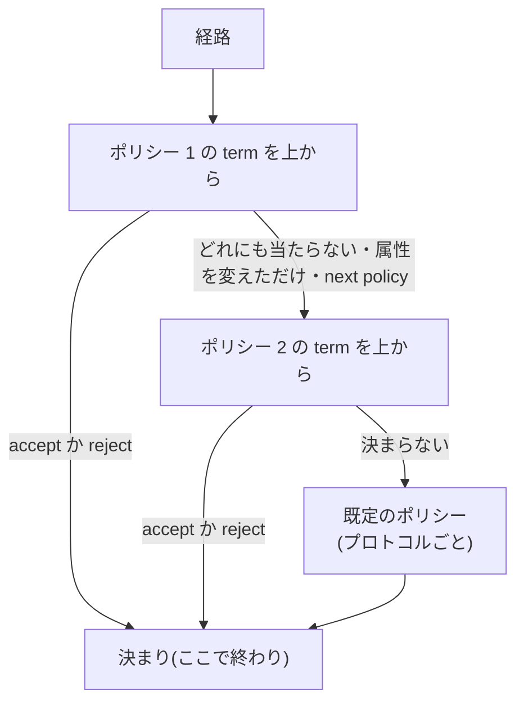

# J1 — policy-statement: term と評価の順

## 1. なぜ term に分けて書くのか

### 1.1 困りごと: 1 つの出口で、経路ごとに扱いを変えたい

JUN01 が OSPF へ出したいものを並べると、direct の網はそのまま、静的経路の網は metric を変えて、検証用の網は出さない、です。
出どころも扱いも違う経路を、OSPF という 1 つの出口に、1 つのポリシーで通したい。

### 1.2 それ以前の手

IOS では、出どころごとに `redistribute connected route-map …` と `redistribute static route-map …` を書き分けます。
route-map の中は、シーケンス番号の順に `match` と `set` を書き、`permit` か `deny` で決めます。どのシーケンスにも当たらなければ
暗黙の deny です。

IOS XR の RPL では、`if` … `elseif` … `else` を上から書き、`pass`・`done`・`drop` で決めます。終わりまでに受け入れも
書き換えもされなかった経路は捨てられます。

### 1.3 Junos の答え

Junos では、名前を付けた **term** を並べます。各 term は「当たる条件(`from`)」と「当たった時の動作(`then`)」の組です。
出どころ(`protocol direct`・`protocol static`)も条件の 1 つなので、1 つのポリシーで direct の網も静的経路も扱えます。
term は上から順に調べ、`accept` か `reject` が出たところで止まります。

## 2. 仕組み

### 2.1 policy-statement の形

設定の木の上では、ポリシーはこう並びます(`show policy-options` の形)。

```
policy-options {
    policy-statement 名前 {
        term 名前 {
            from {
                条件;
                条件;
            }
            then {
                動作;
                動作;
            }
        }
        term 名前 { … }
        then 動作;          ← term の後ろの then は、名前の無い最後の term
    }
}
```

- term の名前は自由です(`LAN`・`SRV`・`REST` など)。名前は評価に関係なく、並び順だけが効きます。
- `from` は省けます。`from` の無い term は、すべての経路に当たります。
- term の外の `then` は、最後に置かれる名前の無い term です。どの term にも当たらなかった経路に効きます。

作ったポリシーは 2 つの方法で見られます。設定モードの `show policy-options policy-statement 名前` は設定の形で、運用モードの
`show policy 名前` はルータが読み込んだ形で見せます。後者は、ポリシーがどこかで使われていると `[RESOLVED]` と出ます。

### 2.2 from: 同じ種類は OR、違う種類は AND

`from` に条件を並べると、**違う種類の条件はすべて当たる必要があり(AND)**、**同じ種類の値はどれか 1 つ当たればよい(OR)**
とされます。次の term は「出どころが static **か** aggregate で、**かつ** 172.16.0.0/12 の中」の経路に当たります。

```
term t {
    from {
        protocol [ static aggregate ];
        route-filter 172.16.0.0/12 orlonger;
    }
    then accept;
}
```

この盤面の JUN02 で試すと、当たったのは集約経路 172.16.0.0/16 の 1 本だけでした。JUN02 には 172.16.0.0/12 の中の静的経路が無く、
172.16.10.0/24 と 172.16.20.0/24 は出どころが OSPF だからです。

この単元でよく使う条件は次のとおりです。

| 条件 | 当たるもの |
|---|---|
| `protocol direct`・`static`・`ospf`・`bgp`・`aggregate` | 経路の出どころ。`show route` の `[Direct/0]` などの名前 |
| `route-filter プレフィックス 一致の型` | プレフィックスと長さ(次のページ) |
| `prefix-list 名前` | 名前を付けたプレフィックスの並び(次のページ) |
| `neighbor アドレス` | その隣から受け取った経路 |
| `community 名前` | その community を持つ経路 |

Juniper は、export ポリシーで `from` を省くと思わぬ結果になると注意しています。from の無い `then accept` だけのポリシーを
JUN01 の OSPF に当てると、direct の 172.16.10.0/24 と、静的経路の 172.16.20.0/24・172.16.99.0/24 の 3 本がすべて外部経路として
出ていきました。

### 2.3 then: 3 種類の動作

| 種類 | 動作 | 評価は |
|---|---|---|
| 終端の動作 | `accept`・`reject` | そこで終わる(このポリシーも、後ろのポリシーも見ない) |
| 流れの制御 | `next term`・`next policy` | 次の term へ・次のポリシーへ進む |
| 属性を変える動作 | `metric`・`external type`・`local-preference`・`community add`・`as-path-prepend` など | 書き換えて、**次の term へ進む** |

3 つ目が要です。属性を変える動作だけを書いた term は、当たっても評価を終わらせません。JUN01 の OSPF に次のポリシーを当てると、
172.16.20.0/24 は 1 つ目の term で metric 77 を付けられ、2 つ目の term で受け入れられました。

```
term SET {
    from {
        route-filter 172.16.20.0/24 exact;
    }
    then metric 77;           ← accept が無い。評価は次の term へ
}
term ACCEPT {
    from {
        protocol static;
    }
    then accept;
}
```

```console
admin@jun02> show ospf database external extensive
    OSPF AS SCOPE link state database
 Type       ID               Adv Rtr           Seq      Age  Opt  Cksum  Len
Extern   172.16.20.0      192.168.0.1      0x80000003    10  0x22 0x8d9a  36
  mask 255.255.255.0
  Topology default (ID 0)
    Type: 2, Metric: 77, Fwd addr: 0.0.0.0, Tag: 0.0.0.0
  Aging timer 00:59:49
  Installed 00:00:07 ago, expires in 00:59:50
  Last changed 00:00:07 ago, Change count: 3
Extern   172.16.99.0      192.168.0.1      0x80000001    10  0x22 0x2404  36
  mask 255.255.255.0
  Topology default (ID 0)
    Type: 2, Metric: 0, Fwd addr: 0.0.0.0, Tag: 0.0.0.0
```

検証用の 172.16.99.0/24 も 2 つ目の term(出どころが static)に当たり、metric 0 のまま出ています。

### 2.4 評価の順: term → 次のポリシー → 既定のポリシー

1 つの経路は、次の順に調べられます。



Juniper の言い方では「accept か reject の動作が実行されたところで、連鎖の評価は終わる」です。ですから、前のポリシーの最後に
`then accept` があると、後ろのポリシーには何も届きません。JUN02 の BGP の import を `[ A B2 ]` にし、B2 で 10.200.0.0/16 を
拒むように書いても、A の最後に `then accept` がある間は 10.200.0.0/16 が使われました。A の `then accept` を消すと、
10.200.0.0/16 は B2 に拒まれて hidden になりました。

どちらのポリシーも決めなかった経路は、既定のポリシーに渡ります。OSPF の export なら拒まれ、BGP の import なら受け入れられます。

`next policy` は、残りの term を飛ばして次のポリシーへ進めます。`next term` は次の term へ進めますが、これは何も書かない時の
振る舞いと同じなので、明示したい時に使います。

### 2.5 term の順と insert

`set` で term を足すと、そのポリシーの**末尾**に付きます。先に `then reject` だけの term を作ってから受け入れる term を足すと、
受け入れる term は reject の後ろに並び、何も受け入れません。

```console
admin@jun01# show policy-options policy-statement ORDER
term REST {
    then reject;
}
term LAN {
    from {
        route-filter 172.16.10.0/24 exact;
    }
    then accept;
}

admin@jun01# run test policy ORDER 172.16.0.0/16
Policy ORDER: 0 prefix accepted, 8 prefix rejected
```

並べ替えは `insert` です。`insert policy-options policy-statement ORDER term LAN before term REST` で LAN が REST の前に移り、
同じ試しで 3 本が accepted になりました(172.16.10.0/24 が inet.0・inet.2・inet.3 の 3 つの表にあるため。2.8 節)。

ポリシーの連鎖にも順があります。`set protocols ospf export 名前` は、すでにある並びの**後ろに足します**。
`export LAN-TO-OSPF` の後に `set protocols ospf export WIDE` を打つと、`export [ LAN-TO-OSPF WIDE ];` になりました。
並びを最初から書き直すなら、`delete protocols ospf export` の後に `set protocols ospf export [ X Y ]` と書きます。
`show configuration | display set` では、並びが 1 行ずつ、評価される順に出ます。

### 2.6 OSPF へ export する: 外部経路の型と metric

`set protocols ospf export 名前` で当てたポリシーが受け入れた経路は、OSPF の外部経路(type 5 の LSA)として広告されます。
既定では **type 2・metric 0** です。受け取った側では、外部経路の preference の 150 で経路表に入ります。

```console
admin@jun02> show ospf database external extensive
    OSPF AS SCOPE link state database
 Type       ID               Adv Rtr           Seq      Age  Opt  Cksum  Len
Extern   172.16.10.0      192.168.0.1      0x80000001    11  0x22 0xfa86  36
  mask 255.255.255.0
  Topology default (ID 0)
    Type: 2, Metric: 0, Fwd addr: 0.0.0.0, Tag: 0.0.0.0
```

型と metric は then で変えます。`then metric 50` と `then external type 1` で type 1・metric 50 になり、JUN02 では
JUN02 までの内部のコスト 1 を足した metric 51 になりました(3.1 節の例)。

```console
admin@jun02> show route 172.16.20.0/24

inet.0: 19 destinations, 19 routes (19 active, 0 holddown, 0 hidden)
+ = Active Route, - = Last Active, * = Both

172.16.20.0/24     *[OSPF/150] 00:00:09, metric 51, tag 0
                    >  to 10.0.12.1 via et-0/0/0.0
```

OSPF を動かしているインターフェースの網(J0 で area 0 に入れたリンクと lo0)は、export を書かなくても OSPF が自分で伝えます。
export が要るのは、それ以外の経路を外部経路として出す時です。

### 2.7 BGP の経路を OSPF へ

OSPF の export が選ぶのは経路表の経路なので、BGP で学んだ経路も選べます。`from protocol bgp` と route-filter で 1 本に絞ると、
その経路が BGP の経路表にある間だけ OSPF に出ます。JUN02 が ISP の網 203.0.113.0/24 だけを OSPF に出すポリシーは次のとおりです。

:::config JUN02 — BGP で学んだ 1 本の経路を OSPF へ
set policy-options policy-statement ISPNET-TO-OSPF term t from protocol bgp                   ## 出どころが BGP の経路
set policy-options policy-statement ISPNET-TO-OSPF term t from route-filter 203.0.113.0/24 exact ## そのうち 203.0.113.0/24 だけ(AND)
set policy-options policy-statement ISPNET-TO-OSPF term t then accept                          ## 
set protocols ospf export ISPNET-TO-OSPF                                                       ## ほかの BGP の経路は OSPF の既定(拒む)へ
:::

JUN01 は、これを OSPF の外部経路として学びます。

```console
admin@jun01> show route 203.0.113.0/24

inet.0: 10 destinations, 10 routes (10 active, 0 holddown, 0 hidden)
+ = Active Route, - = Last Active, * = Both

203.0.113.0/24     *[OSPF/150] 00:00:09, metric 0, tag 0
                    >  to 10.0.12.2 via et-0/0/0.0
```

ISP の group を `deactivate` して commit すると、JUN02 の BGP の経路が消え、JUN02 はこの外部経路を取り下げます
(`show ospf database external` で Age が 3600 になる)。JUN01 の経路表からも消えました。group を `activate` すると戻りました。
出す経路が BGP の経路そのものなので、ISP とのセッションに付いてきます。

`from protocol bgp` だけで route-filter を書かないと、ISP から受け取ったすべての経路が OSPF に出ます。

### 2.8 test policy の読み方と罠

`test policy 名前 プレフィックス` は、経路表の中でそのプレフィックスに含まれる経路を、ポリシーに通して見せます。
当てる前に試せる便利な道具ですが、3 つのことに気を付けます。

- **既定の動作を常に accept として数えます。**Juniper の文書も「test policy は常に accept を既定のポリシーとして使う」と書いています。
  OSPF の export なら拒まれる経路も、accepted に入ります。
- **inet.0 のほかの表も数えます。**inet.2・inet.3・mgmt_junos.inet.0 の経路も評価します。
- **使われていない(hidden の)経路は評価しません。**import で拒んだ経路を試すには、import を外してから試します。

3.1 節のポリシー(静的経路 172.16.20.0/24 だけを出す)を JUN01 で試すと、8 本が accepted になります。実際に OSPF に出るのは
1 本です。

```console
admin@jun01> test policy SRV-TO-OSPF 172.16.0.0/16

inet.0: 9 destinations, 9 routes (9 active, 0 holddown, 0 hidden)
+ = Active Route, - = Last Active, * = Both

172.16.10.0/24     *[Direct/0] 00:20:06
                    >  via et-0/0/1.0
172.16.10.1/32     *[Local/0] 00:20:06
                       Local via et-0/0/1.0
172.16.20.0/24     *[Static/5] 00:20:06
                    >  to 172.16.10.10 via et-0/0/1.0
172.16.99.0/24     *[Static/5] 00:21:12
                       Discard

inet.2: 5 destinations, 5 routes (5 active, 0 holddown, 0 hidden)
+ = Active Route, - = Last Active, * = Both

172.16.10.0/24     *[Direct/0] 00:20:06
                    >  via et-0/0/1.0
172.16.10.1/32     *[Local/0] 00:20:06
                       Local via et-0/0/1.0

inet.3: 5 destinations, 5 routes (5 active, 0 holddown, 0 hidden)
+ = Active Route, - = Last Active, * = Both

172.16.10.0/24     *[Direct/0] 00:20:06
                    >  via et-0/0/1.0
172.16.10.1/32     *[Local/0] 00:20:06
                       Local via et-0/0/1.0

Policy SRV-TO-OSPF: 8 prefix accepted, 0 prefix rejected
```

結果を確かめるなら、当てた後の出口を見ます。OSPF への export なら、隣での `show ospf database external`、BGP の export なら
`show route advertising-protocol bgp 隣`、BGP の import なら `show route receive-protocol bgp 隣` と、`hidden` を付けた同じものです。

### 2.9 commit で見つかる誤り

まだ無いポリシーや prefix-list を名指しすると、commit(と `commit check`)がはじきます。

```console
admin@jun01# set protocols ospf export NO-SUCH-POLICY

admin@jun01# commit check
[edit protocols]
  'ospf'
    warning: requires 'OSPF' license
  'policy-options'
    Policy error: Policy NO-SUCH-POLICY referenced but not defined
error: configuration check-out failed
```

`from prefix-list NO-SUCH-LIST` も、`Policy error: NO-SUCH-LIST prefix-list referenced (in term t) but not defined` で止まります。
名前の打ち間違いは、動かしてから気づくのでなく、commit の時点で分かります。

## 3. 設定例

### 3.1 OSPF へ静的経路を 1 つ、type 1 で

JUN01 の静的経路のうち、サーバの網 172.16.20.0/24 だけを、type 1・metric 50 の外部経路として OSPF へ出します。

:::config JUN01 — 静的経路を 1 つ選んで OSPF へ
set policy-options policy-statement SRV-TO-OSPF term SRV from protocol static                  ## 出どころが静的経路
set policy-options policy-statement SRV-TO-OSPF term SRV from route-filter 172.16.20.0/24 exact ## そのうち 172.16.20.0/24 だけ(AND)
set policy-options policy-statement SRV-TO-OSPF term SRV then metric 50                        ## 外部経路の metric
set policy-options policy-statement SRV-TO-OSPF term SRV then external type 1                  ## type 1(内部のコストを足して比べる)
set policy-options policy-statement SRV-TO-OSPF term SRV then accept                           ## ここで決める。ほかは OSPF の既定(拒む)へ
set protocols ospf export SRV-TO-OSPF                                                          ## OSPF の出口に当てる
:::

```console
admin@jun02> show ospf database external extensive
    OSPF AS SCOPE link state database
 Type       ID               Adv Rtr           Seq      Age  Opt  Cksum  Len
Extern   172.16.20.0      192.168.0.1      0x80000001     9  0x22 0xfec6  36
  mask 255.255.255.0
  Topology default (ID 0)
    Type: 1, Metric: 50, Fwd addr: 0.0.0.0, Tag: 0.0.0.0
  Aging timer 00:59:50
  Installed 00:00:08 ago, expires in 00:59:51
  Last changed 00:00:08 ago, Change count: 1
```

### 3.2 IOS・IOS XR から Junos へ

| IOS では | IOS XR では | Junos では |
|---|---|---|
| `route-map 名前 permit 10` | `route-policy 名前` | `policy-statement 名前 term 名前` |
| `match ip address prefix-list P` | `if destination in P then` | `from route-filter …`・`from prefix-list P` |
| `match` に出どころは無い。`redistribute static route-map …` で出どころごとに分ける | 付け所ごとに分ける | `from protocol static` |
| `set metric 50`・`set metric-type type-1` | `set …` | `then metric 50`・`then external type 1` |
| permit・deny | `done`・`drop` | `then accept`・`then reject` |
| どのシーケンスにも当たらない: 暗黙の deny | 終わりまで受け入れなし: 破棄 | 連鎖の終わり: プロトコルの既定のポリシー |
| `router ospf 1` の `redistribute static subnets route-map 名前` | `router ospf` の `redistribute static route-policy 名前` | `set protocols ospf export 名前` |

## 実践

ラボ **JNT-02** に移り、課題 J1-1 と J1-2 に取り組みます。

<p class="tolab"><a href="/_learn?id=JNT-02">ワークスペースでラボ JNT-02 を開く</a> — <a href="12-j1-practice.html">課題</a></p>

:::note
出典: Juniper Networks『Routing Policies, Firewall Filters, and Traffic Policers User Guide』(2026-06-23)のポリシーの構造・
term・終端の動作と流れの制御・連鎖の評価の節、「Testing a Routing Policy」(test policy は常に accept を既定として使う)。
『OSPF User Guide』(2026-06-18)の import と export の節(既定の export は拒む・export で from を省くと思わぬ結果になる・
既定は type 2 の外部 metric)。IOS XR の振る舞いは IOS XR トラック M5 による。出力は containerlab の vJunos-Evolved
(Junos OS Evolved 26.2R1.7)で取ったものです。
:::
