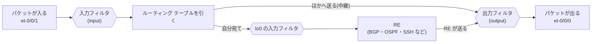

# J2 — firewall filter の部品と、パケットが通る道

J1 では、ルーティング ポリシーで**経路**の出入りを選びました。この単元で選ぶのは**パケット**です。どのパケットを通し、
どれを捨て、捨てたものをどう数えて記録するかを、Junos では firewall filter で書きます。形は J1 のポリシーとよく似ていて、
term を並べ、`from` で当て、`then` で決めます。単元は 3 つのページと付録に分かれています。

| ページ | 中身 | 課題 |
|---|---|---|
| このページ | フィルタが効く場所、1 つのパケットがフィルタを通る道、用語 | — |
| firewall filter: term とアクション | 照合の条件、アクション、末尾の暗黙の discard、discard と reject、term の順、戻りの通信、インターフェースへの当て方 | J2-1、J2-2 |
| RE を守る: lo0 フィルタ | RE が受け取る通信、lo0 に当てる、apply-path、自分が始めた通信の戻り、管理ポート | J2-3 |
| 並べる・記録する | フィルタ リスト、prefix-list と except、カウンタ・log・syslog、policer | J2-4、J2-5 |
| 付録 | 早見表、この仮想ルータの事情 | — |

ラボは JNT-03 です。JUN01 と JUN02 は Junos のルータ(vJunos-Evolved)で、J1 を解き終えた状態から始まります。
firewall filter は何もありません。FRR1 は ISP の役のルータ、NET1 は ISP の先にいるインターネットの端末の役です。
SRV1 はサーバの役で、TCP の 80 番と 443 番で Web を、22 番で SSH を待っています。NET1 は 8080 番で Web を待っています。

:::topo
nodes:
  SRV1: {at: [0, 0], kind: host, label: "SRV1 (サーバ)"}
  JUN01: {at: [2.2, 0], label: "JUN01 (Junos)"}
  JUN02: {at: [4.4, 0], label: "JUN02 (Junos)"}
  FRR1: {at: [6.6, 0], label: "FRR1 (ISP・AS 64500)"}
  NET1: {at: [8.8, 0], kind: host, label: "NET1 (インターネット)"}
links:
  - {a: SRV1, b: JUN01, la: "eth1 .10", lb: "et-0/0/1 .1", label: "172.16.10.0/24"}
  - {a: JUN01, b: JUN02, la: "et-0/0/0 .1", lb: "et-0/0/0 .2", label: "10.0.12.0/30"}
  - {a: JUN02, b: FRR1, la: "et-0/0/1 .1", lb: "eth1 .2", label: "10.0.23.0/30 eBGP"}
  - {a: FRR1, b: NET1, la: "eth2 .1", lb: "eth1 .2", label: "192.0.2.0/30"}
frames:
  - {label: "AS 65000 (OSPF area 0)", nodes: [JUN01, JUN02]}
:::

## 1. firewall filter を覚えると何が嬉しいか

### 1.1 困りごと: 通してよい通信を選びたい

J1 で経路を整えたので、NET1 から社内のどこへでも届くようになりました。届きすぎています。初めの盤面で NET1 から TCP で
つないでみると、サーバの Web だけでなく、サーバの SSH にも、JUN01 と JUN02 の SSH にもつながります。

| NET1 から | 宛先 | 結果 |
|---|---|---|
| 198.51.100.10 | SRV1 の Web(172.16.20.1 の 80 番) | つながる |
| 198.51.100.10 | SRV1 の SSH(172.16.20.1 の 22 番) | つながる |
| 198.51.100.10 | JUN01 の SSH(172.16.10.1 の 22 番) | つながる |
| 198.51.100.10 | JUN02 の SSH(10.0.23.1 の 22 番) | つながる |

外から入ってよい通信を選ぶ仕組みと、ルータ自身を守る仕組みが要ります。

### 1.2 それ以前の手

IOS では ACL を使います。拡張 ACL に permit と deny の行を並べ、`ip access-group 名前 in` でインターフェースに当てます。
行は上から調べ、どの行にも当たらなかったパケットは最後の暗黙の deny で捨てます。ルータ自身へ来る通信は、
vty の `access-class` や CoPP(control plane に当てる policy-map)で別に絞ります。

IOS XR でも ACL(`ipv4 access-list`)を `ipv4 access-group` でインターフェースに当てます。ルータ自身へ来る通信は、
IOS XR トラックの M2 で見た LPTS と管理プレーン保護(MPP)が受け持ちます。

### 1.3 Junos の答え

Junos は、インターフェースを通るパケットも、ルータ自身へ来るパケットも、同じ firewall filter で絞ります。

- フィルタは `firewall family inet filter 名前` の下に、term を並べて 1 度書きます。term の形は J1 のポリシーと同じです。
- それをインターフェースの論理ユニットのファミリーに、**input**(入る向き)か **output**(出る向き)として当てます。
- ルータ自身(RE)を守るときは、同じフィルタを **lo0** に当てます。どのインターフェースから来たパケットでも、
  RE へ届く前にそこを通ります。

firewall filter は**ステートレス**です。1 つずつのパケットを、そのパケットの中身だけで判断します。行きを通したからといって、
戻りが自動で通るわけではありません。

## 2. 仕組み: 部品と流れ

### 2.1 フィルタが効く場所



インターフェースに入ったパケットは、まずそのインターフェースの入力フィルタを通ります。ルーティング テーブルを引いて中継するなら、
出ていくインターフェースの出力フィルタを通ります。自分宛てなら、lo0 の入力フィルタを通って RE に届きます。

ですから、RE 行きのパケットは、入ってきたインターフェースの入力フィルタと lo0 フィルタの**両方**を通ります。
中継するパケットは lo0 フィルタを通りません。RE が送るパケットも、出ていくインターフェースの出力フィルタを通ります。

### 2.2 1 つのパケットを追う

JUN01 のサーバのネットワークへ出る向きに、フィルタ TO-SERVERS を当てた例です。NET1 から SRV1 の 443 番へ来たパケットを追います。
図の番号にカーソルを置く(スマホは押す)と、そのブロックの設定が小窓に出て、下の設定例の行に色が付きます。

:::walk
legend: 線の上は IP パケット。フィルタの term は上から順に調べ、終端アクション(accept・discard など)が出たところで終わる。
rows:
  - {node: NET1, say: ["~198.51.100.10 から SRV1 の Web へ TCP の SYN を送る"]}
  - {wire: "[[TCP 198.51.100.10 → 172.16.20.1:443]] _SYN"}
  - {node: JUN02, say: ["~フィルタは無い。ルーティング テーブルを引いて JUN01 へ送る"]}
  - panel: JUN01
    sub: サーバのネットワークへ出るインターフェース
    items:
      - ref: 1
        head: "**et-0/0/1 の出力** `filter output TO-SERVERS`"
        say: ["ルーティング テーブルを引いた結果、et-0/0/1 から出す。出る前に TO-SERVERS を通す"]
      - ref: 2
        head: "**TO-SERVERS** term を上から"
        match:
          - ["term ICMP  from protocol icmp", false, "当たらない(TCP)"]
          - ["term WEB  from destination-address 172.16.20.0/24・protocol tcp・destination-port http", false, "当たらない(443 番は http でない)"]
          - ["term LAST  (from なし)", true, "当たる → `count TO-SERVERS-DROP`・`discard`"]
      - {say: ["~パケットは捨てられ、NET1 には何も返らない(3 秒待って timeout)"]}
  - {aside: "80 番なら", say: ["②の WEB に当たる → `count WEB-IN`・`accept` → SRV1 へ届く"]}
  - {aside: "③の LAST を書かないと", say: ["~どの term にも当たらないまま終わる → 末尾の暗黙の discard。結果は同じだが、数えられない"]}
:::

:::config JUN01 — サーバのネットワークへ出る通信を絞る(出力フィルタ)
set firewall family inet filter TO-SERVERS term ICMP from protocol icmp                       ## ② ICMP はすべて通す
set firewall family inet filter TO-SERVERS term ICMP then accept                              ## ② 
set firewall family inet filter TO-SERVERS term WEB from destination-address 172.16.20.0/24   ## ② サーバのネットワークの
set firewall family inet filter TO-SERVERS term WEB from protocol tcp                         ## ② TCP の
set firewall family inet filter TO-SERVERS term WEB from destination-port http                ## ② 80 番だけ(違う種類の条件は AND)
set firewall family inet filter TO-SERVERS term WEB then count WEB-IN                         ## ② 数えてから
set firewall family inet filter TO-SERVERS term WEB then accept                               ## ② 通す
set firewall family inet filter TO-SERVERS term LAST then count TO-SERVERS-DROP               ## ③ 残りすべてを数えて
set firewall family inet filter TO-SERVERS term LAST then discard                             ## ③ 黙って捨てる
set interfaces et-0/0/1 unit 0 family inet filter output TO-SERVERS                           ## ① et-0/0/1 から出るパケットに当てる
:::

結果の例: 80 番はつながり、443 番は 3 秒待って timeout になります。ping は通ります。

```console
net1:/# probe 172.16.20.1 80 -s 198.51.100.10
open  tcp 172.16.20.1:80 from 198.51.100.10  0.00s
net1:/# probe 172.16.20.1 443 -s 198.51.100.10
timeout  tcp 172.16.20.1:443 from 198.51.100.10  3.00s

admin@jun01> show firewall filter TO-SERVERS
Filter: TO-SERVERS
Counters:
Name                                                                            Bytes              Packets
TO-SERVERS-DROP                                                                   480                    8
WEB-IN                                                                            320                    6
```

`probe` は、この盤面の SRV1・NET1 で使える道具です。TCP でつないでみて、どう返ってきたかを 1 語で出します。
`timeout` は途中で黙って捨てられたこと、`refused` は相手の機器までは届いたことを表します(次のページの 2.5 節)。

### 2.3 用語を並べる

| Junos の用語 | 何か | 身近なたとえ | IOS では | IOS XR では |
|---|---|---|---|---|
| firewall filter | 名前を付けたパケットの規則の集まり。`firewall family inet` の下に書く | 門の通行規則 | 拡張 ACL | ACL(`ipv4 access-list`) |
| term | フィルタの中の 1 つの規則。上から順に調べる | 規則の 1 項目 | ACL の 1 行 | ACL の 1 行 |
| from | 当たる条件(アドレス・プロトコル・ポートなど) | 「次のパケットは」 | 行の中の条件 | 行の中の条件 |
| then | 当たった時のアクション | 「こうする」 | permit・deny | permit・deny |
| accept・discard・reject | 評価を終わらせるアクション(終端アクション)。通す・黙って捨てる・捨てて ICMP を返す | 通す・止める・止めて伝える | permit・deny | permit・deny |
| count・log・syslog | 数える・記録するアクション。評価は終わらない | 通行の記録をつける | ACL の行ごとのカウンタ・`log` | 同じ |
| 末尾の暗黙の discard | どの term にも当たらなかったパケットを捨てる決まり | 規則に無ければ通さない | 暗黙の deny | 暗黙の deny |
| input・output | フィルタを当てる向き | 入口の門・出口の門 | `ip access-group … in`・`out` | `ipv4 access-group … ingress`・`egress` |
| lo0 フィルタ | RE へ届くパケットを絞るフィルタ | 本部の受付 | CoPP・vty の `access-class` | LPTS・MPP |
| フィルタ リスト | 1 つの向きに並べた複数のフィルタ(`input-list`) | 門を 2 つ続けて置く | —(1 か所に 1 つ) | —(1 か所に 1 つ) |

### 2.4 取り違えやすい点

- **ルーティング ポリシーと firewall filter は別のもの。**ポリシーは経路を選び、フィルタはパケットを選ぶ。どちらにも
  term・from・then があるが、書く場所(`policy-options` と `firewall`)も当てる場所も違う。同じ `reject` も、ポリシーでは
  「経路を受け入れない」、フィルタでは「捨てて ICMP を返す」。
- **当たらなかったパケットは捨てられる。**J1 のデフォルト ポリシーと違い、フィルタの末尾はプロトコルに関係なく暗黙の discard。
  捨てた数を数えたいなら、最後に `count` と `discard` の term を自分で書く。
- **戻りは自動で通らない。**ステートレスなので、外へ始めた TCP の戻り(SYN と ACK)も、入る向きのフィルタで判断される。
- **RE 行きは、インターフェース フィルタと lo0 フィルタの両方を通る。**片方で通しても、もう片方で捨てれば届かない。
- **`set` で足した term は末尾に付く。**先に「残りすべてを捨てる」term があれば、後から足した term には届かない。並べ替えは
  `insert`(J1 のポリシーと同じ)。

### 2.5 盤面の上での分担

| 機器 | JNT-03 での役 | 練習すること |
|---|---|---|
| JUN01 | 社内のルータ。サーバのネットワーク(172.16.10.0/24)につながる | 読み物の設定例をここで組む |
| JUN02 | ISP との境界 | ISP からの入口(J2-1・J2-2・J2-4)・RE を守る(J2-3)・記録(J2-5) |
| FRR1 | ISP。変えられない | JUN02 と BGP を張る。NET1 へ中継する |
| NET1 | インターネットの端末。変えられない | 送信元を 4 つ使い分けて、外からの通信を送る。8080 番で Web を待つ |
| SRV1 | サーバ。変えられない | 80 番・443 番で Web、22 番で SSH を待つ。中から外への通信を送る |

### 2.6 押さえどころ

- フィルタは 1 度書いて、インターフェースの input か output に当てる。RE を守るなら lo0 に当てる。
- term は上から調べ、終端アクションで止まる。どれにも当たらなければ捨てる。
- ステートレス。戻りの通信も、ルータ自身へ来る通信も、通したいものはすべて自分で書く。

## 実践

この単元の課題はラボ **JNT-03** にあります。各ページの最後に、そのページに対応する課題を示します。

<p class="tolab"><a href="/_learn?id=JNT-03">ワークスペースでラボ JNT-03 を開く</a></p>

:::note
出典: Juniper Networks『Routing Policies, Firewall Filters, and Traffic Policers User Guide』(2026-06-23 発行)の
stateless firewall filter の構成要素・評価の順(term に動作が無ければ暗黙の accept・末尾は暗黙の discard)・
インターフェースと lo0 への当て方の節。IOS XR の振る舞いは IOS XR トラック M2 と M12 による。
出力は containerlab の vJunos-Evolved(Junos OS Evolved 26.2R1.7)で取ったものです。
:::
