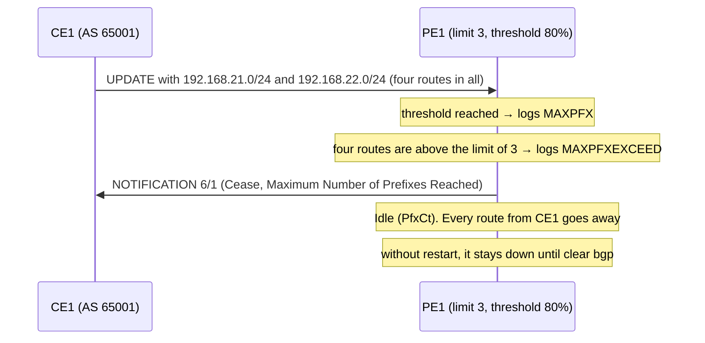
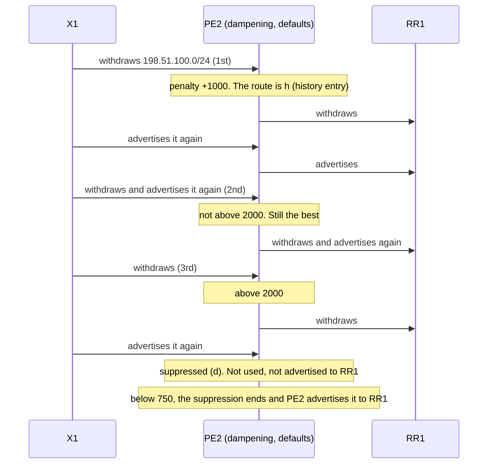

# M6 supplement — Not taking too much: prefix limits, dampening and aggregation

The previous two pages handed out a backup path and protected the sessions with other ASes. This page is about the
amount of routing that travels over those sessions: maximum-prefix, which puts a ceiling on the number of routes
accepted from a customer; dampening, which leaves a route that keeps flapping unused for a while; and aggregation,
which sends the customer's addresses out as one route.

Tasks M6-9 and M6-10 of lab XRT-17 use them. In the blueprint they are 1.5.c, BGP prefix suppression, but no Cisco
document defines that term, so this supplement takes it to mean these three (IOS XE's `bgp suppress-inactive`, which
has a similar name, is in the [Appendix](69-m6-appendix.html)). Route policies were covered in M5, and the neighbor
address family in the main M6 page.

## 1. What it is good for

### 1.1 The problem: customer mistakes, flapping routes, routes that are too specific

The provider on XRT-17 (AS 65000) connects to the customer CE1 (AS 65001) at PE1, and to X1 and X2 in AS 65100 at PE2
and PE3. CE1 advertises its two LANs, 192.168.1.0/24 and 192.168.2.0/24, and X1 advertises its own customer,
198.51.100.0/24. PE2 sets the local preference of the routes it learns from X1 to 200, so PE2 is the primary exit to
AS 65100.

:::topo
nodes:
  CE1: {at: [0, 1], kind: host, label: "CE1 (AS 65001)"}
  PE1: {at: [2.2, 1], label: "PE1 (customer edge)"}
  P1: {at: [4.2, 1], label: "P1 (no BGP)"}
  RR1: {at: [4.2, 2.5], label: "RR1 (route reflector)"}
  PE2: {at: [6.2, 0], label: "PE2 (primary exit)"}
  PE3: {at: [6.2, 2], label: "PE3 (backup exit)"}
  X1: {at: [8.4, 0], label: "X1"}
  X2: {at: [8.4, 2], label: "X2"}
links:
  - {a: CE1, b: PE1, label: "192.168.1.0/24\n192.168.2.0/24"}
  - {a: PE1, b: P1, label: "10.0.1.0/24"}
  - {a: P1, b: PE2, label: "10.0.2.0/24"}
  - {a: P1, b: PE3, label: "10.0.3.0/24"}
  - {a: P1, b: RR1, label: "10.0.21.0/24"}
  - {a: PE2, b: X1, label: "172.16.2.0/24\n198.51.100.0/24 arrives"}
  - {a: PE3, b: X2, label: "172.16.3.0/24"}
  - {a: X1, b: X2, label: "iBGP"}
frames:
  - {label: "AS 65000", nodes: [PE1, P1, RR1, PE2, PE3]}
  - {label: "AS 65100", nodes: [X1, X2]}
:::

There are three eBGP sessions with other ASes, and every route policy on them passes everything. The trouble comes
from what travels over those sessions.

**Customer mistakes.** PE1 accepts every route CE1 sends, hands them to PE2 and PE3 through RR1, and PE2 and PE3
advertise them to AS 65100. If someone misconfigures CE1 and puts the whole internal table into BGP, all of it spreads
along the same path. PE1 has no brake on how many it accepts. With no limit, there is no such thing as too many.

**Flapping routes.** If X1's customer line is unstable and 198.51.100.0/24 keeps disappearing and coming back (it
flaps), PE2 sends a withdrawal and an advertisement to RR1 each time. RR1 reflects them to PE1 and PE3, and every router
that receives them chooses its best path again. One route is flapping; everyone chooses again.

**Routes that are too specific.** In the other direction, PE2 and PE3 advertise CE1's two routes to X1 and X2 as they
are. Each new customer LAN adds one more line to the tables in AS 65100. If the customer's addresses fit in one range,
one route for that range is all the outside needs.

### 1.2 What came before: adding filters by hand

Filters can deal with each of these. A prefix-set listing the customer's prefixes in PE1's inbound route policy from
CE1 keeps every other route out (M5). But PE1's configuration then has to change every time the customer adds a LAN,
and a forgotten change drops correct routes too. The list stops correct changes exactly as firmly as it stops mistakes.

A flapping route is awkward for a filter. The route itself is correct, so stopping it means someone who notices the
flapping adds a filter by hand and removes it once things calm down. Forget to remove it, and the route stays away
after the flapping has stopped. A filter has no expiry date written on it.

To send one summarised route, you create the range with a static route to Null0, put it into BGP with `network`, and
write an outbound filter that stops the more specific routes for each neighbor. With two exits, PE2 and PE3, both need
it. The static route stays there even when every customer route is gone.

### 1.3 The answer: cut by count, count the flaps, send one route

- **Cut by count (maximum-prefix)**: PE1 counts only the number of routes it receives from CE1, and tears the session
  down once the number goes above the limit. It does not look at the contents, so within the limit the customer can add
  LANs without a configuration change. It is a brake separate from the route policy.
- **Count the flaps (dampening)**: PE2 keeps a penalty for each route from X1 that grows with every flap, and leaves a
  route unused and unadvertised for a while once the penalty passes a threshold. The penalty falls over time, and the
  route comes back on its own when it has fallen far enough.
- **Send one route (aggregation)**: PE2 creates a route for the whole range and advertises it, for as long as a route
  inside the range is in the BGP table. With `summary-only`, the more specific routes are not advertised.

All three act only inside the router where they are configured. Nothing changes on CE1 or X1, and unlike GTSM and
TCP-AO the two ends do not have to match.

## 2. How it works

This page follows each of the three features on a route on the board: section 2.1 the number of routes from CE1 to
PE1, section 2.2 X1's 198.51.100.0/24 arriving at PE2, and section 2.3 the customer's addresses leaving PE2 towards X1.
The values differ from the tasks: a limit of 3 routes, dampening with its defaults, and 192.168.0.0/16 as the range.

### 2.1 The prefix limit

maximum-prefix counts the routes received from one neighbor in one address family. This is PE1's neighbor CE1 after
a limit of 3 routes and a warning threshold of 80% have been configured (excerpt). CE1 is sending two routes.

```console
RP/0/RP0/CPU0:PE1#show bgp neighbor 172.16.1.1
...
 For Address Family: IPv4 Unicast
...
  2 accepted prefixes, 2 are bestpaths
...
  Maximum prefixes allowed 3
  Threshold for warning message 80%, restart interval 0 min
...
  Additional-paths operation: None
```

When the number of routes reaches the threshold, a percentage of the limit (75% by default), PE1 logs a warning. When
it goes above the limit, PE1 by default sends a Cease NOTIFICATION and tears the session down, and every route received
from that neighbor goes away. `restart interval 0 min` means that PE1 will not re-establish the session by itself.

On a neighbor that sends additional paths, each path with its own path ID counts separately (BGP Command Reference for
Cisco 8000). Two paths for the same prefix count as two. The eBGP session between PE1 and CE1 does not negotiate
ADD-PATH (`Additional-paths operation: None` above), so on this board one prefix is one route.

A neighbor without `maximum-prefix` shows neither of the two limit lines. The documents disagree about the limit that
applies when nothing is configured (section 6.2 of the [Appendix](69-m6-appendix.html)), so this supplement always sets one.

If CE1 gets two more loopbacks, each advertised with `network`, CE1 sends four routes, one more than the limit of 3.

```console
CE1(config)#interface Loopback21
CE1(config-if)#ip address 192.168.21.1 255.255.255.0
CE1(config-if)#interface Loopback22
CE1(config-if)#ip address 192.168.22.1 255.255.255.0
CE1(config-if)#router bgp 65001
CE1(config-router)#address-family ipv4
CE1(config-router-af)#network 192.168.21.0
CE1(config-router-af)#network 192.168.22.0
CE1(config-router-af)#end
```

From there it goes in this order.



What PE1 and CE1 record (excerpt):

```console
RP/0/RP0/CPU0:PE1#show bgp summary
...
Neighbor        Spk    AS MsgRcvd MsgSent       TblVer  InQ OutQ  Up/Down  St/PfxRcd
172.16.1.1        0 65001     156     172            0    0    0 00:00:05  Idle (PfxCt)
RP/0/RP0/CPU0:PE1#show logging last 20
...
RP/0/RP0/CPU0:Nov 21 08:38:59.128 UTC: bgp[1084]: %ROUTING-BGP-5-MAXPFX : No. of IPv4 Unicast prefixes received from 172.16.1.1 has reached 3, max 3 
RP/0/RP0/CPU0:Nov 21 08:38:59.128 UTC: bgp[1084]: %ROUTING-BGP-4-MAXPFXEXCEED : No. of IPv4 Unicast prefixes received from 172.16.1.1: 4 exceed limit 3 
RP/0/RP0/CPU0:Nov 21 08:38:59.128 UTC: bgp[1084]: %ROUTING-BGP-5-ADJCHANGE : neighbor 172.16.1.1 Down - Peer exceeding maximum prefix limit (CEASE notification sent - maximum number of prefixes reached) (VRF: default) (AS: 65001) 
...
CE1#show logging | include BGP|MAXPFX|NOTIFICATION
*Nov 21 08:38:59.129: %BGP-3-NOTIFICATION: received from neighbor 172.16.1.254 6/1 (Maximum Number of Prefixes Reached) 6 bytes 01010000 0003
*Nov 21 08:38:59.129: %BGP-5-NBR_RESET: Neighbor 172.16.1.254 reset (BGP Notification received)
*Nov 21 08:38:59.129: %BGP-5-ADJCHANGE: neighbor 172.16.1.254 Down BGP Notification received
...
```

PE1 logs the threshold warning, the record of four routes exceeding 3, and the session going down, all at the same
moment. What CE1 receives is a NOTIFICATION with error code 6 (Cease) and subcode 1, and IOS XE shows the reason as
`Maximum Number of Prefixes Reached`.

It took a little over 20 seconds from adding the routes on CE1 to PE1 tearing the session down. During that time
`show bgp summary` on PE1 still showed CE1 established with two routes, and CE1 received the NOTIFICATION only
afterwards. CE1 (IOS XE) did not send the new routes at once. PE1 is not slow; the routes have not arrived yet.

With `restart <minutes>`, PE1 re-establishes the session by itself the given number of minutes after tearing it down.
With `restart 1` and the limit still at 3, PE1 re-established the session after about a minute, CE1 sent its four
routes again, and the session went down again. Here are two displays taken 1 minute 13 seconds apart (excerpt).

```console
RP/0/RP0/CPU0:PE1#show bgp summary
...
Neighbor        Spk    AS MsgRcvd MsgSent       TblVer  InQ OutQ  Up/Down  St/PfxRcd
172.16.1.1        0 65001     171     191            0    0    0 00:00:12  Idle (PfxCt)
RP/0/RP0/CPU0:PE1#show bgp summary
...
Neighbor        Spk    AS MsgRcvd MsgSent       TblVer  InQ OutQ  Up/Down  St/PfxRcd
172.16.1.1        0 65001     175     194            0    0    0 00:00:22  Idle (PfxCt)
```

In the second display MsgRcvd and MsgSent have grown and Up/Down has started counting again: in between, the session
came up once and went down again. Until the customer fixes it, CE1 receives the same NOTIFICATION a little more than a
minute apart.

### 2.2 Dampening: penalty and half-life

Dampening (route flap dampening, RFC 2439) keeps a number called the penalty for each route. Each time the route flaps
(each time it is withdrawn) 1000 is added, and the penalty falls over time. How fast it falls is set by the half-life:
with the default of 15 minutes, it is half after 15 minutes and a quarter after 30.

When the penalty goes above the suppress value (2000 by default), the route is suppressed. A suppressed route stays in
the table, but it is not chosen as best and not advertised. When the penalty has fallen below the reuse value (750 by
default), the suppression ends. But a route stays suppressed no longer than the maximum suppress time (by default four
times the half-life, 60 minutes).

While the route is withdrawn it does not leave the table: it stays as `h` (history entry), to keep the penalty. When the
penalty falls below half the reuse value, the record is removed altogether.

RFC 2439 says this technique is applied only to routes received from eBGP peers, because applying it to routes learned
over iBGP can result in routing loops. Cisco's documents also say that no penalty is applied when a peer reset
withdraws the route. What is counted is the route flapping, not the session.

When X1's 198.51.100.0/24 flaps three times at PE2, it goes like this.



When X1 withdrew 198.51.100.0/24 towards PE2 and brought it back three times within about a minute, PE2 suppressed it
after the third time. The flaps were made on X1 by applying and removing an outbound prefix list towards PE2 that denies
this route, each time followed by `clear ip bgp 172.16.2.254 soft out`. This is what PE2 shows (excerpt).

```console
RP/0/RP0/CPU0:PE2#show bgp 198.51.100.0/24
BGP routing table entry for 198.51.100.0/24
...
Paths: (2 available, best #1)
  Not advertised to any peer
  Path #1: Received by speaker 0
  Not advertised to any peer
  65100
    10.255.0.3 (metric 20) from 10.255.0.21 (10.255.0.3)
      Origin IGP, localpref 100, valid, internal, best, group-best
...
  Path #2: Received by speaker 0
  Not advertised to any peer
  65100, (suppressed due to dampening)
    172.16.2.1 from 172.16.2.1 (10.100.255.1)
      Origin IGP, metric 0, localpref 200, valid, external
...
      Dampinfo: penalty 2929, flapped 3 times in 00:01:01, reuse in 00:29:30
                half life 00:15:00, suppress value 2000, reuse value 750
                Maximum suppress time 01:00:00
```

The `Dampinfo` lines lay out the numbers above as they are. The penalty of 2929 is the 3000 of three flaps, reduced
over the 1 minute 1 second since the first flap. The 29 minutes 30 seconds until reuse is the time 2929 takes to fall
to 750 with a 15-minute half-life; the calculation also gives about 29 and a half minutes.

Two flaps do not suppress the route: the penalty of two flaps stays under 2000 by however much it has already decayed.
A fourth flap took the penalty to 3897 and the time until reuse to 35 minutes 40 seconds. The more it flaps, the longer
it waits.

These are the tables of PE2 and RR1 during the suppression (excerpt). PE2 does not use X1's path (`*d`), and its best
is now the path that came from PE3 through RR1. RR1, too, has only the path through PE3. Only X1's advertisement to PE2
was flapped, so the route from X2 to PE3 did not flap.

```console
RP/0/RP0/CPU0:PE2#show bgp
...
Dampening enabled
...
   Network            Next Hop            Metric LocPrf Weight Path
*>i192.168.1.0/24     10.255.0.1               0    100      0 65001 i
*>i192.168.2.0/24     10.255.0.1               0    100      0 65001 i
*>i198.51.100.0/24    10.255.0.3                    100      0 65100 i
*d                    172.16.2.1               0    200      0 65100 i
*> 203.0.113.0/24     172.16.2.1              11    200      0 65100 i
...
RP/0/RP0/CPU0:RR1#show bgp 198.51.100.0/24
...
Paths: (1 available, best #1)
...
  65100, (Received from a RR-client)
    10.255.0.3 (metric 20) from 10.255.0.3 (10.255.0.3)
      Origin IGP, localpref 100, valid, internal, best, group-best
```

Suppression does not remove the route from the table; it only takes it off the list of candidates for the best path.
X1's path stays in PE2's table as `*d`, and its penalty keeps falling over time.

### 2.3 Aggregation, and suppressing the more specific routes

`aggregate-address` creates a route for the whole range (the aggregate) as long as at least one route inside the range
is in the BGP table. The aggregate is originated by this router itself (next hop 0.0.0.0, weight 32768) and is
advertised to iBGP and eBGP neighbors like any other route. If no route inside the range is left, no aggregate is
created.

Creating the aggregate alone does not stop the more specific routes: they are advertised as before. With
`summary-only`, the routes inside the range are no longer advertised to any neighbor, and `show bgp` puts `s` at the
start of their lines. To stop only some of them, use `suppress-route` in a route policy attached to the aggregate.
IOS XR does not have IOS's `suppress-map`; this takes its place.

To send a suppressed route to particular neighbors only, use `unsuppress-route` in that neighbor's outbound route
policy (it corresponds to IOS's `unsuppress-map`). In IOS XR both are parts of the route policy language.

The aggregate's AS path starts at this router. The AS path of 192.168.0.0/16 as it reaches X1 is just `65000`; the
65001 that was in the more specific routes is lost. The atomic-aggregate attribute marks that information is missing.

With `as-set`, the aggregate's AS path carries an AS_SET collecting the ASes of the more specific routes, and
atomic-aggregate is not set. The Routing Command Reference for the ASR 9000 advises against `as-set` for an aggregate
of many paths, because the aggregate has to be withdrawn and advertised again whenever the AS paths of the more
specific routes change.

With `aggregate-address 192.168.0.0/16 summary-only` on PE2 only, the customer's addresses travel like this. PE3 does
not aggregate.

:::topo
nodes:
  CE1: {at: [0, 1], kind: host, label: "CE1 (AS 65001)"}
  PE1: {at: [2.2, 1], label: "PE1"}
  P1: {at: [4.2, 1], label: "P1 (no BGP)"}
  RR1: {at: [4.2, 2.5], label: "RR1"}
  PE2: {at: [6.2, 0], label: "PE2 (aggregates)"}
  PE3: {at: [6.2, 2], label: "PE3 (does not)"}
  X1: {at: [8.6, 0], label: "X1"}
  X2: {at: [8.6, 2], label: "X2"}
links:
  - {a: CE1, b: PE1, label: "the two /24s"}
  - {a: PE1, b: P1, label: "iBGP to RR1"}
  - {a: P1, b: RR1, label: "RR1 reflects"}
  - {a: P1, b: PE2, label: "the two /24s arrive\n/16 goes to RR1"}
  - {a: P1, b: PE3, label: "the two /24s and\nthe /16 arrive"}
  - {a: PE2, b: X1, label: "192.168.0.0/16\nonly"}
  - {a: PE3, b: X2, label: "the two /24s and the /16"}
  - {a: X1, b: X2, label: "iBGP: the two /24s\nreach X1"}
frames:
  - {label: "AS 65000", nodes: [PE1, P1, RR1, PE2, PE3]}
  - {label: "AS 65100", nodes: [X1, X2]}
:::

PE2's table, and the routes X1 receives from PE2 (excerpt). The customer's two routes on PE2 are marked `s`, and X1
receives just the /16 from PE2.

```console
RP/0/RP0/CPU0:PE2#show bgp
...
   Network            Next Hop            Metric LocPrf Weight Path
*> 192.168.0.0/16     0.0.0.0                            32768 i
s>i192.168.1.0/24     10.255.0.1               0    100      0 65001 i
s>i192.168.2.0/24     10.255.0.1               0    100      0 65001 i
*> 198.51.100.0/24    172.16.2.1               0    200      0 65100 i
*> 203.0.113.0/24     172.16.2.1              11    200      0 65100 i
...
X1#show ip bgp neighbors 172.16.2.254 routes
...
     Network          Next Hop            Metric LocPrf Weight Path
 *>   192.168.0.0/16   172.16.2.254                           0 65000 i

Total number of prefixes 1 
```

Yet X1's whole table still has 192.168.1.0 and 192.168.2.0 (excerpt). They came over iBGP from X2 (10.100.255.2),
with the AS path `65000 65001`. PE3 does not aggregate, so it advertises CE1's two routes to X2 as they are, and X2
passes them on to X1. There are two copies of the /16 as well: one straight from PE2, and one that went round through
RR1, PE3 and X2.

```console
X1#show ip bgp
...
     Network          Next Hop            Metric LocPrf Weight Path
 *>   192.168.0.0/16   172.16.2.254                           0 65000 i
 * i                   10.100.255.2             0    100      0 65000 i
 *>i  192.168.1.0      10.100.255.2             0    100      0 65000 65001 i
 *>i  192.168.2.0      10.100.255.2             0    100      0 65000 65001 i
...
```

If even one more specific route gets out, the routers that receive it use it by longest match (Routing Command
Reference for the ASR 9000). `summary-only` stops only the advertisements of the router it is configured on. With two
exits to AS 65100, you need the aggregate on both. One exit was closed; there were two.

## 3. Configuring it in IOS XR

### 3.1 The maximum-prefix configuration

The limit goes in the neighbor's address family, because routes are counted per neighbor and per address family.

:::config PE1 — accept at most 3 IPv4 unicast routes from CE1, and warn at 80%
router bgp 65000
 neighbor 172.16.1.1
  address-family ipv4 unicast        ## the routes are counted for this neighbor in this address family
   maximum-prefix 3 80               ## limit of 3 routes, warning logged at 80% of it; above the limit, send Cease and tear down, back only after clear bgp
  !
 !
!
:::

Committing it does not reset the session. CE1's two routes are within the limit and stay in use.

What happens above the limit is chosen with a keyword at the end. `maximum-prefix <limit> ?` lists the threshold
(`<1-100>`) together with `discard-extra-paths`, `restart` and `warning-only`.

| Form | Above the limit |
|---|---|
| `maximum-prefix 3 80` | Sends Cease and tears the session down; `Idle (PfxCt)` until `clear bgp 172.16.1.1` |
| `maximum-prefix 3 80 restart <minutes>` | Tears it down, then re-establishes it after the given minutes; tears it down again if there are still too many |
| `maximum-prefix 3 80 warning-only` | Only logs, and accepts the routes above the limit too |
| `maximum-prefix 3 80 discard-extra-paths` | Keeps the session and drops the routes above the limit |

This is with `warning-only`, after re-establishing the session with `clear bgp 172.16.1.1` (in the previous example
it had stayed `Idle (PfxCt)`). PE1 accepted all four routes and logged only the two warning lines (excerpt).

```console
RP/0/RP0/CPU0:PE1#show bgp summary
...
Neighbor        Spk    AS MsgRcvd MsgSent       TblVer  InQ OutQ  Up/Down  St/PfxRcd
10.255.0.21       0 65000     359     126          407    0    0 00:20:44          2
172.16.1.1        0 65001     167     228          407    0    0 00:00:32          4
RP/0/RP0/CPU0:PE1#show logging last 6
...
RP/0/RP0/CPU0:Nov 21 11:00:22.115 UTC: bgp[1089]: %ROUTING-BGP-5-ADJCHANGE : neighbor 172.16.1.1 Up (VRF: default) (AS: 65001) 
RP/0/RP0/CPU0:Nov 21 11:00:22.116 UTC: bgp[1089]: %ROUTING-BGP-5-MAXPFX : No. of IPv4 Unicast prefixes received from 172.16.1.1 has reached 3, max 3 
RP/0/RP0/CPU0:Nov 21 11:00:22.116 UTC: bgp[1089]: %ROUTING-BGP-4-MAXPFXEXCEED : No. of IPv4 Unicast prefixes received from 172.16.1.1: 4 exceed limit 3 
...
```

With `discard-extra-paths` and the session re-established, the session stayed up: PE1 accepted three routes and dropped
192.168.22.0/24. `show bgp neighbor` shows how many were dropped (excerpt).

```console
RP/0/RP0/CPU0:PE1#show bgp neighbor 172.16.1.1 routes
...
   Network            Next Hop            Metric LocPrf Weight Path
*> 192.168.1.0/24     172.16.1.1               0             0 65001 i
*> 192.168.2.0/24     172.16.1.1               0             0 65001 i
*> 192.168.21.0/24    172.16.1.1               0             0 65001 i

Processed 3 prefixes, 3 paths
RP/0/RP0/CPU0:PE1#show bgp neighbor 172.16.1.1
...
  BGP state = Established, up for 00:00:36
...
  3 accepted prefixes, 3 are bestpaths
  Exact no. of prefixes denied: 0
  Cumulative no. of prefixes denied: 1
...
  Maximum prefixes allowed 3 (discard-extra-paths)
  Threshold for warning message 80%, restart interval 0 min
  1 prefixes dropped after exceeding user configured limit
```

### 3.2 The dampening configuration

Dampening goes in the process's address family. Without values, the defaults apply.

:::config PE2 — use dampening with its defaults on IPv4 unicast routes
router bgp 65000
 address-family ipv4 unicast       ## in the process's address family, not under a neighbor
  bgp dampening                    ## no values = the defaults: half-life 15 min, reuse 750, suppress 2000, maximum suppress time 60 min
 !
!
:::

To change the values, list them as `bgp dampening <half-life> <reuse> <suppress> <max-suppress-time>` (half-life and
maximum suppress time in minutes). With the half-life alone, the others keep their defaults, and the maximum suppress
time becomes four times the half-life. To vary the values per route, use `bgp dampening route-policy <name>` with
`set dampening` in the route policy.

`?` under a neighbor also offers `dampening`, but shows it as `(Deprecated in 7.11.1) Enable route-flap-damping`. This
supplement uses `bgp dampening` in the address family.

Once it is in, `show bgp` starts with a `Dampening enabled` line. Suppressed routes can also be seen with
`show bgp flap-statistics` and `show bgp dampened-paths`. This is after the three flaps of section 2.2 (excerpt).

```console
RP/0/RP0/CPU0:PE2#show bgp flap-statistics
...
Dampening enabled
...
   Network            From            Flaps Duration Reuse    Path
*d 198.51.100.0/24    172.16.2.1      3     00:00:58 00:29:30 65100 i
RP/0/RP0/CPU0:PE2#show bgp dampened-paths
...
   Network            From            Reuse    Path
*d 198.51.100.0/24    172.16.2.1      00:29:30 65100 i
```

`Flaps` is the number of flaps, `Duration` the time since the first flap, and `Reuse` the time until the suppression
ends. The penalty itself is in the `Dampinfo` line of `show bgp <prefix>`.

To bring a route back without waiting, use `clear bgp ipv4 unicast dampening` (with a prefix after it, only that
route). Afterwards `show bgp dampened-paths` is empty, and PE2 makes X1's path its best again and advertises it to RR1
(excerpt).

```console
RP/0/RP0/CPU0:PE2#clear bgp ipv4 unicast dampening
RP/0/RP0/CPU0:PE2#show bgp dampened-paths
RP/0/RP0/CPU0:PE2#show bgp 198.51.100.0/24
BGP routing table entry for 198.51.100.0/24
...
Paths: (1 available, best #1)
  Advertised IPv4 Unicast paths to peers (in unique update groups):
    10.255.0.21     
...
  65100
    172.16.2.1 from 172.16.2.1 (10.100.255.1)
      Origin IGP, metric 0, localpref 200, valid, external, best, group-best
```

### 3.3 The aggregation configuration

Aggregation also goes in the process's address family. First, the form that stops every route inside the range.

:::config PE2 — create 192.168.0.0/16 and advertise none of the routes inside it to any neighbor
router bgp 65000
 address-family ipv4 unicast                       ## aggregation goes in the process's address family
  aggregate-address 192.168.0.0/16 summary-only    ## create the /16 while a route inside it exists; summary-only: do not advertise the routes inside it
 !
!
:::

The result is the output in section 2.3. On PE2, the aggregate and a suppressed route look like this (excerpt).

```console
RP/0/RP0/CPU0:PE2#show bgp 192.168.0.0/16
BGP routing table entry for 192.168.0.0/16
...
Paths: (1 available, best #1)
  Advertised IPv4 Unicast paths to peers (in unique update groups):
    10.255.0.21     172.16.2.1      
...
  Local, (aggregated by 65000 10.255.0.2)
    0.0.0.0 from 0.0.0.0 (10.255.0.2)
      Origin IGP, localpref 100, weight 32768, valid, aggregated, atomic-aggregate, best, group-best
RP/0/RP0/CPU0:PE2#show bgp 192.168.1.0/24
BGP routing table entry for 192.168.1.0/24
...
Paths: (1 available, best #1)
Advertisements of this net are suppressed by an aggregate.
  Not advertised to any peer
```

`Local, (aggregated by 65000 10.255.0.2)` says that this is an aggregate PE2 created itself, and RR1 (10.255.0.21) and
X1 (172.16.2.1) are listed as where it is advertised. The suppressed 192.168.1.0/24 shows
`Advertisements of this net are suppressed by an aggregate.` and is advertised nowhere.

To stop only some of the routes inside the range, attach a route policy to the aggregate. The configuration is three
blocks, and inside PE2 they act on the customer's two routes in this order: ① `aggregate-address` creates the
aggregate, ② its route policy examines each route inside the range and decides which to stop, and ③ the outbound policy
towards X1 passes the ones that were not stopped. Hover over a number in the figure (tap it on a phone) to see that part
of the configuration.

:::walk
legend: "The customer's two routes, from RR1 until PE2 advertises to X1. Blue numbers: configuration blocks. Orange: the aggregate PE2 created."
rows:
  - {node: RR1, say: ["~reflects to PE2 the two routes PE1 received from CE1"]}
  - wire:
      - "[[192.168.1.0/24  AS path 65001]] _iBGP"
      - "[[192.168.2.0/24  AS path 65001]]"
  - panel: PE2
    sub: primary exit
    items:
      - ref: 1
        head: "**Create the aggregate** `aggregate-address 192.168.0.0/16 route-policy AGG-SUPPRESS`"
        say: ["a route inside the range is in the table → create 192.168.0.0/16 (`aggregated, atomic-aggregate`)"]
      - ref: 2
        head: "**Examine 192.168.1.0/24** `route-policy AGG-SUPPRESS`"
        match:
          - ["if destination in (192.168.2.0/24) then", false, "no match → not stopped (`*>i`)"]
      - ref: 2
        head: "**Examine 192.168.2.0/24**"
        match:
          - ["if destination in (192.168.2.0/24) then", true, "match → `suppress-route` (`s` at the start of the line)"]
      - ref: 3
        head: "**Out to X1** `route-policy PASS out`"
        say: ["a policy that passes everything; an `s` route goes out only if `unsuppress-route` here says so"]
  - wire:
      - "[[!192.168.0.0/16  AS path 65000]] _atomic-aggregate"
      - "[[192.168.1.0/24  AS path 65000 65001]] _PE2 → X1"
  - {node: X1, say: ["~two routes from PE2 (`Total number of prefixes 2`)"]}
  - aside: "With `summary-only` instead in ①"
    say: ["~both routes inside the range are `s` → X1 receives only the /16 from PE2"]
  - aside: "Without an aggregate on PE3"
    say: ["~PE3 advertises the two /24s to X2, and X2 passes them to X1 over iBGP → the /24s stay in X1's table"]
:::

③ is the outbound policy towards X1 that is there from the start. When changing from the previous example, remove the
earlier line with `no aggregate-address 192.168.0.0/16 summary-only` first.

:::config PE2 — create 192.168.0.0/16 and stop only 192.168.2.0/24 inside it
route-policy AGG-SUPPRESS                     ## ② the policy that examines each route inside the aggregate's range
  if destination in (192.168.2.0/24) then     ## ② only 192.168.2.0/24 matches; 192.168.1.0/24 does not and is not stopped
    suppress-route                            ## ② stop advertising the matching route (s at the start of the line)
  endif
end-policy
!
router bgp 65000
 address-family ipv4 unicast
  aggregate-address 192.168.0.0/16 route-policy AGG-SUPPRESS   ## ① create the /16 while a route inside it exists, and examine those routes with AGG-SUPPRESS
 !
 neighbor 172.16.2.1
  address-family ipv4 unicast
   route-policy PASS out                      ## ③ the outbound policy from the start (passes everything); suppressed routes go out only with unsuppress-route here
  !
 !
!
:::

The result: on PE2 only 192.168.2.0/24 is marked `s`, and X1 receives two routes from PE2, the /16 and 192.168.1.0
(excerpt).

```console
RP/0/RP0/CPU0:PE2#show bgp
...
   Network            Next Hop            Metric LocPrf Weight Path
*> 192.168.0.0/16     0.0.0.0                            32768 i
*>i192.168.1.0/24     10.255.0.1               0    100      0 65001 i
s>i192.168.2.0/24     10.255.0.1               0    100      0 65001 i
*> 198.51.100.0/24    172.16.2.1               0    200      0 65100 i
*> 203.0.113.0/24     172.16.2.1              11    200      0 65100 i
...
RP/0/RP0/CPU0:PE2#show running-config router bgp 65000 address-family ipv4 unicast
router bgp 65000
 address-family ipv4 unicast
  aggregate-address 192.168.0.0/16 route-policy AGG-SUPPRESS
 !
!
X1#show ip bgp neighbors 172.16.2.254 routes
...
     Network          Next Hop            Metric LocPrf Weight Path
 *>   192.168.0.0/16   172.16.2.254                           0 65000 i
 *>   192.168.1.0      172.16.2.254                           0 65000 65001 i

Total number of prefixes 2 
```

In IOS XE, stopping only some routes is the `suppress-map` of `aggregate-address`, and sending suppressed routes to
particular neighbors is `neighbor … unsuppress-map`; both take a route map (IP Routing Configuration Guide, Cisco
IOS XE 17.x). IOS XR has neither command.

### 3.4 Reading the output, and pitfalls

| Command | What to look at |
|---|---|
| `show bgp neighbor <address>` | `accepted prefixes`, `Maximum prefixes allowed` (with the `(discard-extra-paths)` mark), `Threshold for warning message … restart interval …`, the number dropped (`prefixes dropped after exceeding user configured limit`) |
| `show bgp summary` | The number of routes per neighbor (`St/PfxRcd`), and `Idle (PfxCt)` for a neighbor torn down for exceeding its limit |
| `show logging` | `%ROUTING-BGP-5-MAXPFX` (threshold), `%ROUTING-BGP-4-MAXPFXEXCEED` (above the limit), `%ROUTING-BGP-5-ADJCHANGE … Peer exceeding maximum prefix limit` |
| `show bgp <prefix>` | `(suppressed due to dampening)`, `Dampinfo:` (penalty, number of flaps, time until reuse, half-life, the suppress and reuse values, maximum suppress time), `aggregated, atomic-aggregate`, `Advertisements of this net are suppressed by an aggregate.` |
| `show bgp` | `Dampening enabled` at the top; `d` (suppressed by dampening), `h` (history entry) and `s` (suppressed by an aggregate) at the start of a line |
| `show bgp flap-statistics` | The number of flaps per route (`Flaps`), the time since the first flap (`Duration`), the time until reuse |
| `show bgp dampened-paths` | The routes being suppressed, and the time until reuse |

- **Bring a torn-down session back with `clear bgp <address>`**: without `restart`, `Idle (PfxCt)` stays until someone
  brings it back. `clear bgp ipv4 unicast <address>` wants `soft` or `long-lived-stale` after it and does not
  re-establish the session.
- **New routes do not arrive at once**: from adding routes on CE1 (IOS XE) to PE1 tearing the session down took a little
  over 20 seconds. When checking, do not wait a fixed number of seconds; watch until `Idle (PfxCt)` appears.
- **`discard-extra-paths` cannot choose what it drops**: the ASR 9000 configuration guide says there is no way to
  control which prefixes are dropped, that a router that drops prefixes is inconsistent with the rest of the network,
  which can cause routing loops, and that it cannot be combined with soft-reconfiguration.
- **A neighbor sending additional paths is counted by paths**: each path with its own path ID counts, so set the limit
  with that in mind.
- **Dampening does not count peer resets**: re-establishing the session with `clear bgp` adds no penalty. On X1,
  removing and re-adding the `network` statement, or shutting down the loopback, did not count as one flap each time.
  Applying and removing an outbound prefix list followed by soft out counted one flap each time.
- **Suppression is local to the router**: while PE2 suppresses the route, another path (through PE3), if there is one,
  is used. When the suppression ends, PE2 makes X1's path its best again and advertises it.
- **`clear bgp … dampening` per address family**: the ASR 9000 configuration guide says to use it for an individual
  address family, and not to use the `all` option in normal operation.
- **`summary-only` stops only the advertisements of the router it is on**: if there are other exits to AS 65100, they
  need the aggregate too. If a more specific route leaks from anywhere, the receivers use it by longest match.
- **No route inside the range, no aggregate**: unlike an aggregate made from a static route, when every customer route
  is gone, the aggregate is no longer advertised either.
- **IOS XR has no `suppress-map`**: stopping only some routes is `suppress-route` in the aggregate's route policy;
  sending them to particular neighbors is `unsuppress-route` in the neighbor's outbound route policy.

Do Tasks M6-9 and M6-10 in lab **XRT-17**. As the lab starts, no prefix limit, dampening or aggregation is configured
anywhere. The task values differ from the examples on this page.

<p class="tolab"><a href="/_learn?id=XRT-17">Open lab XRT-17 in the workspace</a> — <a href="68-m6-practice-4.html">Tasks M6-9 and M6-10</a></p>

:::note
The `show bgp neighbor` output in section 2.1, the routes added on CE1 and the time until PE1 tore the session down,
`warning-only` and `discard-extra-paths` in section 3.1, the three flaps and the PE2 and RR1 output in section 2.2,
`flap-statistics`, `dampened-paths` and `clear bgp ipv4 unicast dampening` in section 3.2, and the aggregation in
sections 2.3 and 3.3 (`summary-only`, `suppress-route`, X1's table) were taken on XRT-17 with values different from the
tasks (limit 3 with an 80% threshold, dampening with its defaults, 192.168.0.0/16): IOS XRv 9000 26.1.1 on PE1;
IOS XRd 26.1.1 on PE2, PE3, P1 and RR1; IOS XE 17.15, IOL, on CE1, X1, X2 and T.
The `Idle (PfxCt)` display and the logs in section 2.1, CE1's log, the two `restart 1` displays, the facts in
section 2.2 that two flaps do not suppress, that a fourth flap gave a penalty of 3897 and 35 minutes 40 seconds until
reuse, and that a withdrawn route shows `h` (history entry), the different counts for different ways of flapping in
section 3.4, and the `?` lists for `dampening` under a neighbor and `maximum-prefix <limit> ?` come from another board on
which PE1 to PE3, P1, RR1, CE1, X1, X2 and T have the same names and addresses as on XRT-17. There PE1 ran IOS XRd
26.1.1, and there was a second ingress PE with its own customer. The addresses of the routes CE1 added and the prefix
that was flapped differ from the examples on this page; the limit was 3 and the threshold 75%. The `?` lists were the
same on IOS XRv 9000 26.1.1.
The calculation of the time until reuse: solving 2929 × 2^(−t/15) = 750 gives t ≈ 29.5 minutes; for 3897, about
35.7 minutes.
Sources: RFC 2439 (section 4: applied only to routes received from eBGP peers; a value that grows with each withdrawal
and decays over time; the maximum suppress time and the penalty ceiling). The Routing Command Reference for Cisco
ASR 9000 Series Routers (the syntax, defaults and ranges of `bgp dampening`, decay every 5 seconds and the reuse check
every 10 seconds; the syntax of `aggregate-address` and `summary-only`, `as-set`, `route-policy`, atomic-aggregate, and
a leaked more specific route being preferred by longest match; `suppress-route` and `unsuppress-route`; the meaning of
`s`, `d` and `h` in `show bgp` and of "Advertisements of this net are suppressed by an aggregate"; the default warning
threshold of 75% for `maximum-prefix` and what happens above the limit). The BGP Command Reference for Cisco 8000 Series
Routers (the `maximum-prefix` syntax with `discard-extra-paths`, counting per path ID with additional paths, a mechanism
besides the routing policy). The Routing Configuration Guide for Cisco ASR 9000 Series Routers, IOS XR 24.x and 26.x,
"Implementing BGP" (Route Dampening: 1000 per flap, cumulative, the history state, the record removed at half the reuse
value, no penalty for a peer reset; BGP Maximum Prefix - Discard Extra Paths and its Restrictions; `clear bgp dampening`
per address family) and 24.x "Implementing Routing Policy" (`set dampening`, `suppress-route` at the aggregation
attach point). The IP Routing Configuration Guide, Cisco IOS XE 17.x, "Configuring a Basic BGP Network" (`suppress-map`
and `unsuppress-map`; not run on this board). The SPCOR (350-501) blueprint. All checked in November 2026.
Where the documents and the devices differ or are silent: the documents disagree about the limit that applies when
nothing is configured, and the 26.1.1 devices show no limit line (section 6.2 of the Appendix). The IOS XR documents do
not say whether dampening is limited to eBGP routes (RFC 2439 says it is).
:::
