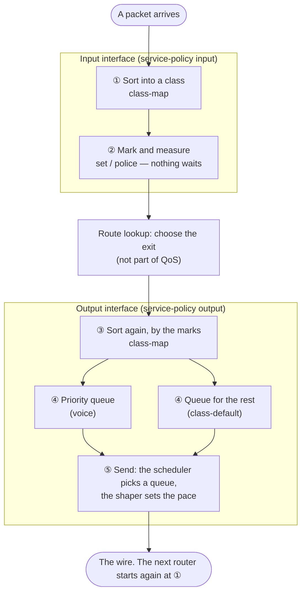

# M12 — The parts of QoS and how they fit together

This unit is about treating the packets that cross the provider's core differently, and about protecting the core
from the packets that should not be there. In the CCNP Service Provider blueprint, it covers 4.5, implementing QoS
services (classification and marking; congestion avoidance, policing and shaping), and 1.7, implementing data-plane
security (uRPF, ACLs, RTBH, MACsec). The QoS architecture of 1.4 (the MPLS QoS models, MPLS TE QoS, DiffServ and
IntServ, trust boundaries, the IPv6 flow label) is explained on the page *Marking and the MPLS QoS models* and in the
appendix. The unit has four pages and an appendix.

| Page | Contents | Tasks |
|---|---|---|
| This page | The parts of QoS (classes, marks, queues, the scheduler, policers, shapers) and the order in which a packet meets them inside one router | — |
| Marking and the MPLS QoS models | What marks are good for, DSCP and EXP, following the marks on the labels hop by hop, the three models, building it in IOS XR | M12-1 |
| Policing and shaping | Holding traffic to a contracted rate, evening it out at an exit, sending some of it first | M12-2, M12-3 |
| Protecting the data plane | Dropping forged sources (uRPF), an ACL that protects the infrastructure, dropping an attack from afar (RTBH) | M12-4, M12-5 |
| Appendix | TE and QoS (DS-TE and others), IntServ and RSVP, the IPv6 flow label, MACsec, what IOS XRv 9000 supports | — |

The lab is XRT-14. XR01 and PE2 are the provider edges (PEs), on either side of P1. XR01 is also the border with the
Internet. P1 is a core router without BGP, and RR1 is the route reflector. RR1 hangs off P1 and is on no customer's
path.

:::topo
nodes:
  CE1: {at: [0, 0], label: "CE1 (A site 1)"}
  CUST1: {at: [0, 1.2], label: "CUST1"}
  INET: {at: [1.6, 2.2], label: "INET (Internet)"}
  XR01: {at: [1.6, 0.6], label: "XR01 (PE)"}
  RR1: {at: [3.2, -0.6], label: "RR1 (RR)"}
  P1: {at: [3.2, 0.6], label: "P1 (P)"}
  PE2: {at: [4.8, 0.6], label: "PE2 (PE)"}
  CE2: {at: [6.4, 0], label: "CE2 (A site 2)"}
  CUST2: {at: [6.4, 1.2], label: "CUST2"}
links:
  - [CE1, XR01, "VRF A"]
  - [CUST1, XR01, "global"]
  - [INET, XR01, "global"]
  - [XR01, P1, "CORE-1"]
  - [P1, PE2, "CORE-2"]
  - [P1, RR1, "RR-LINK"]
  - [PE2, CE2, "VRF A"]
  - [PE2, CUST2, "global"]
frames:
  - {label: "AS 65000 (IS-IS CORE, LDP)", nodes: [XR01, P1, PE2, RR1]}
:::

Customer A has two sites, joined by an L3VPN (VRF A). Site 1 has phones and PCs; site 2 has a voice server and the
business systems. CUST1 and CUST2 are customers who bought Internet access, and INET plays the Internet (page
*Protecting the data plane*).

QoS brings in many parts at once: classes, marks, queues, policers, shapers. Before the details on the next pages,
this page lays them out in the order a packet meets them inside one router.

## 1. What it is good for

### 1.1 The problem: one exit, more packets than it can send

A router sends packets out of an interface one at a time, at the speed of that interface or of the contract behind
it. When packets for one exit arrive faster than it can send them (from a fast port to a slow one, or from many ports
to one), the packets that cannot go yet have to wait somewhere. When there is no room left to wait, some of them are
dropped.

In this lab, the exit from XR01 to site 1 is such a place. The port runs at 1 Gbps, but the contract behind it is
slower. Voice for the phones at site 1 and bulk data for its PCs leave through the same exit.

### 1.2 What came before: one line, first come first served

With no QoS policy, an exit normally has a single line (FIFO: first in, first out). Packets leave in the order they arrived,
and when the line is full, new arrivals are dropped at its tail. It is simple and fair in its way, but it cannot tell
voice from a backup: a voice packet that arrives behind fifty bulk packets waits for all fifty, and is dropped just
like them when the line is full.

### 1.3 The QoS answer: split the work into separate jobs

QoS splits what the router does with a packet into separate jobs.

- **Sort** the packets into groups (classes).
- **Mark** each group with a sign that the next router, or the router's own exit, can read.
- **Measure** a group's rate and deal with the excess at once (policer).
- **Queue** each group in its own line at the exit.
- **Send**: choose which line goes next (scheduler), and hold the exit to a set rate (shaper).

Each job has its own command, and they all sit side by side in the same policy, which is why the parts are easy to
mix up. The rest of this page puts them in the order a packet meets them.

## 2. How it works: one packet through one router

### 2.1 The order of the jobs



1. **Sort (input)**: the input policy checks its classes from the top, and the packet joins the first class whose
   conditions it meets. A packet that meets none joins `class-default`. A class is only a name for a group; on its own
   it does nothing to the packet.
2. **Mark and measure (input)**: the actions of that class run. A mark is written into the packet (DSCP, EXP) or
   attached inside the router (qos-group). A policer measures the rate and passes, re-marks or drops each packet at
   once; it never holds one.
3. The router looks up the route and chooses the exit interface. This part is not QoS.
4. **Sort again (output)**: the output policy has classes of its own. It cannot see which input class the packet was
   in; it sees only the marks: the DSCP and EXP in the packet, and the qos-group the input attached.
5. **Queue and send (output)**: each class that the output policy gives a queuing action (`priority`,
   `bandwidth remaining`, `queue-limit` and others) has its own queue, and the packet waits in its class's queue. The
   scheduler picks the queue that sends next: the priority queue whenever it holds a packet, the others by their
   shares. A shaper holds the whole exit to a set rate.

The packet then goes onto the wire carrying its marks. The next router starts again at step 1, this time sorting by
those marks.

### 2.2 The words side by side

An airport check-in works much the same way, and the right-hand column uses it as a picture.

| Word | What it does | At an airport check-in |
|---|---|---|
| Class (`class-map`) | A name for a group of packets, with the conditions for joining it | The fare class on a boarding pass |
| `class-default` | Every packet that matched no other class | Passengers with no class on the pass |
| Mark (DSCP, EXP) | Carries the group to the **next router** | The class printed on the pass |
| qos-group | Carries the group from the input to the output **of the same router**; never on the wire | A wristband that is only valid inside this terminal |
| Policy (`policy-map`) | What to do for each class | The rules for each fare class |
| `service-policy` | Which interface, and which direction, a policy applies to | Which gate the rules are posted at |
| Queue | A line of packets waiting at the exit, one per class | The line in front of each check-in desk |
| Scheduler | Picks the queue that sends next | The agent who calls the next passenger from one of the lines |
| Policer (`police`) | Measures the rate and deals with the excess at once; nothing waits | Counting people at the entrance, and downgrading or turning away those over the limit |
| Shaper (`shape`) | Holds the exit to a rate; the excess waits in the queue | The desks handle only so many passengers a minute |
| WRED (`random-detect`) | Drops a few packets at random once a queue starts to grow | Asking a few people to take a later flight as a line starts to grow |

### 2.3 A class and a queue are different things

A class is a way of sorting; a queue is a line at the exit. Sorting happens in both directions, but a class becomes a
queue only where the policy gives it a queuing action. In this lab, the input policies only mark and measure, and the
actions that build queues are written in the output policy. The exit is where packets pile up.

A router's input policy and output policy each have their own classes, and the two sets are not linked. The only
things that cross from one to the other are the marks: the DSCP and EXP in the packet, and the qos-group inside the
router (page *Marking and the MPLS QoS models*, section 3.3).

### 2.4 A queue forms only when the exit is busy

While packets arrive no faster than the exit can send them, each one leaves as soon as it arrives. The queues stay
empty, and `priority` and `bandwidth remaining` change nothing: there is no one to overtake. Queuing only acts when
the exit is busy.

Suppose CE2 sends site 1 a stream of 1000-byte packets as fast as it can for about 25 seconds, and in the middle of
it sends 100-byte pings: 50 marked EF and 10 unmarked. With no policy on XR01's exit to CE1 (a 1 Gbps port), every
ping comes back, in 1 to 3 ms. The exit is never busy, so nothing waits, and a priority queue would have nothing to
do.

### 2.5 The parent narrows the exit, the child decides the order

When a 1 Gbps port has a 2 Mbps contract behind it, the port itself is hardly ever busy. Packets pile up further on,
in the customer's access equipment, which drops them without knowing which ones are urgent. A priority queue on the
1 Gbps port would almost never have anyone to overtake.

So a parent policy shapes the exit to 2 Mbps. The excess now waits in the router's own queues, where the router gets
to choose, and a child policy decides the order within those 2 Mbps. The parent decides how much; the child decides
in what order (page *Policing and shaping*, section 2.5).

The test of section 2.4 was repeated with the policy of section 3.3: a parent at 100 kbps, and a child with voice in
the priority queue (capped at 32 kbps) and the rest in a queue of 20 packets. Now the exit was busy. The queue for the
rest received 12533 packets, sent 242 and dropped 12291 at its tail. The voice class lost nothing at a tail; the 3
packets it lost were over its 32 kbps cap and were dropped by its policer.

```console
RP/0/RP0/CPU0:XR01#show policy-map interface GigabitEthernet0/0/0/1 output
...
  Policy CE-OUT-CHILD Class VOICE
      Matched             :                  50/5900                 0
      Transmitted         :                  47/5546                 0
      Total Dropped       :                   3/354                  0
...
      Policed(exceed)     :                   3/354                  0
...
      Taildropped(packets/bytes)           : 0/0
  Policy CE-OUT-CHILD Class class-default
      Matched             :               12533/12749594             0
      Transmitted         :                 242/237356               0
      Total Dropped       :               12291/12512238             0
      Taildropped(packets/bytes)           : 12291/12512238
```

### 2.6 A policer or a shaper: whether the excess waits

Both measure the rate with a token bucket (page *Policing and shaping*, section 2.1). They differ in what they do with
the excess.

| | Policer | Shaper |
|---|---|---|
| The excess | Passed with a new mark, or dropped, at once | Waits in a queue and is sent later |
| Queue | Not used | Used |
| Delay | Not added | Added |
| Where | Input or output. Input: at the trust boundary (to hold a customer to the contract). Output: to cap the priority queue, or to limit the total that gathers at an exit | Usually the output, since it needs a queue: before a slower link, to send no faster than the far side accepts |

### 2.7 Across the network: XRT-14

The jobs are shared out between the routers, as DiffServ intends (page *Marking and the MPLS QoS models*, section
1.3): the edge sorts and marks, the core only reads the marks, and the exits queue.

| Where | Jobs | Tasks |
|---|---|---|
| XR01, input from site 1 | ① sort (voice, business data, the rest); ② mark the EXP and the DSCP, police the business data | M12-1, M12-2 |
| P1, input from XR01 | ① sort by the EXP only, and count (`COUNT-EXP`, fixed) | — |
| XR01, input from P1 | ① sort by the EXP; ② carry it on as a qos-group | M12-3 |
| XR01, output to site 1 | ③ sort by the qos-group, and mark the DSCP; ④ queue (voice first); ⑤ shape the exit | M12-3 |
| CE1 and CE2, input | ① sort by the DSCP, and count (`COUNT-DSCP`, fixed) | — |

### 2.8 Key points

- A class is a group of packets; a queue is a line at the exit; the scheduler picks the line that sends next.
- The input and output policies of a router are linked only by the marks: the DSCP and EXP in the packet, and the
  qos-group inside the router.
- Queues act only when the exit is busy. A parent shaper makes the router's own exit the busy place, so that the child
  can decide the order.
- A policer deals with the excess at once and adds no delay; a shaper makes the excess wait.

## 3. Building it in IOS XR

### 3.1 Where each job is written

| Job | Where it is written |
|---|---|
| Sort | `class-map` (`match …`), and the order of the classes in the `policy-map` |
| Mark | `set dscp`, `set mpls experimental …`, `set qos-group` in a class |
| Measure | `police` in a class |
| Queue | `priority level 1`, `bandwidth remaining`, `queue-limit` in a class of the output policy |
| Send | The scheduler follows the queuing actions; `shape average` in the parent's `class-default` sets the pace |
| Apply | `service-policy input` or `output` on an interface |

### 3.2 The input: sort, mark and measure

The input on XR01 from site 1 sorts the packets into voice, bulk data and the rest, marks the EXP for the core, and
polices the bulk data. Nothing waits here.

The figure follows one bulk-data (AF11) packet through this input policy. The numbers are the job numbers of
section 2.1, the same as in the notes of the configuration; rest the pointer on a number (or tap it on a phone) to see
the configuration for that job.

:::walk
legend: "Packets on the wire: outer label first; tc is a label's EXP. Orange: a mark that was changed."
rows:
  - {node: CE1, kind: host, say: ["~Site 1 sends bulk data (AF11)"]}
  - {wire: "[[IP AF11]]"}
  - panel: XR01
    sub: input from site 1 (Gi0/0/0/1)
    items:
      - ref: 1
        head: "**Sort** `service-policy input CE-IN`"
        say: ["Classes are checked from the top; the packet joins the first that matches"]
        match:
          - ["class VOICE  match dscp ef", false, no match]
          - ["class BULK   match dscp af11", true, "match → BULK's actions"]
      - ref: 2
        head: "**Mark and measure** the actions of class BULK"
        then:
          - "`set mpls experimental imposition 2`  EXP 2 for the core; DSCP stays AF11"
          - "`police rate 64 kbps`  passes what fits, drops the rest at once (no wait)"
      - say: ["~Looks up the route, pushes two labels and sends it to P1. This is not QoS"]
  - {wire: "[[!16 tc 2]] [[!24 tc 2]] [[IP AF11]] ^EXP 2; the DSCP is still AF11"}
  - {node: P1, say: ["~The core reads only the EXP"]}
  - aside: "Other packets"
    say:
      - "~EF (voice): VOICE matches in ① → EXP 5 in ② → [[=16 tc 5]] [[=23 tc 5]] [[IP EF]]"
      - "~Unmarked: no class matches, so it joins class-default → EXP 0 in ②"
:::

:::config XR01 — sort what site 1 sends, mark the EXP, police the bulk data
class-map match-any VOICE                     ## ① sort: the conditions for the voice group
 match dscp ef
 end-class-map
!
class-map match-any BULK                      ## ① sort: the bulk group
 match dscp af11
 end-class-map
!
policy-map CE-IN
 class VOICE                                  ## classes are checked from the top; the first match wins
  set mpls experimental imposition 5          ## ② mark: the EXP the core reads
 !
 class BULK
  set mpls experimental imposition 2          ## ② mark
  police rate 64 kbps                         ## ② measure: up to 64 kbps
   conform-action transmit                    ## within the rate: pass at once
   exceed-action drop                         ## beyond it: drop at once (nothing waits)
  !
 !
 class class-default                          ## ① everything that matched no class above
  set mpls experimental imposition 0
 !
 end-policy-map
!
interface GigabitEthernet0/0/0/1              ## the port towards CE1
 service-policy input CE-IN                   ## apply it to the input
:::

### 3.3 The output: sort again, queue and send

The output on XR01 to site 1 shapes the whole exit to 100 kbps, and within it sends voice first.

The figure follows the voice and the data of the test in section 2.5 through the exit to site 1 (the numbers are the
job numbers of section 2.1).

:::walk
rows:
  - {node: P1, say: ["~Voice (EF) and a stream of 1000-byte data for site 1 arrive"]}
  - {wire: "[[IP EF]] [[IP data]] [[IP data]] [[IP data]]"}
  - panel: XR01
    sub: exit to site 1 (Gi0/0/0/1 output)
    items:
      - ref: 3
        head: "**Sort again** with the classes of the child `CE-OUT-CHILD`"
        say: ["The input's classes are not visible here, only the marks (DSCP, EXP, qos-group)"]
        match:
          - ["class VOICE  match dscp ef", true, "EF matches"]
          - ["class class-default", true, "the data matches"]
      - ref: 4
        head: "**Queue** a queue per class"
        then:
          - "[[IP EF]] priority queue (`priority level 1`): always sent first; capped at 32 kbps"
          - "[[IP data]] [[IP data]] queue for the rest (`queue-limit 20 packets`): tail drop when full"
      - ref: 5
        head: "**Send** the parent `CE-OUT`: `shape average 100 kbps`"
        say: ["The scheduler takes the priority queue first; the shaper keeps the exit at 100 kbps"]
  - {wire: "[[IP EF]] [[IP data]] _100 kbps in all"}
  - {node: CE1, kind: host, say: ["~Site 1"]}
  - aside: "An example result (the test in section 2.5, about 25 seconds)"
    say:
      - "~Voice, 50 packets: 47 sent; the policer dropped the 3 above 32 kbps; none tail-dropped"
      - "~Data, 12533 packets: 242 sent; 12291 tail-dropped in the queue for the rest"
:::

:::config fold XR01 — shape the exit to site 1 and send voice first
policy-map CE-OUT-CHILD                       ## the child: the order within the parent's rate
 class VOICE                                  ## ③ sort again, with the output's own classes
  priority level 1                            ## ④ the priority queue: sent first whenever it holds a packet
  police rate 32 kbps                         ## a cap, so that the priority queue cannot take the whole exit
  !
 !
 class class-default
  queue-limit 20 packets                      ## ④ the queue for the rest: at most 20 packets wait
 !
 end-policy-map
!
policy-map CE-OUT                             ## the parent: how much. class-default only
 class class-default
  shape average 100 kbps                      ## ⑤ the whole exit at 100 kbps; the excess waits
  service-policy CE-OUT-CHILD                 ## the child decides the order (no input/output keyword)
 !
 end-policy-map
!
interface GigabitEthernet0/0/0/1
 service-policy output CE-OUT                 ## apply it to the output
:::

### 3.4 Reading the output: which queues were built

`show qos interface` shows how the policy was programmed. With the output policy of section 3.3:

```console
RP/0/RP0/CPU0:XR01#show qos interface GigabitEthernet0/0/0/1 output
...
Level: 0 Policy: CE-OUT Class: class-default
...
Shape Info: rate 100 kbps, burst 1250 bytes,
QueueID: N/A
----------------------------------------------------------------------
Level: 1 Policy: CE-OUT-CHILD Class: VOICE
...
QueueID: 32 (Priority 1)
...
Level: 1 Policy: CE-OUT-CHILD Class: class-default
...
QueueID: 33 (Priority Normal)
Queue Limit: 5 kbytes (20 packets)
```

- `Level: 0` is the parent, and `Level: 1` the child.
- The parent shows its pace (`Shape Info`) and `QueueID: N/A`: it has no queue of its own and only sets the pace for
  the child's queues.
- Each child class here has its own `QueueID`. `Priority 1` is the priority queue and `Priority Normal` an ordinary one:
  two lines at this exit.
- A child class that only marks, with no queuing action, shows `QueueID: 33 (class-default)`: it has no
  line of its own and waits in the line of `class-default`.
- For the input policy (`show qos interface GigabitEthernet0/0/0/1 input`), every class showed the same
  `QueueID: 25 (Port Default)`: the port's default line, not a line of its own.

The counts per class (`Matched`, `Transmitted`, `Total Dropped`) are in `show policy-map interface`. On XRv 9000 they
rise 10 to 30 seconds late.

### 3.5 Pitfalls

- **Give the parent only `class-default`**: the classes go in the child, under the parent's `class-default`. A
  packet that matches another class in the parent never passes through the child and never enters the priority queue.
  The commit goes through, so the mistake is easy to miss (page *Policing and shaping*, section 2.5).
- **An output class cannot read an input class**: what the output needs to know has to be carried as a mark. A
  qos-group is set on the input and read on the output, never the other way round (page *Marking and the MPLS QoS
  models*, section 3.5).
- **The priority queue needs a cap**: without a policer, it could take the whole exit and leave no turn for the other
  queues (page *Policing and shaping*, section 2.4).

:::note
The output in this unit was taken on IOS XRv 9000 26.1.1 (XR01), IOS XRd 26.1.1 (RR1) and IOS XE 17.15 on IOL (the
other routers). Sources: RFC 2475 (section 2). The ASR 9000 Modular QoS Configuration Guide (IOS XR 24.x: hierarchical policies, the
priority queue and its policer, the directions of qos-group), checked in November 2026. The pings and counts of
sections 2.4 and 2.5, the `show qos interface` output and the counter delay were measured on the PoC board (the same
shape as XRT-14).
:::
