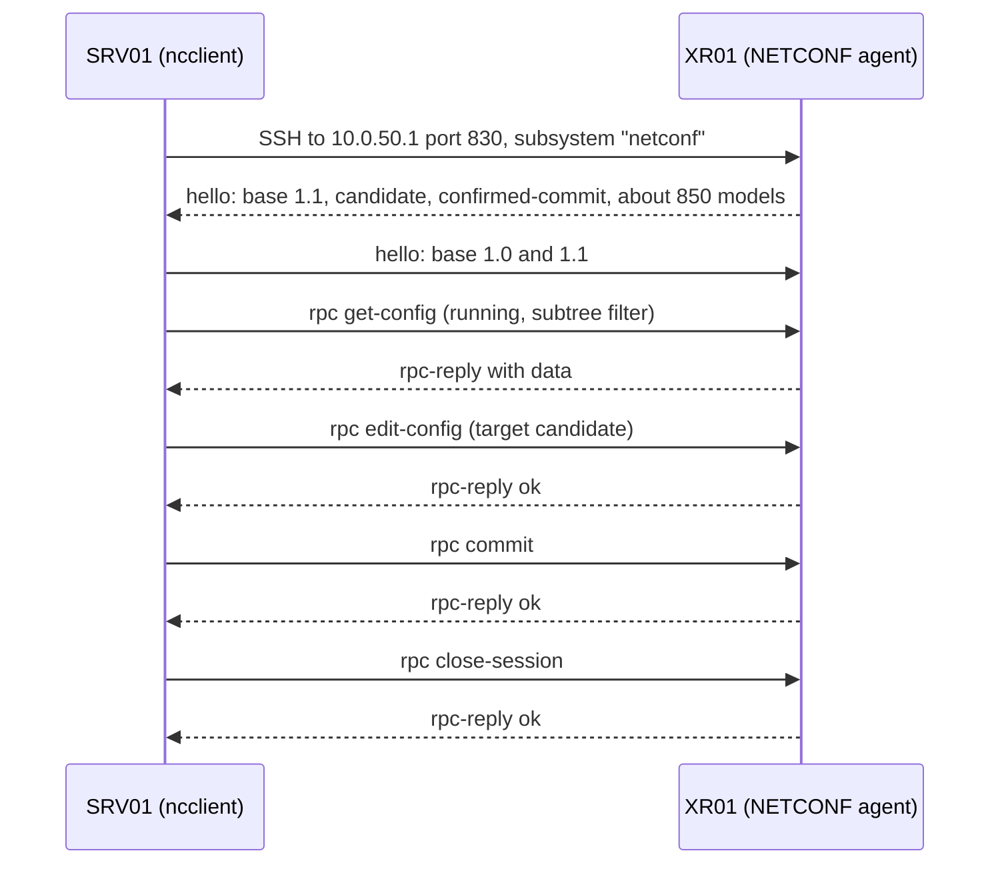

# M13 — Configuring through models: YANG, NETCONF and RESTCONF

The previous page laid out the jobs between an NMS and a router, and the layers of model, encoding and protocol. This
page is about the first job, configuring: how a model describes the configuration, how NETCONF carries a change into
IOS XR's commit, and how RESTCONF does the same over HTTPS on IOS XE. It covers 5.9 of the blueprint (configure and
verify NETCONF and RESTCONF) and 5.2 (interpret an external script that configures a device through a REST API), with
the essentials of 5.4 (YANG) and 5.1 (programmable APIs). More about YANG is in the appendix.

The board is XRT-15, shown on the previous page. On this page SRV01 (10.0.50.10), the NMS, works on XR01 (10.0.50.1)
and PE2 (10.0.50.2) across the NMS segment.

## 1. What it is good for

### 1.1 The problem: a program has to change two different routers, and be sure

The NMS team wants to manage XR01 and PE2 from programs on SRV01: add a customer's service loopback, change
descriptions, read back what is configured, and do it the same way every time, without a person at the keyboard.

The two routers run different operating systems. IOS XR stages the lines you type and applies them with `commit` (M1);
IOS XE applies each line as soon as it is typed. Their `show` outputs differ as well, and so do their error messages.

A program that drives the CLI has to type commands as a person would and read the text that comes back. This is called
screen scraping. The program must recognise prompts, error messages and the layout of each `show` output. A new release
that moves a column or rewords a message breaks it. Worse, the program cannot tell for sure whether a change went in
completely, partly or not at all.

### 1.2 What came before: CLI scripts, SNMP SET, vendor XML

- **CLI scripts** (expect and its relatives): send a line, wait for the prompt, match the text. They work, but they depend
  on the wording of each OS and each release, and an error is text that the script has to guess at. On IOS, a block of
  lines can stop in the middle and leave a half-made change.
- **SNMP SET**: SNMP has a write operation, but standard MIBs have few writable objects, they do not cover most of a
  router's configuration, and there are no transactions. An IAB workshop in 2002 recorded that SNMP was not widely used
  for configuring devices. It listed what operators wanted instead: configuration kept apart from operational state,
  transactions across several devices, a way to dump and restore the configuration, and text that tools such as `diff`
  can compare (RFC 3535).
- **Vendor XML interfaces**: some routers accepted XML documents over a session (IOS XR had an XML agent of its own), but
  every vendor had its own schema and its own protocol.

### 1.3 The model-driven answer

Model-driven management splits the job into three parts.

- **A model** describes what can be configured on a device and what can be read from it, as a tree with a name and a
  type for every value. The language for models is YANG.
- **A protocol** carries data shaped by the model: NETCONF (XML over SSH), RESTCONF (JSON or XML over HTTPS) or gNMI
  (over gRPC; the next page).
- **The answers are structured.** A request either succeeds (`<ok/>`, or an HTTP success code) or fails with an error that
  names its kind and the place in the tree. NETCONF adds transactions: a set of changes is staged and applied as one, and
  can be set to take itself back.

These are the router's programmable APIs (5.1). Each OS offers a different set:

| API | Transport | Encoding | On this board |
|---|---|---|---|
| NETCONF | SSH, TCP 830 | XML | XR01 (Task M13-1). IOS XE has NETCONF too; it is not used in this lab |
| RESTCONF | HTTPS, TCP 443 | JSON or XML | PE2 only (Task M13-2). IOS XR has no RESTCONF server |
| gNMI | gRPC (HTTP/2, usually TLS) | JSON (JSON_IETF on XR01) | XR01 (the next page) |

Controllers such as NSO use the same APIs towards the routers (appendix).

## 2. How it works: one change, from the NMS to the running configuration

### 2.1 YANG: a model of the configuration and the state

YANG (RFC 7950) is a language that describes data as a tree. One model is written as a **module**. The module has a
name and a **namespace** (a URI), and every element of data says by its namespace which module it belongs to.

This is how XR01 answered when SRV01 asked for the configuration of Loopback0 through NETCONF. The same configuration
in the CLI is `interface Loopback0` / `ipv4 address 10.255.0.1 255.255.255.255`.

```console
<data>
 <interfaces xmlns="http://cisco.com/ns/yang/Cisco-IOS-XR-um-interface-cfg">
  <interface>
   <interface-name>Loopback0</interface-name>
   <ipv4>
    <addresses xmlns="http://cisco.com/ns/yang/Cisco-IOS-XR-um-if-ip-address-cfg">
     <address>
      <address>10.255.0.1</address>
      <netmask>255.255.255.255</netmask>
     </address>
    </addresses>
   </ipv4>
  </interface>
 </interfaces>
</data>
```

The parts of YANG that make up this tree:

| Part | What it is | In the reply above |
|---|---|---|
| module, namespace | A file of definitions, and the URI that names it | `Cisco-IOS-XR-um-interface-cfg`, `http://cisco.com/ns/yang/Cisco-IOS-XR-um-interface-cfg` |
| container | A node that only groups other nodes | `interfaces`, `ipv4` |
| list, key | Repeated entries, told apart by the value of a key leaf | `interface`, told apart by `interface-name` |
| leaf | One value with a type | `interface-name`, `address`, `netmask` |
| leaf-list | Several values of one type | (none here) |
| config true / false | Configuration (can be written) or state (can only be read) | All configuration: `-cfg` models hold no state |
| augment | One module adds nodes into another module's tree | `ipv4/addresses` comes from `Cisco-IOS-XR-um-if-ip-address-cfg` |

The `xmlns` attribute changes in the middle of the reply. The address does not belong to the interface module: a second
module adds it under the interface (augment). A request has to use the same two namespaces, or the device does not
recognise the elements.

YANG describes the data; it is not the data. On the wire the data travels as XML (NETCONF) or JSON (RESTCONF and gNMI;
RFC 7951). The same model gives both encodings.

### 2.2 Three families of models on IOS XR

IOS XR ships three families of models. Their names tell them apart.

| Family | Module names | What they are like |
|---|---|---|
| Native | `Cisco-IOS-XR-<feature>-cfg`, `Cisco-IOS-XR-<feature>-oper` (for example `Cisco-IOS-XR-ifmgr-cfg`, `Cisco-IOS-XR-ifmgr-oper`) | The oldest family. The tree follows XR's internal schema. The `-oper` models carry the state |
| Unified (UM) | `Cisco-IOS-XR-um-<feature>-cfg` (for example `Cisco-IOS-XR-um-interface-cfg`) | Configuration only. Generated from the CLI, so the tree follows the CLI closely. Introduced in 7.0.1 to replace the native configuration models |
| OpenConfig | `openconfig-<feature>` (for example `openconfig-interfaces`) | Vendor-neutral models written by a group of operators. Configuration and state side by side (`config` and `state` containers). XR's differences from them are published as deviation modules (`cisco-xr-openconfig-…-deviations`) |

Namespaces follow the same pattern: `http://cisco.com/ns/yang/<module>` for Cisco's models and
`http://openconfig.net/yang/<name>` for OpenConfig.

To find which models a router has, there are three places:

- **The hello**: when a NETCONF session opens, the router sends the list of everything it supports (section 2.3). In
  ncclient it is `m.server_capabilities`. XR01 listed 857 entries: about 220 unified models, 54 OpenConfig modules and
  some 420 other Cisco-IOS-XR models (native). IOS XRv 9000 of the same release listed 1093.
- **The router itself**: `show netconf-yang capabilities` prints the same list.
- **Cisco's catalogue**: Cisco Feature Navigator (YANG Data Models) and the YangModels repository on GitHub, by platform
  and release.

The same interface read through OpenConfig looks like this. It is a state read (`<get>`), so it carries the
operational status and counters that a configuration model does not have.

```console
<interfaces xmlns="http://openconfig.net/yang/interfaces">
 <interface>
  <name>Loopback0</name>
  <state>
   <name>Loopback0</name>
   <type xmlns:idx="urn:ietf:params:xml:ns:yang:iana-if-type">idx:softwareLoopback</type>
   <mtu>1500</mtu>
   <enabled>true</enabled>
   <admin-status>UP</admin-status>
   <oper-status>UP</oper-status>
   <counters>
    <carrier-transitions>1</carrier-transitions>
   </counters>
...
```

(Output shortened.)

Which to use: the unified models when you configure XR the way its CLI does, OpenConfig when one program configures
several vendors, and the native `-oper` models for XR state that OpenConfig does not cover.

### 2.3 NETCONF: a session over SSH, RPCs and datastores

NETCONF (RFC 6241) runs inside SSH (RFC 6242). The client opens an SSH connection to TCP port 830 and asks for the SSH
subsystem `netconf`. Logging in is SSH's job, so the router's own users (or AAA) decide who may connect. Once the
session is up, both ends send a `<hello>` that lists their capabilities. From then on, the client sends RPCs and the
server answers each one.



Every RPC carries a `message-id`, and the reply carries the same one: `<rpc message-id="101">` is answered by
`<rpc-reply message-id="101">`. A reply holds `<ok/>`, `<data>…</data>` or an `<rpc-error>` with an error tag (and,
where it applies, the path of the element at fault). When both ends announce base 1.1, messages are sent in counted
chunks; base 1.0 ends each message with the marker `]]>]]>`. IOS XR answers both on the same port.

The operations that matter here:

| Operation | What it does |
|---|---|
| `<get-config>` | Reads configuration from a datastore (`running` or `candidate`), optionally through a filter |
| `<get>` | Reads configuration and state together |
| `<edit-config>` | Merges, replaces, creates or deletes configuration in a datastore |
| `<commit>` | Makes the candidate the running configuration |
| `<discard-changes>` | Throws away what is staged in the candidate |
| `<lock>`, `<unlock>` | Keeps other sessions from changing a datastore while you work |
| `<validate>` | Checks a datastore without applying it |
| `<close-session>`, `<kill-session>` | Ends your own session, or another one |

A **datastore** is a whole copy of the configuration. `running` always exists. A server that announces `:candidate` also
has a `candidate`, where changes are staged; one that announces `:writable-running` lets clients write to `running`
directly; `:startup` adds a startup configuration. XR01's hello listed `:candidate` and `:confirmed-commit:1.1`, but not
`:writable-running` or `:startup`. So on IOS XR every change goes into the candidate and takes effect with a commit.

The filter in `<get-config>` is a subtree filter (RFC 6241, section 6): a piece of XML in the shape of what you want. An
element with children (`<interfaces>`, `<interface>`) selects that part of the tree; a leaf with a value
(`<interface-name>Loopback0</interface-name>`) keeps only the list entries whose leaf has that value. The reply in 2.1
came from such a filter (section 3.2).

### 2.4 Candidate, commit and confirmed commit

IOS XR's CLI already works with two configurations (M1): your session's private target configuration and the running
configuration, with `commit` applying the difference as one. NETCONF's candidate and `<commit>` are the same idea under
standard names. IOS XR keeps a candidate for each client (its guide speaks of "candidate datastores belonging to other
clients"), much as each CLI session has its own target configuration.

A NETCONF commit is an ordinary commit. It gets a commit ID and is written into the commit history like a commit from
the CLI. The history even says where it came from: Line `netconf`, Client `YANG Frame` (section 3.3). `show
configuration commit changes` shows its lines as it does for any other commit.

A **confirmed commit** (RFC 6241, section 8.4) is the protocol's `commit confirmed`. The client sends
`<commit><confirmed/><confirm-timeout>120</confirm-timeout></commit>`. The change is applied at once, provisionally.

- A plain `<commit/>` before the time runs out makes it permanent. `<cancel-commit/>` takes it back at once.
- If nothing comes in time (600 seconds when no timeout is given), the server restores the configuration as it was.
- If the session that asked for it ends before it is confirmed, the server restores the configuration as well. Only a
  confirmed commit sent with `<persist>` outlives its session.

XR01 follows the third rule. A script that sent a confirmed commit and then closed its session saw the change taken back
four seconds later. The history shows the rollback as a commit of its own, with Line `rollback` and Client `Rollback`.
This is the same rule as the CLI's in M1: leaving configuration mode cancels a pending `commit confirmed`. The session
that asked must stay until it confirms.

While a pending confirmed commit is held, the running configuration is locked. A commit from the CLI in that window
failed with the same message as under `configure exclusive` in M1:

```console
% Failed to commit .. Another configuration session
had a lock on the running configuration.
```

A client can also take a lock deliberately with `<lock>` (RFC 6241, section 7.5), so that nobody else changes the
configuration in the middle of its work. `show configuration sessions` and `show configuration lock` show who holds it.

### 2.5 RESTCONF: the same models over HTTPS

RESTCONF (RFC 8040) carries the same YANG data, but as resources of a web server. Each piece of data has a URL, and the
HTTP method says what to do with it. It must run over TLS (RFC 8040, section 2.1).

The URL is built from the model. This is the one that reads PE2's hostname:

```console
https://10.0.50.2/restconf/data/Cisco-IOS-XE-native:native/hostname
        └ device  │        │    └ module : top node        └ child
                  └ root   └ data
```

- `/restconf` is the root. A client that does not know it can ask for `/.well-known/host-meta`, which points to it.
- `/data` holds the configuration and the state together.
- The first node after `/data` is written with its module name (`Cisco-IOS-XE-native:native`); the nodes below follow
  the tree. A list entry is picked by its key: `…/interface/Loopback=210`.

The methods:

| Method | What it does | Success |
|---|---|---|
| GET | Reads the resource | 200 OK, with the data |
| POST | Creates a child resource; fails if it already exists (409) | 201 Created |
| PUT | Creates the resource, or replaces it whole | 201 Created (new) / 204 No Content (replaced) |
| PATCH | Merges the body into the resource; what the body does not mention stays | 204 No Content (or 200 with a body) |
| DELETE | Deletes the resource; it must exist | 204 No Content |

The body and the answer are YANG data in JSON (`application/yang-data+json`) or XML (`application/yang-data+xml`). The
client names the format of its body in `Content-Type`, and the format it wants back in `Accept`. An error comes back as
an HTTP status code plus an `ietf-restconf:errors` body with the same error tags as NETCONF. Here a script printed the
status code and the body that PE2 sent to a user without the rights:

```console
GET hostname -> 403 {
  "ietf-restconf:errors": {
    "error": [
      {
        "error-type": "application",
        "error-tag": "access-denied",
        "error-message": "access denied"
      }
    ]
  }
}
```

RESTCONF has no candidate and no commit. Each request takes effect as soon as it succeeds (RFC 8040, sections 1.3 and
1.4). There is nothing to confirm and nothing to roll back as a unit; a change made of several requests can stop half
way.

On this board RESTCONF is on PE2 (IOS XE) only. **IOS XR has no RESTCONF server**: the `restconf` command does not exist
on IOS XRd or IOS XRv 9000 (26.1.1), and IOS XR's programmability guide names NETCONF and gRPC as its protocols for YANG.
The blueprint pairs NETCONF and RESTCONF in one item, which is why this page uses both routers.

### 2.6 Reading an external script

Blueprint item 5.2 asks you to read a script that someone else wrote and to say what it will do to the device. A
script that talks REST carries the same few pieces every time. Read them in this order:

| Piece | Where to look | What it tells you |
|---|---|---|
| The URL | `https://…/restconf/data/…` | The scheme and port (https → TCP 443), the device, the API (`/restconf`), the model (`Cisco-IOS-XE-native:`) and the resource |
| The credentials | `auth=(…)`, `curl -u` | Which account the device must know, and with which rights |
| The headers | `Accept`, `Content-Type` | The format: `yang-data+json` means RESTCONF's JSON |
| The body | `json=…`, `curl -d` | The data, in the shape of the model: the top key is `module:node`, a list is a JSON array, a list entry carries its key |
| The method | `requests.get/patch/put/post/delete`, `curl -X` | Read, merge, replace, create or delete |
| What it checks | `status_code`, `raise_for_status()` | Which answers it treats as success, and where it stops |

Here is a short script of that kind, read line by line. It sets the description of PE2's Loopback0.

:::config SRV01 — a RESTCONF script that sets the description of PE2's Loopback0
import requests                                      ## The HTTP library: one call per request
import urllib3                                       ## Only for the next line
urllib3.disable_warnings()                           ## Hides the warning that verify=False (below) causes
BASE = "https://10.0.50.2/restconf/data"             ## https: TCP 443 on PE2. /restconf/data: RESTCONF's data
AUTH = ("noc-auto", "Noc-Auto-15")                   ## HTTP Basic authentication: an account that PE2 must know
HDRS = {"Accept": "application/yang-data+json",      ## The answer in RESTCONF's JSON
        "Content-Type": "application/yang-data+json"}   ## The body is RESTCONF's JSON
BODY = {"Cisco-IOS-XE-native:interface": {           ## Top key: module name, then the node (IOS XE's native model)
            "Loopback": [{                           ## A list: its entries in a JSON array
                "name": 0,                           ## The key of the entry: Loopback0
                "description": "ROUTER-ID"}]}}       ## The only leaf sent; the rest of Loopback0 is left alone
r = requests.patch(f"{BASE}/Cisco-IOS-XE-native:native/interface",   ## PATCH: merge the body into this resource
                   auth=AUTH, headers=HDRS, json=BODY,   ## json= turns BODY into JSON text
                   verify=False, timeout=30)         ## verify=False: does not check PE2's certificate (self-signed)
print(r.status_code, r.text)                         ## Prints the status code and the body of the answer
if r.status_code not in (200, 204):                  ## The success codes of PATCH
    raise SystemExit("PE2 refused the change")      ## Anything else stops the script with an error
:::

When a script like this fails, the first answer it gets tells you which piece is missing.

| What comes back | What it means | What to check |
|---|---|---|
| No connection (`Connection refused`) | Nothing listens on that port | The device's HTTPS server |
| An HTML error page instead of JSON | The web server answers, but RESTCONF is not ready behind it | On IOS XE, it takes about a minute after RESTCONF is enabled |
| 401 Unauthorized | The credentials were not accepted | The user name and password |
| 403 Forbidden, `access-denied` | The user is known but not allowed | The user's rights (on IOS XE, privilege 15) |
| 404 Not Found | Nothing exists at that URL | The module name, the node names and the key in the path |
| 400 Bad Request | The request does not fit the model | The body: names, types, JSON syntax |
| 409 Conflict | It already exists (POST), or a lock is held | PATCH or PUT instead of POST; wait for the lock |
| 200, 201, 204 | Success | The device's configuration, to be sure |

### 2.7 Key points

- YANG describes the data (modules, containers, lists with keys, leaves; configuration or state). NETCONF and RESTCONF
  carry data shaped by it, in XML or JSON. The `xmlns` (or the `module:` prefix) says which model an element comes from.
- IOS XR has three families of models: native (`-cfg`, `-oper`), unified (`-um-…-cfg`, close to the CLI) and OpenConfig.
  The hello of a NETCONF session lists them.
- NETCONF: SSH to port 830, hello with capabilities, then RPCs. IOS XR edits the candidate and applies it with
  `<commit>`, which is an ordinary commit with Line `netconf` in the history. A confirmed commit is taken back if its
  session ends before it is confirmed.
- RESTCONF: the same models as URLs over HTTPS, with GET, POST, PUT, PATCH and DELETE. No candidate and no commit: each
  request takes effect at once. IOS XE has it; IOS XR does not.
- Read a REST script by its URL, credentials, headers, body and method, and read its failures by their status codes.

## 3. Building it

The NETCONF configuration is in three places: the SSH server and the NETCONF agent on XR01, and the script on SRV01. The
figure follows one change from SRV01 into XR01's running configuration. The numbers in the figure are the numbers in
the notes of the configuration examples in 3.1 and 3.2. Rest the pointer on a number (or tap it on a phone) to see that
part of the configuration.

:::walk
legend: "One NETCONF change from SRV01 to XR01. Blue numbers: the examples in 3.1 and 3.2."
rows:
  - panel: SRV01
    sub: NMS (Python, ncclient)
    items:
      - ref: 3
        head: "**Open a session** `manager.connect(host=\"10.0.50.1\", port=830, …)`"
        say: ["SSH to XR01 on the NMS segment, asking for the subsystem netconf"]
  - {wire: "[[SSH  10.0.50.10 → 10.0.50.1  TCP 830]] _NMS segment (global table)"}
  - panel: XR01
    sub: the managed router
    items:
      - ref: 1
        head: "**SSH server** `ssh server netconf vrf default`"
        say: ["Listens for NETCONF on port 830 in the VRFs named here"]
      - ref: 2
        head: "**NETCONF agent** `netconf-yang agent` → `ssh`"
        say: ["Takes over the session and sends its hello"]
      - say: ["~hello: base 1.1, :candidate, :confirmed-commit, about 850 models", "~no :writable-running, so changes go to the candidate"]
      - ref: 4
        head: "**Edit the candidate** `<edit-config>`  unified-model XML"
        say: ["Merged into this client's candidate. The router does not change yet"]
      - ref: 5
        head: "**Commit** `<commit/>`"
        say: ["The candidate becomes the running configuration, as one commit"]
      - say: ["~running configuration: GigabitEthernet0/0/0/2 now has its description", "~commit history: Line `netconf`, Client `YANG Frame`"]
  - aside: "Without ① (the agent alone)"
    say: ["~XR01 does not answer NETCONF on port 830 in that VRF", "~→ the script cannot connect; no hello ever arrives"]
  - aside: "④ without ⑤ (edit, no commit)"
    say: ["~The edit gets `<ok/>`, but it stays in the candidate", "~→ the running configuration and the commit history do not change"]
:::

### 3.1 Turning on NETCONF on IOS XR

:::config fold XR01 — accept NETCONF over SSH on the NMS segment
ssh server netconf vrf default                ## ① Listen for NETCONF (TCP 830) in the default VRF, where the NMS segment is
netconf-yang agent                            ## ② The NETCONF agent
 ssh                                          ## ② Serve the NETCONF sessions that the SSH server hands over
:::

Both halves are needed. `netconf-yang agent ssh` starts the agent; `ssh server netconf vrf <name>` makes the SSH server
accept NETCONF in that VRF. At least one VRF has to be named. An NMS in a management VRF needs that VRF instead (for
example `ssh server netconf vrf MGMT`). The SSH server for the CLI (`ssh server vrf …`) is a separate line; NETCONF needs
its own.

```console
RP/0/RP0/CPU0:XR01#show running-config netconf-yang agent
netconf-yang agent
 ssh
!

RP/0/RP0/CPU0:XR01#show running-config ssh
ssh server rate-limit 600
ssh server v2
ssh server vrf MGMT
ssh server netconf vrf default
```

### 3.2 A NETCONF session from Python (ncclient)

ncclient is a NETCONF client library for Python. `manager.connect()` opens the SSH session and exchanges the hellos.
After that, each NETCONF operation is a method: `get_config()`, `get()`, `edit_config()`, `commit()`,
`discard_changes()`, `locked()` (a lock held for a `with` block) and `close_session()`. Each returns the reply; `.xml`
gives its text.

First read, then change. A read needs only a filter. This one selects the unified-model entry of Loopback0:

```console
FILTER = """<interfaces xmlns="http://cisco.com/ns/yang/Cisco-IOS-XR-um-interface-cfg">
 <interface><interface-name>Loopback0</interface-name></interface></interfaces>"""
print(m.get_config(source="running", filter=("subtree", FILTER)).xml)
```

The reply is the one shown in 2.1, wrapped in `<rpc-reply>`. An entry that does not exist yet gives an empty `<data/>`,
not an error. Reading the entry you want to imitate is the quickest way to learn the shape of the XML that a change
needs.

The change below sets the description of GigabitEthernet0/0/0/2, the backup link to CE1.

:::config fold SRV01 — set an interface description on XR01 through NETCONF (ncclient)
from ncclient import manager                         ## The NETCONF client library (python3-ncclient)
USER, PASS = "<user>", "<password>"                  ## An account on XR01, the same as for the CLI
CONFIG = """<config>                                 ## ④ What to merge: a <config> element, shaped by the unified model
 <interfaces xmlns="http://cisco.com/ns/yang/Cisco-IOS-XR-um-interface-cfg">   ## The module, named by its namespace
  <interface>                                        ## One entry of the interface list…
   <interface-name>GigabitEthernet0/0/0/2</interface-name>   ## …picked by its key
   <description>BACKUP-TO-CE1</description>          ## The leaf to set
  </interface>
 </interfaces>
 </config>"""
m = manager.connect(host="10.0.50.1", port=830,      ## ③ SSH to XR01 on the NMS segment, the NETCONF port
                    username=USER, password=PASS,    ## Logs in with the password…
                    look_for_keys=False, allow_agent=False,   ## …and not with SSH keys found on SRV01
                    hostkey_verify=False,            ## The lab does not check XR01's SSH host key
                    device_params={"name": "iosxr"})  ## ncclient's settings for IOS XR
print(m.edit_config(target="candidate", config=CONFIG).xml)   ## ④ Into this client's candidate
print(m.commit().xml)                                ## ⑤ The candidate becomes the running configuration
m.close_session()                                    ## Ends the NETCONF session
:::

Example output (both RPCs answered `<ok/>`):

```console
<?xml version="1.0"?>
<rpc-reply message-id="urn:uuid:299e301c-ae1d-49ff-a82d-50d8f9b2bacf" xmlns:nc="urn:ietf:params:xml:ns:netconf:base:1.0" xmlns="urn:ietf:params:xml:ns:netconf:base:1.0">
 <ok/>
</rpc-reply>

<?xml version="1.0"?>
<rpc-reply message-id="urn:uuid:40b08adb-b26f-4866-97b6-b1e6bd672793" xmlns:nc="urn:ietf:params:xml:ns:netconf:base:1.0" xmlns="urn:ietf:params:xml:ns:netconf:base:1.0">
 <ok/>
</rpc-reply>
```

`edit_config()` merges by default: what the XML does not mention stays as it is. To remove something, mark the element
with the `operation="delete"` (or `remove`) attribute of the NETCONF namespace; `operation="replace"` replaces the
element and everything under it (RFC 6241, section 7.2).

A confirmed commit from ncclient is one more argument. The change below is applied for 120 seconds, and becomes
permanent only if the script reaches the second `commit()`.

:::config SRV01 — a change that takes itself back unless it is confirmed
m.edit_config(target="candidate", config=CONFIG)   ## Stage the change, as above
m.commit(confirmed=True, timeout="120")           ## Apply it now, provisionally, for 120 seconds
input("Check XR01, then press Enter to confirm ")  ## Your own check while the change is live
m.commit()                                        ## A plain commit in time makes it permanent
:::

If the script stops before the second `commit()` (an error, Ctrl-C, a lost connection), its session ends and XR01 takes
the change back. Example output (`show configuration commit list` on XR01, after a script that closed its session
without confirming):

```console
SNo. Label/ID              User      Line                Client      Time Stamp
~~~~ ~~~~~~~~              ~~~~      ~~~~                ~~~~~~      ~~~~~~~~~~
1    1000000007            SUZUKI    rollback            Rollback    Tue Nov 10 13:03:11 2026
2    1000000006            SUZUKI    netconf             YANG Frame  Tue Nov 10 13:03:07 2026
3    1000000005            SUZUKI    netconf             YANG Frame  Tue Nov 10 13:02:42 2026
```

### 3.3 Where a NETCONF change shows up

XR writes every commit into the same history, whatever it came through. The Line and Client columns say how:

| How the change came in | Line | Client |
|---|---|---|
| The CLI over SSH | `vty0:node0_RP0_CPU` | `CLI` |
| NETCONF | `netconf` | `YANG Frame` |
| gNMI Set (the next page) | `ems` | `YANG Frame` |
| A confirmed commit taken back | `rollback` | `Rollback` |
| The initial configuration at boot | `ZTP` | `CLI` |

```console
RP/0/RP0/CPU0:XR01#show configuration commit list 3
SNo. Label/ID              User      Line                Client      Time Stamp
~~~~ ~~~~~~~~              ~~~~      ~~~~                ~~~~~~      ~~~~~~~~~~
1    1000000005            SUZUKI    netconf             YANG Frame  Tue Nov 10 13:02:42 2026
2    1000000004            SUZUKI    vty0:node0_RP0_CPU  CLI         Tue Nov 10 13:02:19 2026
3    1000000003            ZTP       ZTP                 CLI         Tue Nov 10 12:58:26 2026
RP/0/RP0/CPU0:XR01#show configuration commit changes last 1
!! Building configuration...
!! IOS XR Configuration 26.1.1
interface Loopback0
 description set-by-netconf 130241
!
end
```

`show configuration commit changes <id>` takes the ID from the list; `last 1` is the newest commit. The change made
through NETCONF is shown as CLI lines. The User column is the account the script logged in with. "YANG
Frame" is XR's YANG framework, the layer that turns model data into configuration; it is the `YFW` row in the
statistics below.

The NETCONF agent has its own view:

```console
RP/0/RP0/CPU0:XR01#show netconf-yang clients
No active netconf sessions found.
RP/0/RP0/CPU0:XR01#show netconf-yang statistics
Summary statistics
                         # requests|             total time|   min time per request|   max time per request|   avg time per request|
...
close-session                     1|       0h  0m  0s   0ms|       0h  0m  0s   0ms|       0h  0m  0s   0ms|       0h  0m  0s   0ms|
get                               1|       0h  0m  0s   0ms|       0h  0m  0s   0ms|       0h  0m  0s   0ms|       0h  0m  0s   0ms|
get-config                        1|       0h  0m  0s   0ms|       0h  0m  0s   0ms|       0h  0m  0s   0ms|       0h  0m  0s   0ms|
edit-config                       1|       0h  0m  0s   0ms|       0h  0m  0s   0ms|       0h  0m  0s   0ms|       0h  0m  0s   0ms|
commit                            1|       0h  0m  0s   0ms|       0h  0m  0s   0ms|       0h  0m  0s   0ms|       0h  0m  0s   0ms|
...
YFW                               5|       0h  0m  0s 561ms|       0h  0m  0s   5ms|       0h  0m  0s 495ms|       0h  0m  0s 112ms|
...
```

- `show netconf-yang clients` lists the sessions that are open now. A script that connects, works and closes is gone by
  the time you look, as above.
- `show netconf-yang statistics` counts the requests by operation. If `edit-config` rose and `commit` did not, a change
  was staged but never committed.
- `show configuration sessions` lists the configuration sessions that are open, and `show configuration lock` who holds
  the lock. Both should be empty when no one is working. `clear netconf-yang agent session <id>` ends a NETCONF session
  that is stuck.

### 3.4 Turning on RESTCONF on IOS XE

RESTCONF on IOS XE has three parts, and one request passes through all three in order: the HTTPS server, the RESTCONF
service behind it, and the check of the user. The figure follows one request from SRV01; rest the pointer on a number
(or tap it) to see that line of the configuration below.

:::walk
legend: "One RESTCONF request from SRV01 to PE2. Blue numbers: the configuration example below."
rows:
  - {node: SRV01, kind: host, say: ["~curl or a script: `PATCH /restconf/data/…/interface`", "_HTTP Basic authentication, a JSON body"]}
  - {wire: "[[HTTPS  10.0.50.10 → 10.0.50.2  TCP 443]] _TLS only; TCP 80 stays closed"}
  - panel: PE2
    sub: IOS XE (Catalyst 8000V)
    items:
      - ref: 1
        head: "**Web server** `ip http secure-server`"
        say: ["Accepts TLS on TCP 443 (the nginx process)"]
      - ref: 2
        head: "**RESTCONF** `restconf`"
        say: ["Serves /restconf: maps the URL and the JSON onto the YANG models"]
      - ref: 3
        head: "**The user** `username … privilege 15`"
        say: ["Checks the user and the password; only privilege 15 may use RESTCONF"]
      - say: ["~The change goes straight into the running configuration (no candidate, no commit)", "~answer: 204 No Content"]
  - aside: "Without ①"
    say: ["~Nothing listens on TCP 443: the connection is refused"]
  - aside: "Just after ②"
    say: ["~For about a minute, an HTML error page comes back instead of JSON"]
  - aside: "③ at privilege 1"
    say: ["~403 Forbidden, error-tag access-denied"]
:::

:::config fold PE2 (IOS XE) — open RESTCONF for an automation account
username noc-auto privilege 15 secret Noc-Auto-15   ## ③ A local account for the automation; RESTCONF needs privilege 15
ip http secure-server                         ## ① The HTTPS server (TCP 443)
restconf                                      ## ② The RESTCONF service, behind the HTTPS server
no ip http server                             ## Plain HTTP (TCP 80) stays off: RESTCONF needs only HTTPS
:::

- Wait about a minute after `restconf` before you test. Until then the web server answers with an HTML error page.
- `ip http authentication local` was not needed for the local account to work. The configuration guide's examples also
  show AAA (`aaa new-model` with `aaa authorization exec …`) for RADIUS or TACACS+ users; those users need privilege 15
  too.
- Anyone who can reach TCP 443 can try to log in. Limit who reaches it, as for SSH (M2).

### 3.5 Checking it

| What to look at | Where | Command |
|---|---|---|
| NETCONF is configured | XR01 | `show running-config ssh`, `show running-config netconf-yang agent` |
| Who is connected, what was asked | XR01 | `show netconf-yang clients`, `show netconf-yang statistics` |
| What a NETCONF change did | XR01 | `show configuration commit list`, `show configuration commit changes <id>` |
| Nothing left open | XR01 | `show configuration sessions`, `show configuration lock` |
| RESTCONF is running | PE2 | `show platform software yang-management process` |
| What is open, and for whom | PE2 | `show running-config \| include ^ip http\|^restconf\|^username` |
| The API answers | SRV01 | A GET with curl (below) |

```console
PE2#show platform software yang-management process
confd            : Running
nesd             : Running
syncfd           : Running
ncsshd           : Not Running
dmiauthd         : Running
nginx            : Running
ndbmand          : Running
pubd             : Running
```

`nginx` is the web server and `confd` the engine that holds the models. `ncsshd` is IOS XE's NETCONF server; it is not
running because only RESTCONF is enabled on PE2.

From SRV01, curl makes the same requests as a script and shows the answers as they are. `-k` skips the check of PE2's
certificate, `-u` sends the user, `-H` sets the headers, `-X` the method, `-d` the body, and `-w "%{http_code}"` prints
the status code.

```console
$ curl -sk -u noc-auto:Noc-Auto-15 -H "Accept: application/yang-data+json" \
    https://10.0.50.2/restconf/data/Cisco-IOS-XE-native:native/hostname
{
  "Cisco-IOS-XE-native:hostname": "PE2"
}
$ curl -sk -u noc-auto:Noc-Auto-15 -X PATCH -o /dev/null -w "%{http_code}\n" \
    -H "Content-Type: application/yang-data+json" -H "Accept: application/yang-data+json" \
    -d '{"Cisco-IOS-XE-native:interface": {"Loopback": [{"name": 210, "description": "RESTCONF-TEST",
         "ip": {"address": {"primary": {"address": "10.255.210.2", "mask": "255.255.255.255"}}}}]}}' \
    https://10.0.50.2/restconf/data/Cisco-IOS-XE-native:native/interface
204
$ curl -s -o /dev/null -w "%{http_code}\n" http://10.0.50.2/
000
```

- The GET returns the hostname in JSON, under its module-qualified name.
- The PATCH creates Loopback210 (a merge creates what does not exist yet) and answers 204 No Content. `show
  running-config interface Loopback210` on PE2 then shows the description and the address.
- The last request asks for plain HTTP. `000` means that nothing answered: TCP 80 is closed.

To remove the test loopback, DELETE its URL. The list entry is picked by its key after `=`. A DELETE that succeeds
answers 204 No Content (RFC 8040, section 4.7).

```console
$ curl -sk -u noc-auto:Noc-Auto-15 -X DELETE -o /dev/null -w "%{http_code}\n" \
    https://10.0.50.2/restconf/data/Cisco-IOS-XE-native:native/interface/Loopback=210
```

:::try
Watch XR01 take back a confirmed commit whose session ended. Do it after Task M13-1.

1. On SRV01, copy `~/m13/nc_edit.py` to `~/m13/nc_try.py`. In the copy, set `CONFIG` to a description of
   GigabitEthernet0/0/0/2, and change `m.commit()` to `m.commit(confirmed=True, timeout="300")`.
2. Run `python3 ~/m13/nc_try.py edit`. The script prints two `<ok/>` and ends, which closes its session.
3. On XR01, look at `show configuration commit list 3` and `show running-config interface GigabitEthernet0/0/0/2`.

Example result: the top line was `rollback` / `Rollback`, four seconds after the `netconf` / `YANG Frame` line below it,
and the description was gone. The 300 seconds never mattered: the session that asked for the confirmed commit had ended.
:::

### 3.6 Pitfalls

- **Do not count on the CLI's restrictions for NETCONF.** Cisco's security advisory (2023) warns that without AAA
  authorization (`aaa authorization exec default …`), the command and data rules of a user's task groups may not be
  enforced through NETCONF, gRPC or other YANG agents (the advisory lists which agents and releases), and the user can
  then read and write the whole configuration. Configure AAA authorization (or NACM) before you open NETCONF, and limit
  who can reach TCP 830.
- **RESTCONF needs about a minute after `restconf`.** Before that, IOS XE answers with an HTML error page, not JSON. Do
  not "fix" anything in that minute.
- **Privilege 1 gets 403.** A local account at privilege 1 logs in (no 401) and is then refused with 403
  `access-denied`.
- **A session left open can hold the lock.** A pending confirmed commit locks the running configuration, and CLI commits fail
  with "Another configuration session had a lock on the running configuration". Look with `show configuration sessions`
  and `show configuration lock`, and end a stuck NETCONF session with `clear netconf-yang agent session <id>`.
- **Unified and native are different trees.** `Cisco-IOS-XR-um-interface-cfg` and `Cisco-IOS-XR-ifmgr-cfg` both
  configure interfaces, with different namespaces and different shapes. XML written for one does not fit the other.
  Within one change, keep each element's `xmlns` from the model it belongs to (the address under an interface comes from
  `Cisco-IOS-XR-um-if-ip-address-cfg`).
- **One model family per feature.** IOS XR's guide asks you to configure each feature entirely through OpenConfig, a
  native model or the CLI. Items set through a native model do not appear in the OpenConfig view, and `load rollback
  changes` is not supported for commits that include OpenConfig leaves.
- **`ietf-restconf` in XR's hello is a model, not a server.** IOS XR lists the module among its models, yet it has no
  RESTCONF service to enable.
- **NETCONF is accepted only in the VRFs you name.** An NMS in a management VRF needs `ssh server netconf vrf <that VRF>`;
  the CLI's `ssh server vrf` does not cover NETCONF.

## Practice

Do Tasks M13-1 and M13-2 in lab **XRT-15**. XR01 is IOS XRd and PE2 a Catalyst 8000V. You work on SRV01 from the
workspace console.

<p class="tolab"><a href="/_learn?id=XRT-15">Open lab XRT-15 in the workspace</a> — <a href="e1-m13-practice.html">Tasks M13-1 and M13-2</a></p>

:::note
The output on this page was taken on IOS XRd 26.1.1 and IOS XRv 9000 26.1.1 (XR01; the two behaved the same for
NETCONF), Catalyst 8000V with IOS XE 17.15.1a (PE2) and Ubuntu 24.04 with python3-ncclient (SRV01).
Sources: RFC 3535 (sections 2.1, 3, 5 and 6), RFC 7950, RFC 7951, RFC 6241 (sections 5, 6, 7.2, 7.5 and 8.3 to 8.4), RFC 6242,
RFC 8040 (sections 1.3, 1.4, 2.1, 3.1, 4 and 7). The Programmability Configuration Guide for Cisco 8000 Series Routers
(cumulative, 2025–2026: the protocols for YANG, unified models, `show netconf-yang capabilities`, OpenConfig usage
guidelines) and for the ASR 9000 (26.x), the System Management Configuration Guide for the ASR 9000 (26.x: "Configuring
Network Configuration Protocol"), the Cisco security advisory "Cisco IOS XR Software Model-Driven Programmability
Behavior with AAA Authorization" (September 2023), and the Programmability Configuration Guide for Cisco IOS XE 17.15.x
("RESTCONF Protocol"). All checked in November 2026. The following come from measurements on the PoC boards and on
XRT-15: the hello and the model counts, get-config and edit-config with commit, the commit history columns, the
confirmed commit taken back after the session closed and the lock it held, `restconf` missing on IOS XR, and on PE2 the
minute of start-up, the 403 for privilege 1, `ip http authentication local` not being needed, the process list and plain
HTTP staying closed.
:::
