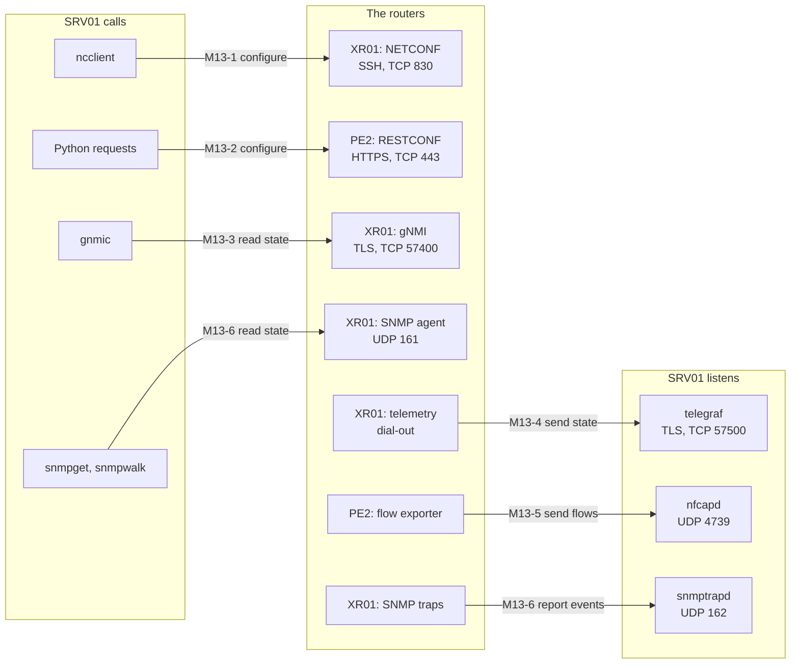
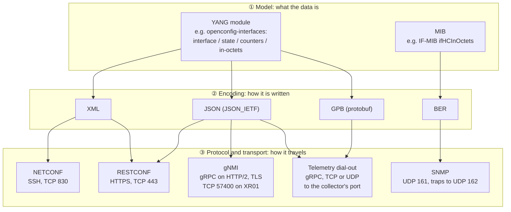

# M13 — The parts of automation and assurance and how they fit together

This unit is about managing routers from a program instead of by hand, and about watching what the network does. In
the CCNP Service Provider blueprint it is section 5.0, automation and assurance. Four of its topics are configured in
the lab: 5.7, gRPC and gNMI (dial-in and dial-out, TCP, TLS and mTLS certificates); 5.8, NetFlow and IPFIX; 5.9,
NETCONF and RESTCONF; and 5.10, SNMP v2c and v3. The pages also explain 5.1, the programmable APIs; 5.2, reading an
external script that configures a device through a REST API; and 5.4, YANG. 5.3 (NSO), 5.5 (Ansible and Terraform) and
5.6 (secure ZTP) are in the appendix, which also goes further into 5.1 and 5.4. The unit has five pages and an appendix.

| Page | Contents | Tasks |
|---|---|---|
| This page | The seven lines between SRV01 and the routers, and the three things to look at on each (who calls, what the line is for, whether it is locked); the model, the encoding and the protocol | — |
| Configuring through models: YANG, NETCONF and RESTCONF | What a data model is good for, the families of YANG models in IOS XR, NETCONF's candidate and commit, RESTCONF on IOS XE, reading a script | M13-1, M13-2 |
| Certificates and TLS from the ground up | Key pairs, signatures, certificates and CAs; the four checks in TLS; mutual TLS and who plays which part on each line | — |
| Streaming state: gNMI, telemetry and TLS | Reading state with gNMI, the router sending state by itself (dial-out), certificates and mutual TLS | M13-3, M13-4 |
| Counting flows and polling: NetFlow/IPFIX and SNMP | Flow records and their export, SNMPv2c and v3, traps | M13-5, M13-6 |
| Appendix | The programmable interfaces side by side, YANG in more depth, NSO, Ansible and Terraform, secure ZTP | — |

The lab is XRT-15. XR01 (IOS XRd) and PE2 (Catalyst 8000V, IOS XE) are provider edges, joined by the core link and
running IS-IS. CE1 is customer A, and sends through PE2. SRV01 is the network management station (NMS): a Linux server
with the tools and the receivers. The three meet on the NMS segment through SW1, a plain switch.

:::topo
nodes:
  CE1: {at: [2.7, -1.2], label: "CE1 (customer A)"}
  PE2: {at: [1.4, 0], label: "PE2 (Cat 8000V)"}
  XR01: {at: [4.0, 0], label: "XR01 (XRd)"}
  SW1: {at: [2.7, 1.2], label: "SW1"}
  SRV01: {at: [2.7, 2.3], kind: host, label: "SRV01 (NMS)"}
links:
  - [CE1, PE2, "ACCESS-A"]
  - [CE1, XR01, "BACKUP-A"]
  - [PE2, XR01, "CORE (IS-IS) 10.0.12.0/24"]
  - {a: PE2, b: SW1, la: "Gi3 .2", ta: 0.3}
  - {a: XR01, b: SW1, la: "Gi0/0/0/1 .1", ta: 0.3}
  - {a: SW1, b: SRV01, label: "NMS 10.0.50.0/24 (.10)"}
:::

On IOS XR in this lab (XRd, and XRv 9000 as well), RESTCONF and NetFlow are not available, so those two jobs are done on
PE2. Everything else is done on XR01.

Automation brings in many words at once: YANG, NETCONF, gNMI, telemetry, dial-out, TLS. What happens on this board,
though, is only seven lines between SRV01 and the routers. This page lays out the lines first (section 2.1), answers the
three questions worth asking of every line (sections 2.2 to 2.4), and only then puts the words and the layers in order.

## 1. What it is good for

### 1.1 The problem: one NMS, and four kinds of question

On this board, the NMS team at SRV01 needs four things from XR01 and PE2.

- Change their configuration: for example, add a loopback for a customer's service, the same way every time.
- Know their state: is the core link up, and how many packets has it carried in the last ten seconds.
- Know who sends what: which of customer A's hosts talk to whom through PE2, and how much.
- Hear at once when something happens, such as a link going down, without waiting for the next look.

With two routers, a person could do all this by hand. With hundreds, and with a change that must go into many routers
in exactly the same way, a person cannot; and someone who looks at a screen every few minutes misses what happened in
between.

### 1.2 What came before: the CLI for people, SNMP for numbers

The CLI is written for people. A script that logs in, types commands and reads the screen has to parse text, and that
text differs between IOS XR and IOS XE and can change between releases. A change sent as CLI lines is checked only by
reading the text that comes back. Network operators described these problems as early as 2002 (RFC 3535).

SNMP has long been the standard way to read numbers. The NMS asks (polls) for each value at an interval, so a change
between two polls is seen late, or not at all. Values are named by numbers (OIDs) in MIBs, and SNMPv2c sends its
password, the community, in clear text. SNMP is not widely used to configure devices (RFC 3535). It is still
everywhere for reading, and it is still in the blueprint (page *Counting flows and polling*).

### 1.3 The answer: a road for each job, and a model of the data

Automation separates the jobs and gives each its own roads.

- **Configure** through a model of the configuration, as a transaction: NETCONF, RESTCONF, gNMI Set. The router checks
  a change as a whole, and commits it or refuses it as a whole.
- **Watch state** by letting the router send it: telemetry, on a timer or when a value changes. SNMP polling stays for
  simple cases.
- **Count traffic** with flow records that the router exports: NetFlow v9 and IPFIX.
- **Hear of events** through messages the router sends at once: SNMP traps, and syslog.

On the configure and watch roads, the data is described by models written in YANG. A program then works with named,
typed data instead of screen text, and the same model can be carried by different protocols. The rest of this page
puts the parts in order.

## 2. How it works: the lines between SRV01 and the routers

### 2.1 Seven lines

M13 is about the lines between SRV01 and the routers. In the figure, each arrow points from the side that starts the
connection to the side that listens. SRV01 appears twice: on the left, the tools that connect; on the right, the
receivers that listen. The label on each arrow gives the task that uses the line, and what the line is for.



| Line (task) | Calls → listens | For | Lock |
|---|---|---|---|
| NETCONF (M13-1) | SRV01 (ncclient) → TCP 830 on XR01 | Configure | SSH |
| RESTCONF (M13-2) | SRV01 (Python requests) → TCP 443 on PE2 | Configure | TLS (HTTPS) |
| gNMI (M13-3) | SRV01 (gnmic) → TCP 57400 on XR01 | Read state | TLS (mutual TLS too) |
| SNMP polling (M13-6) | SRV01 (snmpget, snmpwalk) → UDP 161 on XR01 | Read state | None (v2c) |
| Telemetry dial-out (M13-4) | XR01 → TCP 57500 on SRV01 (telegraf) | Send state | TLS |
| Flow export (IPFIX) (M13-5) | PE2 → UDP 4739 on SRV01 (nfcapd) | Count traffic | None |
| SNMP traps (M13-6) | XR01 → UDP 162 on SRV01 (snmptrapd) | Report events | SNMPv3 authentication and encryption |

On every line, three things are worth looking at: who calls (section 2.2), what the line is for (section 2.3), and
whether it is locked (section 2.4). YANG, XML, JSON and GPB are how the contents of a line are written, laid out in
section 2.5. To begin with, it is enough to remember that YANG is the layout of a form, and XML, JSON and GPB are ways
of filling it in. Seven lines, and still only three questions.

### 2.2 Who calls: dial-in and dial-out, poll and push

Two questions are often mixed up. The first is **who opens the connection**. In dial-in, the NMS connects to a port
that the router listens on. In dial-out, the router connects to a port that the NMS listens on, or, over UDP, simply
sends. The second is **who decides when data flows**. In a poll, the NMS asks each time; in a push, the router sends
on a timer or when a value changes.

| | Poll: the NMS asks each time | Push: the router sends by itself |
|---|---|---|
| **Dial-in**: the NMS opens the connection | SNMP get and walk; NETCONF `<get>`; RESTCONF GET; gNMI Get, and Subscribe in ONCE or POLL mode | gNMI Subscribe in STREAM mode (SAMPLE every n seconds, or ON_CHANGE) |
| **Dial-out**: the router opens it, or just sends | — | Telemetry dial-out; IPFIX export; SNMP traps; syslog |

The two directions put the work in different places. In dial-in, the router's configuration is small: it opens a
listener and decides who may use it. What to read, and how often, is in each request the NMS sends. In dial-out, the
router's configuration holds everything: what to send, how often, to which address and port, in which encoding and
over which protocol. The router keeps the connection up by itself, and tries again when the collector is away. This is why the
configuration of each dial-out sender comes in blocks: what to send, where and how, and what joins the two (section
3.3).

The directions also decide which side needs an open port. In dial-in, the router listens: XR01 on TCP 830 and 57400
and UDP 161, PE2 on TCP 443. In dial-out, the NMS listens: SRV01 on TCP 57500, UDP 4739 and UDP 162. Access lists and
firewalls on the way must let the connection through in the direction it is opened.

### 2.3 What the line is for: four jobs

Each line serves one of the four jobs of section 1.3. The "roads" in the table are the ways a job can be done in
general; the right-hand column gives the lines that do it on this board.

| Job | Roads | On this board |
|---|---|---|
| Configure | The CLI over SSH; NETCONF; RESTCONF; gNMI Set | XR01: NETCONF (M13-1). PE2: RESTCONF (M13-2) |
| Watch state | SNMP polling; reads through NETCONF and RESTCONF; gNMI Get and Subscribe; telemetry dial-out | XR01: gNMI (M13-3), telemetry dial-out (M13-4), SNMPv2c (M13-6) |
| Count traffic | NetFlow v9; IPFIX | PE2: IPFIX (M13-5) |
| Hear of events | SNMP traps and informs; syslog | XR01: SNMPv3 traps (M13-6) |

On IOS XR, every road for configuration ends in the same place: the commit (M1). A change made through NETCONF or gNMI
is checked and committed like a CLI change, and the commit history shows which road it came by (section 3.4).

### 2.4 Whether it is locked: SSH, TLS, nothing

What protects a line depends on the line. NETCONF uses SSH; RESTCONF, gNMI and the telemetry dial-out use TLS. SNMPv2c
polling and the flow export use nothing, and SNMPv3 has authentication and encryption of its own.

In TLS, the side that listens (the server) shows a certificate, and the side that connects (the client) checks it. In
mutual TLS, the client shows a certificate too, and the server checks it. What a certificate is, who holds what, and
what is checked are on page *Certificates and TLS from the ground up*, starting from key pairs.

That page has two rules. Which end is the TLS server depends on who calls. The checking side holds the CA certificate.
So the same XR01 is the server on gNMI (the side that shows a certificate; with mutual TLS, also the side that checks
the client), and the client on the telemetry dial-out (the side that checks the collector's certificate).

The gNMI specification requires TLS and forbids falling back to an unencrypted session. IOS XR still offers `no-tls` on
its gRPC server. Where XR01 keeps its certificates and its trusted CAs, and how to change them, is on page
*Streaming state*.

### 2.5 What travels on a line: the model, the encoding, the protocol

The most common confusion is between words that sit on different layers. YANG is not a protocol, and NETCONF is not a
data format. Every piece of data on the configure and watch roads passes through three layers.

| Layer | The question it answers | Examples |
|---|---|---|
| ① Model | What data exists: names, types, nesting; what can be configured and what can only be read | YANG modules (native, unified, OpenConfig). For SNMP, the MIB |
| ② Encoding | How the data is written as bytes | XML; JSON (JSON_IETF); GPB (protobuf). For SNMP, BER |
| ③ Protocol and transport | Which requests can be made, who starts, and which connection carries and protects them | NETCONF over SSH; RESTCONF over HTTPS; gNMI over gRPC (HTTP/2 with TLS); telemetry dial-out over gRPC, TCP or UDP; SNMP over UDP |



One model can travel by several roads. As an example, the state of XR01's Loopback0 in the OpenConfig model was read
once with NETCONF and once with gNMI. Both answers carry the same leaf, `counters/carrier-transitions`, with the
value 1. NETCONF writes it in XML (an excerpt of the reply to `<get>`):

```console
  <interfaces xmlns="http://openconfig.net/yang/interfaces">
   <interface>
    <name>Loopback0</name>
    <state>
     <name>Loopback0</name>
...
     <counters>
      <carrier-transitions>1</carrier-transitions>
     </counters>
```

gNMI writes it in JSON_IETF (an excerpt of the reply to Get):

```console
        "Path": "openconfig:/interfaces/interface[name=Loopback0]/state",
        "values": {
          "interfaces/interface/state": {
            "admin-status": "UP",
            "counters": {
              "carrier-transitions": "1"
            },
```

In JSON_IETF, a 64-bit counter is written as a string (`"1"`, in quotes), as RFC 7951 prescribes for 64-bit integers.
A program that reads it has to turn it into a number first.

IOS XR offers three families of YANG models. The **native** models (`Cisco-IOS-XR-…-cfg` for configuration, `-oper`
for state) are XR's own. The **unified** models (`Cisco-IOS-XR-um-…-cfg`, since IOS XR 7.0.1) are generated from the
CLI and replace the native configuration models, so they read almost like the CLI. The **OpenConfig** models
(`openconfig-…`) come from a group of network operators and aim to be the same on every vendor's routers; what IOS XR
does differently is listed in its deviation modules. In its NETCONF hello, IOS XRd 26.1.1 lists 857 capabilities, among
them 220 unified models and 54 OpenConfig models.

### 2.6 The words side by side

A chain of shops works much the same way, and the right-hand column uses it as a picture: the NMS is the head office,
and the routers are the shops.

| Word | What it is | In a chain of shops |
|---|---|---|
| NMS | The server that configures and watches the routers; SRV01 on this board | The head office |
| Data model (YANG) | The definition of the data: names, types, nesting; what can be set and what can only be read | The printed report form: which boxes it has, and what goes in each |
| Native, unified, OpenConfig | XR's own models; XR's models laid out like its CLI; models shared between vendors | The company's old form; a new form laid out like the shop's own ledger; the trade association's common form |
| Encoding (XML, JSON, GPB) | How the data is written as bytes | Filling in the form in full words, or in a compact code |
| Protocol (NETCONF, RESTCONF, gNMI, SNMP) | The requests one side can make, and the session that carries them | The delivery service, and what it can be asked to do |
| Transport (SSH, HTTPS, gRPC over HTTP/2, UDP) | The connection underneath, and the protection it gives | The van, and whether it is locked |
| MIB, OID | SNMP's own model: a tree of objects named by numbers | An old form whose boxes have numbers instead of names |
| Poll | The NMS asks for a value each time it wants one | The head office phones to ask for today's sales |
| Push (telemetry) | The router sends values on a timer, or when they change | The shop sends its figures every hour without being asked |
| Dial-in, dial-out | Who opens the connection: the NMS, or the router | Who places the call |
| Trap | A message the router sends at once when something happens | The shop phones in when its shutter breaks |
| Flow record (NetFlow, IPFIX) | One line per conversation: who, to whom, which port, how much | A receipt. An interface counter is the till total |
| Certificate, CA | A signed statement of a name; the authority that signs them | An ID card; the office that issues ID cards |
| TLS, mutual TLS | The client checks the server's certificate; with mutual TLS, the server checks the client's too | Checking the courier's ID card; both checking each other's |

### 2.7 gRPC, gNMI and telemetry are three different words

**gRPC** is a general way for programs to call each other over HTTP/2, with messages written in protobuf. **gNMI** is
one service defined on gRPC, with four calls: Capabilities, Get, Set and Subscribe. **Model-driven telemetry** is the
router sending state on a schedule or on a change. It can be done through gNMI's Subscribe (dial-in), or by the router
connecting to a collector (dial-out); the dial-out rides on gRPC, on plain TCP or on UDP.

On XR01 these are configured in different places. The `grpc` configuration is the server that answers gNMI (dial-in).
The dial-out is configured under `telemetry model-driven`, with its own destination, port and protocol.

### 2.8 Counters and flow records are different things

An interface counter is one number per interface: how many packets and bytes went through. It says how much, but not
who. A flow record is one line per conversation: the source and destination addresses, the protocol and the ports, the
interface it came in on, and how many packets and bytes. It says who talked to whom, and how much.

The router builds flow records in a cache at an interface, and exports a record when the flow has been silent for a
while, or, for a long flow, every so often. The record goes to a collector over UDP: NetFlow v9 or IPFIX, which
describe their fields with templates (page *Counting flows and polling*).

For example, CE1 sent 37 pings of 748 bytes from 192.168.100.1 to XR01's Loopback0, through PE2. On the collector they
became one flow record. For ICMP, the type and the code stand where the destination port would be (`8.0`: an echo
request).

```console
$ nfdump -R /var/cache/nfdump/lab -o extended -c 10 'src ip 192.168.100.1'
Date first seen             Duration     Proto      Src IP Addr:Port          Dst IP Addr:Port     Flags Tos  Packets    Bytes      pps      bps    Bpp Flows
2026-11-10 14:27:08.500     00:00:00.049 ICMP     192.168.100.1:0     ->       10.255.0.1:8.0   ........   0       37    27676      755    4.5 M    748     1
```

### 2.9 One value, several lines

One value can reach SRV01 by several lines. Take the bytes received on XR01's GigabitEthernet0/0/0/0, the
core link:

| Road | How the value is named | Who starts; how it is written; port |
|---|---|---|
| CLI | `show interfaces GigabitEthernet0/0/0/0`: the line `… packets input, … bytes` | A person, over SSH; text for people; TCP 22 |
| SNMP | IF-MIB `ifHCInOctets`: `1.3.6.1.2.1.31.1.1.1.6.<ifIndex>` | SRV01 asks; BER; UDP 161 |
| NETCONF | A `<get>` on the OpenConfig `interfaces` tree: `…/state/counters/in-octets` | SRV01 asks; XML; TCP 830 |
| gNMI | `/interfaces/interface[name=…]/state/counters/in-octets`, read once (Get) or kept coming (Subscribe) | SRV01 opens; JSON_IETF; TCP 57400 |
| Telemetry dial-out | A YANG path of the same kind, written as a sensor path in XR01's configuration | XR01 opens and sends; GPB; TCP 57500 on SRV01 |
| IPFIX | Not this counter: the bytes of each flow that enters PE2 from CE1 | PE2 sends; IPFIX records; UDP 4739 on SRV01 |

SNMP names an interface by a number, its ifIndex, which has to be found first (in `ifDescr`, `1.3.6.1.2.1.2.2.1.2`).
YANG names it by a key, its name: the `…` in the gNMI path is `GigabitEthernet0/0/0/0`.

### 2.10 Key points

- Seven lines. On each, look at three things: who calls, what the line is for, and whether it is locked.
- Who opens the connection (dial-in, dial-out) and who decides when data flows (poll, push) are two separate questions.
  In dial-out, the whole subscription is in the router's configuration.
- Four jobs: configure, watch state, count traffic, hear of events. On IOS XR every configure road ends in the same
  commit.
- The TLS server is the side that listens. The checking side holds the CA certificate. The same XR01 is a server on
  one line and a client on another.
- Three layers: the model says what the data is (YANG, or a MIB), the encoding how it is written (XML, JSON, GPB, BER),
  the protocol how it travels (NETCONF, RESTCONF, gNMI, dial-out, SNMP). One model can travel by several roads.
- An interface counter says how much; a flow record says who talked to whom.

## 3. Building it: where each part is configured

### 3.1 Where each job is configured

| Job | XR01 (IOS XR) | PE2 (IOS XE) | SRV01 (the tool) |
|---|---|---|---|
| NETCONF | `ssh server netconf vrf …`, `netconf-yang agent` → `ssh` | — (not used on this board) | ncclient (Python) |
| RESTCONF | — (not on XRd or XRv 9000) | `ip http secure-server`, `restconf`, a local user with privilege 15 | Python requests, curl |
| gNMI (dial-in) | `grpc`: `port`, `address-family`, TLS or `no-tls`, `tls-mutual` | — | gnmic |
| Telemetry dial-out | `telemetry model-driven`: `sensor-group`, `destination-group`, `subscription` | — | telegraf |
| Flow records | — (`flow exporter-map`, `flow monitor-map` and `sampler-map` exist on hardware platforms, not on XRd or XRv 9000) | `flow record`, `flow exporter`, `flow monitor`; `ip flow monitor … input` on the interface | nfcapd, nfdump |
| SNMP polling | `snmp-server community`, `view`, `group`, `user` | — | snmpget, snmpwalk |
| SNMP traps | `snmp-server host`, `snmp-server traps …` | — | snmptrapd |

### 3.2 Roads the NMS starts: the router only listens

In dial-in, the router's side is a listener and the rules for who may use it. The example opens NETCONF and the gRPC
server on XR01. It has the same form as the start of Tasks M13-1 and M13-3, so it is folded.

:::config fold XR01 — accept NETCONF and gNMI from the NMS
ssh server netconf vrf default                ## NETCONF rides on the SSH server; answer it in this VRF (the global table)
netconf-yang agent
 ssh                                          ## the NETCONF agent, reached over SSH on TCP 830 (the default port)
!
grpc                                          ## the gRPC server that answers gNMI; TLS is on unless no-tls is written
 port 57400                                   ## 57400 is the default (57344 to 57999 can be used)
 address-family ipv4                          ## listen on IPv4
!
:::

PE2 needs a web server, the RESTCONF service on top of it, and an account that may change the configuration. The
account in the example is not the one of Task M13-2; the form is the same, so it is folded.

:::config fold PE2 (IOS XE) — accept RESTCONF from the NMS
username nms-ops privilege 15 secret Ops-Pass-15   ## a local account; with privilege 1, RESTCONF answers 403 (access denied)
no ip http server                                  ## keep plain HTTP closed
ip http secure-server                              ## the HTTPS server that RESTCONF rides on (TCP 443)
restconf                                           ## the RESTCONF service; it starts answering about a minute later
:::

Nothing in these examples says what the NMS will read or change. That is in each request: the XML of a NETCONF
`<edit-config>`, the URL and body of a RESTCONF request, the path of a gNMI Get.

### 3.3 Roads the router starts: the router holds the whole subscription

In dial-out, the router's configuration says what to send, where and how, and joins the two. All three senders on this
board have that shape, and their parts refer to each other by name:

| Sender | What to send | Where, and how | What joins them and switches it on |
|---|---|---|---|
| Telemetry dial-out (XR01) | `sensor-group`: the sensor paths (YANG paths) | `destination-group`: address, port, encoding, protocol, TLS | `subscription`: a sensor group with its interval, a destination group, the source interface |
| Flow export (PE2) | `flow record`: `match` (the fields that tell flows apart) and `collect` (what is counted) | `flow exporter`: destination, source, UDP port, NetFlow v9 or IPFIX | `flow monitor`: a record, an exporter and the cache timers; then `ip flow monitor` on an interface and a direction |
| SNMP traps (XR01) | `snmp-server traps …`: which events | `snmp-server host`: address, version, user | `snmp-server user`, `group` and `view`: the SNMPv3 security that the traps are sent under |

How each sender is built, part by part, is on its own page: *Streaming state* for telemetry, and *Counting flows and
polling* for the flow export and the traps.

### 3.4 Reading the output: which road changed the configuration

The commit history of IOS XR shows how each change came in. `Line` is the road, and `Client` the kind of client:

```console
RP/0/RP0/CPU0:XR01#show configuration commit list 4
SNo. Label/ID              User      Line                Client      Time Stamp
~~~~ ~~~~~~~~              ~~~~      ~~~~                ~~~~~~      ~~~~~~~~~~
1    1000000007            SUZUKI    rollback            Rollback    Tue Nov 10 13:03:11 2026
2    1000000006            SUZUKI    netconf             YANG Frame  Tue Nov 10 13:03:07 2026
3    1000000005            SUZUKI    netconf             YANG Frame  Tue Nov 10 13:02:42 2026
4    1000000004            SUZUKI    vty0:node0_RP0_CPU  CLI         Tue Nov 10 13:02:19 2026
```

- `vty…` and `CLI`: a change typed at the CLI.
- `netconf` and `YANG Frame`: a change sent through NETCONF. A change sent through gNMI Set shows `ems` (the gRPC
  server's process) and `YANG Frame`.
- `rollback` and `Rollback`: XR01 took a change back by itself. Change 2 was a confirmed commit sent through NETCONF;
  its session closed without confirming it, and four seconds later XR01 rolled it back.

Whether each road is open can be read on both ends:

| Road | On the router | On SRV01 |
|---|---|---|
| NETCONF | `show netconf-yang clients`, `show netconf-yang statistics` | The hello of a NETCONF session (ncclient) |
| RESTCONF (PE2) | `show platform software yang-management process` (`nginx` and `confd` Running) | The HTTP status code of a request |
| gNMI | `show grpc` | `gnmic … capabilities` |
| Telemetry dial-out | `show telemetry model-driven subscription`, `show telemetry model-driven destination` | The collector's file |
| Flow export (PE2) | `show flow exporter`, `show flow monitor … cache` | `nfdump` |
| SNMP | `show snmp` | `snmpget`; the trap receiver's log |

`show grpc` shows whether the gRPC server uses TLS, and with which certificate:

```console
RP/0/RP0/CPU0:XR01#show grpc | include "TLS|Certificate"
TLS                                     : enabled
TLS mutual                              : disabled
Certificate Authentication              : disabled
Certificate common name                 : ems.cisco.com
...
```

### 3.5 Pitfalls

- **The encoding has to be one the router offers**: gNMI on XR01 offers only JSON_IETF (`supported encodings` in the
  answer to Capabilities). A Get that asks for JSON is refused with `unsupported get-request encoding: JSON`.
- **TLS needs a TLS client, and the client checks the name**: a gNMI client without TLS gets only
  `error reading server preface: EOF`. A client that connects to 10.0.50.1 and checks the name finds only
  `ems.cisco.com` in XR01's certificate, and stops with `doesn't contain any IP SANs` (page *Streaming state*).
- **Every road changes one configuration**: while a NETCONF session holds a confirmed commit, a commit at the CLI
  fails with `Another configuration session had a lock on the running configuration`.
- **NETCONF can write more than the CLI allows**: the Programmability Configuration Guide notes that NETCONF access
  gives write permission by default, even to a user whose CLI access is read-only. Limit who can reach NETCONF.
- **Open each listener only where it is needed**: NETCONF answers only in the VRFs named in `ssh server netconf vrf`.
  For the other services, limit where they answer with MPP and access lists (page *Securing the management plane*,
  section 2).

## Practice

The six tasks are in lab **XRT-15**, two after each of the pages *Configuring through models*, *Streaming state* and
*Counting flows and polling*. Much of the work is done on SRV01: log in
to it from the workspace console with the lab account.

<p class="tolab"><a href="/_learn?id=XRT-15">Open lab XRT-15 in the workspace</a> — <a href="e1-m13-practice.html">Tasks M13-1 and M13-2</a></p>

:::note
The output on this page was taken on IOS XRd 26.1.1 (XR01 of XRT-15) and IOS XE 17.15.1a on Catalyst 8000V (PE2), with
gnmic 0.49.1, ncclient, telegraf 1.32.3 and nfdump on Ubuntu 24.04 (SRV01). On the PoC
board, IOS XRv 9000 26.1.1 and IOS XRd 26.1.1 behaved the same for NETCONF, gNMI, telemetry and SNMP, and neither has
RESTCONF or NetFlow. Sources: RFC 3535 (sections 2.1, 2.4 and 5), RFC 6241, RFC 6242, RFC 7950, RFC 7951 (section
6.1), RFC 8040, the gNMI specification (openconfig: sections 2.3, 3.1 and 3.5), RFC 3417 (sections 3.2 and 8), RFC 2863
(IF-MIB), RFC 1901, RFC 7011 and RFC 3954. The Programmability Configuration Guide for IOS XR (Cisco 8000 cumulative and ASR 9000
26.x: the model families, the gRPC server and its authentication methods, the note on NETCONF rights), the System
Management Configuration Guide (ASR 9000 26.x: NETCONF; NCS 5500 26.x: SNMP), the Telemetry Configuration Guide (Cisco
8000 cumulative and NCS 5500 26.x: dial-in and dial-out, encodings, TLS) and the NetFlow Configuration Guides (ASR 9000
26.x; IOS XE 17.x). All checked in November 2026. The following were measured on the PoC board and on XRT-15: the commit
history, the two answers for Loopback0, the hello counts, the encodings gNMI offers, the error
messages, the flow record, RESTCONF's start-up delay and its answer to a privilege-1 user.
:::
