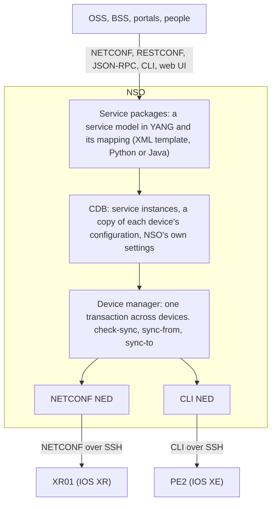
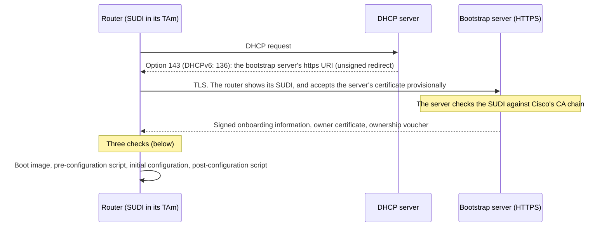

# M13 — Appendix

This appendix covers the items of blueprint section 5.0 that the main pages explain only briefly or not at all: the
programmable interfaces as a whole (5.1), YANG in more depth (5.4), NSO (5.3), Ansible and Terraform (5.5) and secure
ZTP (5.6). None of them is configured in the lab; the examples are written on the XRT-15 board only to be read. At the
end are what was checked on the four platforms of this unit and a command correspondence table.

## 1. The programmable interfaces at a glance

### 1.1 What a program needs from a router

The CLI was made for people. A person reads `show interfaces` and finds the line they want; a program has to cut the
same numbers out of text laid out for the eye, and that layout can change between releases and differs between
vendors.

Sending configuration as CLI lines has the same weakness: the program learns what the router accepted only by
reading error text. Cisco's programmability guide for the ASR 9000 says it plainly: "the general mechanism of CLI
scraping is not flexible and optimal".

A program needs four things that the CLI does not give: data whose names and types are fixed in advance (a model);
several changes applied as one unit, whole or not at all (a transaction); errors that point to the element that failed;
and state that arrives without being asked for each time (push). The model-driven interfaces give these. The CLI
stays, for people and for troubleshooting.

### 1.2 The interfaces side by side

| Interface | Carried over | Data written as | Model | Who opens the connection | Main use | On XRT-15 |
|---|---|---|---|---|---|---|
| CLI | SSH (TCP 22) | Text for people | None (the CLI's own grammar) | The client | People; scripts that send commands and read text | Everywhere |
| SNMP | UDP 161 (requests), UDP 162 (traps) | BER | MIB | The NMS for requests; the device for traps | Counters, status, events | XR01 (M13-6) |
| NETCONF (RFC 6241) | SSH, TCP 830 (RFC 6242) | XML | YANG | The client | Configuration through datastores, locks, candidate and commit; reading state | XR01 (M13-1) |
| RESTCONF (RFC 8040) | HTTPS, TCP 443 | XML or JSON | YANG | The client | The same YANG data as web resources: GET, POST, PUT, PATCH, DELETE | PE2 (M13-2) |
| gNMI | gRPC over HTTP/2, with TLS | Protobuf messages; values in JSON_IETF and other encodings | YANG (OpenConfig and native paths) | The client (dial-in) | Capabilities, Get, Set, Subscribe | XR01 (M13-3) |
| Telemetry dial-out | gRPC, TCP or UDP | GPB (compact or self-describing) or JSON | YANG (sensor paths) | The device | Sending state to a collector on a timer or on change | XR01 (M13-4) |
| gNOI | gRPC | Protobuf | One `.proto` definition per service | The client | Operations: ping, traceroute, reboot, files, certificates, software | — |
| gRIBI | gRPC | Protobuf | OpenConfig AFT (forwarding entries) | The client | A controller adds and removes routing entries | — |
| P4Runtime | gRPC | Protobuf | The tables of a P4 program | The client (a controller) | A controller fills the forwarding tables a P4 program defines | — |

The first two rows are the older roads. NETCONF, RESTCONF, gNMI and telemetry carry YANG data; the main pages cover them.
The gNMI specification requires TLS on every session ("a target or client MUST NOT fall back to unencrypted
sessions"); IOS XR's `no-tls` is an option outside the specification.

The last three rows are further services on the same gRPC server. None of them is used in this unit:

- **gNOI** (gRPC Network Operations Interface) "defines a set of gRPC-based microservices for executing operational
  commands on network devices": for example ping, traceroute, time and reboot (the `system` service), file transfer
  (`file`), certificate management (`cert`) and software installation (`os`).
- **gRIBI** (gRPC Routing Information Base Interface) lets an external program add and remove entries in the router's
  routing table. The entries are described with a protobuf form of OpenConfig's AFT model.
- **P4Runtime** is "a control plane protocol for controlling the data plane elements of a device or program defined by a
  P4 program": the controller writes the entries of the tables that the P4 program declares.

On IOS XR all of them run on the gRPC server (`grpc`). The programmability guide for the Cisco 8000 has configuration
chapters for gRIBI and P4Runtime; the guides for the NCS 5500 and the ASR 9000 only mention them. From release 24.1.1,
gNMI, gRIBI and P4Runtime can also listen on the ports IANA assigned to them (9339, 9340 and 9559). Which of these a
router offers depends on the platform and the release.

### 1.3 Model-driven and CLI-driven

| | CLI-driven | Model-driven |
|---|---|---|
| What the program sends | Command lines, as a person would type them | Data in a tree that a YANG model defines (XML, JSON or protobuf) |
| What comes back | Text laid out for people | Data in the same tree, with names and types |
| How the program knows what is valid | Trial and error, or the guide | The model: types, ranges, keys, mandatory nodes. The router checks the data against it |
| When something is refused | An error message to parse | An error that names the element (NETCONF's `error-path`) |
| Several changes at once | Line by line (on IOS XR the CLI commit groups them) | One NETCONF commit or one gNMI SetRequest: all or nothing |
| Several vendors | Different commands for each | The OpenConfig models are shared; each vendor's own models stay its own |
| State | Polled and parsed | Read by path, or streamed (telemetry) |

The model does not replace the CLI's view of the configuration. IOS XR's unified models are generated from the CLI, so
both describe the same configuration, and a change made through NETCONF or gNMI appears in `show running-config` and in
the commit list like any other (main page *Configuring through models*).

### 1.4 On-box and off-box

Off-box automation runs on another machine: an NMS, an orchestrator such as NSO, an Ansible control node. It reaches
the router through the interfaces above, sees many routers at once, and needs a working path to each of them.

On-box automation runs on the router itself. IOS XR's programmability guide has four kinds of automation scripts, written
in Python:

- **Config scripts** "are invoked automatically when you change a configuration and commit the changes". They can block
  the commit with an error, return a warning, or change the configuration being committed: house rules for the
  configuration.
- **Exec scripts**: "Automate operational tasks and network troubleshooting." Run on demand.
- **Process scripts**: "Monitor the system continuously using daemons."
- **EEM scripts**: "Respond to a predefined set of events."

IOS XR can also host third-party applications in containers (application hosting). An on-box script keeps working when
the path to the NMS is down and reacts at once to what happens on its router, but it sees only that router. The guide
describes on-box scripting as similar to off-box scripting, with the management software that would run on an
external controller moved into the router.

## 2. YANG in more depth

### 2.1 Modules and submodules

The unit of YANG is the **module**: a file with a name, a namespace, a prefix and a revision date. The router lists its
modules in the NETCONF hello and in the gNMI Capabilities. RFC 7950 calls a module self-contained and "compilable":
together with what it imports and includes, it can be read on its own.

A large module can be split into **submodules**. A submodule is a partial definition. It names its module with
`belongs-to`, and only that module, or another of its submodules, may include it. Cisco's model set for IOS XR has an
example: `tailf-common`, which the unified models import, is built from two submodules.

```text
module tailf-common {
  namespace "http://tail-f.com/yang/common";
  prefix tailf;
  include tailf-meta-extensions { ... }
  include tailf-cli-extensions { ... }
  ...

submodule tailf-cli-extensions {
  belongs-to tailf-common {
    prefix tailf;
  }
  ...
```

Modules refer to each other in two ways. `import` borrows another module's types and groupings, and lets a module
point into another module's tree (augment and deviation, section 2.4). `include` brings in the module's own
submodules. The unified models import `Cisco-IOS-XR-types` for XR's own types, such as the type of an interface name.

### 2.2 Reading a tree diagram

A model is long to read as text. A **tree diagram** (RFC 8340) prints only its shape, one line per node, and
`pyang -f tree` prints it from the module file. This is part of the unified model for name resolution in IOS XR 26.1.1,
`Cisco-IOS-XR-um-domain-cfg` (folded branches are shown as `...`):

```text
module: Cisco-IOS-XR-um-domain-cfg
  +--rw domain
     +--rw list
     |  ...
     +--rw lookup
     |  +--rw disable!
     |  +--rw source-interface?   xr:Interface-name
     +--rw name?            xr:Cisco-ios-xr-string
     +--rw ipv4
     |  +--rw hosts
     |     +--rw host* [host-name]
     |        +--rw host-name     string
     |        +--rw ip-address*   inet:ipv4-address-no-zone
     +--rw name-servers
     |  +--rw name-server* [order address]
     |     +--rw order      uint32
     |     +--rw address    inet:ip-address-no-zone
     ...
```

| Mark | Meaning | In the tree above |
|---|---|---|
| `rw` | Configuration (`config true`) | Every node: this is a `-cfg` model |
| `ro` | State (`config false`), and the output of operations | Section 2.3 |
| `?` | An optional leaf | `name?`: the domain name may be absent |
| `*` | A list or a leaf-list: may have many entries | `host*` is a list, `ip-address*` a leaf-list |
| `[…]` | The keys of a list | `host* [host-name]`; `name-server* [order address]` has two keys |
| `!` | A presence container: its existence is the setting | `disable!` |
| `-x`, `-w`, `-n` | An operation (rpc or action), its input, a notification | Section 2.5 |
| `prefix:name` | A node that another module adds (augment) | Section 2.4 |

The kinds of node: a **container** groups other nodes and has no value of its own (`domain`, `ipv4`, `hosts`); a
**list** holds entries told apart by its key (`host`, keyed by `host-name`); a **leaf** holds one value of one type
(`name`, `order`); a **leaf-list** holds several values of one type (`ip-address`: a host can have several addresses).

A list that holds configuration must have a key (RFC 7950, 7.8.2).

These CLI lines fill the nodes of the tree above. They are not part of the lab; they only show how the model and the
CLI line up.

:::config XR01 — name resolution entries (the nodes of the tree above)
domain name nms.lab                      ## Leaf name: one value
domain ipv4 host srv01 10.0.50.10        ## An entry of list host (key host-name = srv01); the address goes into leaf-list ip-address
domain lookup disable                    ## Presence container lookup/disable: the line exists, or not
:::

The same host entry in XML, as NETCONF would carry it:

```text
<domain xmlns="http://cisco.com/ns/yang/Cisco-IOS-XR-um-domain-cfg">
  <ipv4>
    <hosts>
      <host>
        <host-name>srv01</host-name>
        <ip-address>10.0.50.10</ip-address>
      </host>
    </hosts>
  </ipv4>
</domain>
```

### 2.3 Configuration and state: config true and false

`config false` marks **state**: values the router reports but nobody configures (status, counters). RFC 7950: "Data
nodes representing state data are not part of configuration datastores." A node takes the setting of its parent, and
nothing below a `config false` node can be configuration. In a tree diagram it is the difference between `rw` and `ro`.

OpenConfig puts the two side by side under each object: what was asked for in `config`, what the router is doing in
`state`. This is `openconfig-interfaces` as IOS XR 26.1.1 ships it (shortened):

```text
module: openconfig-interfaces
  +--rw interfaces
     +--rw interface* [name]
        +--rw name             -> ../config/name
        +--rw config
        |  +--rw name?            string
        |  +--rw type             identityref
        |  +--rw mtu?             uint16
        |  +--rw loopback-mode?   oc-opt-types:loopback-mode-type
        |  +--rw description?     string
        |  +--rw enabled?         boolean
        +--ro state
        |  +--ro name?            string
        |  +--ro type             identityref
        |  ...
        |  +--ro admin-status     enumeration
        |  +--ro oper-status      enumeration
        |  ...
        ...
```

What it means for requests: NETCONF `<get-config>` returns configuration only, and `<get>` returns configuration and
state (RFC 6241, 7.1 and 7.7). IOS XR's native models do not mix the two in one module; they split them into `-cfg` and
`-oper` modules (main page *Configuring through models*).

The tree also explains an error. The key `name` points to `config/name` (`->` is a reference), and `type` in `config`
has no `?`: it is mandatory. On IOS XR 26.1.1, an OpenConfig gNMI Set that sent only `config/description` was refused
until `config/name` and `config/type` were sent as well.

### 2.4 augment and deviation

`augment` adds nodes into another module's tree. The module being added to does not change; a router that implements
both shows one tree. In a tree diagram, an added node carries the prefix of the module that added it. In 26.1.1, the NTP
model adds a trap switch into the SNMP model's `traps` container:

```text
augment "/a1:snmp-server/a1:traps" {          (in Cisco-IOS-XR-um-ntp-cfg)
  container ntp {
    presence "Indicates a ntp node is configured.";
    description "Enable SNMP Cisco Ntp traps";
  }
}

module: Cisco-IOS-XR-um-snmp-server-cfg         (pyang -f tree, with both modules loaded)
  +--rw snmp-server
     +--rw traps
        +--rw snmp
        |  ...
        +--rw um-ntp-cfg:ntp!
```

In the CLI the two modules make one line, `snmp-server traps ntp`. In XML the `ntp` element carries the NTP model's
namespace inside the SNMP model's elements, the same way an interface's address carried its own namespace on the main
page.

`deviation` is how a router declares where it does not implement a model as written. RFC 7950 explains why: an
application should learn a limit in advance rather than by failing (5.6.3). There are four kinds of `deviate`:
`not-supported` (the node does not exist on this router), and `add`, `replace` and `delete` (a property such as a
default value, a range or `config` is added, changed or removed).

Deviations are kept in a module of their own, and the
hello names it next to the model it changes. From Cisco's list for XRd 26.1.1:

```text
http://openconfig.net/yang/system-grpc?module=openconfig-system-grpc&revision=2024-05-29&deviations=cisco-xr-openconfig-system-grpc-deviations

deviation /oc-sys:system/oc-sys-grpc:grpc-servers/oc-sys-grpc:grpc-server/oc-sys-grpc:connections {
  deviate not-supported;
}
```

OpenConfig's model of the gRPC server has a list of the current connections; IOS XR does not report it. A program that
reads deviations knows this before it asks.

### 2.5 Operations and events: rpc, action, notification

A model describes operations and events as well as data.

- **rpc**: an operation of the whole module, with `input` and `output`. NETCONF's own operations (`get-config`,
  `edit-config`, `commit`) are defined this way in the YANG module of RFC 6241. IOS XR's operation models end in `-act`;
  `Cisco-IOS-XR-ping-act` defines `ping` (tree below).
- **action** (new in YANG 1.1): an operation tied to one node of the data tree and called on one entry. RFC 7950's example
  resets one server in a list of servers.
- **notification**: an event the router sends without being asked. NETCONF delivers notifications to a client that has
  subscribed; XR01's hello listed the `notification` and `interleave` capabilities.

```text
module: Cisco-IOS-XR-ping-act
  rpcs:
    +---x ping
       +---w input
       |  +---w destination!
       |  |  ...
       |  +---w ipv4* [destination]
       |  +---w ipv6!
       +--ro output
          +--ro ping-response
             ...
```

### 2.6 What the model buys

- **Checked before it is applied.** Types, ranges, keys and mandatory nodes are in the model; the router checks a
  request against it and refuses what does not fit, naming the element. NETCONF's `validate` checks a datastore without
  applying it (RFC 6241, 8.6).
- **Discoverable.** The hello lists every module, revision and deviation, so a client knows what it may send before it
  sends anything.
- **Readable by programs.** Tools build trees, code and documentation from the module files (`pyang` above).
- **Shared between vendors.** An OpenConfig model is the same on every router that implements it, and the deviations
  show the gaps.
- **One model, several roads.** The same tree travels as XML over NETCONF and as JSON over RESTCONF and gNMI (RFC 7951).
- **Changed as a whole.** A NETCONF candidate and commit, or one gNMI SetRequest, applies all of its changes or none
  (RFC 6241, 8.3; the gNMI specification, 3.4.3).

## 3. NSO, the Network Services Orchestrator

### 3.1 What it is for

Adding a customer site on this board means lines on PE2 (IOS XE) and on XR01 (IOS XR), in two syntaxes and in the right
order; when the customer leaves, it means removing exactly those lines and nothing else. A script can push the lines.
The hard parts are changing a service later, removing it cleanly, and remembering which line belongs to which customer.

Cisco Network Services Orchestrator (NSO) works on that layer. Its documentation describes it as "acting as an interface
between people or software that want to configure the network and the devices in the network".

The operator describes a service (customer A, site 2, a VLAN, addresses); NSO turns it into the configuration of each device, through a model of
the service written in YANG, for devices of several vendors.

### 3.2 The parts

If NSO managed this board, it would look like this (the kinds of NED are an example; either kind could be used for
either router):



| Part | What it does |
|---|---|
| CDB | NSO's database, defined by YANG: the service instances, a copy of the configuration of every managed device, and NSO's own run-time settings. What is stored is validated against the schema. It also records which device configuration each service instance produced |
| NED (Network Element Driver) | The connection to one kind of device, installed as a package. Four kinds, by the device's interface: NETCONF (YANG models only, no code), CLI (NSO renders and parses the device's CLI from YANG models; over SSH or Telnet), generic (other interfaces such as REST, RESTCONF or gNMI) and SNMP |
| Service package | The service model in YANG and the mapping from it to the device models: an XML template, code in Python or Java, or both |
| Device manager | Talks to the devices through the NEDs, and finds and repairs changes made outside NSO: `check-sync`, `compare-config`, `sync-from`, `sync-to` |
| Northbound interfaces | For people: a CLI (Cisco style or Juniper style) and a web UI. For programs: NETCONF, RESTCONF, JSON-RPC, and APIs in Python, Java and Erlang. An SNMP agent, for watching NSO itself |

### 3.3 FASTMAP: write the create, get the change and the delete

A service is written as "what to create". NSO's documentation: "NSO reduces this problem to a single data-mapping
definition for the 'create' scenario." When a service instance is created, NSO stores the reverse of the device changes
it made (the **reverse diff**) together with the instance.

| The operator | What NSO does |
|---|---|
| Creates a service instance | Runs the mapping (create) with the inputs, sends the device changes, stores their reverse diff with the instance |
| Changes an input | Applies the reverse diff in an isolated transaction (undoing the old create), runs create again with the new inputs, and sends the devices only the net difference |
| Deletes the instance | Applies the reverse diff: removes exactly what the service added |
| `re-deploy` | Runs the mapping again and deploys any difference from the current configuration (for example after someone changed a device by hand) |
| `un-deploy` | Removes the service's device configuration but keeps the service, so that it can be deployed again later |

Hence the rule in NSO's documentation: the create code must produce the same device changes for the same inputs, every
time it runs.

### 3.4 One transaction across devices

A commit in NSO changes every device it touches in one transaction: "The changes to the devices are done in a
distributed and atomic transaction across all devices in parallel." If one device fails, all are rolled back and the CDB
is not updated. That holds for devices with no transactions of their own, such as those configured through the CLI.

NSO keeps a rollback file for every commit, so a whole transaction can also be undone later
(`rollback-files apply-rollback-file`, when rollback is enabled in `ncs.conf`). `commit dry-run outformat native` shows
the commands each device would receive, without sending them. In large networks a commit queue sends the device changes
after the database lock is released.

Before it trusts its copy, NSO can check whether a device was changed behind its back: `check-sync` (cheap: it compares
timestamps, transaction IDs or checksums, whatever the device supports), `compare-config` (shows the difference), then
`sync-from` (take the device's configuration) or `sync-to` (push NSO's). It is the idea of IOS XR's commit and rollback
(M1), stretched over the whole network.

### 3.5 NSO and the NMS on XRT-15

On this board SRV01 is the NMS: it receives state (telemetry, IPFIX, traps), polls with SNMP and, in the tasks,
configures XR01 and PE2 directly.

NSO would not replace the collectors. It would sit beside SRV01 as the configuration
layer: a portal or OSS asks NSO for "customer A, site 2", NSO configures XR01 and PE2 through their NEDs in one
transaction, and telegraf, nfcapd and snmptrapd go on receiving what the routers send. NSO's SNMP agent is for watching
NSO, not the network.

## 4. Configuration management tools: Ansible and Terraform

### 4.1 Ansible: ordered tasks, pushed from a control node

Ansible runs on one machine, the **control node**, and acts on **managed nodes** listed in an **inventory**. It
installs nothing on them ("Agent-less architecture"). The work is written in a **playbook**, in YAML: a playbook holds
plays, a play applies an ordered list of tasks to a group of hosts, and each task calls a **module**. Modules come in
**collections**; Cisco's are `cisco.iosxr` and `cisco.ios`.

With network devices one thing is different: the modules run on the control node, not on the device, and talk to the
device through a connection plugin. `ansible_network_os` names the platform (`cisco.iosxr.iosxr`, `cisco.ios.ios`).

| `ansible_connection` | Protocol | In the Cisco collections |
|---|---|---|
| `ansible.netcommon.network_cli` | CLI over SSH | The most common. `iosxr_config`, `iosxr_command` and the resource modules use it |
| `ansible.netcommon.netconf` | XML over SSH (NETCONF) | In `cisco.iosxr`, only a few modules use it (banner, system, user) |
| `ansible.netcommon.httpapi` | An API over HTTP or HTTPS | Not provided by `cisco.iosxr` or `cisco.ios` |

**Resource modules** (`iosxr_interfaces`, `iosxr_l3_interfaces` and many more) describe one part of the configuration as
data, and take a `state`:

| `state` | What it does |
|---|---|
| `merged` | Merges the given settings into the device's (the default) |
| `replaced` | Replaces the settings of the named objects with the given ones |
| `overridden` | Makes the whole part of the configuration equal to the given settings; can remove your own access |
| `deleted` | Removes the settings and restores the defaults |
| `gathered` | Reads the device's settings as data |
| `rendered` | Prints the commands for the given settings, without a device |
| `parsed` | Turns configuration text into data, without a device |

A run is **idempotent**: "When the system is in the state your playbook describes, Ansible does not change anything,
even if the playbook runs multiple times." A resource module computes the commands from the difference, sends nothing
when there is none, and reports `changed` only when it sent something.

`--check` runs without changing the device and
reports what would change; `--diff` shows before and after. `iosxr_config`, which sends raw lines, commits by itself;
in check mode it loads the lines into the candidate, reads the difference and discards it.

### 4.2 An Ansible example on the XRT-15 board

Ansible is not installed on SRV01; this example is only to be read. It adds a loopback on XR01 and a description on
PE2, through the CLI over SSH.

:::config SRV01 — inventory.ini: the managed nodes and how to reach them
[xr]                                              ## A group of hosts
XR01 ansible_host=10.0.50.1                       ## XR01, on the NMS segment
[xe]
PE2 ansible_host=10.0.50.2                        ## PE2, on the NMS segment
[xr:vars]                                         ## Settings for every host of the group
ansible_connection=ansible.netcommon.network_cli  ## CLI over SSH
ansible_network_os=cisco.iosxr.iosxr              ## The platform: IOS XR
[xe:vars]
ansible_connection=ansible.netcommon.network_cli
ansible_network_os=cisco.ios.ios                  ## The platform: IOS and IOS XE
:::

:::config SRV01 — lo210.yml: a loopback on XR01, a description on PE2
- name: XR01 - a loopback for the NMS tests      ## A play
  hosts: XR01                                    ## Which hosts of the inventory
  gather_facts: false                            ## Do not collect facts first
  tasks:
    - name: Loopback210 and its description
      cisco.iosxr.iosxr_interfaces:              ## A resource module: interfaces
        config:
          - name: Loopback210
            description: ANSIBLE-DEMO
            enabled: true                        ## Becomes "no shutdown"
        state: merged                            ## Merge into the device's configuration
    - name: Its IPv4 address
      cisco.iosxr.iosxr_l3_interfaces:           ## A resource module: L3 settings of interfaces
        config:
          - name: Loopback210
            ipv4:
              - address: 10.255.210.1/32         ## Written as a prefix; the module turns it into a mask
        state: merged

- name: PE2 - describe the customer port         ## A second play, for PE2
  hosts: PE2
  gather_facts: false
  tasks:
    - name: GigabitEthernet2 description
      cisco.ios.ios_interfaces:                  ## The same kind of module, from the IOS collection
        config:
          - name: GigabitEthernet2
            description: CUSTOMER-A-ACCESS
        state: merged
:::

```console
nms@SRV01:~$ ansible-playbook -i inventory.ini lo210.yml --check --diff
nms@SRV01:~$ ansible-playbook -i inventory.ini lo210.yml
```

The first run only reports what would change. To see the commands without any device, set every `state` to `rendered`
and run the playbook. Example output:

```console
TASK [Loopback210 and its description] *****************************************
ok: [XR01] => {"changed": false, "rendered": ["interface Loopback210", "description ANSIBLE-DEMO", "no shutdown"]}

TASK [Its IPv4 address] ********************************************************
ok: [XR01] => {"changed": false, "rendered": ["interface Loopback210", "ipv4 address 10.255.210.1 255.255.255.255"]}

TASK [GigabitEthernet2 description] ********************************************
ok: [PE2] => {"changed": false, "rendered": ["interface GigabitEthernet2", "description CUSTOMER-A-ACCESS"]}
```

The same data became an IOS XR line (`ipv4 address …`) for XR01; the modules know each platform's syntax.

### 4.3 Terraform: a declared end state and a plan

Terraform describes the end state, not the steps: "Terraform configuration files are declarative, meaning that they
describe the end state of your infrastructure." The files are written in HCL. Terraform itself knows no device;
**providers**, plugins that `terraform init` installs, talk to each kind of system.

Terraform keeps a **state file**
(`terraform.tfstate` by default) that binds each resource in the files to the object it manages on the device.

The cycle: `terraform plan` reads the current state of the objects, compares it with the files and shows what it would
create, change or destroy; `terraform apply` carries that out after you approve it; `terraform destroy` removes
everything the configuration manages. A change made by hand on the device shows up in the next plan, and
`terraform plan -refresh-only` updates the state to match without changing the device (`terraform refresh` is
deprecated).

Cisco's DevNet publishes providers for both platforms of this board:

- **`CiscoDevNet/iosxr`** talks **gNMI** (release 0.7.1, April 2026). The router needs `grpc`. The default port is 57400 and
  TLS is on by default, but the router's certificate is not checked unless `verify_certificate = true`. The resources
  follow the YANG models (`iosxr_interface_loopback`, `iosxr_hostname` and many more), and `iosxr_gnmi` sets any one
  path. NETCONF support exists on the development branch but not in a release.
- **`CiscoDevNet/iosxe`** talks **NETCONF** over SSH (release 1.2.0, November 2026); the device needs `netconf-yang`.
  Earlier versions used RESTCONF: 0.15.0 made NETCONF the default, and 1.0.0 removed RESTCONF.

Neither provider states a minimum software release; their documents list the releases they were tested with (IOS XR
24.4.2; IOS XE 17.15).

### 4.4 A Terraform example on the XRT-15 board

Terraform is not installed on SRV01 either; this example is only to be read.

:::config SRV01 — main.tf: a loopback on XR01 through gNMI
terraform {
  required_providers {
    iosxr = {
      source  = "CiscoDevNet/iosxr"              ## The provider, from the Terraform Registry
      version = "0.7.1"                          ## Pin it: resources change between versions
    }
  }
}

provider "iosxr" {
  host = "10.0.50.1"                             ## XR01's gRPC server; the default port 57400 is added
}                                                ## User name and password come from IOSXR_USERNAME and IOSXR_PASSWORD

resource "iosxr_interface_loopback" "nms_lo211" {  ## Resource type and a local name
  name         = "211"                           ## Loopback211 (the number only)
  description  = "TERRAFORM-DEMO"
  ipv4_address = "10.255.211.1"
  ipv4_netmask = "255.255.255.255"               ## A mask, not a prefix length
}
:::

```console
nms@SRV01:~$ terraform init                     # install the provider
nms@SRV01:~$ terraform plan                     # what would change
nms@SRV01:~$ terraform apply                    # do it, after approval
nms@SRV01:~$ terraform plan -refresh-only       # has someone changed XR01 by hand?
```

Removing the `resource` block and applying again removes Loopback211: the state file remembers that Terraform created
it. If the gRPC server asks for client certificates (mutual TLS), the provider is given `certificate` and `key`, and
`ca_certificate` to check the router.

### 4.5 Side by side

| | Ansible | Terraform |
|---|---|---|
| How the work is written | Tasks in order, in YAML (each resource module is declarative about its own part) | The whole end state, in HCL |
| Talks to the devices through | Connection plugins: `network_cli` (CLI over SSH), `netconf`, `httpapi` | Providers: `CiscoDevNet/iosxr` (gNMI), `CiscoDevNet/iosxe` (NETCONF) |
| Remembers what it made | No state file; each run reads the device and changes only what differs | The state file binds each resource to its object |
| Preview | `--check`, `--diff`, `state: rendered` | `terraform plan` |
| Removing what is no longer wanted | Write a task for it (`state: deleted`, or `overridden`) | Delete it from the files; the plan proposes to destroy it |
| Changes made by hand | The next run puts back what the playbook describes | The next plan shows them; `-refresh-only` accepts them into the state |
| Software on the device | None | None |
| Also good at | Procedures with steps: commands, checks, upgrades | The life cycle of many objects; cloud infrastructure |

## 5. Secure ZTP

### 5.1 Classic ZTP: DHCP points to a file

Zero Touch Provisioning (ZTP) lets a router configure itself at first boot. On IOS XR, "the ZTP process initiates
automatically if the device does not have a prior configuration". It sends DHCP requests, on the management ports first
and then on the data ports, IPv4 before IPv6.

The request identifies the router (its serial number in the client
identifier, option 61; vendor, platform and serial number in options 60 and 124) and carries the user class `xr-config`
(`exr-config` up to release 7.3.1). The DHCP server answers with the URL of a file in option 67 (DHCPv6: option 59).

:::config SRV01 — an ISC DHCP server entry that hands XR01 its ZTP file (classic ZTP)
host XR01 {                                                  ## One router
  hardware ethernet 52:54:00:13:00:01;                       ## Its port on the NMS segment (an example address)
  fixed-address 10.0.50.1;                                   ## The address it gets
  if exists user-class and option user-class = "xr-config" { ## Only IOS XR's ZTP client sends this user class
    filename = "http://10.0.50.10/ztp/xr01.cfg";             ## Option 67: where to fetch the file
  }
}
:::

The router downloads the file and looks at its first line. A file that starts with `!! IOS XR` is configuration and is
applied. A file that starts with `#! /bin/bash`, `#! /bin/sh` or `#! /usr/bin/python` is a script and is run; a script
can install software first and then configure, using helper functions that IOS XR provides (`/pkg/bin/ztp_helper.sh`
and a Python library).

:::config SRV01 — /ztp/xr01.cfg: a configuration file, because of its first line
!! IOS XR                                    ## ZTP applies a file that starts like this as configuration
hostname XR01
interface Loopback0
 ipv4 address 10.255.0.1 255.255.255.255
!
end
:::

`!! IOS XR` is the line that heads an IOS XR configuration (M1, section 3: `!! IOS XR Configuration 24.3.1`).

The commands: `ztp initiate` starts a new ZTP DHCP session by hand, `ztp terminate` stops a session in progress, `ztp clean`
removes ZTP's state files, and `ztp enable` and `ztp disable` decide whether ZTP runs at boot. The log is
`/var/log/ztp.log`, with a copy at `/disk0:/ztp/ztp.log`.

### 5.2 What classic ZTP cannot prove

Classic ZTP trusts the network it boots into.

- The router takes the file from whichever DHCP server answers. Nothing proves that the server belongs to the router's
  owner.
- The file carries no signature. Over TFTP, FTP or HTTP it can be changed on the way; Cisco's TAC note on ZTP says that
  iPXE does not support HTTPS "as it cannot predict which signature to verify".
- The server cannot be sure which router is asking: the serial number in a DHCP request is text that any client can send.

RFC 8572 calls a DHCP server, a DNS server and a removable drive *untrusted sources* of bootstrapping data. Inside a
provider's own staging room that may be acceptable. For a router shipped to a remote site and connected through networks
the provider does not control, it is not.

### 5.3 Secure ZTP (RFC 8572): the parts

Secure ZTP (SZTP) keeps the idea, a router that obtains everything by itself "with no installer action beyond physical
placement and connecting network and power cables", and adds proof in both directions.

| Part | What it is | Made by |
|---|---|---|
| Bootstrap server | A RESTCONF server that hands out bootstrapping data. Cisco calls it the ZTP server: "a RESTCONF or HTTPs server" | The owner (or the manufacturer, for a redirect server) |
| Conveyed information | Either **redirect information** (a list of bootstrap servers, each with an optional trust anchor) or **onboarding information** (a boot image, an initial configuration, scripts) | The owner; signed with the owner's key when it must be trusted |
| Owner certificate | An X.509 certificate that binds the owner's identity to a public key. The router checks the signature on the conveyed information with it | The owner |
| Ownership voucher (RFC 8366) | A statement signed by the manufacturer: this device (its serial number) belongs to this owner, given as a certificate (the pinned-domain-cert) to which the owner certificate must chain | The manufacturer's signing authority (MASA); Cisco issues it on request |
| Device identity | A certificate and private key installed at manufacture (IDevID, IEEE 802.1AR, which RFC 8572 recommends). At Cisco: the SUDI, kept in the hardware Trust Anchor module (TAm) | The manufacturer |
| Trust anchors in the device | Certificates for checking ownership vouchers (and well-known bootstrap servers) | The manufacturer |

Two proofs meet here. The router proves *what it is* with its manufacturer certificate (SUDI). The owner proves *that
the router is theirs* through the voucher, which only the manufacturer can sign, and signs what the router is to run.

### 5.4 The steps



DHCP cannot carry signed data (a DHCPv4 option is too small), so it carries only an unsigned redirect: where the
bootstrap server is. The router connects to it "by blindly accepting its TLS server certificate" (a provisional
connection). The security comes from the signatures, which the router checks in this order (RFC 8572, 5.4):

1. **The voucher**: its signature against the manufacturer's trust anchor in the router; that it names this router's
   serial number; that it has not expired. From it the router takes the pinned-domain-cert.
2. **The owner certificate**: it must chain to the pinned-domain-cert.
3. **The conveyed information**: its signature must be the owner certificate's.

If any check fails, the router discards the data. If all pass, it processes the onboarding information in a fixed order:
boot image, pre-configuration script, initial configuration, post-configuration script (RFC 8572, 5.6).

### 5.5 On IOS XR

- "The Cisco IOS XR software implements the secure zero touch provisioning capabilities as described in RFC 8572." It
  came in release 7.3.1 with `ztp secure-mode enable` (then reload the router); release 7.3.2 added signed data on a
  removable storage device.
- Sources: a DHCP server (`OPTION_V4_SZTP_REDIRECT (143)`, `OPTION_V6_SZTP_REDIRECT (136)`, with an `https://` URI) and
  a USB drive, which must hold signed onboarding information and no redirect. In secure mode, ZTP "accepts only the
  secure-redirect-URL and ignores the presence of boot file name option".
- "Secure ZTP is supported only on platforms that have Hardware TAM support. Routers with HW TAM have the SUDI embedded
  in TAM."
- The ZTP server needs Cisco's CA chain to check SUDI certificates (ACT2 SUDI CA, Cisco Root CA 2048, High Assurance
  SUDI CA, Cisco Root CA 2099).
- The voucher: "Contact Cisco Support to obtain a voucher", giving the pinned domain certificate and the serial numbers.
  It comes as a `.vcj` file.
- Turning secure mode off needs a consent token (`request consent-token generate-challenge secure-ztp …`, then
  `accept-challenge`).

Secure ZTP was not tried in this lab. The ZTP process does run on the virtual routers: the commit list in M1 shows two
commits by `ZTP` at first boot (what they applied was not examined).

| | Classic ZTP | Secure ZTP |
|---|---|---|
| Where the router learns the location | DHCP option 67 (DHCPv6 59) | DHCP option 143 (DHCPv6 136); or a USB drive |
| What it fetches | A configuration file or a script | Conveyed information, owner certificate, ownership voucher |
| Transport | TFTP, FTP, HTTP | HTTPS (RESTCONF) |
| Who proves the router | Nobody (the serial number is only text) | The SUDI (the router's manufacturer certificate) |
| Who proves the data | Nobody | The owner's signature, tied to the router by the manufacturer's voucher |
| On IOS XR | All releases of this course | From 7.3.1; hardware TAm required |

## 6. What was checked in this lab

| Item | XRd 26.1.1 | XRv 9000 26.1.1 | Catalyst 8000V 17.15 | IOL 17.15 |
|---|---|---|---|---|
| NETCONF | Works: TCP 830; hello with base 1.1, candidate, confirmed-commit, validate, notification; 857 modules | Works the same way; 1093 modules | (Not tried) | Not available (`netconf-yang` is unknown) |
| Confirmed commit, session closed | (Not tried) | Rolled back about 4 seconds after the session ended (commit list: `rollback`); CLI commits refused meanwhile | (Not tried) | — |
| RESTCONF | Not available (`restconf` is unknown) | Not available | Works: `ip http secure-server`, `restconf`, a privilege-15 user; answers about a minute after it is enabled; privilege 1 gets 403 | Not available |
| gNMI (dial-in) | Works: JSON_IETF only; Get, Subscribe (ONCE, SAMPLE, ON_CHANGE), Set; TLS and mutual TLS | The same | (Not tried) | (Not tried) |
| Telemetry dial-out: TCP, gRPC, gRPC with TLS | Works | Works | (Not tried) | (Not tried) |
| Dial-out to a collector that asks for a client certificate | Never connects (no client certificate is shown) | The same | (Not tried) | (Not tried) |
| NetFlow, IPFIX | Not available (no `flow exporter-map`; `flow` is FlowSpec) | Not available | Works: IPFIX to nfcapd; `cache timeout` 1 to 604800 seconds | Works, but no `cache timeout`, and no absolute time stamps (nfdump shows 1970) |
| SNMPv2c with an ACL | Works; a refused source gets no answer and is counted as "Unknown community name" | The same | (Not tried) | (Not tried) |
| SNMPv3 authPriv (SHA, AES 128) | Works; the ACL on the community does not apply | The same | (Not tried) | Works (another lab of this course) |
| SNMPv3 traps | Need a notify view in the group; the receiver needs XR's engine ID | The same | (Not tried) | (Not tried) |
| Where SNMP answers | On in-band interfaces, with no MPP configured | The same | (Not tried) | — |
| Trap host changed from `auth` to `priv` | The running-config changes but `show snmp host` keeps `v3 auth`; remove, commit, add, commit | (Not tried) | — | — |

Two results disagree with, or go beyond, the documentation. The SNMP chapter for the NCS 5500 (26.x) says that SNMP
answers on management interfaces by default, but both virtual routers answered on in-band interfaces; restrict where
SNMP answers with MPP and with the community's ACL rather than relying on the default. The trap host behaviour is not
documented and may belong to this release; compare `show snmp host` with the running-config. Neither is used to decide
whether a task is right.

## 7. Command correspondence (IOS XE and IOS XR)

| To do | IOS XE (Catalyst 8000V 17.15) | IOS XR (26.1.1) |
|---|---|---|
| Turn on NETCONF | `netconf-yang` | `netconf-yang agent ssh` and `ssh server netconf vrf <vrf>` |
| NETCONF's candidate datastore | `netconf-yang feature candidate-datastore` | Offered without any configuration |
| Who may use NETCONF | A privilege-15 user | A local or AAA user. Write access by default, even when the user's CLI access is read-only, unless AAA authorization is configured |
| See NETCONF sessions | `show netconf-yang sessions` | `show netconf-yang clients` |
| NETCONF counters | `show netconf-yang statistics` | `show netconf-yang statistics` |
| Turn on RESTCONF | `ip http secure-server` and `restconf` | Not available |
| RESTCONF processes | `show platform software yang-management process` | — |
| gNMI server with TLS | `gnxi`, `gnxi secure-trustpoint <tp>`, `gnxi secure-server` (port 9339) | `grpc` with `port 57400` (TLS is the default) |
| gNMI without TLS | `gnxi server` (port 50052) | `grpc` with `no-tls` |
| Ask clients for a certificate | `gnxi secure-client-auth` | `grpc` with `tls-mutual` |
| gNMI state | `show gnxi state` | `show grpc` |
| Telemetry dial-out | `telemetry ietf subscription <id>` with `encoding encode-kvgpb`, `filter xpath …`, `stream yang-push`, `update-policy periodic <centiseconds>`, `receiver ip address <ip> <port> protocol grpc-tcp` | `telemetry model-driven` with `destination-group`, `sensor-group`, `subscription` (`sample-interval` in milliseconds) |
| Telemetry state | `show telemetry ietf subscription all` | `show telemetry model-driven subscription` |
| Flow export | `flow record`, `flow exporter` (`export-protocol ipfix`), `flow monitor` | `flow exporter-map`, `flow monitor-map`, `sampler-map` (not on XRd or XRv 9000) |
| Apply it to an interface | `ip flow monitor <M> input` | `flow ipv4 monitor <M> sampler <S> ingress` |
| Flow cache and templates | `show flow monitor <M> cache`, `show flow exporter <E> templates` | `show flow monitor <M> cache location <loc>`, `show flow exporter-map` |
| Community with an ACL | `snmp-server community <c> RO <acl>` | `snmp-server community <c> RO IPv4 <acl>` |
| v3 group | `snmp-server group <g> v3 priv read <v> notify <v>` | The same |
| v3 user | `snmp-server user <u> <g> v3 auth sha <pw> priv aes 128 <pw>` | `snmp-server user <u> <g> v3 auth sha clear <pw> priv aes 128 clear <pw>` (shown `encrypted` afterwards) |
| v3 trap receiver | `snmp-server host <ip> version 3 priv <u>` | `snmp-server host <ip> traps version 3 priv <u>` |
| Link traps | `snmp-server enable traps snmp linkdown linkup` | `snmp-server traps snmp linkdown`, `snmp-server traps snmp linkup` |
| Keep interface numbers across reboots | `snmp-server ifindex persist` | `snmp-server ifindex persist` |
| The engine ID | `show snmp engineID` | `show snmp engineid` |

:::note
Sources: RFC 6020 (section 5.6.4), RFC 6241 (sections 4.3, 7.1, 7.7, 8.3, 8.4, 8.6 and Appendix C), RFC 6242, RFC 7950 (sections 1, 3, 5.6.3, 7.2.2,
7.8.2, 7.15, 7.17, 7.20.3, 7.21.1), RFC 7951, RFC 8040 (sections 2.2 and 4), RFC 8340 (section 2.6), RFC 8366, RFC 8572
(sections 1, 3, 4, 5.1, 5.3 to 5.6, 8 and 9.2), RFC 3417 (sections 3.2 and 8); the IANA registries of port numbers and of IPFIX information elements. The gNMI specification 0.10.0 (sections 3, 3.1, 3.4.3,
3.5); the openconfig/gnoi and openconfig/gribi repositories and the p4lang/p4runtime repository on GitHub. Cisco's YANG
models for IOS XR 26.1.1 (github.com/YangModels/yang, vendor/cisco/xr/2611, including the capability list for XRd); the
trees in section 2 were printed from those files with pyang 2.7.1. Cisco: the Programmability Configuration Guides for the
ASR 9000 (IOS XR 26.1.x–26.3.x: data models, automation scripts, config scripts) and the Cisco 8000 (gRPC services, IANA
ports); the System Setup and Software Installation Guides for the NCS 540 (25.x, "Zero Touch Provisioning") and the NCS 5500
(25.x and 7.3.x, "Deploy Router Using Secure ZTP"); TAC document 217224 (ZTP implementation and troubleshooting tips); the
System Management Configuration Guide for the NCS 5500 (26.x, SNMP); the IOS XE 17.15 Programmability Configuration Guide
(NETCONF, RESTCONF, gNMI, model-driven telemetry) and Command Reference; the IOS XE 17 Network Services (Flexible NetFlow)
and SNMP Configuration Guides. NSO: the NSO 6.7 documentation at nso-docs.cisco.com (NSO at a Glance; CDB and YANG; Services;
Implementing Services; NEDs and Adding Devices; Basic Operations; Device Manager; Northbound APIs). Ansible:
docs.ansible.com (introduction, network getting started, platform pages for IOS XR and IOS, resource modules, check mode)
and the cisco.iosxr 12.3.1 collection (module documentation and source). Terraform: developer.hashicorp.com (language,
plan, apply, state, refresh) and the documentation of the CiscoDevNet/iosxr 0.7.1 and CiscoDevNet/iosxe 1.2.0 providers.
All checked in November 2026. The Ansible output in section 4.2 was produced offline with ansible-core 2.20.6 (cisco.iosxr
12.3.1, cisco.ios 11.4.1); the playbooks were not run against the lab. The table in section 6 comes from measurements on the
PoC board (XRv 9000 and XRd side by side) and on the XRT-15 board; the IOL SNMP results come from another lab of this
course.
:::
