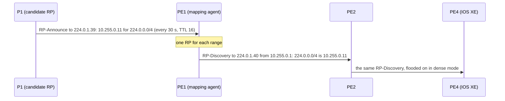

# M14 — Finding the RP, IPv6, and troubleshooting

The first page of this unit configured the RP by hand: one `rp-address` line on every router. This page lets the
routers find the RP by themselves, first with the bootstrap router (BSR) mechanism and then with Auto-RP.

It then moves the same PIM sparse mode to IPv6 (PIMv6 and MLD), and ends with a way to look for faults: follow the tree
from the receiver up. It covers the PIMv6 and MLD parts of 4.4 of the blueprint, and the ways of finding the RP that
PIM sparse mode depends on. The board is XRT-16, as on the previous pages.

## 1. What it is good for

### 1.1 The problem: the RP's address on every router, by hand

On the first page, P1's Loopback0 became the RP through one line, `rp-address 10.255.0.11`, on each of the five
routers. Every router has to agree on that address. A router that maps a group to another address sends its Join
toward that other address, and the router above it, which maps the group to P1, keeps no state for that Join
(section 3.4). The configuration is accepted, and the channel simply does not arrive.

Changes are worse. To move the RP from P1 to PE3, every router has to be changed, and until the last one is done, the
routers disagree. If P1 simply stops, the configuration on all five routers still names it: new receivers' Joins and
new sources' Registers have nowhere to go. The configuration is consistent, and consistently out of date.

### 1.2 What came before: static RPs

- **One static RP for all groups**: `rp-address` without a list, as on the first page. The simplest form, and every
  router must carry the same line.
- **Static RPs per range**: `rp-address <address> <access list>`, one list per RP, as for the BIDIR RP on the previous
  page. More lines, all kept the same on every router.
- **One static address on two routers** (Anycast RP): the address stays the same when one of the two fails, at the
  cost of a protocol that keeps the two RPs informed about sources. It is in the appendix.

All three are static. When the RP changes, a person changes every router, and the routers hear about it at the speed
of that person's typing.

### 1.3 The answer: let the routers announce the RP

- **Candidates offer themselves**: a router that may be the RP says so, with the groups it offers and a priority, and
  repeats it.
- **One router collects and distributes**: the offers reach every PIM router without anyone typing an RP address on
  them.
- **Failures are handled by time**: an offer that is not repeated expires, and the routers choose again from what is
  left.
- **Two methods**: BSR, the standard one in PIM version 2 (RFC 5059), and Auto-RP, Cisco's own. They differ in who
  makes the choice and in how the messages travel (sections 2.1 and 2.2).

For IPv6, this unit keeps a static RP (section 2.4).

## 2. How it works

The board is the one of the previous pages. Loopback0 is 10.255.0.N on each router (PE1 .1, PE2 .2, PE3 .3, PE4 .4,
P1 .11). In the examples of this page, P1 offers to be the RP and PE1 offers to collect and distribute; later, PE3
offers too. PE4, the IOS XE router, is configured for neither role and learns like the others.

:::topo
nodes:
  SRC1: {at: [0, 0], kind: host, label: "SRC1"}
  PE1: {at: [1.3, 0], label: "PE1 (candidate BSR)"}
  PE2: {at: [3.9, 0], label: "PE2"}
  RCV2: {at: [5.2, 0], kind: host, label: "RCV2"}
  P1: {at: [2.6, 1.1], label: "P1 (candidate RP)"}
  PE3: {at: [2.6, 2.4], label: "PE3 (2nd candidate RP)"}
  PE4: {at: [3.9, 1.3], label: "PE4 (IOS XE)"}
  SW1: {at: [3.9, 2.4], label: "SW1"}
  RCV3: {at: [5.2, 2.4], kind: host, label: "RCV3"}
links:
  - [SRC1, PE1, "HEADEND"]
  - [PE1, PE2, "CORE-12"]
  - [PE1, P1, "CORE-1"]
  - [P1, PE2, "CORE-2"]
  - [P1, PE3, "CORE-3"]
  - [PE2, PE4, "CORE-4"]
  - [PE2, RCV2, "ACCESS-2"]
  - {a: PE3, b: SW1, la: ".252", ta: 0.6}
  - {a: PE4, b: SW1, la: ".253"}
  - {a: SW1, b: RCV3, lb: ".1"}
frames:
  - {label: "ACCESS-3 192.168.3.0/24", nodes: [SW1, RCV3]}
:::

### 2.1 BSR: two elections

BSR has two kinds of candidate. A **candidate BSR** offers to collect the offers and distribute them. A **candidate
RP** offers to be the RP for a range of groups. The two roles are independent: a router can take both, one or neither,
and the BSR does not have to be an RP.

**The first election: one BSR.** Every candidate BSR sends bootstrap messages that carry its priority and its address.
The highest priority wins, and on a tie the highest address. The winner is the BSR. A candidate that hears a better
one stops sending its own messages, and takes over if the better one goes quiet.

**The offers go to the BSR.** Each candidate RP learns the BSR's address from the bootstrap messages and sends it, by
unicast, a candidate-RP advertisement: its address, its priority, the ranges it offers and a holdtime. On IOS XR and
IOS XE it repeats the advertisement every 60 seconds by default, with a holdtime of 150 seconds.

**The BSR floods the RP set.** The BSR does not choose. It puts every candidate it has heard into the **RP set** and
sends that in its bootstrap messages, to the all-PIM-routers group 224.0.0.13 with a TTL of 1. Each router accepts a
bootstrap message only from its RPF neighbour toward the BSR, keeps the RP set, and sends it on to its own PIM
neighbours. Hop by hop, it reaches every PIM router.

**The second election: every router, for every group.** From the RP set, each router takes, in this order: the
candidates whose range matches the group longest; of those, the lowest priority value; on a tie, the highest hash
value; and last, the highest address. All routers hold the same RP set and use the same rule, so all of them pick the
same RP. Nobody is told the result; everybody works it out.

The hash mixes the group address, cut to the hash mask length, with each candidate's address. It spreads groups over
candidates of equal priority. With a mask length of 30, the IOS XR default, groups that differ only in their last two
bits get the same hash, so blocks of four groups share an RP.

| | Candidate BSR | Candidate RP |
|---|---|---|
| What wins | The highest priority, then the highest address | The longest range, then the lowest priority value, then the hash, then the highest address |
| IOS XR default | 1 (hash mask length 30) | 192 |
| IOS XE default | 0 (hash mask length 0) | 0 |
| RFC 5059 default | 64 | 192 |

The two priorities run in opposite directions, and the defaults differ between platforms. Where both platforms take
part, an IOS XE candidate RP left at its default (0) beats an IOS XR one left at its default (192), and an IOS XE
candidate BSR left at 0 loses to an IOS XR one left at 1. Write the priorities.

When the RP stops sending advertisements, the BSR drops it from the RP set once its holdtime runs out, and every router
chooses again from what is left. When the BSR stops, the candidate BSRs elect another.

### 2.2 Auto-RP: two groups for the announcements

Auto-RP is Cisco's own method. It uses two groups set aside for it: 224.0.1.39 (CISCO-RP-ANNOUNCE) and 224.0.1.40
(CISCO-RP-DISCOVERY).

1. Each candidate RP sends **RP-Announce** messages to 224.0.1.39: its address and the ranges it offers.
2. A **mapping agent** listens on 224.0.1.39, chooses one RP for each range, and sends the result in **RP-Discovery**
   messages to 224.0.1.40. On IOS and IOS XE, it chooses the candidate with the highest address.
3. IOS, IOS XE and IOS XR routers listen on 224.0.1.40 by default (IOS XR on its Loopback0) and use the mappings they
   hear.



Unlike BSR, the choice is made in one place, the mapping agent, and the other routers take its result as it is.

There is a catch. The two groups are ordinary multicast groups, and in sparse mode a group needs an RP before it can be
forwarded, which is exactly what the routers are trying to learn. Auto-RP gets round this by sending the two groups in
dense mode: flooded out of every PIM interface, with no RP involved. Dense mode, for exactly two groups.

IOS XR does this by default: its group map lists 224.0.1.39 and 224.0.1.40 as `DM perm`. IOS and IOS XE in sparse mode
forward them only with `ip pim autorp listener` (or with sparse-dense mode on the interfaces).

On XRT-16, PE4 receives the discovery messages from PE2 and learns the RP with nothing configured. In a network of IOS routers in sparse mode
without the listener, the discovery messages do not get past the mapping agent.

`scope` is the TTL that the candidate RP and the mapping agent put on these packets, so it limits how far they travel.
It has to reach every router; 16 is more than XRT-16 needs. BSR has no such setting: its messages go hop by hop with a
TTL of 1, and every router passes them on.

Both kinds of message are repeated (every 30 seconds in this page's example, every 60 seconds by default on IOS XE),
and a mapping that is not renewed expires.

### 2.3 Static and dynamic together

A router can hold static and learned mappings at the same time. For the same groups, the learned one (BSR or Auto-RP)
is used, unless the static line carries `override`. On IOS XE this holds even when the static range is narrower than
the learned one.

A static entry never expires (`expires: never`). A learned one carries a timer that each message renews. When a
candidate goes away, what the routers learned from it stays until the timer runs out. Below is PE2 less than two
minutes after every BSR line was removed and Auto-RP configured in its place: both BSR entries are still listed, with
52 seconds to go, beside the Auto-RP one.

```console
RP/0/RP0/CPU0:PE2#show pim rp mapping
PIM Group-to-RP Mappings
Group(s) 239.2.0.0/16
  RP 10.255.1.11 (?), v2, bidir
    Info source: 0.0.0.0 (?), elected via config
      Uptime: 00:06:46, expires: never
Group(s) 224.0.0.0/4
  RP 10.255.0.11 (?), v2
    Info source: 10.255.0.1 (?), elected via autorp
      Uptime: 00:01:36, expires: 00:01:29
Group(s) 224.0.0.0/4
  RP 10.255.0.3 (?), v2
    Info source: 10.0.12.1 (?), elected via bsr, priority 50, holdtime 150
      Uptime: 00:03:13, expires: 00:00:52
Group(s) 224.0.0.0/4
  RP 10.255.0.11 (?), v2
    Info source: 10.0.12.1 (?), elected via bsr, priority 192, holdtime 150
      Uptime: 00:04:27, expires: 00:00:52
RP/0/RP0/CPU0:PE2#show pim group-map
...
Group Range         Proto Client   Groups RP address      Info
...
224.0.0.0/4*        SM    autorp   2      10.255.0.11     RPF: Gi0/0/0/1,10.0.2.11
224.0.0.0/4         SM    bsr      0      10.255.0.3      RPF: Null,0.0.0.0
224.0.0.0/4         SM    bsr      0      10.255.0.11     RPF: Gi0/0/0/1,10.0.2.11
224.0.0.0/4         SM    static   0      0.0.0.0         RPF: Null,0.0.0.0
```

The line in use is the one marked `*` in the group map, here the Auto-RP one. Cisco's IOS XE guide does not support
running Auto-RP and BSR together. When changing from one to the other, expect a couple of minutes in which both are in
the tables. Removing a candidate stops the renewals; the entries leave on their own schedule.

### 2.4 IPv6: PIMv6 and MLD

IPv6 multicast uses the same PIM sparse mode with IPv6 addresses (PIMv6), and MLD in place of IGMP. MLD (Multicast
Listener Discovery) does IGMP's job for IPv6: MLDv1 corresponds to IGMPv2, and MLDv2 to IGMPv3, with source lists
(RFC 3810). MLD messages are ICMPv6 messages.

On IOS XR, IPv6 is a separate address family under both `multicast-routing` and `router pim`. Nothing configured for
IPv4 applies to IPv6: not the interfaces, not the RP, not the SSM ranges. The default MLD version is 2.

PIMv6 routers speak from their link-local addresses. Hellos, neighbours, RPF neighbours and the DR are all link-local
addresses (fe80::…). The DR is still the highest address (when the priorities are equal) and the MLD querier the
lowest, but the addresses compared are the link-local ones.

By default a link-local address is made from the MAC address (EUI-64), and in a virtual lab the MAC addresses are
random. XRT-16 therefore fixes them on ACCESS-3: PE3 FE80::252, PE4 FE80::253. PE4 is the DR and PE3 the querier, as in
IPv4. Left to EUI-64, the election would be decided by whatever MAC addresses the lab was given.

The RP works as in IPv4. On the RP, the (*,G) entry points at `Decaps6tunnel0`, where it unpacks Registers (IPv4 uses
`Decapstunnel…`). The last-hop router moves to the shortest-path tree at the first packet, as in IPv4.

IOS XR's IPv6 group map also lists `ff70::/12` with the client `embd`: embedded RP, a scheme that writes the RP's
address into the group address itself. It is on by default; this unit does not use it.

On IOS XE, `ipv6 multicast-routing` turns on PIMv6 and MLD on every interface that has IPv6, with nothing to add per
interface, and `ipv6 pim rp-address` sets a static RP. A ping to an IPv6 group asks for the output interface before it
sends anything.

### 2.5 Troubleshooting: follow the tree from the receiver

When a receiver gets nothing, start at the receiver and go up the tree toward the RP and the source, checking one
thing at a time. Each step depends on the one before: no membership, no Join; no Join, no state at the RP.

1. **Membership**: on the receiver's router, is the group in `show igmp groups <group>` (`show ip igmp groups` on IOS
   XE)? On a shared LAN, look on the DR: on ACCESS-3 that is PE4, not the querier PE3.
2. **DR**: on a shared LAN only the DR sends the Join. `show pim interface` names it.
3. **RPF toward the RP**: `show pim rpf <RP address>` on the last-hop router. The interface it gives must run PIM and
   lead to a PIM neighbour. In the (*,G) entry, `RPF: Null,0.0.0.0` means there is no usable path.
4. **The same RP everywhere**: `show pim group-map <group>` on every router from the receiver to the RP must give the
   same RP address.
5. **State at the RP**: on the RP, `show pim topology <group>` must have the (*,G) entry, with the interface toward the
   receivers in `fwd Join`.
6. **Register**: once the source sends, the RP's (S,G) entry carries `RR` (Register Received). If the first-hop
   router's (S,G) entry has no outgoing interface and the RP has no (S,G) entry, the Registers did not get through, or
   were refused.
7. **Shortest-path tree**: the last-hop router's (S,G) entry is `SPT`, with its RPF toward the source (unless the group
   is kept on the shared tree, as with `spt-threshold infinity`).

Test every change with a group that nobody has joined before. A router keeps the state from earlier Joins until their
holdtime runs out (210 seconds), and a router further down may still send its own (S,G) Join along a path that works.
Either way, the old group keeps arriving and the test passes for reasons that have nothing to do with the change. A
test that passes on an old group proves that the old group worked.

The checks of XRT-16 pick a random group within the range of each task for the same reason.

### 2.6 Key points

- BSR: candidate BSRs elect one BSR (highest priority, then highest address). Candidate RPs send their offers to it by
  unicast, and it floods all of them hop by hop. Every router then picks, for each group: longest range, lowest
  priority value, hash, highest address.
- Default priorities: IOS XR candidate RP 192 and candidate BSR 1; IOS XE 0 for both. Write them.
- Auto-RP: candidate RPs announce on 224.0.1.39; the mapping agent chooses and announces on 224.0.1.40. IOS XR floods
  the two groups in dense mode; IOS in sparse mode needs `ip pim autorp listener`.
- For the same groups, a learned mapping beats a static one unless `override`. Learned entries last until their
  holdtime, after the candidate has gone.
- IPv6: its own address family, MLDv2 by default, link-local neighbours and DR, `Decaps6tunnel0` on the RP.
- Troubleshoot from the receiver up: membership, DR, RPF, the same RP, the RP's state, Register, SPT. Test with a group
  nobody has used.

## 3. Building it in IOS XR

### 3.1 BSR

The example replaces the static RP of the first page by BSR. `rp-address 10.255.0.11` is removed from all five routers
(the BIDIR RP of the previous page stays). P1 becomes a candidate RP and PE1 a candidate BSR, both with the default
priorities. Later, PE3 becomes a second candidate RP, with priority 50.

`bsr candidate-rp` takes `priority`, `interval` and `group-list <access list>`. Without a group list, the candidate
offers 224.0.0.0/4, every group.

The figure follows the two kinds of message: P1's offer to the BSR, and the BSR's bootstrap messages on their way to
PE2 and PE4. Rest the pointer on a number in the figure (or tap it on a phone) to see that line of the configuration.

:::walk
legend: "Blue numbers: the lines that make a router a candidate. The rest happens with no configuration."
rows:
  - panel: P1
    sub: candidate RP
    items:
      - ref: 1
        head: "**Offer to be the RP** `bsr candidate-rp 10.255.0.11`"
        say: ["No priority, interval or group list written: 192, every 60 s, 224.0.0.0/4"]
        then: ["→ learns the BSR's address from the bootstrap messages", "→ sends its offer there, by unicast"]
  - {wire: ["[[IP → 10.255.0.1]] [[=C-RP-Adv  10.255.0.11  pri 192  224/4  hold 150]]", "_by unicast, to the BSR"]}
  - panel: PE1
    sub: candidate BSR, then the BSR
    items:
      - ref: 2
        head: "**Offer to be the BSR** `bsr candidate-bsr 10.255.0.1`"
        say: ["Priority 1 and hash mask length 30 (defaults). The only candidate BSR"]
        match:
          - ["the highest priority, then the highest address", true, "Elected"]
      - say: ["Puts every offer it hears into the RP set, and chooses none of them", "~RP set: 10.255.0.11, priority 192, 224/4"]
  - {wire: ["[[IP → 224.0.0.13  TTL 1]] [[=Bootstrap  BSR 10.255.0.1  RP set]]", "_out of every PIM interface: to PE2 on CORE-12, and to P1"]}
  - {node: PE2, say: ["Accepts it from its RPF neighbour toward 10.255.0.1 (PE1, on CORE-12)", "~keeps the RP set, picks 10.255.0.11 for 224/4, and sends it on"]}
  - {wire: "[[IP → 224.0.0.13  TTL 1]] [[=Bootstrap  BSR 10.255.0.1  RP set]]"}
  - {node: PE4, say: ["IOS XE, nothing configured for BSR", "~`via bootstrap`: 224.0.0.0/4 → 10.255.0.11"]}
  - aside: "③ PE3 offers too, with priority 50"
    say: ["~The RP set holds two offers for 224/4; the BSR still chooses neither", "~Every router: the same range, the lower value wins → 10.255.0.3"]
:::

:::config P1 — offer 10.255.0.11 (Loopback0) as a candidate RP for all groups
router pim
 address-family ipv4
  bsr candidate-rp 10.255.0.11                ## ① Offer to be the RP; defaults: priority 192, interval 60, 224.0.0.0/4
 !
!
:::

:::config PE1 — offer 10.255.0.1 (Loopback0) as a candidate BSR
router pim
 address-family ipv4
  bsr candidate-bsr 10.255.0.1                ## ② Offer to be the BSR; defaults: priority 1, hash-mask-len 30
 !
!
:::

:::config PE3 — a second candidate RP with a lower priority value than P1
router pim
 address-family ipv4
  bsr candidate-rp 10.255.0.3 priority 50     ## ③ 50 is lower than P1's 192, so every router picks PE3
 !
!
:::

On IOS XE, both roles take an interface instead of an address. Routers that are neither candidate need no BSR
configuration at all; PE4 learned the RP with none.

:::config IOS XE — a candidate RP with priority 50, and a candidate BSR
ip pim rp-candidate Loopback0 priority 50     ## Candidate RP; without priority it is 0, which beats every XR default
ip pim bsr-candidate Loopback0                ## Candidate BSR; without priority it is 0, which loses to XR's default 1
:::

IOS XR writes the defaults into the running configuration, and shows what each candidate offers.

```console
RP/0/RP0/CPU0:P1#show running-config router pim
router pim
 address-family ipv4
  rp-address 10.255.1.11 BIDIR-GROUPS bidir
  bsr candidate-rp 10.255.0.11 priority 192 interval 60
  ssm range SSM-RANGE
 !
...
RP/0/RP0/CPU0:P1#show pim bsr candidate-rp
PIM BSR Candidate RP Info 

Cand-RP          mode  scope priority uptime    group-list
10.255.0.11      SM    16    192      00:01:04  224/4
RP/0/RP0/CPU0:PE1#show running-config router pim
router pim
 address-family ipv4
  rp-address 10.255.1.11 BIDIR-GROUPS bidir
  bsr candidate-bsr 10.255.0.1 hash-mask-len 30 priority 1
  ssm range SSM-RANGE
 !
...
RP/0/RP0/CPU0:PE1#show pim bsr election
PIM BSR Election State 

Cand/Elect-State        Uptime   BS-Timer BSR                      C-BSR

Elected/Accept-Pref     00:01:07 00:00:07 10.255.0.1 [1, 30]       10.255.0.1 [1, 30]      
```

On PE2 and PE4, which are not candidates:

```console
RP/0/RP0/CPU0:PE2#show pim bsr election
PIM BSR Election State 

Cand/Elect-State        Uptime   BS-Timer BSR                      C-BSR

No-Info/Accept-Pref     00:01:08 00:01:16 10.255.0.1 [1, 30]       0.0.0.0 [0, 0]          
RP/0/RP0/CPU0:PE2#show pim rp mapping
PIM Group-to-RP Mappings
Group(s) 239.2.0.0/16
  RP 10.255.1.11 (?), v2, bidir
    Info source: 0.0.0.0 (?), elected via config
      Uptime: 00:03:27, expires: never
Group(s) 224.0.0.0/4
  RP 10.255.0.11 (?), v2
    Info source: 10.0.12.1 (?), elected via bsr, priority 192, holdtime 150
      Uptime: 00:01:09, expires: 00:01:35
RP/0/RP0/CPU0:PE2#show pim group-map 239.1.1.1

IP PIM Group Mapping Table 
(* indicates group mappings being used) 
(+ indicates BSR group mappings active in MRIB) 

Group Range         Proto Client   Groups RP address      Info

224.0.0.0/4*        SM    bsr+     2      10.255.0.11     RPF: Gi0/0/0/1,10.0.2.11
PE4#show ip pim bsr-router
PIMv2 Bootstrap information
  BSR address: 10.255.0.1 (?)
  Uptime:      00:01:10, BSR Priority: 1, Hash mask length: 30
  Expires:     00:01:14
PE4#show ip pim rp mapping
PIM Group-to-RP Mappings

Group(s) 224.0.0.0/4
  RP 10.255.0.11 (?), v2
    Info source: 10.255.0.1 (?), via bootstrap, priority 192, holdtime 150
         Uptime: 00:01:11, expires: 00:01:29
Acl: 20, Static, Bidir Mode
    RP: 10.255.1.11 (?)
```

- **`show pim bsr election`**: the BSR shows `Elected`. PE2, which is not a candidate, shows `No-Info` and accepts the
  elected BSR's messages (`Accept-Pref`). The brackets are [priority, hash mask length].
- **`show pim rp mapping`**: a learned entry says `elected via bsr` with its priority and holdtime, and `expires`
  counts down; the static BIDIR entry says `elected via config` and `expires: never`.
- **`Info source`**: IOS XR shows the neighbour that passed the bootstrap message on (10.0.12.1, PE1's address on
  CORE-12); a router further away shows the router before it. IOS XE shows the BSR's own address, 10.255.0.1.
- **`show pim group-map <group>`**: the client `bsr`, the RP in use, and the RPF toward it. PE4 also received the hash
  mask length (30) from the BSR.

After PE3 offers itself with priority 50, both offers are in the RP set, and every router uses PE3:

```console
RP/0/RP0/CPU0:PE2#show pim rp mapping
...
Group(s) 224.0.0.0/4
  RP 10.255.0.3 (?), v2
    Info source: 10.0.12.1 (?), elected via bsr, priority 50, holdtime 150
      Uptime: 00:01:18, expires: 00:02:11
Group(s) 224.0.0.0/4
  RP 10.255.0.11 (?), v2
    Info source: 10.0.12.1 (?), elected via bsr, priority 192, holdtime 150
      Uptime: 00:02:33, expires: 00:02:11
RP/0/RP0/CPU0:PE2#show pim group-map 239.1.1.1
...
224.0.0.0/4*        SM    bsr+     2      10.255.0.3      RPF: Gi0/0/0/1,10.0.2.11
PE4#show ip pim rp-hash 239.1.1.1
  RP 10.255.0.3 (?), v2
    Info source: 10.255.0.1 (?), via bootstrap, priority 50, holdtime 150
         Uptime: 00:01:20, expires: 00:02:09
  PIMv2 Hash Value (mask 255.255.255.252)
    RP 10.255.0.3, via bootstrap, priority 50, hash value 1929039339
    RP 10.255.0.11, via bootstrap, priority 192, hash value 1690851971
```

IOS XR writes `elected via bsr` on both offers; which one is in use is in the group map, which gives 10.255.0.3. Both
are elected, and one is used. On IOS XE, `show ip pim rp-hash <group>` gives the RP chosen for that group and the values
it was compared on.

:::drill xr-m14-6

### 3.2 Auto-RP

The example then swaps BSR for Auto-RP. The BSR lines are removed from P1, PE3 and PE1. P1 becomes the Auto-RP
candidate RP and PE1 the mapping agent, both on Loopback0, with scope 16 and an interval of 30 seconds. PE4 gets
nothing.

:::config P1 — announce Loopback0 as an Auto-RP candidate RP
router pim
 address-family ipv4
  auto-rp candidate-rp Loopback0 scope 16 interval 30   ## RP-Announce to 224.0.1.39 every 30 s, TTL 16; all groups
 !
!
:::

:::config PE1 — the mapping agent
router pim
 address-family ipv4
  auto-rp mapping-agent Loopback0 scope 16 interval 30  ## Listens on 224.0.1.39; RP-Discovery to 224.0.1.40 from 10.255.0.1
 !
!
:::

On IOS XE, the two roles have commands of their own, and a router in sparse mode needs the listener to forward the two
groups.

:::config IOS XE — a candidate RP, a mapping agent, and the listener
ip pim send-rp-announce Loopback0 scope 16    ## Candidate RP: RP-Announce to 224.0.1.39 (every 60 s by default)
ip pim send-rp-discovery Loopback0 scope 16   ## Mapping agent: RP-Discovery to 224.0.1.40 (every 60 s by default)
ip pim autorp listener                        ## Floods 224.0.1.39 and 224.0.1.40 in dense mode on sparse-mode interfaces
:::

On IOS XR, Auto-RP is shown by `show auto-rp mapping-agent` and `show auto-rp candidate-rp`.

```console
RP/0/RP0/CPU0:PE1#show auto-rp mapping-agent
Mapping Agent Table
  Maximum number of mapping cache entries 500
  Current number of mapping cache entries 1
10.255.0.11 (expire : 86 secs)
  224.0.0.0/4  SM  *

RP/0/RP0/CPU0:P1#show auto-rp candidate-rp
ACL Name        Group Range        Mode   Candidate RP    TTL   Interval
                224.0.0.0/4        SM     10.255.0.11     16    30

RP/0/RP0/CPU0:PE2#show pim rp mapping
...
Group(s) 224.0.0.0/4
  RP 10.255.0.11 (?), v2
    Info source: 10.255.0.1 (?), elected via autorp
      Uptime: 00:03:55, expires: 00:01:28
RP/0/RP0/CPU0:PE2#show pim group-map

IP PIM Group Mapping Table 
(* indicates group mappings being used) 
(+ indicates BSR group mappings active in MRIB) 

Group Range         Proto Client   Groups RP address      Info

224.0.1.39/32*      DM    perm     1      0.0.0.0         
224.0.1.40/32*      DM    perm     1      0.0.0.0         
224.0.0.0/24*       NO    perm     0      0.0.0.0         
239.100.0.0/16*     SSM   config   0      0.0.0.0         
232.0.0.0/8*        SSM   config   0      0.0.0.0         
239.2.0.0/16*       BD    config   0      10.255.1.11     RPF: Gi0/0/0/1,10.0.2.11
224.0.0.0/4*        SM    autorp   2      10.255.0.11     RPF: Gi0/0/0/1,10.0.2.11
224.0.0.0/4         SM    static   0      0.0.0.0         RPF: Null,0.0.0.0
RP/0/RP0/CPU0:PE2#show pim topology 224.0.1.40
...
(10.255.0.1,224.0.1.40)SPT DM Up: 00:03:56 
JP: Null(never) RPF: GigabitEthernet0/0/0/0,10.0.12.1 Flags: KAT(00:03:27) 
  Loopback0                   00:03:56  fwd 
  GigabitEthernet0/0/0/0      00:03:56  fwd 
  GigabitEthernet0/0/0/1      00:03:56  fwd 
  GigabitEthernet0/0/0/2      00:03:56  fwd 
  GigabitEthernet0/0/0/3      00:03:56  fwd 
PE4#show ip pim rp mapping
PIM Group-to-RP Mappings

Group(s) 224.0.0.0/4
  RP 10.255.0.11 (?), v2
    Info source: 10.255.0.1 (?), elected via Auto-RP
         Uptime: 00:06:49, expires: 00:01:26
Acl: 20, Static, Bidir Mode
    RP: 10.255.1.11 (?)
PE4#show ip mroute 224.0.1.40
...
(10.255.0.1, 224.0.1.40), 00:03:58/00:02:56, flags: PLTX
  Incoming interface: Ethernet0/0, RPF nbr 10.0.4.2
  Outgoing interface list: Null
```

- **`show auto-rp mapping-agent`**: the mapping agent's cache, one entry per candidate, with the time left until it
  expires unless the next announcement renews it.
- **`show auto-rp candidate-rp`**: the TTL is the `scope`, and the interval the one configured.
- **`elected via autorp`**: the `Info source` is the mapping agent (10.255.0.1).
- **`DM perm`**: the two Auto-RP groups, in dense mode without any configuration. The `static` line with RP 0.0.0.0 has
  no `*` and is not used.
- **PE2's (10.255.0.1,224.0.1.40)**: the discovery messages from PE1's Loopback0, `DM`, forwarded out of every
  interface, including Gi0/0/0/2 toward PE4.
- **PE4**: `elected via Auto-RP` without the listener; the discovery messages come in on Ethernet0/0 from PE2.

### 3.3 IPv6 multicast

The example uses P1's Loopback0 (2001:db8:255::11) as a static RP for all IPv6 groups. On IOS XR, IPv6 needs its own
address family in both places, `multicast-routing` and `router pim`.

:::config PE1, PE2, P1 and PE3 — IPv6 multicast with a static RP for all groups
multicast-routing
 address-family ipv6
  interface all enable                        ## PIMv6 and MLD (version 2) on every interface, Loopback0 too
 !
!
router pim
 address-family ipv6
  rp-address 2001:db8:255::11                 ## P1's Loopback0, for all groups (ff00::/8)
 !
!
:::

:::config IOS XE — the same
ipv6 multicast-routing                        ## PIMv6 and MLD on every interface that has IPv6
ipv6 pim rp-address 2001:DB8:255::11          ## The same static RP, for all groups
:::

On PE2, the interfaces, the neighbours and the RP:

```console
RP/0/RP0/CPU0:PE2#show running-config multicast-routing
multicast-routing
 address-family ipv4
  interface all enable
 !
 address-family ipv6
  interface all enable
 !
!

RP/0/RP0/CPU0:PE2#show pim ipv6 interface

PIM interfaces in VRF default
Interface                  PIM  Nbr   Hello  DR
                                Count Intvl  Prior

Loopback0                   on   1     30     1     
    Primary Address : fe80::9da8:acff:fe90:c81d
                 DR : this system
...
GigabitEthernet0/0/0/2      on   2     30     1     
    Primary Address : fe80::5054:ff:fe4d:3474
                 DR : fe80::a8bb:ccff:fe00:d00
...
RP/0/RP0/CPU0:PE2#show pim ipv6 neighbor
...
GigabitEthernet0/0/0/2

Neighbor Address                          Uptime    Expires  DR pri  DR  Flags
fe80::5054:ff:fe4d:3474*                  01:24:27  00:01:29 1           B
fe80::a8bb:ccff:fe00:d00                  01:24:25  00:01:17 1      (DR) B
...
RP/0/RP0/CPU0:PE2#show mld interface GigabitEthernet0/0/0/3

GigabitEthernet0/0/0/3 is up, line protocol is up
  Internet address is fe80::5054:ff:fe9d:9a52
...
  Current MLD version is 2
  MLD query interval is 125 seconds
  MLD querier timeout is 255 seconds
  MLD max query response time is 10 seconds
  Last member query response interval is 1 seconds
...
  MLD querying router is fe80::5054:ff:fe9d:9a52 (this system)
...
RP/0/RP0/CPU0:PE2#show pim ipv6 group-map ff0e::1:1

IP PIM Group Mapping Table 
(* indicates group mappings being used) 
(+ indicates BSR group mappings active in MRIB) 

Group Range                                            Proto Client   Groups
ff00::/8*                                              SM    config   0
  RP: 2001:db8:255::11
  RPF: Gi0/0/0/1,fe80::5054:ff:fe18:c53f
```

On ACCESS-3, the fixed link-local addresses decide the roles:

```console
RP/0/RP0/CPU0:PE3#show pim ipv6 interface GigabitEthernet0/0/0/1
...
GigabitEthernet0/0/0/1      on   2     30     1     
    Primary Address : fe80::252
                 DR : fe80::253
RP/0/RP0/CPU0:PE3#show mld interface GigabitEthernet0/0/0/1
...
  MLD querying router is fe80::252 (this system)
...
PE4#show ipv6 pim interface Ethernet0/1
Interface          PIM   Nbr   Hello  DR
                         Count Intvl  Prior

Ethernet0/1        on    1     30     1     
    Address: FE80::253
    DR     : this system

PE4#show ipv6 mld interface Ethernet0/1
Ethernet0/1 is up, line protocol is up
  Internet address is FE80::253/10
  MLD is enabled on interface
  Current MLD version is 2
...
  MLD querying router is FE80::252 
```

- **PIMv6 speaks link-local**: the interface's `Primary Address`, the neighbours, the DR, and the RPF neighbour in the
  group map (toward the RP through P1, `fe80::5054:ff:fe18:c53f`). The RP itself is a global address.
- **Loopback0 counts itself**: `Nbr Count 1` and `DR : this system`, as in IPv4.
- **MLD**: version 2, queries every 125 seconds (IGMP on the same interface: 60).
- **ACCESS-3**: PE4 (FE80::253) is the DR, PE3 (FE80::252) the querier, on both sides.

Then RCV2 and RCV3 join FF0E::1:1 (`ipv6 mld join-group FF0E::1:1` on the hosts), and SRC1 pings the group. The IOS XE
ping asks for the output interface first; on SRC1 that is Ethernet0/0.

```console
SRC1#ping FF0E::1:1 repeat 10 timeout 1
Output Interface: Ethernet0/0
Type escape sequence to abort.
Sending 10, 100-byte ICMP Echos to FF0E::1:1, timeout is 1 seconds:
Packet sent with a source address of 2001:DB8:100:1::1

Request 0 timed out
Request 1 timed out
Reply to request 2 received from 2001:DB8:100:2::1, 8 ms
Reply to request 2 received from 2001:DB8:100:3::1, 28 ms
...
Success rate is 80 percent (8/10), round-trip min/avg/max = 2/6/28 ms
16 multicast replies and 0 errors.
```

The tree afterwards, from the source to RCV2 (excerpt):

```console
RP/0/RP0/CPU0:PE1#show pim ipv6 topology ff0e::1:1
...
(2001:db8:100:1::1,ff0e::1:1) SPT
SM Up: 00:00:23 JP: Join(never) Flags: KAT(00:03:08) RA 
RPF: GigabitEthernet0/0/0/2,2001:db8:100:1::1* 
  GigabitEthernet0/0/0/0      00:00:21  fwd Join(00:03:08) 
RP/0/RP0/CPU0:P1#show pim ipv6 topology ff0e::1:1
...
(*,ff0e::1:1)
SM Up: 00:03:46 JP: Join(never) Flags: 
RP: 2001:db8:255::11* 
RPF: Decaps6tunnel0,2001:db8:255::11 
  GigabitEthernet0/0/0/1      00:03:46  fwd Join(00:03:06) 

(2001:db8:100:1::1,ff0e::1:1)RPT
SM Up: 00:00:22 JP: Prune(never) Flags: KAT(00:03:08) RA DCC RR (00:04:11) 
RP: 2001:db8:255::11* 
RPF: Decaps6tunnel0,2001:db8:255::11 
  GigabitEthernet0/0/0/1      00:00:22  off Prune(00:03:07) 
...
RP/0/RP0/CPU0:PE2#show mld groups ff0e::1:1 detail

Interface:	GigabitEthernet0/0/0/3
Group:		ff0e::1:1
Uptime:		00:00:15
Router mode:	EXCLUDE (Expires: 00:04:05)
Host mode:	INCLUDE
Last reporter:	::
...
RP/0/RP0/CPU0:PE2#show pim ipv6 topology ff0e::1:1
...
(*,ff0e::1:1)
SM Up: 00:03:49 JP: Join(00:00:30) Flags: LH 
RP: 2001:db8:255::11 
RPF: GigabitEthernet0/0/0/1,fe80::5054:ff:fea6:9eac 
  GigabitEthernet0/0/0/2      00:03:46  fwd Join(00:02:46) 
  GigabitEthernet0/0/0/3      00:03:49  fwd LI LH 

(2001:db8:100:1::1,ff0e::1:1) SPT
SM Up: 00:00:25 JP: Join(00:00:28) Flags: KAT(00:03:06) RA 
RPF: GigabitEthernet0/0/0/0,fe80::5054:ff:fefe:67ea 
  GigabitEthernet0/0/0/2      00:00:25  fwd Join(00:03:04) 
```

- **PE1**: the source is on its own LAN, so its RPF neighbour is the source itself (`2001:db8:100:1::1*`).
- **P1, the RP**: the (*,G) entry points at `Decaps6tunnel0`. The (S,G) entries carry `RR`: Registers arrived. The
  (S,G)RPT entry prunes the source toward PE2, which has moved to the shortest-path tree.
- **PE2**: the (S,G) entry is `SPT`, with its RPF on Gi0/0/0/0, the direct link to PE1, as in IPv4.
- **`Last reporter: ::`**: IOS XR shows `::` for the IOS XE host's report; the group is there all the same.

### 3.4 What faults look like

Each row is one fault on an otherwise working network, tested with a group that nobody had joined before (section
2.5). They are on IPv4. With `ipv6` in `show pim` and `mld` for `igmp`, the same reading works for IPv6.

| Fault | Where to look | What it shows | Delivered (of 10) |
|---|---|---|---|
| PIM turned off on PE2's interface toward the RP (`router pim` → `interface …` → `disable`) | PE2: `show pim interface`, `show pim rpf 10.255.0.11`, `show pim topology <G>` | The interface is `off`, DR `not elected`; `via Null with rpf neighbor 0.0.0.0`; the (*,G) entry has `RPF: Null,0.0.0.0`; the RP has no state | 0 |
| Multicast turned off on the receiver LAN interface (`multicast-routing` → `interface …` → `disable`) | `show igmp interface`, `show pim interface`, `show pim topology <G>` | The IGMP version and timer lines are gone; PIM is `off`; the (*,G) entry has no `LI` on that interface | 0 on that LAN; other LANs 10 |
| PE2 maps the group to another RP address | `show pim group-map <G>` on each router | PE2's (*,G) names the other RP and sends its Join toward it; P1, which maps the group to itself, keeps no state; the source side registers to P1 (`RR`, no outgoing interface) | 0 |
| An ACL that drops PIM, inbound on PE2's side of CORE-2 only | `show pim neighbor` on both ends | PE2 no longer lists P1; P1 still lists PE2 and still receives its Joins | 9 |
| An ACL that drops IGMP, inbound on the receiver LAN | `show igmp groups <G>` | `No matching entries in IGMP`; no PIM state for the group | 0 |
| The RP refuses the source: `accept-register` with a list that denies it (`deny ipv4 host 192.168.1.1 any`) | `show pim topology <G>` on the first-hop router and on the RP | The first-hop (S,G) entry has `JP: Null` and no interfaces; the RP has only the (*,G) entry | 0 for every receiver |
| The IOS XE DR on the receiver LAN left at IGMPv2; the receiver sends a version 3 (S,G) report | The DR: `show ip igmp groups` | The (S,G) report is not in the DR's table | 0 (10 after `ip igmp version 3`) |
| The IOS XE DR without `ip pim ssm default`, IGMPv3 on | The DR: `show ip mroute <G>`; the RP: `show pim topology <G>` | The DR sends a (*,232.x.x.x) Join toward the RP; PE2, for which 232/8 is SSM, does not pass it on; the RP has no state; the XR routers' own displays look normal | 0 (10 after the line is added) |
| PE2's receiver LAN set to IGMP version 2, then back to 3 | `show igmp groups <G> detail` | The host falls back to version 2 and reports the SSM group in version 2, which IOS XR discards; after version 3 is back, nothing until the host returns to version 3, about two minutes later | 0, then 10 |
| A static RP added on PE2 while Auto-RP runs | `show pim group-map` | The Auto-RP line keeps the `*`; the static (`config`) line takes it only with `override` | — |

`accept-register <access list>` sits under `router pim` on the RP. The access list matches the source of the multicast
stream and the group; a Register that the list denies is answered at once with a Register-Stop, and the first-hop
router stops registering.

A Register that matches no line of the list is a different case. On the IOS XR routers here it is accepted, on IPv4 and
on IPv6, and Cisco's documents do not say what should happen. Close the list with an explicit `deny ipv4 any any`
(`deny ipv6 any any` for IPv6), so that the result does not depend on that case.

Two rows can mislead. With the one-sided ACL, the display on PE2 says the neighbour is gone, while P1 still holds PE2 as
a neighbour and the channel keeps flowing; the display and the packets disagree. With the two SSM rows on the IOS XE DR,
every display on the IOS XR routers looks normal, and the fault shows only on the IOS XE router.

### 3.5 Pitfalls

- **Default priorities where IOS XE and IOS XR meet**: an IOS XE candidate RP at its default 0 beats every IOS XR
  candidate at 192; an IOS XE candidate BSR at 0 loses to IOS XR's 1. Write both priorities.
- **Opposite directions**: for the candidate BSR the highest priority wins; for the candidate RP the lowest value wins.
- **A candidate RP without a group list** offers 224.0.0.0/4, including groups meant for a static RP, and the learned
  mapping wins over the static one for the same groups (on IOS XE, even over a narrower static range). Limit the offer
  with `group-list`, or use `override`.
- **Removed candidates linger** until their holdtime runs out (150 seconds with the default interval). Wait, or check
  the `expires` column before testing.
- **Auto-RP and BSR together**: not supported in Cisco's IOS XE guide. Finish one before starting the other.
- **Auto-RP on IOS routers in sparse mode**: without `ip pim autorp listener`, the discovery messages do not get past
  the mapping agent. IOS XR floods the two groups by itself.
- **`show pim auto-rp`**: does not exist on IOS XR. Use `show auto-rp mapping-agent` and `show auto-rp candidate-rp`.
- **IPv6 is a separate address family**: the IPv4 lines under `multicast-routing` and `router pim` do nothing for IPv6.
- **The IPv6 DR follows the link-local addresses**: with EUI-64 they follow the MAC addresses. Fix them where the DR
  matters, as on ACCESS-3.
- **An IPv6 ping to a group on IOS XE** waits for an answer to `Output Interface:`.
- **Testing on a group used before**: earlier Joins last up to 210 seconds. Use a new group.
- **`clear igmp groups`** is not an IOS XR command; the command is `clear igmp group`.
- **Clearing the state on the RP** stops the channel until the next periodic Join, up to 60 seconds later.

## Practice

Do Tasks M14-5 and M14-6 in lab **XRT-16**.

<p class="tolab"><a href="/_learn?id=XRT-16">Open lab XRT-16 in the workspace</a> — <a href="f5-m14-practice-3.html">Tasks M14-5 and M14-6</a></p>

:::note
The output on this page was taken on XRT-16 with the values of this page: IOS XRd 26.1.1 on PE1, PE2, P1 and PE3, and
IOS XE 17.15 (IOL) on PE4 and the hosts. The IPv6 tree (the join, SRC1's ping, the PIMv6 entries afterwards and the
`embd` line of the IPv6 group map) and the behaviour in the fault table come from a test board with the same names and addresses for PE1, PE2, P1 and the
hosts, where PE1 and PE2 ran IOS XRv 9000 26.1.1, P1 ran IOS XRd 26.1.1, and an IOS XE router (IOL 17.15) on the
receiver LAN took PE4's part. On that board, a router two hops from the BSR showed, as `Info source`, the address of
the router before it. Auto-RP without the listener on a network of IOS routers only, and an IOS dynamic mapping that
won over a narrower static one, were measured earlier on IOL 17.15.1. IOS XRd's multicast forwarding is not described
in Cisco's documents; on this virtual platform it forwarded.
Not in the documents: on IOS XRd 26.1.1, a Register that matched no line of the `accept-register` list was accepted,
on IPv4 and on IPv6. A list with only a `permit` for another source let the stream through; a final `deny … any any`
stopped it. The command references describe only the Register-Stop for a denied source.
Sources: RFC 5059 (BSR: the two elections, the candidate-RP advertisements by unicast, the flooding of bootstrap
messages, the default priorities 192 and 64), RFC 7761 (PIM sparse mode: the choice of RP and the hash function, the DR
election, the Join/Prune holdtime of 210 seconds), RFC 3810 (MLDv2), RFC 3376 (the timer behind the two-minute
return to version 3). The Multicast Command Reference for the Cisco 8000 (2026-09-11): the candidate-BSR default,
`accept-register` and the Register-Stop. The Multicast Configuration Guide for the Cisco 8000, IOS XR 26.1.x–26.3.x:
MLDv2 by default, the candidate-RP example with priority 192. The Multicast Configuration Guide for the ASR 9000, IOS
XR 25.1.x–25.4.x: Auto-RP and BSR ranges preferred over static ones, and `override`. The Multicast Command Reference
for the CRS (2020): Auto-RP learned by default, embedded RP on by default. For IOS XE: the IP Multicast Configuration
Guide, IOS XE 17.x (the default priority 0 of candidate RPs and candidate BSRs; Auto-RP with the listener or sparse-dense
mode; Auto-RP and BSR together not supported, read through a summary), and the Cisco IOS IP Multicast Command Reference
(candidate-RP advertisements by unicast, bootstrap messages to 224.0.0.13 with TTL 1, the order longest match →
priority → hash → address, the two Auto-RP groups, the mapping agent's choice of the highest address, the 60-second
defaults, hash mask length 0). All checked in November 2026.
:::
