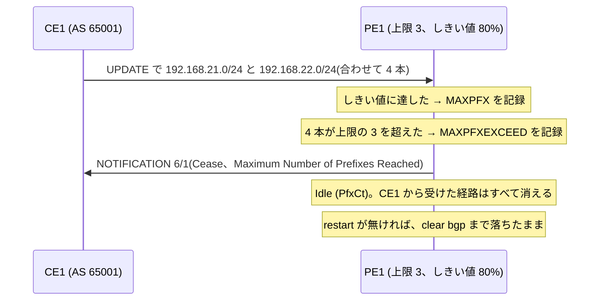
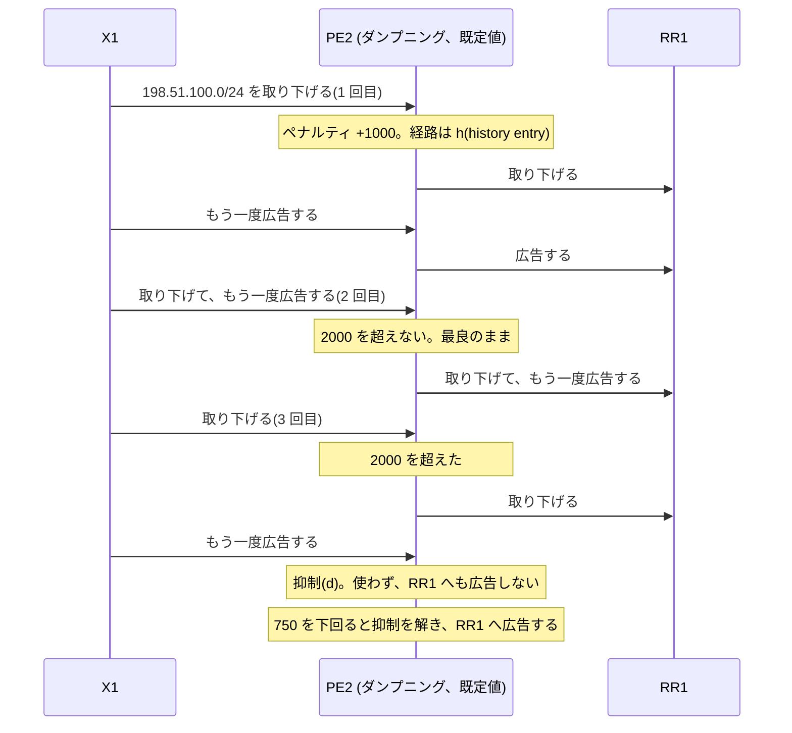

# M6 追補 — 受け取りすぎない: 経路数の上限、ダンプニング、集約

前の 2 つのページでは、予備の道を配ることと、外とのセッションを守ることを扱いました。このページは、そのセッションの上を
流れる経路の量を扱います。顧客から受け付ける経路の数に上限を付ける maximum-prefix、フラップを繰り返す経路をしばらく
使わずにおくダンプニング、顧客のアドレスを 1 本にまとめて外へ出す集約です。

ラボ XRT-17 の課題 M6-9 と M6-10 で使います。ブループリントでは 1.5.c の BGP プレフィックスの抑制にあたりますが、この語は
Cisco の文書に定義が見当たらないので、この追補ではこの 3 つとして扱います(名前の近い IOS XE の `bgp suppress-inactive` は
[付録](69-m6-appendix.html))。ルート ポリシーは M5、ネイバーのアドレス ファミリは M6 の本編で扱いました。

## 1. 何が嬉しいのか

### 1.1 困りごと: 顧客の間違い、揺れる経路、細かすぎる経路

XRT-17 のプロバイダー(AS 65000)は、PE1 で顧客の CE1(AS 65001)と、PE2 と PE3 で AS 65100 の X1 と X2 とつながっています。
CE1 は自分の 2 つの LAN、192.168.1.0/24 と 192.168.2.0/24 を広告し、X1 は自分の顧客の 198.51.100.0/24 を広告します。
PE2 は X1 から学習した経路のローカル プリファレンスを 200 にするので、AS 65100 への主の出口は PE2 です。

:::topo
nodes:
  CE1: {at: [0, 1], kind: host, label: "CE1 (AS 65001)"}
  PE1: {at: [2.2, 1], label: "PE1 (顧客の入口)"}
  P1: {at: [4.2, 1], label: "P1 (BGP なし)"}
  RR1: {at: [4.2, 2.5], label: "RR1 (ルート リフレクタ)"}
  PE2: {at: [6.2, 0], label: "PE2 (主の出口)"}
  PE3: {at: [6.2, 2], label: "PE3 (予備の出口)"}
  X1: {at: [8.4, 0], label: "X1"}
  X2: {at: [8.4, 2], label: "X2"}
links:
  - {a: CE1, b: PE1, label: "192.168.1.0/24\n192.168.2.0/24"}
  - {a: PE1, b: P1, label: "10.0.1.0/24"}
  - {a: P1, b: PE2, label: "10.0.2.0/24"}
  - {a: P1, b: PE3, label: "10.0.3.0/24"}
  - {a: P1, b: RR1, label: "10.0.21.0/24"}
  - {a: PE2, b: X1, label: "172.16.2.0/24\n198.51.100.0/24 が届く"}
  - {a: PE3, b: X2, label: "172.16.3.0/24"}
  - {a: X1, b: X2, label: "iBGP"}
frames:
  - {label: "AS 65000", nodes: [PE1, P1, RR1, PE2, PE3]}
  - {label: "AS 65100", nodes: [X1, X2]}
:::

外の AS との eBGP のセッションは 3 本で、どのルート ポリシーもすべての経路を通します。困りごとは、そのセッションの上を
流れる経路の中身から来ます。

**顧客の間違い。** PE1 は CE1 が送ってくる経路をすべて受け付け、RR1 を通して PE2 と PE3 へ配り、PE2 と PE3 はそれを
AS 65100 へ広告します。CE1 の設定を誰かが誤って、社内の経路を丸ごと BGP に入れれば、その全部が同じ道で広がります。PE1 には、
受け付ける数の歯止めがありません。上限が無いので、多すぎるということもありません。

**揺れる経路。** X1 の顧客の線が不安定で、198.51.100.0/24 が消えては戻ることを繰り返すと(フラップ)、PE2 はそのたびに
取り下げと広告を RR1 へ送ります。RR1 はそれを PE1 と PE3 へ反射し、受けたルータはそれぞれ最良を選び直します。揺れているのは
1 本ですが、選び直すのは全員です。

**細かすぎる経路。** 反対の向きでは、PE2 と PE3 は CE1 の 2 本を、そのまま X1 と X2 へ広告します。顧客の LAN が増えれば、
AS 65100 の表の行もその数だけ増えます。顧客のアドレスがまとまった範囲に収まっているなら、外へ出すのは範囲の 1 本で足ります。

### 1.2 それ以前の手: フィルタを手で足す

どれも、フィルタで手当てはできます。PE1 の CE1 からの入力のルート ポリシーに、顧客のプレフィックスを並べた prefix-set を
書けば、ほかの経路は入りません(M5)。ただ、顧客が LAN を足すたびに PE1 の設定を直すことになり、直し忘れれば正しい経路まで
落ちます。一覧は、間違いを止めるのと同じ強さで、正しい変更も止めます。

揺れる経路は、フィルタでは扱いにくい相手です。経路そのものは正しいので、止めるなら、揺れに気づいた人が手でフィルタを足し、
落ち着いたころに外すことになります。外し忘れれば、揺れが収まった後も、その経路は届きません。フィルタには、外す日付が
書いてありません。

まとめた 1 本を出すには、Null0 への static で範囲の経路を作って `network` で BGP に入れ、より詳細な経路を止める出口の
フィルタを相手ごとに書きます。出口が PE2 と PE3 の 2 つなら、どちらにも要ります。static の経路は、顧客の経路が全部消えても
残り続けます。

### 1.3 答え: 数で切る、フラップを数える、まとめて出す

- **数で切る(maximum-prefix)**: PE1 は、CE1 から受け取った経路の数だけを数え、決めた上限を超えたらセッションを切ります。
  中身は見ないので、上限の内なら、顧客が LAN を足しても設定を直す必要はありません。ルート ポリシーとは別の歯止めです。
- **フラップを数える(ダンプニング)**: PE2 は、X1 から受けた経路ごとにフラップをペナルティとして積み、しきい値を超えた経路を
  しばらく使わず、広告もしません。ペナルティは時間とともに減り、減れば自動で戻ります。
- **まとめて出す(集約)**: PE2 は、範囲の中の経路が BGP の表にある間だけ、範囲全体の経路を作って広告します。`summary-only` を
  付ければ、より詳細な経路は広告しません。

3 つとも、設定したルータの中だけで効きます。CE1 や X1 の設定は変えず、GTSM や TCP-AO のように両端をそろえる必要もありません。

## 2. 仕組み

このページでは、3 つの機能を、それぞれ盤面の上の経路で追います。2.1 節は CE1 から PE1 へ届く経路の数、2.2 節は X1 から PE2 へ
届く 198.51.100.0/24、2.3 節は PE2 から X1 へ出ていく顧客のアドレスです。値は課題と変えてあり、上限は 3 本、ダンプニングは
既定値、集約の範囲は 192.168.0.0/16 です。

### 2.1 経路数の上限

maximum-prefix は、1 つのネイバーの 1 つのアドレス ファミリについて、受け取った経路の数を数えます。PE1 の CE1 とのネイバーに、
上限 3 本、警告のしきい値 80% を入れた後の表示です(抜粋)。CE1 は 2 本を送っています。

```console
RP/0/RP0/CPU0:PE1#show bgp neighbor 172.16.1.1
...
 For Address Family: IPv4 Unicast
...
  2 accepted prefixes, 2 are bestpaths
...
  Maximum prefixes allowed 3
  Threshold for warning message 80%, restart interval 0 min
...
  Additional-paths operation: None
```

経路の数が、上限に対するしきい値(既定 75%)に達すると、PE1 は警告を記録します。上限を超えると、既定では Cease の
NOTIFICATION を送ってセッションを切り、そのネイバーから受けた経路はすべて消えます。`restart interval 0 min` は、切った後に
自分からは張り直さない、という表示です。

追加パスを受けるネイバーでは、パス ID の違う経路が 1 本ずつ数えられます(Cisco 8000 の BGP Command Reference)。同じ
プレフィックスでも、2 本届けば 2 です。PE1 と CE1 の eBGP は追加パスを交渉しないので(上の `Additional-paths operation: None`)、
この盤面では 1 つのプレフィックスが 1 本です。

`maximum-prefix` を書かないネイバーの表示には、上限の 2 行が出ません。何も書かない時の上限は文書によって言うことが違うので
([付録](69-m6-appendix.html)の 6.2 節)、この追補では上限を必ず書きます。

CE1 にループバックを 2 つ足し、それぞれを `network` で広告すると、CE1 が送る経路は 4 本になり、上限の 3 を超えます。

```console
CE1(config)#interface Loopback21
CE1(config-if)#ip address 192.168.21.1 255.255.255.0
CE1(config-if)#interface Loopback22
CE1(config-if)#ip address 192.168.22.1 255.255.255.0
CE1(config-if)#router bgp 65001
CE1(config-router)#address-family ipv4
CE1(config-router-af)#network 192.168.21.0
CE1(config-router-af)#network 192.168.22.0
CE1(config-router-af)#end
```

そこから先は、次の順に進みます。



PE1 と CE1 の記録です(抜粋)。

```console
RP/0/RP0/CPU0:PE1#show bgp summary
...
Neighbor        Spk    AS MsgRcvd MsgSent       TblVer  InQ OutQ  Up/Down  St/PfxRcd
172.16.1.1        0 65001     156     172            0    0    0 00:00:05  Idle (PfxCt)
RP/0/RP0/CPU0:PE1#show logging last 20
...
RP/0/RP0/CPU0:Nov 21 08:38:59.128 UTC: bgp[1084]: %ROUTING-BGP-5-MAXPFX : No. of IPv4 Unicast prefixes received from 172.16.1.1 has reached 3, max 3 
RP/0/RP0/CPU0:Nov 21 08:38:59.128 UTC: bgp[1084]: %ROUTING-BGP-4-MAXPFXEXCEED : No. of IPv4 Unicast prefixes received from 172.16.1.1: 4 exceed limit 3 
RP/0/RP0/CPU0:Nov 21 08:38:59.128 UTC: bgp[1084]: %ROUTING-BGP-5-ADJCHANGE : neighbor 172.16.1.1 Down - Peer exceeding maximum prefix limit (CEASE notification sent - maximum number of prefixes reached) (VRF: default) (AS: 65001) 
...
CE1#show logging | include BGP|MAXPFX|NOTIFICATION
*Nov 21 08:38:59.129: %BGP-3-NOTIFICATION: received from neighbor 172.16.1.254 6/1 (Maximum Number of Prefixes Reached) 6 bytes 01010000 0003
*Nov 21 08:38:59.129: %BGP-5-NBR_RESET: Neighbor 172.16.1.254 reset (BGP Notification received)
*Nov 21 08:38:59.129: %BGP-5-ADJCHANGE: neighbor 172.16.1.254 Down BGP Notification received
...
```

PE1 は、しきい値に達した警告、4 本が 3 を超えた記録、セッションを切った記録を、同じ時刻に残しています。CE1 が受け取るのは、
エラー コード 6(Cease)、サブコード 1 の NOTIFICATION で、IOS XE は理由を `Maximum Number of Prefixes Reached` と表示します。

CE1 で経路を足してから PE1 がセッションを切るまでには、20 秒あまりかかりました。その間、PE1 の `show bgp summary` では CE1 は
2 本のまま確立していて、CE1 が NOTIFICATION を受け取ったのはその後です。CE1(IOS XE)が、足した経路をすぐには送って
いません。PE1 が遅いのではなく、まだ届いていないだけです。

`restart <分>` を付けると、PE1 は切ってから指定の分数の後に、自分からセッションを張り直します。上限 3 のまま `restart 1` を
付けると、PE1 は約 1 分後に張り直し、CE1 がまた 4 本を送るので、また切れました。1 分 13 秒をおいた 2 回の表示です(抜粋)。

```console
RP/0/RP0/CPU0:PE1#show bgp summary
...
Neighbor        Spk    AS MsgRcvd MsgSent       TblVer  InQ OutQ  Up/Down  St/PfxRcd
172.16.1.1        0 65001     171     191            0    0    0 00:00:12  Idle (PfxCt)
RP/0/RP0/CPU0:PE1#show bgp summary
...
Neighbor        Spk    AS MsgRcvd MsgSent       TblVer  InQ OutQ  Up/Down  St/PfxRcd
172.16.1.1        0 65001     175     194            0    0    0 00:00:22  Idle (PfxCt)
```

2 回目の表示では、MsgRcvd と MsgSent が増え、Up/Down が数え直されています。間に一度セッションが確立し、また切れたという
ことです。顧客が直すまで、CE1 には 1 分あまりおきに同じ NOTIFICATION が届きます。

### 2.2 ダンプニング: ペナルティと半減期

ダンプニング(ルート フラップ ダンプニング、RFC 2439)は、経路ごとにペナルティという数を持ちます。経路がフラップするたびに
(取り下げられるたびに)1000 が加わり、ペナルティは時間とともに減っていきます。減り方は半減期で決まります。既定の 15 分なら、
15 分で半分、30 分で 4 分の 1 です。

ペナルティが suppress の値(既定 2000)を超えると、その経路を抑制します。抑制した経路は表に残りますが、最良には選ばれず、
広告もされません。ペナルティが減って reuse の値(既定 750)を下回ると、抑制を解きます。ただし、抑制が続くのは、最大抑制時間
(既定は半減期の 4 倍で 60 分)までです。

取り下げられている間も、経路は表から消えず、`h`(history entry)として残ります。ペナルティを覚えておくためで、ペナルティが
reuse の値の半分を下回ると、記録ごと消えます。

RFC 2439 は、この仕組みを eBGP の相手から受けた経路にだけ使うよう定めています。iBGP で学習した経路に使うと、ルーティング
ループを招きうるからです。また Cisco の文書は、ピアのリセットで経路が取り下げられても、ペナルティは加えないと書いています。
数えるのは経路の揺れで、セッションの揺れではありません。

X1 の 198.51.100.0/24 が PE2 のところで 3 回フラップすると、次のように進みます。



X1 で、PE2 へ出す 198.51.100.0/24 を 1 分ほどの間に 3 回取り下げて戻すと、PE2 は 3 回目の後に抑制しました。揺らし方は、
X1 の PE2 への出口に、この経路を断る prefix-list を付けて外し、そのたびに `clear ip bgp 172.16.2.254 soft out` で出し直す、
というものです。PE2 の表示です(抜粋)。

```console
RP/0/RP0/CPU0:PE2#show bgp 198.51.100.0/24
BGP routing table entry for 198.51.100.0/24
...
Paths: (2 available, best #1)
  Not advertised to any peer
  Path #1: Received by speaker 0
  Not advertised to any peer
  65100
    10.255.0.3 (metric 20) from 10.255.0.21 (10.255.0.3)
      Origin IGP, localpref 100, valid, internal, best, group-best
...
  Path #2: Received by speaker 0
  Not advertised to any peer
  65100, (suppressed due to dampening)
    172.16.2.1 from 172.16.2.1 (10.100.255.1)
      Origin IGP, metric 0, localpref 200, valid, external
...
      Dampinfo: penalty 2929, flapped 3 times in 00:01:01, reuse in 00:29:30
                half life 00:15:00, suppress value 2000, reuse value 750
                Maximum suppress time 01:00:00
```

`Dampinfo` の行は、上の数をそのまま並べています。ペナルティ 2929 は、3 回分の 3000 が、最初のフラップからの 1 分 1 秒で
減った値です。reuse までの 29 分 30 秒は、2929 が半減期 15 分で 750 まで下がる時間で、計算しても約 29 分半です。

2 回では抑制されません。2 回分のペナルティは、減っていく分だけ 2000 に届かないからです。4 回目を足すと、ペナルティは 3897 に、
reuse までの時間は 35 分 40 秒に延びました。揺らすほど、待つ時間が延びます。

抑制している間の、PE2 と RR1 の表です(抜粋)。PE2 は X1 の経路(`*d`)を使わず、最良は PE3 から RR1 経由で届いた経路に
なりました。RR1 が持つのも PE3 経由の 1 本です。揺らしたのは X1 から PE2 への広告だけなので、X2 から PE3 への経路は揺れて
いません。

```console
RP/0/RP0/CPU0:PE2#show bgp
...
Dampening enabled
...
   Network            Next Hop            Metric LocPrf Weight Path
*>i192.168.1.0/24     10.255.0.1               0    100      0 65001 i
*>i192.168.2.0/24     10.255.0.1               0    100      0 65001 i
*>i198.51.100.0/24    10.255.0.3                    100      0 65100 i
*d                    172.16.2.1               0    200      0 65100 i
*> 203.0.113.0/24     172.16.2.1              11    200      0 65100 i
...
RP/0/RP0/CPU0:RR1#show bgp 198.51.100.0/24
...
Paths: (1 available, best #1)
...
  65100, (Received from a RR-client)
    10.255.0.3 (metric 20) from 10.255.0.3 (10.255.0.3)
      Origin IGP, localpref 100, valid, internal, best, group-best
```

抑制は経路を表から消すのではなく、最良を選ぶ候補から外すだけです。PE2 の表には X1 の経路が `*d` として残り、ペナルティは
時間とともに減っていきます。

### 2.3 集約と、より詳細な経路の抑制

`aggregate-address` は、指定した範囲に入る経路が BGP の表に 1 本でもあると、範囲全体の経路(集約経路)を作ります。作った
経路はこのルータ自身が出すもので(next-hop 0.0.0.0、weight 32768)、ほかの経路と同じように iBGP と eBGP の相手へ広告されます。
範囲の中の経路が 1 本も無ければ、集約経路は作られません。

集約経路を作っただけでは、より詳細な経路も今までどおり広告されます。`summary-only` を付けると、範囲の中の経路は、どの相手にも
広告されなくなり、`show bgp` では行頭に `s` が付きます。一部だけを止めるなら、集約に付けたルート ポリシーの中で
`suppress-route` を使います。IOS XR には IOS の `suppress-map` がなく、これがその代わりです。

止めた経路を特定の相手にだけ出すには、そのネイバーの出力のルート ポリシーで `unsuppress-route` を使います(IOS の
`unsuppress-map` にあたります)。どちらも、IOS XR ではルート ポリシーの部品です。

集約経路の AS パスは、このルータから始まります。X1 に届く 192.168.0.0/16 の AS パスは `65000` だけで、より詳細な経路に
あった 65001 は落ちます。情報が欠けたことを示すのが atomic-aggregate の属性です。

`as-set` を付けると、より詳細な経路の AS を集めた AS_SET を AS パスに入れ、atomic-aggregate は付けません。ASR 9000 の
Routing Command Reference は、多くの経路をまとめる集約に `as-set` を使わないよう書いています。より詳細な経路の AS パスが
変わるたびに、集約経路を出し直すことになるからです。

PE2 だけに `aggregate-address 192.168.0.0/16 summary-only` を入れると、顧客のアドレスは次のように流れます。PE3 は集約しません。

:::topo
nodes:
  CE1: {at: [0, 1], kind: host, label: "CE1 (AS 65001)"}
  PE1: {at: [2.2, 1], label: "PE1"}
  P1: {at: [4.2, 1], label: "P1 (BGP なし)"}
  RR1: {at: [4.2, 2.5], label: "RR1"}
  PE2: {at: [6.2, 0], label: "PE2 (集約する)"}
  PE3: {at: [6.2, 2], label: "PE3 (集約しない)"}
  X1: {at: [8.6, 0], label: "X1"}
  X2: {at: [8.6, 2], label: "X2"}
links:
  - {a: CE1, b: PE1, label: "/24 の 2 本"}
  - {a: PE1, b: P1, label: "iBGP で RR1 へ"}
  - {a: P1, b: RR1, label: "RR1 が反射"}
  - {a: P1, b: PE2, label: "/24 の 2 本が届く\n/16 を RR1 へ"}
  - {a: P1, b: PE3, label: "/24 の 2 本と\n/16 が届く"}
  - {a: PE2, b: X1, label: "192.168.0.0/16\nだけ"}
  - {a: PE3, b: X2, label: "/24 の 2 本と /16"}
  - {a: X1, b: X2, label: "iBGP: /24 の 2 本が\nX1 へ届く"}
frames:
  - {label: "AS 65000", nodes: [PE1, P1, RR1, PE2, PE3]}
  - {label: "AS 65100", nodes: [X1, X2]}
:::

PE2 の表と、X1 が PE2 から受け取る経路です(抜粋)。PE2 の顧客の 2 本には `s` が付き、X1 が PE2 から受け取るのは /16 の
1 本だけです。

```console
RP/0/RP0/CPU0:PE2#show bgp
...
   Network            Next Hop            Metric LocPrf Weight Path
*> 192.168.0.0/16     0.0.0.0                            32768 i
s>i192.168.1.0/24     10.255.0.1               0    100      0 65001 i
s>i192.168.2.0/24     10.255.0.1               0    100      0 65001 i
*> 198.51.100.0/24    172.16.2.1               0    200      0 65100 i
*> 203.0.113.0/24     172.16.2.1              11    200      0 65100 i
...
X1#show ip bgp neighbors 172.16.2.254 routes
...
     Network          Next Hop            Metric LocPrf Weight Path
 *>   192.168.0.0/16   172.16.2.254                           0 65000 i

Total number of prefixes 1 
```

ところが X1 の表全体を見ると、192.168.1.0 と 192.168.2.0 が残っています(抜粋)。X2(10.100.255.2)から iBGP で届いたもので、
AS パスは `65000 65001` です。PE3 は集約していないので、CE1 の 2 本をそのまま X2 へ広告し、X2 がそれを X1 へ渡しています。
/16 も、PE2 から直接届いたものと、RR1、PE3、X2 を回って届いたものの 2 本です。

```console
X1#show ip bgp
...
     Network          Next Hop            Metric LocPrf Weight Path
 *>   192.168.0.0/16   172.16.2.254                           0 65000 i
 * i                   10.100.255.2             0    100      0 65000 i
 *>i  192.168.1.0      10.100.255.2             0    100      0 65000 65001 i
 *>i  192.168.2.0      10.100.255.2             0    100      0 65000 65001 i
...
```

より詳細な経路が 1 本でも外へ出ていれば、受けたルータは長い一致でそちらを使います(ASR 9000 の Routing Command Reference)。
`summary-only` が止めるのは、設定したルータ自身の広告だけです。AS 65100 への出口が 2 つあれば、集約も 2 つ要ります。閉めた
出口は 1 つで、出口は 2 つありました。

## 3. IOS XR での設定

### 3.1 maximum-prefix の設定例

上限は、ネイバーの下のアドレス ファミリに書きます。経路の数は、ネイバーごと、アドレス ファミリごとに数えるからです。

:::config PE1 — CE1 から受け付ける IPv4 ユニキャストの経路を 3 本までにし、80% で警告する
router bgp 65000
 neighbor 172.16.1.1
  address-family ipv4 unicast        ## 経路の数は、このネイバーのこのアドレス ファミリについて数える
   maximum-prefix 3 80               ## 上限 3 本。その 80% で警告を記録。超えたら Cease を送って切り、clear bgp まで戻さない
  !
 !
!
:::

コミットしても、セッションは張り直されません。CE1 の 2 本は上限の内なので、そのまま使われます。

上限を超えた時の動きは、後ろのキーワードで選びます。`maximum-prefix <上限> ?` は、しきい値(`<1-100>`)と並べて
`discard-extra-paths`、`restart`、`warning-only` を表示します。

| 書き方 | 上限を超えた時 |
|---|---|
| `maximum-prefix 3 80` | Cease を送って切る。`clear bgp 172.16.1.1` まで `Idle (PfxCt)` のまま |
| `maximum-prefix 3 80 restart <分>` | 切った後、指定の分数がたつと張り直す。まだ多ければ、また切る |
| `maximum-prefix 3 80 warning-only` | 記録するだけで、超えた分も受け付ける |
| `maximum-prefix 3 80 discard-extra-paths` | セッションを保ち、上限を超えた分を捨てる |

`warning-only` にして、`clear bgp 172.16.1.1` で張り直した後です。前の例で、セッションは `Idle (PfxCt)` のままでした。PE1 は
4 本とも受け付け、警告の 2 行だけを記録しました(抜粋)。

```console
RP/0/RP0/CPU0:PE1#show bgp summary
...
Neighbor        Spk    AS MsgRcvd MsgSent       TblVer  InQ OutQ  Up/Down  St/PfxRcd
10.255.0.21       0 65000     359     126          407    0    0 00:20:44          2
172.16.1.1        0 65001     167     228          407    0    0 00:00:32          4
RP/0/RP0/CPU0:PE1#show logging last 6
...
RP/0/RP0/CPU0:Nov 21 11:00:22.115 UTC: bgp[1089]: %ROUTING-BGP-5-ADJCHANGE : neighbor 172.16.1.1 Up (VRF: default) (AS: 65001) 
RP/0/RP0/CPU0:Nov 21 11:00:22.116 UTC: bgp[1089]: %ROUTING-BGP-5-MAXPFX : No. of IPv4 Unicast prefixes received from 172.16.1.1 has reached 3, max 3 
RP/0/RP0/CPU0:Nov 21 11:00:22.116 UTC: bgp[1089]: %ROUTING-BGP-4-MAXPFXEXCEED : No. of IPv4 Unicast prefixes received from 172.16.1.1: 4 exceed limit 3 
...
```

`discard-extra-paths` にして張り直すと、セッションは切れず、PE1 は 3 本を受け付けて 192.168.22.0/24 を捨てました。
`show bgp neighbor` には、捨てた数が出ます(抜粋)。

```console
RP/0/RP0/CPU0:PE1#show bgp neighbor 172.16.1.1 routes
...
   Network            Next Hop            Metric LocPrf Weight Path
*> 192.168.1.0/24     172.16.1.1               0             0 65001 i
*> 192.168.2.0/24     172.16.1.1               0             0 65001 i
*> 192.168.21.0/24    172.16.1.1               0             0 65001 i

Processed 3 prefixes, 3 paths
RP/0/RP0/CPU0:PE1#show bgp neighbor 172.16.1.1
...
  BGP state = Established, up for 00:00:36
...
  3 accepted prefixes, 3 are bestpaths
  Exact no. of prefixes denied: 0
  Cumulative no. of prefixes denied: 1
...
  Maximum prefixes allowed 3 (discard-extra-paths)
  Threshold for warning message 80%, restart interval 0 min
  1 prefixes dropped after exceeding user configured limit
```

### 3.2 ダンプニングの設定例

ダンプニングは、プロセスのアドレス ファミリに書きます。値を書かなければ既定値です。

:::config PE2 — IPv4 ユニキャストの経路に、既定値のダンプニングを使う
router bgp 65000
 address-family ipv4 unicast       ## ネイバーの下ではなく、プロセスのアドレス ファミリに書く
  bgp dampening                    ## 値なし= 既定値。半減期 15 分、reuse 750、suppress 2000、最大抑制時間 60 分
 !
!
:::

値を変えるには、`bgp dampening <半減期> <reuse> <suppress> <最大抑制時間>` と並べます(半減期と最大抑制時間は分)。半減期だけを
書けば、ほかは既定のままで、最大抑制時間は半減期の 4 倍になります。経路ごとに値を変えるなら、`bgp dampening route-policy <名前>`
で、ルート ポリシーの `set dampening` を使います。

ネイバーの下の `?` にも `dampening` がありますが、`(Deprecated in 7.11.1) Enable route-flap-damping` と表示されます。この追補では、
アドレス ファミリの `bgp dampening` を使います。

入れた後の `show bgp` の先頭には `Dampening enabled` の行が出ます。抑制した経路は、`show bgp flap-statistics` と
`show bgp dampened-paths` でも見られます。2.2 節の 3 回の後です(抜粋)。

```console
RP/0/RP0/CPU0:PE2#show bgp flap-statistics
...
Dampening enabled
...
   Network            From            Flaps Duration Reuse    Path
*d 198.51.100.0/24    172.16.2.1      3     00:00:58 00:29:30 65100 i
RP/0/RP0/CPU0:PE2#show bgp dampened-paths
...
   Network            From            Reuse    Path
*d 198.51.100.0/24    172.16.2.1      00:29:30 65100 i
```

`Flaps` はフラップの回数、`Duration` は最初のフラップからの時間、`Reuse` は抑制が解けるまでの時間です。ペナルティそのものは
`show bgp <プレフィックス>` の `Dampinfo` の行で見ます。

抑制が解けるのを待たずに戻すのは `clear bgp ipv4 unicast dampening` です(後ろにプレフィックスを付けると、その経路だけ)。戻した後は
`show bgp dampened-paths` が空になり、PE2 は X1 の経路を最良に戻して、RR1 へ広告します(抜粋)。

```console
RP/0/RP0/CPU0:PE2#clear bgp ipv4 unicast dampening
RP/0/RP0/CPU0:PE2#show bgp dampened-paths
RP/0/RP0/CPU0:PE2#show bgp 198.51.100.0/24
BGP routing table entry for 198.51.100.0/24
...
Paths: (1 available, best #1)
  Advertised IPv4 Unicast paths to peers (in unique update groups):
    10.255.0.21     
...
  65100
    172.16.2.1 from 172.16.2.1 (10.100.255.1)
      Origin IGP, metric 0, localpref 200, valid, external, best, group-best
```

### 3.3 集約の設定例

集約も、プロセスのアドレス ファミリに書きます。まず、範囲の中の経路をすべて止める形です。

:::config PE2 — 192.168.0.0/16 を作り、その中の経路をどの相手にも広告しない
router bgp 65000
 address-family ipv4 unicast                       ## 集約はプロセスのアドレス ファミリに書く
  aggregate-address 192.168.0.0/16 summary-only    ## 範囲の中に経路があれば /16 を作る。summary-only で、範囲の中の経路は広告しない
 !
!
:::

結果は 2.3 節の出力のとおりです。PE2 では、集約経路と、止めた経路が次のように見えます(抜粋)。

```console
RP/0/RP0/CPU0:PE2#show bgp 192.168.0.0/16
BGP routing table entry for 192.168.0.0/16
...
Paths: (1 available, best #1)
  Advertised IPv4 Unicast paths to peers (in unique update groups):
    10.255.0.21     172.16.2.1      
...
  Local, (aggregated by 65000 10.255.0.2)
    0.0.0.0 from 0.0.0.0 (10.255.0.2)
      Origin IGP, localpref 100, weight 32768, valid, aggregated, atomic-aggregate, best, group-best
RP/0/RP0/CPU0:PE2#show bgp 192.168.1.0/24
BGP routing table entry for 192.168.1.0/24
...
Paths: (1 available, best #1)
Advertisements of this net are suppressed by an aggregate.
  Not advertised to any peer
```

`Local, (aggregated by 65000 10.255.0.2)` は、PE2 が自分で作った集約経路だという表示で、広告先に RR1(10.255.0.21)と
X1(172.16.2.1)が並びます。止めた 192.168.1.0/24 には `Advertisements of this net are suppressed by an aggregate.` が出て、
どこにも広告されていません。

範囲の中の一部だけを止めるには、集約にルート ポリシーを付けます。設定は 3 つの塊で、PE2 の中で、顧客の 2 本に次の順で効きます。
① `aggregate-address` が集約経路を作り、② そのルート ポリシーが範囲の中の経路を 1 本ずつ調べて止めるものを決め、③ X1 への
出口のポリシーが、止めなかったものを通します。図の番号にカーソルを置くと(スマホでは押すと)、その部分の設定が出ます。

:::walk
legend: "RR1 から届いた顧客の 2 本を、PE2 が X1 へ広告するまで。青い番号: 設定の塊。橙: PE2 が作った集約経路。"
rows:
  - {node: RR1, say: ["~PE1 が CE1 から受けた 2 本を、PE2 へ反射する"]}
  - wire:
      - "[[192.168.1.0/24  AS パス 65001]] _iBGP"
      - "[[192.168.2.0/24  AS パス 65001]]"
  - panel: PE2
    sub: 主の出口
    items:
      - ref: 1
        head: "**集約を作る** `aggregate-address 192.168.0.0/16 route-policy AGG-SUPPRESS`"
        say: ["範囲の中の経路が表にある → 192.168.0.0/16 を作る(`aggregated, atomic-aggregate`)"]
      - ref: 2
        head: "**192.168.1.0/24 を調べる** `route-policy AGG-SUPPRESS`"
        match:
          - ["if destination in (192.168.2.0/24) then", false, "当たらない → 止めない(`*>i`)"]
      - ref: 2
        head: "**192.168.2.0/24 を調べる**"
        match:
          - ["if destination in (192.168.2.0/24) then", true, "当たる → `suppress-route`(行頭に `s`)"]
      - ref: 3
        head: "**X1 への出口** `route-policy PASS out`"
        say: ["全部を通すポリシー。`s` の経路は、ここで `unsuppress-route` しない限り出ない"]
  - wire:
      - "[[!192.168.0.0/16  AS パス 65000]] _atomic-aggregate"
      - "[[192.168.1.0/24  AS パス 65000 65001]] _PE2 → X1"
  - {node: X1, say: ["~PE2 から 2 本(`Total number of prefixes 2`)"]}
  - aside: "① を `summary-only` に替えると"
    say: ["~範囲の中の 2 本とも `s` → X1 が PE2 から受けるのは /16 の 1 本だけ"]
  - aside: "PE3 に集約が無いと"
    say: ["~PE3 は /24 の 2 本を X2 へ広告し、X2 が iBGP で X1 へ渡す → X1 の表に /24 が残る"]
:::

③ は、初めの状態からある X1 への出口のポリシーです。前の例から替える時は、`no aggregate-address 192.168.0.0/16 summary-only` で
先の行を消してから入れます。

:::config PE2 — 192.168.0.0/16 を作り、その中の 192.168.2.0/24 だけを止める
route-policy AGG-SUPPRESS                     ## ② 集約の範囲に入る経路を 1 本ずつ調べるポリシー
  if destination in (192.168.2.0/24) then     ## ② 192.168.2.0/24 だけが当たる。192.168.1.0/24 は当たらず、止めない
    suppress-route                            ## ② 当たった経路の広告を止める(行頭に s)
  endif
end-policy
!
router bgp 65000
 address-family ipv4 unicast
  aggregate-address 192.168.0.0/16 route-policy AGG-SUPPRESS   ## ① 範囲の中に経路があれば /16 を作り、範囲の中の経路を AGG-SUPPRESS で調べる
 !
 neighbor 172.16.2.1
  address-family ipv4 unicast
   route-policy PASS out                      ## ③ 初めからある出口のポリシー(全部を通す)。止めた経路は、ここに unsuppress-route が無い限り出ない
  !
 !
!
:::

結果です。PE2 の表では 192.168.2.0/24 にだけ `s` が付き、X1 は PE2 から、/16 と 192.168.1.0 の 2 本を受け取ります(抜粋)。

```console
RP/0/RP0/CPU0:PE2#show bgp
...
   Network            Next Hop            Metric LocPrf Weight Path
*> 192.168.0.0/16     0.0.0.0                            32768 i
*>i192.168.1.0/24     10.255.0.1               0    100      0 65001 i
s>i192.168.2.0/24     10.255.0.1               0    100      0 65001 i
*> 198.51.100.0/24    172.16.2.1               0    200      0 65100 i
*> 203.0.113.0/24     172.16.2.1              11    200      0 65100 i
...
RP/0/RP0/CPU0:PE2#show running-config router bgp 65000 address-family ipv4 unicast
router bgp 65000
 address-family ipv4 unicast
  aggregate-address 192.168.0.0/16 route-policy AGG-SUPPRESS
 !
!
X1#show ip bgp neighbors 172.16.2.254 routes
...
     Network          Next Hop            Metric LocPrf Weight Path
 *>   192.168.0.0/16   172.16.2.254                           0 65000 i
 *>   192.168.1.0      172.16.2.254                           0 65000 65001 i

Total number of prefixes 2 
```

IOS XE では、一部だけを止めるのは `aggregate-address` の `suppress-map`、止めた経路を相手ごとに出すのは `neighbor … unsuppress-map`
で、どちらもルート マップを使います(IOS XE 17.x の IP Routing Configuration Guide)。IOS XR には、どちらのコマンドもありません。

### 3.4 出力の読み方と落とし穴

| コマンド | 何を見るか |
|---|---|
| `show bgp neighbor <アドレス>` | `accepted prefixes`、`Maximum prefixes allowed`(`(discard-extra-paths)` の印)、`Threshold for warning message … restart interval …`、捨てた数(`prefixes dropped after exceeding user configured limit`) |
| `show bgp summary` | ネイバーごとの経路の数(`St/PfxRcd`)、上限を超えて切ったネイバーの `Idle (PfxCt)` |
| `show logging` | `%ROUTING-BGP-5-MAXPFX`(しきい値)、`%ROUTING-BGP-4-MAXPFXEXCEED`(上限を超えた)、`%ROUTING-BGP-5-ADJCHANGE … Peer exceeding maximum prefix limit` |
| `show bgp <プレフィックス>` | `(suppressed due to dampening)`、`Dampinfo:`(ペナルティ、フラップの回数、reuse までの時間、半減期、suppress と reuse の値、最大抑制時間)、`aggregated, atomic-aggregate`、`Advertisements of this net are suppressed by an aggregate.` |
| `show bgp` | 先頭の `Dampening enabled`、行頭の `d`(抑制)、`h`(history entry)、`s`(集約で止めた) |
| `show bgp flap-statistics` | 経路ごとのフラップの回数(`Flaps`)、最初のフラップからの時間(`Duration`)、reuse までの時間 |
| `show bgp dampened-paths` | 抑制している経路と、reuse までの時間 |

- **切れたセッションは `clear bgp <アドレス>` で戻す**: `restart` が無ければ、`Idle (PfxCt)` は誰かが戻すまでそのまま。
  `clear bgp ipv4 unicast <アドレス>` は後ろに `soft` か `long-lived-stale` を求め、セッションを張り直さない。
- **足した経路は、すぐには届かない**: CE1(IOS XE)で経路を足してから PE1 がセッションを切るまで、20 秒あまりかかった。確かめる時は
  秒数を決めて待たず、`Idle (PfxCt)` になるまで見る。
- **`discard-extra-paths` は、どれを捨てるかを選べない**: ASR 9000 の設定ガイドは、捨てる経路を選ぶ方法は無いこと、捨てた
  ルータはほかのルータと表が食い違い、ルーティング ループを招きうること、soft-reconfiguration と一緒には使えないことを書いている。
- **追加パスを受けるネイバーは、パスの数で数える**: パス ID の違う経路を 1 本ずつ数えるので、上限はその分を見込んで決める。
- **ダンプニングは、ピアのリセットを数えない**: `clear bgp` で張り直しても、ペナルティは加わらない。X1 で `network` の文を
  消して入れ直す、ループバックを shutdown する、という揺らし方では、1 回ごとに 1 回のフラップとは数えられなかった。出口の
  prefix-list の付け外しと soft out では、1 回ずつ数えられた。
- **抑制は、設定したルータの中だけ**: PE2 が抑制している間も、ほかの道(PE3 経由)があれば、そちらが使われる。抑制が解ければ、
  PE2 はまた X1 の経路を最良にして広告する。
- **`clear bgp … dampening` はアドレス ファミリごとに**: ASR 9000 の設定ガイドは、アドレス ファミリを指定して使い、`all` は
  ふだんの運用で使わないよう書いている。
- **`summary-only` は、設定したルータの広告だけを止める**: AS 65100 への出口がほかにもあれば、そこにも集約が要る。どこかから
  より詳細な経路が漏れていれば、受けた側は長い一致でそちらを使う。
- **範囲の中に経路が無ければ、集約経路は作られない**: static の経路で作る集約と違い、顧客の経路が全部消えると、集約経路も
  出なくなる。
- **IOS XR に `suppress-map` は無い**: 一部だけを止めるのは、集約のルート ポリシーの `suppress-route`。相手ごとに戻すのは、
  ネイバーの出力のルート ポリシーの `unsuppress-route`。

ラボ **XRT-17** で課題 M6-9 と M6-10 に取り組みます。ラボの初めの状態では、経路数の上限も、ダンプニングも、集約も、どこにも
設定されていません。課題の値は、このページの例と違います。

<p class="tolab"><a href="/_learn?id=XRT-17">ワークスペースでラボ XRT-17 を開く</a> — <a href="68-m6-practice-4.html">課題 M6-9、M6-10</a></p>

:::note
2.1 節の `show bgp neighbor`、CE1 で経路を足した操作と、PE1 がセッションを切るまでの時間、3.1 節の `warning-only` と
`discard-extra-paths`、2.2 節の 3 回のフラップと PE2・RR1 の表示、3.2 節の `flap-statistics`・`dampened-paths`・
`clear bgp ipv4 unicast dampening`、2.3 節と 3.3 節の集約(`summary-only`、`suppress-route`、X1 の表)は、XRT-17 の上で、課題と
違う値(上限 3・しきい値 80%、既定値のダンプニング、192.168.0.0/16)で取得しました(PE1 は IOS XRv 9000 26.1.1、PE2・PE3・
P1・RR1 は IOS XRd 26.1.1、CE1・X1・X2・T は IOS XE 17.15 の IOL)。
2.1 節の `Idle (PfxCt)` の表示とログ、CE1 のログ、`restart 1` の 2 回の表示、2.2 節の 2 回では抑制されないこと・4 回目の
ペナルティ 3897 と reuse までの 35 分 40 秒・取り下げ中の `h`(history entry)、3.4 節の揺らし方による数え方の違い、
ネイバーの下の `dampening` と `maximum-prefix <上限> ?` の `?` の一覧は、PE1〜PE3・P1・RR1・CE1・X1・X2・T が XRT-17 と同じ名前と
アドレスを持つ別の盤面のものです。そこでは PE1 が IOS XRd 26.1.1 で、入口の PE と顧客がもう 1 組ありました。CE1 が足した経路の
アドレスと、揺らした経路のプレフィックスは、このページの例と違います。上限は 3、しきい値は 75% でした。`?` の一覧は IOS XRv 9000
26.1.1 でも同じでした。
ペナルティと reuse までの時間の計算: 2929 × 2^(−t/15) = 750 を解くと t ≈ 29.5 分、3897 では約 35.7 分。
出典: RFC 2439(4 節: eBGP の相手から受けた経路にだけ使うこと、取り下げのたびに増えて時間とともに減る値、最大の抑制時間と
ペナルティの上限)。Routing Command Reference for Cisco ASR 9000 Series Routers(`bgp dampening` の書式・既定値・範囲・5 秒ごとの
減衰と 10 秒ごとの reuse の確認、`aggregate-address` の書式と `summary-only`・`as-set`・`route-policy`・atomic-aggregate・
漏れたより詳細な経路が長い一致で使われること、`suppress-route` と `unsuppress-route`、`show bgp` の `s`・`d`・`h` の意味と
`Advertisements of this net are suppressed by an aggregate`、`maximum-prefix` の既定のしきい値 75% と超えた時の動き)。BGP Command
Reference for Cisco 8000 Series Routers(`maximum-prefix` の書式と `discard-extra-paths`、追加パスではパス ID ごとに数えること、
ルート ポリシーとは別の歯止めであること)。Routing Configuration Guide for Cisco ASR 9000 Series Routers, IOS XR 24.x と 26.x の
「Implementing BGP」(Route Dampening: フラップ 1 回に 1000・積み上がること・history・reuse の値の半分で記録を消すこと・ピアの
リセットにはペナルティを加えないこと。BGP Maximum Prefix - Discard Extra Paths とその Restrictions。`clear bgp dampening` は
アドレス ファミリごとに使うこと)と、24.x の「Implementing Routing Policy」(`set dampening`、集約での `suppress-route`)。IP Routing
Configuration Guide, Cisco IOS XE 17.x の「Configuring a Basic BGP Network」(`suppress-map` と `unsuppress-map`。この盤面では
動かしていません)。SPCOR(350-501)のブループリント。いずれも 2026 年 11 月に確認。
文書と機器が食い違う所・文書に記述が無い所: 何も書かない時の上限の値は、文書どうしで食い違い、26.1.1 の機器は上限の行を表示
しません(付録の 6.2 節)。IOS XR の文書は、ダンプニングを eBGP の経路に限るかどうかを書いていません(RFC 2439 は限ると定めています)。
:::
