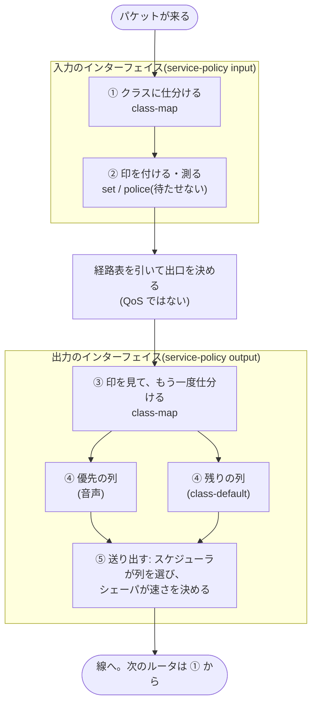

# M12 — QoS の部品と、その並び方

この単元では、プロバイダーのコアを流れるパケットを、扱いで分けることと、悪いパケットから守ることを扱います。
CCNP Service Provider のブループリントでは、4.5 の QoS サービスの実装(分類とマーキング、輻輳回避・ポリシング・シェーピング)と、
1.7 のデータプレーンのセキュリティの実装(uRPF・ACL・RTBH・MACsec)にあたります。1.4 の QoS アーキテクチャ(MPLS の QoS の
モデル、TE の QoS、DiffServ と IntServ、信頼の境界、IPv6 のフロー ラベル)は、ページ「マーキングと MPLS の QoS のモデル」と
付録で説明します。単元は 4 つのページと付録に分かれています。

| ページ | 中身 | 課題 |
|---|---|---|
| このページ | QoS の部品(クラス・印・キュー・スケジューラ・ポリサ・シェーパ)と、1 台のルータの中でパケットがそれに出会う順番 | — |
| マーキングと MPLS の QoS のモデル | 印で扱いを分けると何が嬉しいか、DSCP と EXP、ラベルの上の印を 1 ホップずつ追う、3 つのモデル、IOS XR での組み方 | M12-1 |
| ポリシングとシェーピング | 契約の速さで絞る、出口で待たせて均す、優先して送る | M12-2、M12-3 |
| データプレーンの保護 | 偽の送信元を落とす(uRPF)、基盤を守る ACL、攻撃を遠隔で捨てる(RTBH) | M12-4、M12-5 |
| 付録 | TE と QoS(DS-TE ほか)、IntServ と RSVP、IPv6 のフロー ラベル、MACsec、XRv 9000 の対応 | — |

ラボは XRT-14 です。P1 を挟んで、XR01 と PE2 がプロバイダー エッジ(PE)です。XR01 はインターネットとの接続点も兼ねます。
P1 は BGP を持たないコアのルータで、RR1 はルート リフレクタです。RR1 は P1 の脇にぶら下がり、顧客のパケットの経路には
入りません。

:::topo
nodes:
  CE1: {at: [0, 0], label: "CE1 (A のサイト 1)"}
  CUST1: {at: [0, 1.2], label: "CUST1"}
  INET: {at: [1.6, 2.2], label: "INET (インターネット)"}
  XR01: {at: [1.6, 0.6], label: "XR01 (PE)"}
  RR1: {at: [3.2, -0.6], label: "RR1 (RR)"}
  P1: {at: [3.2, 0.6], label: "P1 (P)"}
  PE2: {at: [4.8, 0.6], label: "PE2 (PE)"}
  CE2: {at: [6.4, 0], label: "CE2 (A のサイト 2)"}
  CUST2: {at: [6.4, 1.2], label: "CUST2"}
links:
  - [CE1, XR01, "VRF A"]
  - [CUST1, XR01, "global"]
  - [INET, XR01, "global"]
  - [XR01, P1, "CORE-1"]
  - [P1, PE2, "CORE-2"]
  - [P1, RR1, "RR-LINK"]
  - [PE2, CE2, "VRF A"]
  - [PE2, CUST2, "global"]
frames:
  - {label: "AS 65000 (IS-IS CORE、LDP)", nodes: [XR01, P1, PE2, RR1]}
:::

顧客 A は 2 つのサイトを持ち、L3VPN(VRF A)でつながっています。サイト 1 には電話と PC、サイト 2 には音声サーバと業務の
システムがあります。CUST1 と CUST2 はインターネットへの接続を買った顧客で、INET はインターネットの役です(ページ
「データプレーンの保護」)。

QoS では、クラス・印・キュー・ポリサ・シェーパと、部品が一度にたくさん出てきます。次のページから細部に入る前に、
このページでは、1 台のルータの中でパケットがそれぞれの部品に出会う順番に並べます。

## 1. 何が嬉しいのか

### 1.1 困りごと: 出口は 1 本、来るパケットは送れる量より多い

ルータは、インターフェイスからパケットを 1 つずつ、そのインターフェイスの速さ(またはその先の契約の速さ)で送り出します。
1 つの出口に、送り出せるより速くパケットが来ると(速いポートから遅いポートへ、多くのポートから 1 つのポートへ)、
まだ出られないパケットはどこかで待つしかありません。待つ場所が足りなくなれば、いくつかは捨てられます。

このラボでは、XR01 からサイト 1 への出口がその場所です。ポートは 1 Gbps ですが、その先の契約はもっと遅い速さです。
サイト 1 の電話への音声も、PC への大量のデータも、同じ出口から出ていきます。

### 1.2 それ以前の手: 1 本の列に、来た順に並べる

QoS のポリシーが無いと、出口はふつう 1 本の列(FIFO: 先に来たものが先に出る)を持ちます。パケットは来た順に出ていき、
列が満杯なら、新しく来たパケットは列の末尾で捨てられます。単純で、それなりに公平ですが、音声とバックアップを区別できません。
大量のデータ 50 個の後ろに来た音声のパケットは 50 個分待たされ、列が満杯なら同じように捨てられます。

### 1.3 QoS の答え: 仕事を分ける

QoS は、ルータがパケットにすることを、別々の仕事に分けます。

- **仕分ける**: パケットを組(クラス)に分ける。
- **印を付ける**: 組を、次のルータや自分の出口が読める印にする。
- **測る**: 組の速さを測り、超えた分をその場で処置する(ポリサ)。
- **並べる**: 出口で、組ごとの列(キュー)に並べる。
- **送り出す**: 次にどの列から出すかを選び(スケジューラ)、出口の速さを決めた値に抑える(シェーパ)。

仕事ごとにコマンドがあり、それが同じポリシーの中に並んで書かれるので、部品の区別が付きにくくなります。このページの
残りでは、パケットが出会う順にそれを並べます。

## 2. 仕組み: 1 つのパケットが 1 台のルータを通る

### 2.1 仕事の順番



1. **仕分ける(入力)**: 入力のポリシーは、クラスを上から調べ、パケットは条件に最初に当たったクラスに入ります。どれにも
   当たらなければ `class-default` に入ります。クラスは組の名前にすぎず、それだけではパケットに何もしません。
2. **印を付ける・測る(入力)**: そのクラスの動作が実行されます。印は、パケットに書き込むもの(DSCP・EXP)と、ルータの中だけで
   付けるもの(qos-group)があります。ポリサは速さを測り、1 つずつその場で、通す・印を付け替えて通す・捨てる、を決めます。
   パケットを待たせることはありません。
3. ルータは経路表を引いて、出口のインターフェイスを決めます。ここは QoS ではありません。
4. **もう一度仕分ける(出力)**: 出力のポリシーは、自分のクラスを持っています。パケットが入力でどのクラスにいたかは見えず、
   見えるのは印だけです。パケットの中の DSCP と EXP、そして入力が付けた qos-group です。
5. **並べる・送り出す(出力)**: 出力のポリシーでキューの動作(`priority`・`bandwidth remaining`・`queue-limit` など)を書いた
   クラスは、それぞれ自分の列を持ち、パケットは自分のクラスの列で待ちます。スケジューラが、次に送る列を選びます。優先の列に
   パケットがあればいつもそれを先に、ほかの列は割合に従って選びます。シェーパは、出口全体の速さを決めた値に抑えます。

パケットは印を付けたまま線に出ます。次のルータは、その印を使って、また 1 から仕分けます。

### 2.2 用語を並べる

空港のチェックインがほぼ同じ仕組みなので、右の列でたとえます。

| 用語 | すること | 空港のチェックインなら |
|---|---|---|
| クラス(`class-map`) | パケットの組の名前と、その組に入る条件 | 搭乗券の等級 |
| `class-default` | ほかのどのクラスにも当たらなかったパケット全部 | 等級の書いていない乗客 |
| 印(DSCP・EXP) | 組を**次のルータへ**伝える | 搭乗券に印字された等級 |
| qos-group | 組を**同じルータの**入力から出力へ伝える。線には出ない | このターミナルの中だけで使うリストバンド |
| ポリシー(`policy-map`) | クラスごとに何をするか | 等級ごとの扱いの規則 |
| `service-policy` | ポリシーを、どのインターフェイスのどの向きに当てるか | 規則をどのゲートに貼り出すか |
| キュー | 出口で送り出しを待つパケットの列。クラスごとに 1 本 | チェックイン カウンターごとの列 |
| スケジューラ | 次に送る列を選ぶ | 次の乗客をどの列から呼ぶかを決める係員 |
| ポリサ(`police`) | 速さを測り、超えた分をその場で処置する。待たせない | 入口で人数を数え、超えた人を格下げするか断る |
| シェーパ(`shape`) | 出口の速さを抑え、超えた分を列で待たせる | カウンターが 1 分に受け付ける人数を決める |
| WRED(`random-detect`) | 列が伸び始めたら、いくつかを無作為に捨てる | 列が伸び始めたら、何人かに後の便へ回ってもらう |

### 2.3 クラスとキューは別のもの

クラスは「分け方」で、キューは「出口の列」です。仕分けは入力でも出力でも行いますが、クラスが列になるのは、ポリシーが
そのクラスにキューの動作を書いたときだけです。このラボでは、入力のポリシーは印を付けて測るだけで、列を作る動作は出力の
ポリシーに書きます。パケットが溜まるのは出口だからです。

1 台のルータの入力のポリシーと出力のポリシーは、それぞれ自分のクラスを持ち、両者のクラスはつながっていません。入力から
出力へ渡るのは印だけです。パケットの中の DSCP と EXP、そしてルータの中の qos-group です(ページ「マーキングと MPLS の
QoS のモデル」の 3.3 節)。

### 2.4 列ができるのは、出口が混んだときだけ

パケットが、出口が送り出せる速さ以下で来ている間は、どのパケットも着いたらすぐに出ていきます。列は空のままで、
`priority` も `bandwidth remaining` も何も変えません。追い越す相手がいないからです。キューが働くのは、出口が混んだときだけです。

CE2 からサイト 1 へ、1000 バイトのパケットを約 25 秒間、送れるだけ速く送り、その途中で 100 バイトの ping を送ってみます
(EF の印付きを 50 発、印なしを 10 発)。XR01 の CE1 への出口(1 Gbps のポート)にポリシーが無いとき、ping は
すべて 1〜3 ms で戻りました。出口が混まなかったので何も待たず、優先の列があってもすることはありませんでした。

### 2.5 親が出口を狭くし、子が順番を決める

1 Gbps のポートの先に 2 Mbps の契約があると、ポートそのものはまず混みません。パケットが溜まるのはもっと先の、顧客の
アクセス回線の装置で、その装置はどれが急ぐパケットかを知らずに捨てます。1 Gbps のポートに優先の列を作っても、
追い越す相手はまずいません。

そこで、親のポリシーで出口を 2 Mbps に整形します。超えた分は、ルータ自身の列で待つようになり、ルータが選べるように
なります。その 2 Mbps の中の順番を、子のポリシーが決めます。親が量を決め、子が順番を決めます(ページ「ポリシングと
シェーピング」の 2.5 節)。

2.4 節と同じ試験を、3.3 節のポリシー(親= 100 kbps、子= 音声を優先の列に入れて上限 32 kbps、残りを 20 個の列に入れる)で
行いました。今度は出口が混みました。残りの列は 12533 個を受け取り、242 個を送り出し、12291 個を末尾で捨てました。音声の
クラスは、末尾で 1 つも捨てられていません。失った 3 個は、上限の 32 kbps を超えた分で、ポリサが捨てたものです。

```console
RP/0/RP0/CPU0:XR01#show policy-map interface GigabitEthernet0/0/0/1 output
...
  Policy CE-OUT-CHILD Class VOICE
      Matched             :                  50/5900                 0
      Transmitted         :                  47/5546                 0
      Total Dropped       :                   3/354                  0
...
      Policed(exceed)     :                   3/354                  0
...
      Taildropped(packets/bytes)           : 0/0
  Policy CE-OUT-CHILD Class class-default
      Matched             :               12533/12749594             0
      Transmitted         :                 242/237356               0
      Total Dropped       :               12291/12512238             0
      Taildropped(packets/bytes)           : 12291/12512238
```

### 2.6 ポリサかシェーパか: 超えた分を待たせるかどうか

どちらもトークン バケツで速さを測ります(ページ「ポリシングとシェーピング」の 2.1 節)。違いは、超えた分の扱いです。

| | ポリサ | シェーパ |
|---|---|---|
| 超えた分 | その場で、印を付け替えて通すか捨てる | 列で待たせ、後で送る |
| 列 | 使わない | 使う |
| 遅れ | 増えない | 増える |
| 置く場所 | 入力にも出力にも置ける。入力= 信頼の境界(顧客を契約の速さに収める)、出力= 優先の列の上限・出口に集まった総量の制限 | ふつうは出力(列が要るため)。遅い回線の手前で、相手が受け取れる速さを超えて送らない |

### 2.7 網の中で: XRT-14

DiffServ の考え方どおり、仕事はルータの間で分担します(ページ「マーキングと MPLS の QoS のモデル」の 1.3 節)。
縁が仕分けて印を付け、コアは印だけを読み、出口で並べます。

| 場所 | 仕事 | 課題 |
|---|---|---|
| XR01 の、サイト 1 からの入力 | ① 仕分ける(音声・業務のデータ・その他)。② EXP と DSCP の印を付け、業務のデータを測る | M12-1、M12-2 |
| P1 の、XR01 からの入力 | ① EXP だけで仕分けて数える(`COUNT-EXP`・据え付け) | — |
| XR01 の、P1 からの入力 | ① EXP で仕分ける。② qos-group にして先へ渡す | M12-3 |
| XR01 の、サイト 1 への出力 | ③ qos-group で仕分けて DSCP の印を付ける。④ 並べる(音声を先に)。⑤ 出口を整形する | M12-3 |
| CE1 と CE2 の入力 | ① DSCP で仕分けて数える(`COUNT-DSCP`・据え付け) | — |

### 2.8 押さえどころ

- クラスはパケットの組、キューは出口の列、スケジューラは次に送る列を選ぶ係。
- ルータの入力のポリシーと出力のポリシーをつなぐのは印だけ(パケットの中の DSCP と EXP、ルータの中の qos-group)。
- キューが働くのは出口が混んだときだけ。親のシェーパでルータ自身の出口を混む場所にすると、子が順番を決められる。
- ポリサは超えた分をその場で処置し、遅れを足さない。シェーパは超えた分を待たせる。

## 3. IOS XR で組む

### 3.1 仕事ごとの書き場所

| 仕事 | 書き場所 |
|---|---|
| 仕分ける | `class-map`(`match …`)と、`policy-map` の中のクラスの順番 |
| 印を付ける | クラスの中の `set dscp`・`set mpls experimental …`・`set qos-group` |
| 測る | クラスの中の `police` |
| 並べる | 出力のポリシーのクラスの中の `priority level 1`・`bandwidth remaining`・`queue-limit` |
| 送り出す | スケジューラはキューの動作に従う。速さは親の `class-default` の `shape average` |
| 当てる | インターフェイスの `service-policy input`・`output` |

### 3.2 入力: 仕分けて、印を付けて、測る

XR01 のサイト 1 からの入力で、パケットを音声・大量のデータ・その他に仕分け、コアのための EXP を付け、大量のデータを
測ります。ここでは何も待ちません。

図は、大量のデータ(AF11)のパケット 1 つが、この入力のポリシーを通る順です。番号は 2.1 節の仕事の番号で、設定例の注記の
番号と同じです。図の番号にカーソルを置くと(スマホでは押すと)、その仕事の設定が出ます。

:::walk
legend: 線の上のパケットは左が外側。tc がラベルの EXP。橙は書き換わった印。
rows:
  - {node: CE1, kind: host, say: ["~サイト 1 から、大量のデータ(AF11)を送る"]}
  - {wire: "[[IP AF11]]"}
  - panel: XR01
    sub: サイト 1 からの入口(Gi0/0/0/1 の入力)
    items:
      - ref: 1
        head: "**仕分ける** `service-policy input CE-IN`"
        say: ["クラスを上から調べ、最初に当たったクラスに入る"]
        match:
          - ["class VOICE  match dscp ef", false, 当たらない]
          - ["class BULK   match dscp af11", true, "当たる → BULK の動作へ"]
      - ref: 2
        head: "**印を付けて、測る** class BULK の動作"
        then:
          - "`set mpls experimental imposition 2`  コアが読む EXP を 2 に。DSCP は AF11 のまま"
          - "`police rate 64 kbps`  収まる分は通し、超えた分はその場で捨てる。待たせない"
      - say: ["~経路を引き、ラベルを 2 枚積んで P1 へ送る。ここは QoS ではない"]
  - {wire: "[[!16 tc 2]] [[!24 tc 2]] [[IP AF11]] ^EXP は 2、DSCP は AF11 のまま"}
  - {node: P1, say: ["~コアは EXP だけを読む"]}
  - aside: "ほかのパケットなら"
    say:
      - "~EF(音声): ①で VOICE に当たる → ②で EXP 5 → [[=16 tc 5]] [[=23 tc 5]] [[IP EF]]"
      - "~印なし: どのクラスにも当たらず class-default に入る → ②で EXP 0"
:::

:::config XR01 — サイト 1 から来るパケットを仕分け、EXP を付け、大量のデータを測る
class-map match-any VOICE                     ## ① 仕分ける: 音声の組に入る条件
 match dscp ef
 end-class-map
!
class-map match-any BULK                      ## ① 仕分ける: 大量のデータの組
 match dscp af11
 end-class-map
!
policy-map CE-IN
 class VOICE                                  ## クラスは上から調べ、最初に当たったものに入る
  set mpls experimental imposition 5          ## ② 印: コアが読む EXP
 !
 class BULK
  set mpls experimental imposition 2          ## ② 印
  police rate 64 kbps                         ## ② 測る: 64 kbps まで
   conform-action transmit                    ## 収まる分: その場で通す
   exceed-action drop                         ## 超えた分: その場で捨てる(待たせない)
  !
 !
 class class-default                          ## ① 上のどのクラスにも当たらなかったもの全部
  set mpls experimental imposition 0
 !
 end-policy-map
!
interface GigabitEthernet0/0/0/1              ## CE1 へのポート
 service-policy input CE-IN                   ## 入力に当てる
:::

### 3.3 出力: もう一度仕分けて、並べて、送り出す

XR01 のサイト 1 への出力で、出口全体を 100 kbps に整形し、その中で音声を先に送ります。

図は、2.5 節の試験で、サイト 1 へ向かう音声とデータが出口を通る順です(番号は 2.1 節の仕事の番号)。

:::walk
rows:
  - {node: P1, say: ["~サイト 1 宛ての音声(EF)と、1000 バイトのデータが続けて来る"]}
  - {wire: "[[IP EF]] [[IP データ]] [[IP データ]] [[IP データ]]"}
  - panel: XR01
    sub: サイト 1 への出口(Gi0/0/0/1 の出力)
    items:
      - ref: 3
        head: "**もう一度仕分ける** 子 `CE-OUT-CHILD` のクラス"
        say: ["入力のクラスは見えない。見えるのは印(DSCP・EXP・qos-group)だけ"]
        match:
          - ["class VOICE  match dscp ef", true, "EF が当たる"]
          - ["class class-default", true, "データが当たる"]
      - ref: 4
        head: "**並べる** クラスごとの列"
        then:
          - "[[IP EF]] 優先の列(`priority level 1`): パケットがあればいつも先。上限 32 kbps"
          - "[[IP データ]] [[IP データ]] 残りの列(`queue-limit 20 packets`): 溢れたら末尾で捨てる"
      - ref: 5
        head: "**送り出す** 親 `CE-OUT` の `shape average 100 kbps`"
        say: ["スケジューラが優先の列を先に選び、シェーパが出口全体を 100 kbps に抑える。超えた分は列で待つ"]
  - {wire: "[[IP EF]] [[IP データ]] _合わせて 100 kbps まで"}
  - {node: CE1, kind: host, say: ["~サイト 1"]}
  - aside: "結果の例(2.5 節の試験。約 25 秒)"
    say:
      - "~音声 50 発: 47 発を送り、上限の 32 kbps を超えた 3 発はポリサが捨てた。末尾で捨てられたのは 0"
      - "~データ 12533 発: 242 発を送り、12291 発は残りの列の末尾で捨てられた"
:::

:::config fold XR01 — サイト 1 への出口を整形し、音声を先に送る
policy-map CE-OUT-CHILD                       ## 子: 親の速さの中での順番
 class VOICE                                  ## ③ もう一度仕分ける(出力のポリシー自身のクラス)
  priority level 1                            ## ④ 優先の列: パケットがあればいつも先に送る
  police rate 32 kbps                         ## 上限。優先の列が出口を使い切らないように
  !
 !
 class class-default
  queue-limit 20 packets                      ## ④ 残りの列: 待てるのは 20 個まで
 !
 end-policy-map
!
policy-map CE-OUT                             ## 親: 量。クラスは class-default だけ
 class class-default
  shape average 100 kbps                      ## ⑤ 出口全体を 100 kbps に。超えた分は待つ
  service-policy CE-OUT-CHILD                 ## 順番は子が決める(input/output は付けない)
 !
 end-policy-map
!
interface GigabitEthernet0/0/0/1
 service-policy output CE-OUT                 ## 出力に当てる
:::

### 3.4 出力の読み方: どの列ができたか

`show qos interface` は、ポリシーが装置にどう入ったかを示します。3.3 節の出力のポリシーでは次のとおりです。

```console
RP/0/RP0/CPU0:XR01#show qos interface GigabitEthernet0/0/0/1 output
...
Level: 0 Policy: CE-OUT Class: class-default
...
Shape Info: rate 100 kbps, burst 1250 bytes,
QueueID: N/A
----------------------------------------------------------------------
Level: 1 Policy: CE-OUT-CHILD Class: VOICE
...
QueueID: 32 (Priority 1)
...
Level: 1 Policy: CE-OUT-CHILD Class: class-default
...
QueueID: 33 (Priority Normal)
Queue Limit: 5 kbytes (20 packets)
```

- `Level: 0` が親、`Level: 1` が子です。
- 親には速さ(`Shape Info`)と `QueueID: N/A` が出ます。親は自分の列を持たず、子の列の送り出す速さを決めるだけです。
- ここでは、子のクラスがそれぞれ自分の `QueueID` を持ちます。`Priority 1` が優先の列、`Priority Normal` がふつうの列で、
  この出口には列が 2 本あります。
- 印を付けるだけでキューの動作の無い子のクラスは `QueueID: 33 (class-default)` になります。自分の列を持たず、
  `class-default` の列で待ちます。
- 入力のポリシー(`show qos interface GigabitEthernet0/0/0/1 input`)では、どのクラスも同じ `QueueID: 25 (Port Default)`
  でした。ポートの既定の列で、クラス自身の列ではありません。

クラスごとの数(`Matched`・`Transmitted`・`Total Dropped`)は `show policy-map interface` で見ます。XRv 9000 では、数は
10〜30 秒遅れて増えます。

### 3.5 落とし穴

- **親には `class-default` だけを書く**: クラスは子に書き、親の `class-default` の下に入れます。親にほかのクラスを書くと、
  そのクラスに入ったパケットは子を通らず、優先の列にも入りません。コミットは通るので、気づきにくい点です(ページ「ポリシングと
  シェーピング」の 2.5 節)。
- **出力のクラスは入力のクラスを読めない**: 出力で知りたいことは、印にして運びます。qos-group は入力で付けて出力で読み、
  逆には書けません(ページ「マーキングと MPLS の QoS のモデル」の 3.5 節)。
- **優先の列には上限が要る**: ポリサが無いと、優先の列が出口を使い切り、ほかの列の番が回ってこなくなります(ページ
  「ポリシングとシェーピング」の 2.4 節)。

:::note
この単元の出力は、IOS XRv 9000 26.1.1(XR01)、IOS XRd 26.1.1(RR1)、IOL 上の IOS XE 17.15(他のルータ)で取得しました。
出典: RFC 2475(2 節)。ASR 9000 の Modular QoS Configuration Guide(IOS XR 24.x。階層のポリシー、優先の列とそのポリサ、qos-group の
向き)。いずれも 2026 年 11 月に確認。2.4 節と 2.5 節の ping と数、`show qos interface` の出力、カウンタの遅れは、PoC の盤面
(XRT-14 と同じ形)での実測です。
:::
