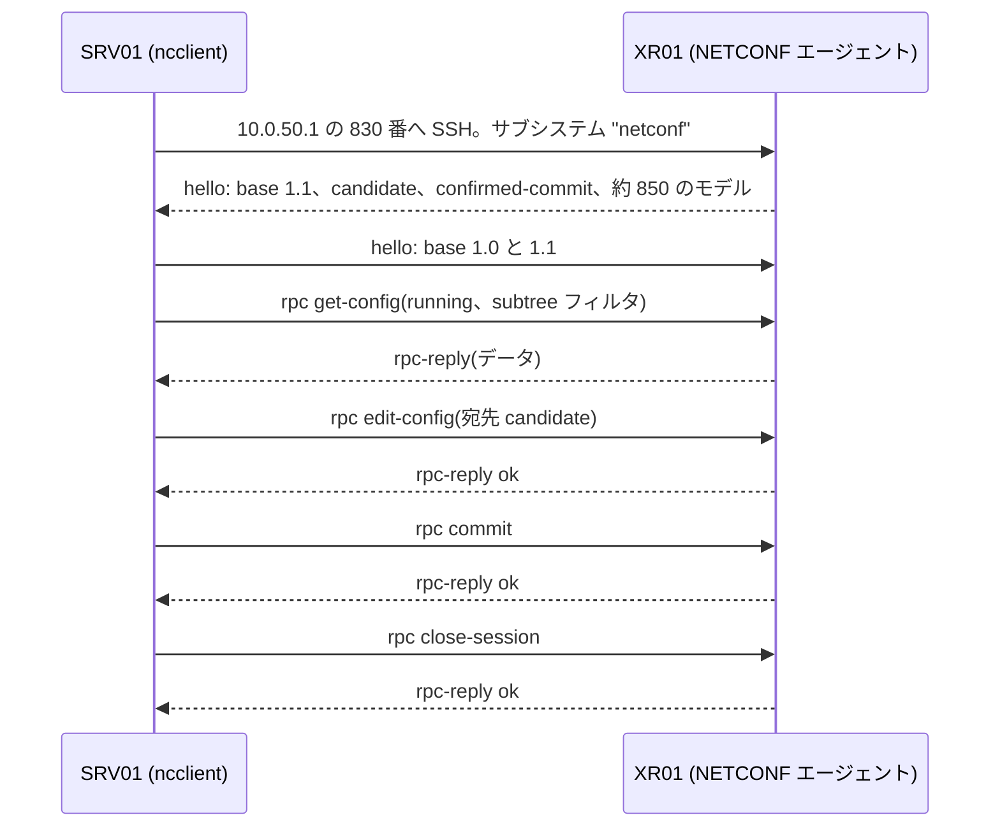

# M13 — モデルで設定する: YANG・NETCONF・RESTCONF

前のページでは、NMS とルータの間の仕事と、モデル・エンコード・プロトコルの層を並べました。このページは、その最初の仕事である
設定を扱います。モデルが設定をどう表すか、NETCONF が変更を IOS XR のコミットまでどう運ぶか、RESTCONF が IOS XE で同じことを
HTTPS でどう行うか、です。ブループリントの 5.9(NETCONF と RESTCONF の設定と確認)と 5.2(REST API で機器を設定する外部の
スクリプトの解釈)にあたり、5.4(YANG)と 5.1(プログラマブルな API)の要点にも触れます。YANG の続きは付録にあります。

盤面は前のページの XRT-15 です。このページでは、NMS の SRV01(10.0.50.10)が、NMS のセグメントを通して XR01(10.0.50.1)と
PE2(10.0.50.2)を扱います。

## 1. 何が嬉しいのか

### 1.1 困りごと: プログラムが 2 種類のルータを変え、確かに入ったと知りたい

NMS のチームは、SRV01 のプログラムから XR01 と PE2 を管理したいと考えています。顧客のサービス用のループバックを足す、
説明を変える、設定されている内容を読み戻す、といったことを、人がキーボードの前にいなくても、毎回同じやり方で行うためです。

2 台のルータは OS が違います。IOS XR は打った行をためておき、`commit` でまとめて適用します(M1)。IOS XE は 1 行ごとに、
打った時点で適用します。`show` の出力も、エラー メッセージも違います。

CLI を操作するプログラムは、人と同じようにコマンドを打ち、返ってきた文字を読まなければなりません。これをスクリーン
スクレイピングと呼びます。プログラムは、プロンプト、エラー メッセージ、`show` の出力ごとの並び方を見分ける必要があります。
新しいリリースで列がずれたり、メッセージの言い回しが変わったりすると、動かなくなります。さらに困るのは、変更が全部入ったのか、
一部だけ入ったのか、まったく入らなかったのかを、確実には判断できないことです。

### 1.2 それ以前の手: CLI のスクリプト、SNMP の SET、ベンダーごとの XML

- **CLI のスクリプト**(expect などの仲間): 1 行送り、プロンプトを待ち、文字を照らし合わせます。動きはしますが、OS ごと・
  リリースごとの言い回しに頼り、エラーはスクリプトが推し量るしかない文字です。IOS では、まとめて流した行が途中で止まり、
  作りかけの変更が残ることがあります。
- **SNMP の SET**: SNMP には書き込みの操作がありますが、標準の MIB には書き込めるオブジェクトが少なく、ルータの設定の大半を
  カバーしていません。トランザクションもありません。2002 年の IAB のワークショップは、SNMP は機器の設定にはあまり使われて
  いないと記録しています。代わりに運用者が求めたものとして、設定と運用状態を分けること、複数の機器にまたがるトランザクション、
  設定を丸ごと取り出して戻す手段、`diff` などの道具で比べられる文字を挙げています(RFC 3535)。
- **ベンダーごとの XML のインターフェイス**: セッションの上で XML 文書を受け付けるルータもありました(IOS XR にも独自の XML
  エージェントがありました)。ただ、ベンダーごとにスキーマもプロトコルも別々でした。

### 1.3 モデル駆動の答え

モデル駆動の管理は、仕事を 3 つに分けます。

- **モデル**が、機器で何を設定でき、何を読めるかを、値ごとに名前と型を持つツリーとして表します。モデルを書く言語が YANG です。
- **プロトコル**が、モデルの形をしたデータを運びます。NETCONF(SSH の上の XML)、RESTCONF(HTTPS の上の JSON か XML)、
  gNMI(gRPC の上。次のページ)です。
- **答えが構造化されています。** 要求は、成功する(`<ok/>`、または HTTP の成功のコード)か、種類とツリーの中の場所を示すエラーで
  失敗するかのどちらかです。NETCONF にはトランザクションもあります。変更の組をためておいて 1 つとして適用でき、自分で元に戻る
  ように指定することもできます。

これらがルータのプログラマブルな API です(5.1)。OS によって、そろっているものが違います。

| API | 運び方 | エンコード | この盤面では |
|---|---|---|---|
| NETCONF | SSH、TCP 830 | XML | XR01(課題 M13-1)。IOS XE にも NETCONF はあるが、このラボでは使わない |
| RESTCONF | HTTPS、TCP 443 | JSON か XML | PE2 だけ(課題 M13-2)。IOS XR には RESTCONF サーバが無い |
| gNMI | gRPC(HTTP/2。ふつうは TLS) | JSON(XR01 では JSON_IETF) | XR01(次のページ) |

NSO のようなコントローラも、ルータに向かっては同じ API を使います(付録)。

## 2. 仕組み: 1 つの変更を、NMS から実行コンフィギュレーションまで

### 2.1 YANG: 設定と状態のモデル

YANG(RFC 7950)は、データをツリーとして表す言語です。1 つのモデルは 1 つの**モジュール**として書きます。モジュールには名前と
**名前空間**(URI)があり、データの要素はそれぞれ、名前空間でどのモジュールに属するかを示します。

SRV01 が NETCONF で Loopback0 の設定を尋ねたとき、XR01 は次のように答えました。CLI で書くと
`interface Loopback0` / `ipv4 address 10.255.0.1 255.255.255.255` と同じ設定です。

```console
<data>
 <interfaces xmlns="http://cisco.com/ns/yang/Cisco-IOS-XR-um-interface-cfg">
  <interface>
   <interface-name>Loopback0</interface-name>
   <ipv4>
    <addresses xmlns="http://cisco.com/ns/yang/Cisco-IOS-XR-um-if-ip-address-cfg">
     <address>
      <address>10.255.0.1</address>
      <netmask>255.255.255.255</netmask>
     </address>
    </addresses>
   </ipv4>
  </interface>
 </interfaces>
</data>
```

このツリーを作っている YANG の部品は次のとおりです。

| 部品 | 何か | 上の答えでは |
|---|---|---|
| モジュール、名前空間 | 定義をまとめたファイルと、それを指す URI | `Cisco-IOS-XR-um-interface-cfg`、`http://cisco.com/ns/yang/Cisco-IOS-XR-um-interface-cfg` |
| コンテナ | ほかのノードをまとめるだけのノード | `interfaces`、`ipv4` |
| リスト、キー | 繰り返す項目。キーのリーフの値で見分ける | `interface`。`interface-name` で見分ける |
| リーフ | 型を持つ 1 つの値 | `interface-name`、`address`、`netmask` |
| リーフ リスト | 同じ型の値の並び | (ここには無い) |
| config true / false | 設定(書ける)か、状態(読むだけ)か | すべて設定。`-cfg` のモデルは状態を持たない |
| augment | あるモジュールが、別のモジュールのツリーにノードを足す | `ipv4/addresses` は `Cisco-IOS-XR-um-if-ip-address-cfg` から来る |

答えの途中で `xmlns` の属性が変わっています。アドレスはインターフェイスのモジュールの持ち物ではなく、2 つ目のモジュールが
インターフェイスの下に足しています(augment)。要求の側も同じ 2 つの名前空間を使わないと、機器は要素を見分けられません。

YANG はデータを説明するもので、データそのものではありません。線の上では、データは XML(NETCONF)か JSON(RESTCONF と
gNMI。RFC 7951)で運ばれます。同じモデルから、どちらのエンコードも決まります。

### 2.2 IOS XR の 3 つのモデルの系統

IOS XR には、3 つの系統のモデルが入っています。名前で見分けられます。

| 系統 | モジュールの名前 | どんなものか |
|---|---|---|
| ネイティブ | `Cisco-IOS-XR-<機能>-cfg`、`Cisco-IOS-XR-<機能>-oper`(例: `Cisco-IOS-XR-ifmgr-cfg`、`Cisco-IOS-XR-ifmgr-oper`) | いちばん古い系統。ツリーは XR の内部のスキーマに沿う。状態は `-oper` のモデルが持つ |
| ユニファイド モデル(UM) | `Cisco-IOS-XR-um-<機能>-cfg`(例: `Cisco-IOS-XR-um-interface-cfg`) | 設定だけ。CLI から生成されているので、ツリーは CLI によく似る。ネイティブの設定のモデルに代わるものとして 7.0.1 で入った |
| OpenConfig | `openconfig-<機能>`(例: `openconfig-interfaces`) | 運用者のグループが書いた、ベンダーに依らないモデル。設定と状態が並ぶ(`config` と `state` のコンテナ)。XR との違いは deviation モジュールで公開されている(`cisco-xr-openconfig-…-deviations`) |

名前空間も同じ決まりです。Cisco のモデルは `http://cisco.com/ns/yang/<モジュール>`、OpenConfig は
`http://openconfig.net/yang/<名前>` です。

ルータがどのモデルを持つかは、3 か所で分かります。

- **hello**: NETCONF セッションが開くと、ルータは対応するものの一覧を送ってきます(2.3 節)。ncclient では
  `m.server_capabilities` です。XR01 は 857 項目を挙げました。ユニファイド モデルが約 220、OpenConfig が 54、残りのおよそ 420 が
  ほかの Cisco-IOS-XR のモデル(ネイティブ)です。同じリリースの IOS XRv 9000 は 1093 項目でした。
- **ルータそのもの**: `show netconf-yang capabilities` が同じ一覧を出します。
- **Cisco の目録**: Cisco Feature Navigator(YANG Data Models)と GitHub の YangModels のリポジトリで、機種とリリースごとに
  調べられます。

同じインターフェイスを OpenConfig で読むと、次のようになります。状態を読む要求(`<get>`)なので、設定のモデルには無い
運用の状態とカウンタが入っています。

```console
<interfaces xmlns="http://openconfig.net/yang/interfaces">
 <interface>
  <name>Loopback0</name>
  <state>
   <name>Loopback0</name>
   <type xmlns:idx="urn:ietf:params:xml:ns:yang:iana-if-type">idx:softwareLoopback</type>
   <mtu>1500</mtu>
   <enabled>true</enabled>
   <admin-status>UP</admin-status>
   <oper-status>UP</oper-status>
   <counters>
    <carrier-transitions>1</carrier-transitions>
   </counters>
...
```

(出力は一部を省いています。)

使い分け: XR をその CLI と同じ考え方で設定するならユニファイド モデル、1 つのプログラムで複数のベンダーを設定するなら OpenConfig、
OpenConfig に無い XR の状態はネイティブの `-oper` のモデルです。

### 2.3 NETCONF: SSH の上のセッション、RPC、データストア

NETCONF(RFC 6241)は SSH の中で動きます(RFC 6242)。クライアントは TCP の 830 番に SSH で接続し、SSH サブシステム
`netconf` を求めます。ログインは SSH の仕事なので、誰が接続できるかはルータのユーザ(または AAA)が決めます。セッションが
開くと、両端が自分のケイパビリティ(capabilities)を並べた `<hello>` を送ります。その後は、クライアントが RPC を送り、サーバが 1 つずつ
答えます。



RPC はどれも `message-id` を持ち、答えは同じ ID を付けて返ります。`<rpc message-id="101">` には
`<rpc-reply message-id="101">` が答えます。答えの中身は、`<ok/>`、`<data>…</data>`、またはエラー タグ(場合によっては、
問題の要素の位置も)を持つ `<rpc-error>` です。両端が base 1.1 を名乗ると、メッセージは長さを付けたチャンクで送られます。base 1.0
では、メッセージの終わりに `]]>]]>` の印を付けます。IOS XR は同じポートでどちらにも答えます。

ここで要る操作は次のとおりです。

| 操作 | 何をするか |
|---|---|
| `<get-config>` | データストア(`running` か `candidate`)から設定を読む。フィルタも付けられる |
| `<get>` | 設定と状態をまとめて読む |
| `<edit-config>` | データストアの設定に、マージ・置き換え・作成・削除をする |
| `<commit>` | candidate を実行コンフィギュレーションにする |
| `<discard-changes>` | candidate にためた変更を捨てる |
| `<lock>`、`<unlock>` | 作業の間、ほかのセッションにデータストアを変えさせない |
| `<validate>` | 適用せずにデータストアを検査する |
| `<close-session>`、`<kill-session>` | 自分のセッション、またはほかのセッションを終える |

**データストア**は、設定の丸ごとの 1 揃いです。`running` はいつもあります。`:candidate` を名乗るサーバには、変更をためておく
`candidate` もあります。`:writable-running` を名乗るサーバは、クライアントが `running` に直接書けます。`:startup` は起動時の
設定を足します。XR01 の hello には `:candidate` と `:confirmed-commit:1.1` があり、`:writable-running` と `:startup` はありません
でした。そのため IOS XR では、変更はすべて candidate に入り、コミットで有効になります。

`<get-config>` のフィルタは subtree フィルタです(RFC 6241 の 6 節)。欲しいものの形をした XML の切れ端です。子を持つ要素
(`<interfaces>`、`<interface>`)はツリーのその部分を選び、値を持つリーフ(`<interface-name>Loopback0</interface-name>`)は、その値を
持つリストの項目だけを残します。2.1 節の答えは、このようなフィルタで得たものです(3.2 節)。

### 2.4 candidate・commit・confirmed commit

IOS XR の CLI は、もともと 2 つのコンフィギュレーションで動いています(M1)。自分のセッション専用のターゲット
コンフィギュレーションと、実行コンフィギュレーションで、`commit` が差分を 1 つとして適用します。NETCONF の candidate と
`<commit>` は、同じ考え方を標準の名前で呼んだものです。IOS XR はクライアントごとに candidate を持ちます(ガイドは「ほかの
クライアントに属する candidate データストア」と書いています)。CLI のセッションがそれぞれ自分のターゲット コンフィギュレーション
を持つのと同じです。

NETCONF のコミットは、ふつうのコミットです。コミット ID が付き、CLI からのコミットと同じようにコミット履歴に書かれます。
履歴には、どこから来たかも残ります。Line が `netconf`、Client が `YANG Frame` です(3.3 節)。`show configuration commit
changes` も、ほかのコミットと同じようにその行を見せます。

**confirmed commit**(確認つきコミット。RFC 6241 の 8.4 節)は、プロトコルの `commit confirmed` です。クライアントは
`<commit><confirmed/><confirm-timeout>120</confirm-timeout></commit>` を送ります。変更はすぐに、仮のものとして適用されます。

- タイムアウトの前に、ふつうの `<commit/>` を送ると恒久的になります。`<cancel-commit/>` を送ると、すぐに取り消されます。
- 時間内に何も来なければ(時間を指定しなければ 600 秒)、サーバは設定を元に戻します。
- 求めたセッションが、確定する前に終わった場合も、サーバは設定を元に戻します。セッションの後まで残るのは、`<persist>` を
  付けて送った確認つきコミットだけです。

XR01 は 3 つ目の決まりどおりに動きます。確認つきコミットを送ってセッションを閉じたスクリプトでは、4 秒後に変更が取り消され
ました。履歴には、取り消しが Line `rollback`、Client `Rollback` の独立したコミットとして残ります。M1 の CLI と同じ決まりです。
CLI でも、コンフィギュレーション モードを抜けると、保留中の `commit confirmed` は取り消されます。求めたセッションは、確定する
まで留まっていなければなりません。

確認つきコミットが保留されている間、実行コンフィギュレーションはロックされます。その間に CLI からコミットすると、M1 の
`configure exclusive` のときと同じメッセージで失敗しました。

```console
% Failed to commit .. Another configuration session
had a lock on the running configuration.
```

クライアントは、`<lock>` でわざとロックを取ることもできます(RFC 6241 の 7.5 節)。作業の途中でほかの誰かに設定を変えられない
ようにするためです。誰がロックを持っているかは、`show configuration sessions` と `show configuration lock` で分かります。

### 2.5 RESTCONF: 同じモデルを HTTPS で

RESTCONF(RFC 8040)は、同じ YANG データを、Web サーバのリソースとして運びます。データにはそれぞれ URL があり、HTTP
メソッドが何をするかを表します。TLS の上で動かさなければなりません(RFC 8040 の 2.1 節)。

URL はモデルから組み立てます。PE2 のホスト名を読む URL は次のとおりです。

```console
https://10.0.50.2/restconf/data/Cisco-IOS-XE-native:native/hostname
        └ device  │        │    └ module : top node        └ child
                  └ root   └ data
```

- `/restconf` がルートです。知らないクライアントは `/.well-known/host-meta` を尋ねれば、ルートの場所を教えてもらえます。
- `/data` は、設定と状態をまとめて持ちます。
- `/data` の次のノードは、モジュール名を付けて書きます(`Cisco-IOS-XE-native:native`)。その下はツリーのとおりにたどります。
  リストの項目はキーで選びます(`…/interface/Loopback=210`)。

メソッドは次のとおりです。

| メソッド | 何をするか | 成功のとき |
|---|---|---|
| GET | リソースを読む | 200 OK とデータ |
| POST | 子のリソースを作る。もうあれば失敗する(409) | 201 Created |
| PUT | リソースを作る、または丸ごと置き換える | 201 Created(新規)/204 No Content(置き換え) |
| PATCH | 本文をリソースにマージする。本文に無いものはそのまま残る | 204 No Content(本文を返すなら 200) |
| DELETE | リソースを消す。存在していなければならない | 204 No Content |

本文と答えは、JSON(`application/yang-data+json`)か XML(`application/yang-data+xml`)の YANG データです。クライアントは、
自分の本文の形式を `Content-Type` で、返してほしい形式を `Accept` で伝えます。エラーは、HTTP ステータス コードと、NETCONF と同じ
エラー タグを持つ `ietf-restconf:errors` の本文で返ります。次は、権限の無いユーザに PE2 が返したステータス コードと本文を、
スクリプトが出力したものです。

```console
GET hostname -> 403 {
  "ietf-restconf:errors": {
    "error": [
      {
        "error-type": "application",
        "error-tag": "access-denied",
        "error-message": "access denied"
      }
    ]
  }
}
```

RESTCONF には candidate もコミットもありません。要求は、成功した時点でそれぞれ有効になります(RFC 8040 の 1.3 節・1.4 節)。
確定するものも、ひとまとまりで戻すものもありません。いくつもの要求でできた変更は、途中で止まることがあります。

この盤面で RESTCONF があるのは PE2(IOS XE)だけです。**IOS XR には RESTCONF サーバがありません**。IOS XRd にも
IOS XRv 9000 にも(26.1.1)`restconf` のコマンドは無く、IOS XR のプログラマビリティのガイドも、YANG のプロトコルとして
NETCONF と gRPC を挙げています。ブループリントは NETCONF と RESTCONF を 1 つの項目にまとめているので、このページでは 2 台の
ルータを使い分けます。

### 2.6 外部のスクリプトを読む

ブループリントの 5.2 は、ほかの人が書いたスクリプトを読み、それが機器に何をするかを説明できることを求めています。REST で
話すスクリプトには、毎回同じいくつかの部品があります。次の順に読みます。

| 部品 | どこを見るか | 分かること |
|---|---|---|
| URL | `https://…/restconf/data/…` | 方式とポート(https → TCP 443)、機器、API(`/restconf`)、モデル(`Cisco-IOS-XE-native:`)、リソース |
| 資格情報 | `auth=(…)`、`curl -u` | 機器がどのアカウントを、どの権限で知っていなければならないか |
| ヘッダ | `Accept`、`Content-Type` | 形式。`yang-data+json` は RESTCONF の JSON |
| 本文 | `json=…`、`curl -d` | データ。モデルの形をしている。いちばん外のキーは `モジュール:ノード`、リストは JSON の配列、リストの項目はキーを持つ |
| メソッド | `requests.get/patch/put/post/delete`、`curl -X` | 読む・マージ・置き換え・作成・削除のどれか |
| 何を確かめるか | `status_code`、`raise_for_status()` | どの答えを成功とみなし、どこで止まるか |

そうしたスクリプトの短い例を、1 行ずつ読みます。PE2 の Loopback0 に説明を付けるスクリプトです。

:::config SRV01 — PE2 の Loopback0 に説明を付ける RESTCONF のスクリプト
import requests                                      ## HTTP のライブラリ。1 回の呼び出しが 1 つの要求
import urllib3                                       ## 次の行のためだけ
urllib3.disable_warnings()                           ## 下の verify=False が出す警告を隠す
BASE = "https://10.0.50.2/restconf/data"             ## https= PE2 の TCP 443。/restconf/data= RESTCONF のデータ
AUTH = ("noc-auto", "Noc-Auto-15")                   ## HTTP の Basic 認証。PE2 が知っていなければならないアカウント
HDRS = {"Accept": "application/yang-data+json",      ## 答えは RESTCONF の JSON で
        "Content-Type": "application/yang-data+json"}   ## 本文は RESTCONF の JSON
BODY = {"Cisco-IOS-XE-native:interface": {           ## いちばん外のキー= モジュール名とノード(IOS XE のネイティブ モデル)
            "Loopback": [{                           ## リスト。項目は JSON の配列に入る
                "name": 0,                           ## 項目のキー= Loopback0
                "description": "ROUTER-ID"}]}}       ## 送るリーフはこれだけ。Loopback0 のほかの部分には触らない
r = requests.patch(f"{BASE}/Cisco-IOS-XE-native:native/interface",   ## PATCH= 本文をこのリソースにマージする
                   auth=AUTH, headers=HDRS, json=BODY,   ## json= が BODY を JSON の文字にする
                   verify=False, timeout=30)         ## verify=False= PE2 の証明書(自己署名)を確かめない
print(r.status_code, r.text)                         ## ステータス コードと答えの本文を出す
if r.status_code not in (200, 204):                  ## PATCH の成功のコード
    raise SystemExit("PE2 refused the change")      ## それ以外なら、エラーでスクリプトを止める
:::

こうしたスクリプトが失敗したときは、最初に返ってきた答えで、どの部品が足りないかが分かります。

| 返ってきたもの | 意味 | 確かめるもの |
|---|---|---|
| 接続できない(`Connection refused`) | そのポートで誰も待っていない | 機器の HTTPS サーバ |
| JSON の代わりに HTML のエラー ページ | Web サーバは答えるが、後ろの RESTCONF の用意ができていない | IOS XE では、RESTCONF を有効にしてから 1 分ほどかかる |
| 401 Unauthorized | 資格情報が受け付けられなかった | ユーザ名とパスワード |
| 403 Forbidden、`access-denied` | ユーザは分かったが、許されていない | ユーザの権限(IOS XE では特権レベル 15) |
| 404 Not Found | その URL には何も無い | パスの中のモジュール名・ノード名・キー |
| 400 Bad Request | 要求がモデルに合わない | 本文の名前・型・JSON の書き方 |
| 409 Conflict | もうある(POST)、またはロックされている | POST ではなく PATCH か PUT にする。ロックが外れるのを待つ |
| 200・201・204 | 成功 | 念のため、機器の設定 |

### 2.7 押さえどころ

- YANG はデータを説明する(モジュール・コンテナ・キーを持つリスト・リーフ。設定か状態か)。NETCONF と RESTCONF は、その形の
  データを XML か JSON で運ぶ。要素がどのモデルのものかは `xmlns`(または `モジュール:` の接頭辞)で分かる。
- IOS XR のモデルは 3 系統。ネイティブ(`-cfg`・`-oper`)、ユニファイド モデル(`-um-…-cfg`。CLI に近い)、OpenConfig。NETCONF
  セッションの hello に一覧が出る。
- NETCONF: 830 番へ SSH、ケイパビリティを並べた hello、その後は RPC。IOS XR は candidate を編集し、`<commit>` で適用する。それは
  ふつうのコミットで、履歴の Line は `netconf`。確認つきコミットは、確定する前にセッションが終わると取り消される。
- RESTCONF: 同じモデルを HTTPS の URL として、GET・POST・PUT・PATCH・DELETE で扱う。candidate もコミットも無く、要求は
  すぐに有効になる。IOS XE にはあり、IOS XR には無い。
- REST のスクリプトは URL・資格情報・ヘッダ・本文・メソッドで読み、失敗はステータス コードで読む。

## 3. 組む

NETCONF の設定は 3 か所にあります。XR01 の SSH サーバと NETCONF エージェント、そして SRV01 のスクリプトです。図は、
1 つの変更を SRV01 から XR01 の実行コンフィギュレーションまで追います。図の番号は、3.1 節と 3.2 節の設定例の注記の番号と
同じです。図の番号にカーソルを置くと(スマホでは押すと)、その部分の設定が出ます。

:::walk
legend: "1 つの NETCONF の変更を SRV01 から XR01 へ。青い番号= 3.1 節・3.2 節の設定例"
rows:
  - panel: SRV01
    sub: NMS(Python・ncclient)
    items:
      - ref: 3
        head: "**セッションを開く** `manager.connect(host=\"10.0.50.1\", port=830, …)`"
        say: ["NMS のセグメントで XR01 へ SSH。サブシステム netconf を求める"]
  - {wire: "[[SSH  10.0.50.10 → 10.0.50.1  TCP 830]] _NMS のセグメント(グローバル)"}
  - panel: XR01
    sub: 管理されるルータ
    items:
      - ref: 1
        head: "**SSH サーバ** `ssh server netconf vrf default`"
        say: ["ここで名前を挙げた VRF で、830 番の NETCONF を待つ"]
      - ref: 2
        head: "**NETCONF エージェント** `netconf-yang agent` → `ssh`"
        say: ["セッションを引き継ぎ、hello を送る"]
      - say: ["~hello: base 1.1、:candidate、:confirmed-commit、約 850 のモデル", "~:writable-running は無い → 変更は candidate へ"]
      - ref: 4
        head: "**candidate を編集** `<edit-config>`  ユニファイド モデルの XML"
        say: ["このクライアントの candidate にマージ。ルータはまだ変わらない"]
      - ref: 5
        head: "**コミット** `<commit/>`"
        say: ["candidate が実行コンフィギュレーションになる。1 つのコミットとして"]
      - say: ["~実行コンフィギュレーション: Gi0/0/0/2 に説明が付く", "~コミット履歴: Line `netconf`、Client `YANG Frame`"]
  - aside: "①が無いと(エージェントだけ)"
    say: ["~XR01 はその VRF の 830 番で NETCONF に答えない", "~→ スクリプトは接続できず、hello も来ない"]
  - aside: "④だけで⑤が無いと(編集してコミットしない)"
    say: ["~編集には `<ok/>` が返るが、変更は candidate に留まる", "~→ 実行コンフィギュレーションも履歴も変わらない"]
:::

### 3.1 IOS XR で NETCONF を有効にする

:::config fold XR01 — NMS のセグメントで、SSH の上の NETCONF を受け付ける
ssh server netconf vrf default                ## ① NMS のセグメントがある default の VRF で、NETCONF(TCP 830)を待つ
netconf-yang agent                            ## ② NETCONF エージェント
 ssh                                          ## ② SSH サーバから渡された NETCONF セッションを受け持つ
:::

両方が要ります。`netconf-yang agent ssh` がエージェントを起こし、`ssh server netconf vrf <名前>` が、その VRF で SSH サーバに
NETCONF を受け付けさせます。VRF は少なくとも 1 つ挙げなければなりません。NMS が管理用の VRF にいるなら、その VRF を挙げます
(例: `ssh server netconf vrf MGMT`)。CLI 用の SSH サーバ(`ssh server vrf …`)は別の行で、NETCONF には NETCONF の行が要ります。

```console
RP/0/RP0/CPU0:XR01#show running-config netconf-yang agent
netconf-yang agent
 ssh
!

RP/0/RP0/CPU0:XR01#show running-config ssh
ssh server rate-limit 600
ssh server v2
ssh server vrf MGMT
ssh server netconf vrf default
```

### 3.2 Python(ncclient)から NETCONF セッションを張る

ncclient は Python 用の NETCONF クライアントのライブラリです。`manager.connect()` が SSH セッションを開き、hello を
交わします。その後は、NETCONF の操作がそれぞれメソッドになっています。`get_config()`・`get()`・`edit_config()`・`commit()`・
`discard_changes()`・`locked()`(`with` の間だけロックを持つ)・`close_session()` です。どれも答えを返し、`.xml` でその文字が
取れます。

先に読み、それから変えます。読むにはフィルタだけがあれば足ります。次のフィルタは、ユニファイド モデルの Loopback0 の項目を選びます。

```console
FILTER = """<interfaces xmlns="http://cisco.com/ns/yang/Cisco-IOS-XR-um-interface-cfg">
 <interface><interface-name>Loopback0</interface-name></interface></interfaces>"""
print(m.get_config(source="running", filter=("subtree", FILTER)).xml)
```

答えは 2.1 節のものが `<rpc-reply>` に包まれて返ります。まだ無い項目を尋ねると、エラーではなく空の `<data/>` が返ります。
変更に要る XML の形を知るには、まねしたい項目を読んでみるのがいちばん早い方法です。

次の変更は、CE1 への予備のリンクである GigabitEthernet0/0/0/2 に説明を付けます。

:::config fold SRV01 — NETCONF(ncclient)で XR01 のインターフェイスに説明を付ける
from ncclient import manager                         ## NETCONF クライアントのライブラリ(python3-ncclient)
USER, PASS = "<user>", "<password>"                  ## XR01 のアカウント。CLI と同じもの
CONFIG = """<config>                                 ## ④ マージするもの。ユニファイド モデルの形をした <config> の要素
 <interfaces xmlns="http://cisco.com/ns/yang/Cisco-IOS-XR-um-interface-cfg">   ## モジュールを名前空間で示す
  <interface>                                        ## インターフェイスのリストの 1 項目を…
   <interface-name>GigabitEthernet0/0/0/2</interface-name>   ## …キーで選ぶ
   <description>BACKUP-TO-CE1</description>          ## 設定するリーフ
  </interface>
 </interfaces>
 </config>"""
m = manager.connect(host="10.0.50.1", port=830,      ## ③ NMS のセグメントで XR01 の NETCONF のポートへ SSH
                    username=USER, password=PASS,    ## パスワードでログインし…
                    look_for_keys=False, allow_agent=False,   ## …SRV01 にある SSH の鍵は使わない
                    hostkey_verify=False,            ## ラボでは XR01 の SSH のホスト鍵を確かめない
                    device_params={"name": "iosxr"})  ## ncclient の IOS XR 向けの設定
print(m.edit_config(target="candidate", config=CONFIG).xml)   ## ④ このクライアントの candidate へ
print(m.commit().xml)                                ## ⑤ candidate が実行コンフィギュレーションになる
m.close_session()                                    ## NETCONF セッションを終える
:::

結果の例(どちらの RPC にも `<ok/>` が返る):

```console
<?xml version="1.0"?>
<rpc-reply message-id="urn:uuid:299e301c-ae1d-49ff-a82d-50d8f9b2bacf" xmlns:nc="urn:ietf:params:xml:ns:netconf:base:1.0" xmlns="urn:ietf:params:xml:ns:netconf:base:1.0">
 <ok/>
</rpc-reply>

<?xml version="1.0"?>
<rpc-reply message-id="urn:uuid:40b08adb-b26f-4866-97b6-b1e6bd672793" xmlns:nc="urn:ietf:params:xml:ns:netconf:base:1.0" xmlns="urn:ietf:params:xml:ns:netconf:base:1.0">
 <ok/>
</rpc-reply>
```

`edit_config()` の既定はマージで、XML に書かなかったものはそのまま残ります。消すときは、要素に NETCONF の名前空間の
`operation="delete"`(または `remove`)の属性を付けます。`operation="replace"` は、その要素と下にあるものを丸ごと置き換えます
(RFC 6241 の 7.2 節)。

ncclient から確認つきコミットを出すには、引数を 1 つ足すだけです。次の変更は 120 秒のあいだ適用され、スクリプトが 2 つ目の
`commit()` まで進んだときだけ恒久的になります。

:::config SRV01 — 確認しないと自分で元に戻る変更
m.edit_config(target="candidate", config=CONFIG)   ## 上と同じように変更をためる
m.commit(confirmed=True, timeout="120")           ## いますぐ、仮のものとして 120 秒適用する
input("Check XR01, then press Enter to confirm ")  ## 変更が効いている間に、自分で確かめる
m.commit()                                        ## 時間内のふつうのコミットで恒久的になる
:::

2 つ目の `commit()` の前でスクリプトが止まると(エラー、Ctrl-C、接続の切断)、セッションが終わり、XR01 は変更を取り消します。
結果の例(確定せずにセッションを閉じたスクリプトの後の、XR01 の `show configuration commit list`):

```console
SNo. Label/ID              User      Line                Client      Time Stamp
~~~~ ~~~~~~~~              ~~~~      ~~~~                ~~~~~~      ~~~~~~~~~~
1    1000000007            SUZUKI    rollback            Rollback    Tue Nov 10 13:03:11 2026
2    1000000006            SUZUKI    netconf             YANG Frame  Tue Nov 10 13:03:07 2026
3    1000000005            SUZUKI    netconf             YANG Frame  Tue Nov 10 13:02:42 2026
```

### 3.3 NETCONF の変更はどこに出るか

XR は、どこから来たコミットも同じ履歴に書きます。Line と Client の列が、どう入ってきたかを示します。

| 変更の入り方 | Line | Client |
|---|---|---|
| SSH の上の CLI | `vty0:node0_RP0_CPU` | `CLI` |
| NETCONF | `netconf` | `YANG Frame` |
| gNMI の Set(次のページ) | `ems` | `YANG Frame` |
| 取り消された確認つきコミット | `rollback` | `Rollback` |
| 起動時の初期設定 | `ZTP` | `CLI` |

```console
RP/0/RP0/CPU0:XR01#show configuration commit list 3
SNo. Label/ID              User      Line                Client      Time Stamp
~~~~ ~~~~~~~~              ~~~~      ~~~~                ~~~~~~      ~~~~~~~~~~
1    1000000005            SUZUKI    netconf             YANG Frame  Tue Nov 10 13:02:42 2026
2    1000000004            SUZUKI    vty0:node0_RP0_CPU  CLI         Tue Nov 10 13:02:19 2026
3    1000000003            ZTP       ZTP                 CLI         Tue Nov 10 12:58:26 2026
RP/0/RP0/CPU0:XR01#show configuration commit changes last 1
!! Building configuration...
!! IOS XR Configuration 26.1.1
interface Loopback0
 description set-by-netconf 130241
!
end
```

`show configuration commit changes <ID>` には一覧の ID を渡します。`last 1` はいちばん新しいコミットです。NETCONF で入れた
変更も、CLI の行で表示されます。User の列は、スクリプトがログインに使ったアカウントです。「YANG Frame」は XR の YANG の
フレームワーク(モデルのデータを設定に変える層)で、下の統計の `YFW` の行がそれです。

NETCONF エージェントにも、自分の表示があります。

```console
RP/0/RP0/CPU0:XR01#show netconf-yang clients
No active netconf sessions found.
RP/0/RP0/CPU0:XR01#show netconf-yang statistics
Summary statistics
                         # requests|             total time|   min time per request|   max time per request|   avg time per request|
...
close-session                     1|       0h  0m  0s   0ms|       0h  0m  0s   0ms|       0h  0m  0s   0ms|       0h  0m  0s   0ms|
get                               1|       0h  0m  0s   0ms|       0h  0m  0s   0ms|       0h  0m  0s   0ms|       0h  0m  0s   0ms|
get-config                        1|       0h  0m  0s   0ms|       0h  0m  0s   0ms|       0h  0m  0s   0ms|       0h  0m  0s   0ms|
edit-config                       1|       0h  0m  0s   0ms|       0h  0m  0s   0ms|       0h  0m  0s   0ms|       0h  0m  0s   0ms|
commit                            1|       0h  0m  0s   0ms|       0h  0m  0s   0ms|       0h  0m  0s   0ms|       0h  0m  0s   0ms|
...
YFW                               5|       0h  0m  0s 561ms|       0h  0m  0s   5ms|       0h  0m  0s 495ms|       0h  0m  0s 112ms|
...
```

- `show netconf-yang clients` は、いま開いているセッションを並べます。接続して仕事をして閉じるスクリプトは、上のように、
  見るころにはもういません。
- `show netconf-yang statistics` は、要求を操作ごとに数えます。`edit-config` が増えたのに `commit` が増えていなければ、
  変更をためたままコミットしていません。
- `show configuration sessions` は開いている設定のセッションを、`show configuration lock` はロックを持っている者を示します。
  誰も作業していないときは、どちらも空のはずです。止まったままの NETCONF セッションは、
  `clear netconf-yang agent session <ID>` で終えられます。

### 3.4 IOS XE で RESTCONF を有効にする

IOS XE の RESTCONF には 3 つの部品があり、1 つの要求は 3 つを順に通ります。HTTPS サーバ、その後ろの RESTCONF のサービス、
ユーザの確認です。図は SRV01 からの要求を 1 つ追います。番号にカーソルを置くと(スマホでは押すと)、下の設定例のその行が
出ます。

:::walk
legend: "1 つの RESTCONF の要求を SRV01 から PE2 へ。青い番号= 下の設定例"
rows:
  - {node: SRV01, kind: host, say: ["~curl かスクリプト: `PATCH /restconf/data/…/interface`", "_HTTP の Basic 認証、JSON の本文"]}
  - {wire: "[[HTTPS  10.0.50.10 → 10.0.50.2  TCP 443]] _TLS だけ。TCP 80 は閉じたまま"}
  - panel: PE2
    sub: IOS XE(Catalyst 8000V)
    items:
      - ref: 1
        head: "**Web サーバ** `ip http secure-server`"
        say: ["TCP 443 で TLS を受ける(nginx のプロセス)"]
      - ref: 2
        head: "**RESTCONF** `restconf`"
        say: ["/restconf を受け持ち、URL と JSON を YANG モデルに当てはめる"]
      - ref: 3
        head: "**ユーザ** `username … privilege 15`"
        say: ["ユーザとパスワードを確かめる。RESTCONF を使えるのは特権レベル 15 だけ"]
      - say: ["~変更は実行コンフィギュレーションへ直接入る(candidate もコミットも無い)", "~答え: 204 No Content"]
  - aside: "①が無いと"
    say: ["~TCP 443 で誰も待っていない。接続を拒否される"]
  - aside: "②の直後"
    say: ["~1 分ほどは、JSON の代わりに HTML のエラー ページが返る"]
  - aside: "③が特権レベル 1 だと"
    say: ["~403 Forbidden、エラー タグは access-denied"]
:::

:::config fold PE2(IOS XE)— 自動化用のアカウントに RESTCONF を開く
username noc-auto privilege 15 secret Noc-Auto-15   ## ③ 自動化用のローカル アカウント。RESTCONF には特権レベル 15 が要る
ip http secure-server                         ## ① HTTPS サーバ(TCP 443)
restconf                                      ## ② HTTPS サーバの後ろの RESTCONF のサービス
no ip http server                             ## 平文の HTTP(TCP 80)は止めたまま。RESTCONF には HTTPS だけで足りる
:::

- `restconf` の後、試す前に 1 分ほど待ちます。それまでは Web サーバが HTML のエラー ページで答えます。
- ローカル アカウントを使うのに、`ip http authentication local` は要りませんでした。設定ガイドの例には、RADIUS や
  TACACS+ のユーザ向けの AAA(`aaa new-model` と `aaa authorization exec …`)もあります。そうしたユーザにも特権レベル 15 が
  要ります。
- TCP 443 に届く人は誰でもログインを試せます。SSH と同じように、届く相手を絞ります(M2)。

### 3.5 確かめ方

| 見るもの | どこで | コマンド |
|---|---|---|
| NETCONF が設定されているか | XR01 | `show running-config ssh`、`show running-config netconf-yang agent` |
| 誰がつながっているか、何を求めたか | XR01 | `show netconf-yang clients`、`show netconf-yang statistics` |
| NETCONF の変更が何をしたか | XR01 | `show configuration commit list`、`show configuration commit changes <ID>` |
| 開いたままのものが無いか | XR01 | `show configuration sessions`、`show configuration lock` |
| RESTCONF が動いているか | PE2 | `show platform software yang-management process` |
| 何を、誰に開いているか | PE2 | `show running-config \| include ^ip http\|^restconf\|^username` |
| API が答えるか | SRV01 | curl で GET(下) |

```console
PE2#show platform software yang-management process
confd            : Running
nesd             : Running
syncfd           : Running
ncsshd           : Not Running
dmiauthd         : Running
nginx            : Running
ndbmand          : Running
pubd             : Running
```

`nginx` が Web サーバ、`confd` がモデルを持つ仕組みです。`ncsshd` は IOS XE の NETCONF サーバで、PE2 では RESTCONF だけを
有効にしたので動いていません。

SRV01 では、curl でスクリプトと同じ要求を送り、答えをそのまま見られます。`-k` は PE2 の証明書を確かめない、`-u` はユーザを
送る、`-H` はヘッダ、`-X` はメソッド、`-d` は本文、`-w "%{http_code}"` はステータス コードを出す、です。

```console
$ curl -sk -u noc-auto:Noc-Auto-15 -H "Accept: application/yang-data+json" \
    https://10.0.50.2/restconf/data/Cisco-IOS-XE-native:native/hostname
{
  "Cisco-IOS-XE-native:hostname": "PE2"
}
$ curl -sk -u noc-auto:Noc-Auto-15 -X PATCH -o /dev/null -w "%{http_code}\n" \
    -H "Content-Type: application/yang-data+json" -H "Accept: application/yang-data+json" \
    -d '{"Cisco-IOS-XE-native:interface": {"Loopback": [{"name": 210, "description": "RESTCONF-TEST",
         "ip": {"address": {"primary": {"address": "10.255.210.2", "mask": "255.255.255.255"}}}}]}}' \
    https://10.0.50.2/restconf/data/Cisco-IOS-XE-native:native/interface
204
$ curl -s -o /dev/null -w "%{http_code}\n" http://10.0.50.2/
000
```

- GET は、ホスト名をモジュール名つきの名前で、JSON で返します。
- PATCH は Loopback210 を作り(マージは、まだ無いものを作ります)、204 No Content を返します。その後 PE2 の
  `show running-config interface Loopback210` に、説明とアドレスが出ます。
- 最後の要求は平文の HTTP を尋ねています。`000` は何も答えなかったという意味で、TCP 80 は閉じています。

試験用のループバックを消すには、その URL に DELETE を送ります。リストの項目は `=` の後のキーで選びます。DELETE が成功すると
204 No Content が返ります(RFC 8040 の 4.7 節)。

```console
$ curl -sk -u noc-auto:Noc-Auto-15 -X DELETE -o /dev/null -w "%{http_code}\n" \
    https://10.0.50.2/restconf/data/Cisco-IOS-XE-native:native/interface/Loopback=210
```

:::try
セッションが終わった確認つきコミットを、XR01 が取り消すところを見ます。課題 M13-1 の後に行ってください。

1. SRV01 で `~/m13/nc_edit.py` を `~/m13/nc_try.py` に写します。写しの `CONFIG` を GigabitEthernet0/0/0/2 の説明にし、
   `m.commit()` を `m.commit(confirmed=True, timeout="300")` に変えます。
2. `python3 ~/m13/nc_try.py edit` を動かします。スクリプトは `<ok/>` を 2 つ出して終わり、セッションも閉じます。
3. XR01 で `show configuration commit list 3` と `show running-config interface GigabitEthernet0/0/0/2` を見ます。

結果の例: いちばん上の行は `rollback` / `Rollback` で、その下の `netconf` / `YANG Frame` の行の 4 秒後でした。説明は消えて
いました。300 秒は関係ありませんでした。確認つきコミットを求めたセッションが、もう終わっていたからです。
:::

### 3.6 落とし穴

- **NETCONF では、CLI の制限に頼らないでください。** Cisco のセキュリティ アドバイザリ(2023 年)は、AAA の認可
  (`aaa authorization exec default …`)が無いと、ユーザのタスク グループのコマンドとデータの決まりが、NETCONF・gRPC・ほかの
  YANG のエージェントでは効かないことがあり(どのエージェントとリリースかはアドバイザリの表にあります)、そのユーザが設定全体を
  読み書きできてしまうと警告しています。NETCONF を開く前に AAA の認可(または NACM)を設定し、TCP 830 に届く相手を絞ります。
- **RESTCONF は `restconf` の後 1 分ほどかかります。** それまで IOS XE は JSON ではなく HTML のエラー ページで答えます。
  その 1 分の間に、何かを「直そう」としないでください。
- **特権レベル 1 では 403 です。** 特権レベル 1 のローカル アカウントはログインでき(401 にはならない)、その後 403
  `access-denied` で断られます。
- **開いたままのセッションが、ロックを持ち続けることがあります。** 保留中の確認つきコミットは実行コンフィギュレーションをロックし、CLI の
  コミットが「Another configuration session had a lock on the running configuration」で失敗します。
  `show configuration sessions` と `show configuration lock` で見て、止まったままの NETCONF セッションは
  `clear netconf-yang agent session <ID>` で終えます。
- **ユニファイド モデルとネイティブは別のツリーです。** `Cisco-IOS-XR-um-interface-cfg` も `Cisco-IOS-XR-ifmgr-cfg` もインターフェイスを
  設定しますが、名前空間も形も違います。片方のために書いた XML は、もう片方には合いません。1 つの変更の中でも、要素ごとに
  属するモデルの `xmlns` を守ります(インターフェイスの下のアドレスは `Cisco-IOS-XR-um-if-ip-address-cfg` のもの)。
- **1 つの機能には 1 つの系統で。** IOS XR のガイドは、機能ごとに、OpenConfig・ネイティブ モデル・CLI のどれか 1 つで
  設定しきるよう求めています。ネイティブ モデルで設定したものは OpenConfig の見え方には出ず、OpenConfig のリーフを含む
  コミットには `load rollback changes` が使えません。
- **XR の hello の `ietf-restconf` はモデルで、サーバではありません。** IOS XR はこのモジュールをモデルの一覧に挙げますが、
  有効にできる RESTCONF のサービスはありません。
- **NETCONF を受け付けるのは、名前を挙げた VRF だけです。** NMS が管理用の VRF にいるなら
  `ssh server netconf vrf <その VRF>` が要ります。CLI の `ssh server vrf` は NETCONF を含みません。

## 実践

ラボ **XRT-15** で課題 M13-1 と M13-2 に取り組みます。XR01 は IOS XRd、PE2 は Catalyst 8000V です。作業は、ワークスペースの
コンソールから SRV01 で行います。

<p class="tolab"><a href="/_learn?id=XRT-15">ワークスペースでラボ XRT-15 を開く</a> — <a href="e1-m13-practice.html">課題 M13-1、M13-2</a></p>

:::note
このページの出力は、IOS XRd 26.1.1 と IOS XRv 9000 26.1.1(XR01。NETCONF では 2 つの動きは同じでした)、IOS XE 17.15.1a の
Catalyst 8000V(PE2)、python3-ncclient を入れた Ubuntu 24.04(SRV01)で取得しました。
出典: RFC 3535(2.1・3・5・6 節)、RFC 7950、RFC 7951、RFC 6241(5・6・7.2・7.5 節、8.3〜8.4 節)、RFC 6242、RFC 8040(1.3・1.4・
2.1・3.1・4・7 節)。Cisco 8000 の Programmability Configuration Guide(累積版、2025〜2026 年: YANG のプロトコル、ユニファイド モデル、
`show netconf-yang capabilities`、OpenConfig の使い方の指針)と ASR 9000 の同ガイド(26.x)、ASR 9000 の System Management
Configuration Guide(26.x:「Configuring Network Configuration Protocol」)、Cisco のセキュリティ アドバイザリ「Cisco IOS XR
Software Model-Driven Programmability Behavior with AAA Authorization」(2023 年 9 月)、Cisco IOS XE 17.15.x の
Programmability Configuration Guide(「RESTCONF Protocol」)。いずれも 2026 年 11 月に確認しました。次のものは PoC の盤面と
XRT-15 での実測です: hello とモデルの数、get-config と edit-config とコミット、コミットの履歴の列、セッションを閉じた後の
確認つきコミットの取り消しとその間のロック、IOS XR に `restconf` が無いこと、PE2 の起動までの 1 分、特権レベル 1 の 403、
`ip http authentication local` が要らなかったこと、プロセスの一覧、平文の HTTP が閉じたままであること。
:::
