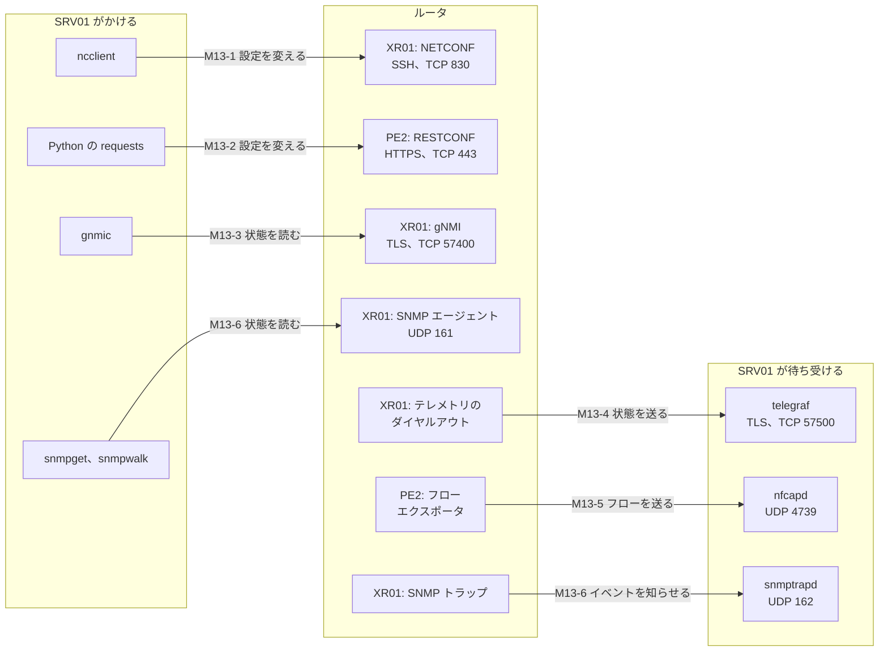
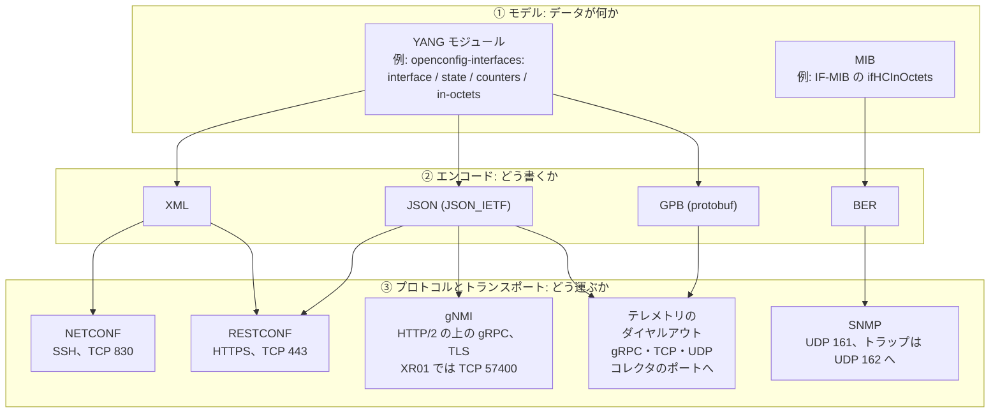

# M13 — 自動化とアシュアランスの部品と流れ

この単元では、ルータを手でなくプログラムから管理することと、ネットワークで起きていることを見ることを扱います。CCNP
Service Provider のブループリントでは 5.0 の自動化とアシュアランスにあたります。ラボで設定するのは、5.7 の gRPC と gNMI
(ダイヤルイン/ダイヤルアウト、TCP、TLS と mTLS の証明書)、5.8 の NetFlow と IPFIX、5.9 の NETCONF と RESTCONF、5.10 の
SNMP v2c と v3 の 4 つです。5.1 のプログラマブルな API、5.2 の REST API で機器を設定する外部スクリプトの読み方、5.4 の YANG も
ページの中で説明します。5.3(NSO)、5.5(Ansible と Terraform)、5.6(セキュア ZTP)は付録で扱い、付録では 5.1 と 5.4 も掘り下げます。単元は 5 つのページと付録に
分かれています。

| ページ | 中身 | 課題 |
|---|---|---|
| このページ | SRV01 とルータの間の 7 本の線と、どの線でも見る 3 つ(どちらがかけるか・何のための線か・鍵をかけるか)、モデル・エンコード・プロトコル | — |
| モデルで設定する: YANG・NETCONF・RESTCONF | データ モデルで何が嬉しいか、IOS XR の YANG モデルの種類、NETCONF の candidate と commit、IOS XE の RESTCONF、スクリプトの読み方 | M13-1、M13-2 |
| 証明書と TLS を土台から | 鍵ペア・署名・証明書・CA、TLS で確かめる 4 つ、相互 TLS と線ごとの役 | — |
| 状態を流す: gNMI・テレメトリ・TLS | gNMI で状態を読む、ルータが自分から状態を送る(ダイヤルアウト)、証明書と相互 TLS | M13-3、M13-4 |
| フローを数え、問い合わせる: NetFlow/IPFIX と SNMP | フロー レコードとそのエクスポート、SNMPv2c と v3、トラップ | M13-5、M13-6 |
| 付録 | プログラマブルなインタフェースの比較、YANG の掘り下げ、NSO、Ansible と Terraform、セキュア ZTP | — |

ラボは XRT-15 です。XR01(IOS XRd)と PE2(Catalyst 8000V、IOS XE)がプロバイダー エッジで、コア リンクでつながり、IS-IS を
動かしています。CE1 は顧客 A で、PE2 を通って送ります。SRV01 はネットワーク管理ステーション(NMS)で、道具と受け手を持つ
Linux のサーバです。3 台は、ただのスイッチである SW1 を介して、NMS のセグメントでつながっています。

:::topo
nodes:
  CE1: {at: [2.7, -1.2], label: "CE1 (顧客 A)"}
  PE2: {at: [1.4, 0], label: "PE2 (Cat 8000V)"}
  XR01: {at: [4.0, 0], label: "XR01 (XRd)"}
  SW1: {at: [2.7, 1.2], label: "SW1"}
  SRV01: {at: [2.7, 2.3], kind: host, label: "SRV01 (NMS)"}
links:
  - [CE1, PE2, "ACCESS-A"]
  - [CE1, XR01, "BACKUP-A"]
  - [PE2, XR01, "CORE (IS-IS) 10.0.12.0/24"]
  - {a: PE2, b: SW1, la: "Gi3 .2", ta: 0.3}
  - {a: XR01, b: SW1, la: "Gi0/0/0/1 .1", ta: 0.3}
  - {a: SW1, b: SRV01, label: "NMS 10.0.50.0/24 (.10)"}
:::

このラボの IOS XR(XRd。XRv 9000 も同じ)では RESTCONF と NetFlow を使えないので、その 2 つの仕事は PE2 で行います。
ほかはすべて XR01 で行います。

自動化では、YANG・NETCONF・gNMI・テレメトリ・ダイヤルアウト・TLS と、用語が一度にたくさん出てきます。ただ、この盤面で
起きていることは、SRV01 とルータの間に線が 7 本あるだけです。このページでは、まず線を並べ(2.1 節)、どの線でも見る 3 つの
問いに答え(2.2〜2.4 節)、そのあとで用語と層を並べます。

## 1. 何が嬉しいのか

### 1.1 困りごと: NMS は 1 台、知りたいことは 4 種類

この盤面では、SRV01 にいる NMS のチームが、XR01 と PE2 に 4 つのことを求めています。

- 設定を変える: たとえば、顧客のサービス用のループバックを、毎回同じやり方で追加する。
- 状態を知る: コア リンクは上がっているか、直近の 10 秒でパケットをいくつ運んだか。
- 誰が何を送っているかを知る: 顧客 A のどのホストが、PE2 を通って誰と、どれだけ通信しているか。
- 何かが起きたら、すぐに知る: たとえばリンクが落ちたとき、次に見に行くのを待たずに。

ルータが 2 台なら、人の手でもできます。何百台もあり、同じ変更を多くのルータへまったく同じように入れるとなると、人の手では
できません。数分おきに画面を見る人は、その間に起きたことを見逃します。

### 1.2 それ以前の手: 人のための CLI、数のための SNMP

CLI は人が読むために書かれています。ログインしてコマンドを打ち、画面を読むスクリプトは、テキストを解析するしかありません。
そのテキストは IOS XR と IOS XE で違い、リリースでも変わることがあります。CLI の行で送った変更は、返ってきたテキストを読んで
確かめるしかありません。こうした問題は、2002 年の時点でネットワークの運用者から挙げられていました(RFC 3535)。

数を読むには、長く SNMP が標準でした。NMS は値を 1 つずつ、間隔をあけて問い合わせます(ポーリング)。そのため、2 回の
問い合わせの間の変化は、遅れて見えるか、見えません。値は MIB の中で番号(OID)で名付けられ、SNMPv2c はパスワードにあたる
コミュニティを平文で送ります。機器の設定に SNMP はあまり使われていません(RFC 3535)。読み取りには今もどこでも使われ、
ブループリントにも残っています(ページ「フローを数え、問い合わせる」)。

### 1.3 答え: 仕事ごとの道と、データのモデル

自動化は仕事を分け、それぞれに専用の道を用意します。

- **設定する**: 設定のモデルを通して、トランザクションとして。NETCONF・RESTCONF・gNMI の Set。ルータは変更をまとめて
  確かめ、まとめてコミットするか、まとめて拒否します。
- **状態を見る**: ルータに送らせる。テレメトリで、時間ごとに、または値が変わったときに。単純な用途には SNMP ポーリングが
  残ります。
- **流れを数える**: ルータがエクスポートするフロー レコードで。NetFlow v9 と IPFIX。
- **出来事を知る**: ルータがすぐに送ってくる知らせで。SNMP トラップと syslog。

設定する道と状態を見る道では、データは YANG で書かれたモデルで定義されます。プログラムは画面のテキストでなく、名前と型の
あるデータを扱えるようになり、同じモデルを別々のプロトコルで運べます。このページの残りでは、部品を順に並べます。

## 2. 仕組み: SRV01 とルータの間の線

### 2.1 線は 7 本

M13 で扱うのは、SRV01 とルータの間の線です。図の矢印は、接続を始める側から待ち受ける側へ向いています。SRV01 は 2 回
出てきます。左はつなぎに行く道具、右は待ち受ける受け手です。矢印の札は、その線を使う課題と、何のための線かです。



| 線(課題) | かける側 → 待ち受ける側 | 何のため | 鍵 |
|---|---|---|---|
| NETCONF(M13-1) | SRV01(ncclient)→ XR01 の TCP 830 | 設定を変える | SSH |
| RESTCONF(M13-2) | SRV01(Python の requests)→ PE2 の TCP 443 | 設定を変える | TLS(HTTPS) |
| gNMI(M13-3) | SRV01(gnmic)→ XR01 の TCP 57400 | 状態を読む | TLS(相互 TLS も) |
| SNMP ポーリング(M13-6) | SRV01(snmpget・snmpwalk)→ XR01 の UDP 161 | 状態を読む | なし(v2c) |
| テレメトリのダイヤルアウト(M13-4) | XR01 → SRV01 の TCP 57500(telegraf) | 状態を送る | TLS |
| フロー エクスポート(M13-5) | PE2 → SRV01 の UDP 4739(nfcapd) | 流れを数える | なし |
| SNMP トラップ(M13-6) | XR01 → SRV01 の UDP 162(snmptrapd) | 出来事を知らせる | SNMPv3 の認証と暗号化 |

どの線でも、見るところは 3 つです。どちらがかけるか(2.2 節)、何のための線か(2.3 節)、鍵をかけるか(2.4 節)です。YANG・XML・
JSON・GPB は、線の上を流れる中身の書き方で、2.5 節で並べます。最初は、YANG が帳票の様式、XML・JSON・GPB がその帳票の
書き方、とだけ覚えておけば足ります。線が 7 本あっても、問いは 3 つのままです。

### 2.2 どちらがかけるか: ダイヤルインとダイヤルアウト、ポーリングとプッシュ

2 つの問いがよく混ざります。1 つ目は**接続を開くのはどちらか**です。ダイヤルインでは、NMS がルータの待ち受けるポートへ
つなぎます。ダイヤルアウトでは、ルータが NMS の待ち受けるポートへつなぐか、UDP ならただ送ります。
2 つ目は**データが流れる時を決めるのはどちらか**です。ポーリングでは NMS が毎回問い合わせ、プッシュではルータが
時間ごとに、または値が変わったときに送ります。

| | ポーリング: NMS が毎回問い合わせる | プッシュ: ルータが自分から送る |
|---|---|---|
| **ダイヤルイン**: NMS が接続を開く | SNMP の get と walk、NETCONF の `<get>`、RESTCONF の GET、gNMI の Get、ONCE か POLL の Subscribe | STREAM の gNMI Subscribe(n 秒ごとの SAMPLE か、ON_CHANGE) |
| **ダイヤルアウト**: ルータが開く、またはただ送る | — | テレメトリのダイヤルアウト、IPFIX のエクスポート、SNMP トラップ、syslog |

向きが違うと、仕事を置く場所が変わります。ダイヤルインでは、ルータの設定は小さく、待ち受けを開いて、誰が使ってよいかを
決めるだけです。何をどれだけの頻度で読むかは、NMS が送る要求のほうに入っています。ダイヤルアウトでは、ルータの設定が
すべてを持ちます。何を送るか、どれだけの頻度で、どのアドレスとポートへ、どのエンコードで、どのプロトコルで。ルータは
自分で接続を保ち、コレクタがいなければやり直します。ダイヤルアウトの送り手の設定が、何を送るか、どこへどう送るか、その 2 つを
結ぶもの、のブロックに分かれるのはこのためです(3.3 節)。

向きは、どちらの側がポートを開けておくかも決めます。ダイヤルインではルータが待ち受けます。XR01 は TCP 830 と 57400 と
UDP 161、PE2 は TCP 443 です。ダイヤルアウトでは NMS が待ち受けます。SRV01 は TCP 57500、UDP 4739、UDP 162 です。途中の
アクセス リストやファイアウォールは、接続が開かれる向きに通す必要があります。

### 2.3 何のための線か: 4 つの仕事

線の目的は、1.3 節の 4 つの仕事のどれかです。表の「道」はその仕事に使える方式で、右の列は、この盤面でそれを受け持つ
線です。

| 仕事 | 道 | この盤面では |
|---|---|---|
| 設定する | SSH の上の CLI、NETCONF、RESTCONF、gNMI の Set | XR01: NETCONF(M13-1)。PE2: RESTCONF(M13-2) |
| 状態を見る | SNMP ポーリング、NETCONF と RESTCONF での読み取り、gNMI の Get と Subscribe、テレメトリのダイヤルアウト | XR01: gNMI(M13-3)、テレメトリのダイヤルアウト(M13-4)、SNMPv2c(M13-6) |
| 流れを数える | NetFlow v9、IPFIX | PE2: IPFIX(M13-5) |
| 出来事を知る | SNMP トラップとインフォーム、syslog | XR01: SNMPv3 トラップ(M13-6) |

IOS XR では、設定するどの道も、同じ場所に行き着きます。コミットです(M1)。NETCONF や gNMI での変更も、CLI での変更と同じく
確かめられてコミットされ、どの道から来たかはコミット履歴に残ります(3.4 節)。

### 2.4 鍵をかけるか: SSH、TLS、なし

線を守るものは、線によって違います。NETCONF は SSH、RESTCONF・gNMI・テレメトリのダイヤルアウトは TLS です。SNMPv2c
ポーリングとフロー エクスポートは何もかけず、SNMPv3 は自分で認証と暗号化を持ちます。

TLS では、待ち受ける側(サーバ)が証明書を見せ、つないだ側(クライアント)がそれを確かめます。相互 TLS では、クライアントも
証明書を見せ、サーバが確かめます。証明書が何で、誰が何を持ち、何を確かめるかは、ページ「証明書と TLS を土台から」で、
鍵ペアから順に扱います。

そのページの決まりは 2 つです。TLS サーバとクライアントは、どちらがかけたかで決まります。CA 証明書を持つのは、確かめる
側です。そのため同じ XR01 が、gNMI ではサーバ(証明書を見せる側。相互 TLS では、クライアントを確かめる側も兼ねる)になり、
テレメトリのダイヤルアウトではクライアント(コレクタの証明書を確かめる側)になります。

gNMI の仕様は TLS を必須とし、暗号化しないセッションへの切り替えを禁じています。IOS XR は、gRPC サーバで `no-tls` も
受け付けます。XR01 が自分の証明書と信頼する CA をどこに置き、どう変えるかは、ページ「状態を流す」で扱います。

### 2.5 線の中身: モデル、エンコード、プロトコル

いちばん多い取り違えは、別々の層にある用語どうしの取り違えです。YANG はプロトコルではなく、NETCONF はデータの書式では
ありません。設定する道と状態を見る道のデータは、どれも 3 つの層を通ります。

| 層 | 答える問い | 例 |
|---|---|---|
| ① モデル | どんなデータがあるか。名前、型、入れ子の形、設定できるものと読むだけのもの | YANG モジュール(ネイティブ、ユニファイド モデル、OpenConfig)。SNMP では MIB |
| ② エンコード | データをバイトの並びとしてどう書くか | XML、JSON(JSON_IETF)、GPB(protobuf)。SNMP では BER |
| ③ プロトコルとトランスポート | どんな要求を出せるか、どちらが始めるか、どの接続が運んで守るか | SSH の上の NETCONF、HTTPS の上の RESTCONF、gRPC(TLS 付きの HTTP/2)の上の gNMI、gRPC・TCP・UDP の上のテレメトリのダイヤルアウト、UDP の上の SNMP |



1 つのモデルは、いくつもの道で運べます。例として、XR01 の Loopback0 の状態を OpenConfig モデルで、NETCONF と gNMI で
1 回ずつ読みました。どちらの答えにも、同じリーフ `counters/carrier-transitions` が値 1 で入っています。NETCONF はそれを XML で
書きます(`<get>` への返事の抜粋)。

```console
  <interfaces xmlns="http://openconfig.net/yang/interfaces">
   <interface>
    <name>Loopback0</name>
    <state>
     <name>Loopback0</name>
...
     <counters>
      <carrier-transitions>1</carrier-transitions>
     </counters>
```

gNMI は JSON_IETF で書きます(Get への返事の抜粋)。

```console
        "Path": "openconfig:/interfaces/interface[name=Loopback0]/state",
        "values": {
          "interfaces/interface/state": {
            "admin-status": "UP",
            "counters": {
              "carrier-transitions": "1"
            },
```

JSON_IETF では、64 ビットのカウンタは文字列で書かれます(`"1"` と引用符付き)。RFC 7951 が 64 ビットの整数をそう書くと
定めているためです。読むプログラムは、先に数へ直す必要があります。

IOS XR には YANG モデルが 3 種類あります。**ネイティブ** モデル(設定は `Cisco-IOS-XR-…-cfg`、状態は `-oper`)は XR
独自のものです。**ユニファイド モデル**(`Cisco-IOS-XR-um-…-cfg`、IOS XR 7.0.1 から)は CLI から生成され、ネイティブの設定のモデルに
置き換わるもので、CLI とほぼ同じ形に読めます。**OpenConfig** モデル(`openconfig-…`)はネットワークの運用者の集まりが
作り、どのベンダーのルータでも同じになることを目指しています。IOS XR での違いは、deviation モジュールに書かれて
います。IOS XRd 26.1.1 は NETCONF の hello で 857 個のケイパビリティを知らせ、その中にユニファイド モデルが 220 個、OpenConfig モデルが
54 個あります。

### 2.6 用語を並べる

チェーン店がほぼ同じ仕組みなので、右の列でたとえます。NMS が本部、ルータが店舗です。

| 用語 | 何か | チェーン店なら |
|---|---|---|
| NMS | ルータを設定し、監視するサーバ。この盤面では SRV01 | 本部 |
| データ モデル(YANG) | データの定義。名前、型、入れ子の形、設定できるものと読むだけのもの | 報告用の印刷された用紙。どんな欄があり、それぞれに何を書くか |
| ネイティブ、ユニファイド モデル、OpenConfig | XR 独自のモデル、XR の CLI と同じ形に並べたモデル、ベンダーの間で共通のモデル | 会社の古い用紙、店舗の帳簿と同じ並びの新しい用紙、業界団体の共通の用紙 |
| エンコード(XML・JSON・GPB) | データをバイトの並びとしてどう書くか | 用紙を言葉で書き込むか、短い符号で書き込むか |
| プロトコル(NETCONF・RESTCONF・gNMI・SNMP) | 一方が出せる要求と、それを運ぶセッション | 配送の業者と、頼める仕事 |
| トランスポート(SSH・HTTPS・HTTP/2 の上の gRPC・UDP) | その下の接続と、それが与える守り | 配送の車と、鍵がかかるかどうか |
| MIB、OID | SNMP 独自のモデル。番号で名付けたオブジェクトのツリー | 欄に名前でなく番号が振ってある古い用紙 |
| ポーリング | NMS が、欲しいときに毎回値を問い合わせる | 本部が電話で「今日の売上は?」と聞く |
| プッシュ(テレメトリ) | ルータが、時間ごとに、または値が変わったときに送る | 店舗が、聞かれなくても 1 時間ごとに数字を送る |
| ダイヤルイン、ダイヤルアウト | 接続を開くのが NMS か、ルータか | どちらが電話をかけるか |
| トラップ | 何かが起きたときに、ルータがすぐ送る知らせ | シャッターが壊れたら、店舗から電話がある |
| フロー レコード(NetFlow・IPFIX) | 会話ごとに 1 行。誰が、誰へ、どのポートで、どれだけ | レシート。インターフェイスのカウンタはレジの合計 |
| 証明書、CA | 名前を署名付きで述べたもの。それに署名する機関 | 身分証と、身分証を発行する役所 |
| TLS、相互 TLS | クライアントがサーバの証明書を確かめる。相互 TLS では、サーバもクライアントの証明書を確かめる | 配達員の身分証を確かめる。互いに確かめ合う |

### 2.7 gRPC、gNMI、テレメトリは別々の言葉

**gRPC** は、プログラムどうしが HTTP/2 の上で呼び合うための汎用の仕組みで、メッセージは protobuf で書きます。**gNMI** は
gRPC の上に定義されたサービスの 1 つで、呼び出しは Capabilities・Get・Set・Subscribe の 4 つです。**モデル駆動型テレメトリ**は、
ルータが状態を時間ごとに、または変化のたびに送ることです。gNMI の Subscribe(ダイヤルイン)でも、ルータがコレクタへつなぐ
形(ダイヤルアウト)でも行えます。ダイヤルアウトは gRPC、ただの TCP、UDP のどれかに乗ります。

XR01 では、これらを別々の場所で設定します。`grpc` の設定は、gNMI に答えるサーバ(ダイヤルイン)です。ダイヤルアウトは
`telemetry model-driven` の下で、宛先・ポート・プロトコルを自分で持って設定します。

### 2.8 カウンタとフロー レコードは別のもの

インターフェイスのカウンタは、インターフェイスごとに 1 つの数です。パケットとバイトがどれだけ通ったか。量はわかっても、
誰かはわかりません。フロー レコードは、会話ごとに 1 行です。送信元と宛先のアドレス、プロトコルとポート、入ってきた
インターフェイス、パケット数とバイト数。誰が誰と、どれだけ話したかがわかります。

ルータはインターフェイスのキャッシュでフロー レコードを作り、フローがしばらく途切れたとき、長く続くフローならときどき、
レコードをエクスポートします。レコードは UDP でコレクタへ送られます。NetFlow v9 か IPFIX で、どちらもテンプレートで項目を
説明します(ページ「フローを数え、問い合わせる」)。

たとえば、CE1 が 192.168.100.1 から XR01 の Loopback0 へ、748 バイトの ping を 37 発、PE2 を通して送りました。コレクタでは、
それが 1 つのフロー レコードになりました。ICMP では、宛先ポートの位置にタイプとコードが入ります(`8.0`: エコー要求)。

```console
$ nfdump -R /var/cache/nfdump/lab -o extended -c 10 'src ip 192.168.100.1'
Date first seen             Duration     Proto      Src IP Addr:Port          Dst IP Addr:Port     Flags Tos  Packets    Bytes      pps      bps    Bpp Flows
2026-11-10 14:27:08.500     00:00:00.049 ICMP     192.168.100.1:0     ->       10.255.0.1:8.0   ........   0       37    27676      755    4.5 M    748     1
```

### 2.9 1 つの値を、いくつもの線で

1 つの値が、いくつもの線で SRV01 に届きます。コア リンクである XR01 の GigabitEthernet0/0/0/0 の、受信した
バイト数で見てみます。

| 道 | 値の呼び方 | 始める側・書き方・ポート |
|---|---|---|
| CLI | `show interfaces GigabitEthernet0/0/0/0` の `… packets input, … bytes` の行 | 人が SSH で。人が読むテキスト。TCP 22 |
| SNMP | IF-MIB の `ifHCInOctets`: `1.3.6.1.2.1.31.1.1.1.6.<ifIndex>` | SRV01 が問い合わせる。BER。UDP 161 |
| NETCONF | OpenConfig の `interfaces` のツリーへの `<get>`: `…/state/counters/in-octets` | SRV01 が問い合わせる。XML。TCP 830 |
| gNMI | `/interfaces/interface[name=…]/state/counters/in-octets`。1 回読む(Get)か、送り続けてもらう(Subscribe) | SRV01 が開く。JSON_IETF。TCP 57400 |
| テレメトリのダイヤルアウト | 同じ種類の YANG パスを、XR01 の設定にセンサー パスとして書く | XR01 が開いて送る。GPB。SRV01 の TCP 57500 |
| IPFIX | このカウンタではない。CE1 から PE2 に入る、フローごとのバイト数 | PE2 が送る。IPFIX のレコード。SRV01 の UDP 4739 |

SNMP はインターフェイスを番号(ifIndex)で呼ぶので、先にその番号を調べる必要があります(`ifDescr`、
`1.3.6.1.2.1.2.2.1.2`)。YANG はキー、つまり名前で呼びます。gNMI のパスの `…` には `GigabitEthernet0/0/0/0` が入ります。

### 2.10 押さえどころ

- 線は 7 本。どの線でも見るのは 3 つ。どちらがかけるか、何のための線か、鍵をかけるか。
- 接続を開くのはどちらか(ダイヤルイン・ダイヤルアウト)と、データが流れる時を決めるのはどちらか(ポーリング・プッシュ)は
  別の問い。ダイヤルアウトでは、サブスクリプションのすべてがルータの設定にある。
- 仕事は 4 つ。設定する、状態を見る、流れを数える、出来事を知る。IOS XR では、設定するどの道も同じコミットに行き着く。
- TLS サーバは待ち受ける側。CA 証明書を持つのは確かめる側。同じ XR01 が、線によってサーバにもクライアントにもなる。
- 層は 3 つ。モデルはデータが何か(YANG か MIB)、エンコードはどう書くか(XML・JSON・GPB・BER)、プロトコルはどう運ぶか
  (NETCONF・RESTCONF・gNMI・ダイヤルアウト・SNMP)。1 つのモデルを、いくつもの道で運べる。
- インターフェイスのカウンタは量を、フロー レコードは誰が誰と話したかを示す。

## 3. 組む: 部品ごとの設定の場所

### 3.1 仕事ごとの設定の場所

| 仕事 | XR01(IOS XR) | PE2(IOS XE) | SRV01(道具) |
|---|---|---|---|
| NETCONF | `ssh server netconf vrf …`、`netconf-yang agent` → `ssh` | —(この盤面では使わない) | ncclient(Python) |
| RESTCONF | —(XRd と XRv 9000 には無い) | `ip http secure-server`、`restconf`、権限 15 のローカル ユーザ | Python の requests、curl |
| gNMI(ダイヤルイン) | `grpc`: `port`、`address-family`、TLS か `no-tls`、`tls-mutual` | — | gnmic |
| テレメトリのダイヤルアウト | `telemetry model-driven`: `sensor-group`、`destination-group`、`subscription` | — | telegraf |
| フロー レコード | —(`flow exporter-map`・`flow monitor-map`・`sampler-map` はハードウェアの機種にあり、XRd と XRv 9000 には無い) | `flow record`、`flow exporter`、`flow monitor`。インターフェイスに `ip flow monitor … input` | nfcapd、nfdump |
| SNMP ポーリング | `snmp-server community`、`view`、`group`、`user` | — | snmpget、snmpwalk |
| SNMP トラップ | `snmp-server host`、`snmp-server traps …` | — | snmptrapd |

### 3.2 NMS が始める道: ルータは待ち受けるだけ

ダイヤルインでのルータの側は、待ち受けと、誰が使ってよいかの決まりです。例では、XR01 で NETCONF サーバと gRPC サーバを開きます。
課題 M13-1 と M13-3 の始めの部分と同じ形なので、折りたたんであります。

:::config fold XR01 — NMS からの NETCONF と gNMI を受け付ける
ssh server netconf vrf default                ## NETCONF は SSH サーバに乗る。この VRF(グローバル テーブル)で答える
netconf-yang agent
 ssh                                          ## NETCONF エージェント。SSH で TCP 830(既定のポート)に来る
!
grpc                                          ## gNMI に答える gRPC サーバ。no-tls を書かなければ TLS が有効
 port 57400                                   ## 既定は 57400(57344〜57999 を使える)
 address-family ipv4                          ## IPv4 で待ち受ける
!
:::

PE2 には、Web サーバと、その上の RESTCONF のサービスと、設定を変えてよいアカウントが要ります。例のアカウントは課題 M13-2 の
ものではありませんが、形が同じなので折りたたんであります。

:::config fold PE2(IOS XE)— NMS からの RESTCONF を受け付ける
username nms-ops privilege 15 secret Ops-Pass-15   ## ローカル アカウント。権限 1 だと RESTCONF は 403(access denied)を返す
no ip http server                                  ## 平文の HTTP は閉じたまま
ip http secure-server                              ## RESTCONF が乗る HTTPS サーバ(TCP 443)
restconf                                           ## RESTCONF のサービス。答え始めるのは約 1 分後
:::

この例のどこにも、NMS が何を読み、何を変えるかは書いてありません。それは要求のほうにあります。NETCONF の `<edit-config>` の
XML、RESTCONF の要求の URL と本文、gNMI の Get のパスです。

### 3.3 ルータが始める道: サブスクリプションのすべてをルータが持つ

ダイヤルアウトでは、ルータの設定が、何を送るか、どこへどう送るかを述べ、その 2 つを結びます。この盤面の 3 つの送り手は
どれもその形で、部品は名前で互いを参照します。

| 送り手 | 何を送るか | どこへ、どう送るか | 2 つを結んで動かすもの |
|---|---|---|---|
| テレメトリのダイヤルアウト(XR01) | `sensor-group`: センサー パス(YANG パス) | `destination-group`: アドレス、ポート、エンコード、プロトコル、TLS | `subscription`: センサー グループと間隔、宛先グループ、送信元インターフェイス |
| フロー エクスポート(PE2) | `flow record`: `match`(フローを分ける項目)と `collect`(数えるもの) | `flow exporter`: 宛先、送信元、UDP ポート、NetFlow v9 か IPFIX | `flow monitor`: レコード、エクスポータ、キャッシュのタイマー。それをインターフェイスと向きに `ip flow monitor` で当てる |
| SNMP トラップ(XR01) | `snmp-server traps …`: どの出来事か | `snmp-server host`: アドレス、バージョン、ユーザ | `snmp-server user`・`group`・`view`: トラップを送るときの SNMPv3 のセキュリティ |

それぞれの送り手を部品ごとにどう組むかは、テレメトリはページ「状態を流す」で、フロー エクスポートとトラップはページ
「フローを数え、問い合わせる」で扱います。

### 3.4 出力の読み方: どの道で設定が変わったか

IOS XR のコミット履歴は、変更がどう入ってきたかを示します。`Line` が道、`Client` がクライアントの種類です。

```console
RP/0/RP0/CPU0:XR01#show configuration commit list 4
SNo. Label/ID              User      Line                Client      Time Stamp
~~~~ ~~~~~~~~              ~~~~      ~~~~                ~~~~~~      ~~~~~~~~~~
1    1000000007            SUZUKI    rollback            Rollback    Tue Nov 10 13:03:11 2026
2    1000000006            SUZUKI    netconf             YANG Frame  Tue Nov 10 13:03:07 2026
3    1000000005            SUZUKI    netconf             YANG Frame  Tue Nov 10 13:02:42 2026
4    1000000004            SUZUKI    vty0:node0_RP0_CPU  CLI         Tue Nov 10 13:02:19 2026
```

- `vty…` と `CLI`: CLI で打ち込んだ変更。
- `netconf` と `YANG Frame`: NETCONF で送った変更。gNMI の Set で送った変更は `ems`(gRPC サーバのプロセス)と `YANG Frame`
  になる。
- `rollback` と `Rollback`: XR01 が自分で変更を取り消した。2 番は NETCONF で送った確認つきコミット(confirmed commit)で、
  確認されないままセッションが閉じ、その 4 秒後に XR01 が取り消した。

道が開いているかどうかは、両端で読めます。

| 道 | ルータで | SRV01 で |
|---|---|---|
| NETCONF | `show netconf-yang clients`、`show netconf-yang statistics` | NETCONF セッションの hello(ncclient) |
| RESTCONF(PE2) | `show platform software yang-management process`(`nginx` と `confd` が Running) | 要求の HTTP ステータス コード |
| gNMI | `show grpc` | `gnmic … capabilities` |
| テレメトリのダイヤルアウト | `show telemetry model-driven subscription`、`show telemetry model-driven destination` | コレクタのファイル |
| フロー エクスポート(PE2) | `show flow exporter`、`show flow monitor … cache` | `nfdump` |
| SNMP | `show snmp` | `snmpget`、トラップの受け手のログ |

`show grpc` は、gRPC サーバが TLS を使っているか、どの証明書を使うかを示します。

```console
RP/0/RP0/CPU0:XR01#show grpc | include "TLS|Certificate"
TLS                                     : enabled
TLS mutual                              : disabled
Certificate Authentication              : disabled
Certificate common name                 : ems.cisco.com
...
```

### 3.5 落とし穴

- **エンコードはルータが対応するものに**: XR01 の gNMI が対応するのは JSON_IETF だけです(Capabilities の答えの
  `supported encodings`)。JSON を求める Get は `unsupported get-request encoding: JSON` で断られます。
- **TLS の相手には TLS で。名前はクライアントが確かめる**: TLS を使わない gNMI のクライアントには
  `error reading server preface: EOF` しか返りません。10.0.50.1 へつないで名前を確かめるクライアントは、XR01 の証明書に
  `ems.cisco.com` しか見つけられず、`doesn't contain any IP SANs` で止まります(ページ「状態を流す」)。
- **どの道も 1 つの設定を変える**: NETCONF セッションが確認つきコミットを握っている間、CLI でのコミットは
  `Another configuration session had a lock on the running configuration` で失敗します。
- **NETCONF は CLI より多く書けることがある**: Programmability Configuration Guide は、NETCONF でのアクセスは既定で書き込みの
  権限を与え、CLI では読み取りだけのユーザでもそうなる、と注意しています。NETCONF に届く人を絞ってください。
- **待ち受けは要る所でだけ開く**: NETCONF は `ssh server netconf vrf` に書いた VRF でだけ答えます。ほかのサービスも、答える
  場所を MPP とアクセス リストで絞ります(ページ「管理プレーンの保護」の 2 節)。

## 実践

課題は 6 つで、ラボ **XRT-15** にあり、「モデルで設定する」「状態を流す」「フローを数え、問い合わせる」の 3 つのページの後に、
2 つずつ取り組みます。作業の多くは SRV01 の上で
行います。ワークスペースのコンソールから、ラボのアカウントでログインしてください。

<p class="tolab"><a href="/_learn?id=XRT-15">ワークスペースでラボ XRT-15 を開く</a> — <a href="e1-m13-practice.html">課題 M13-1、M13-2</a></p>

:::note
このページの出力は、IOS XRd 26.1.1(XRT-15 の XR01)と Catalyst 8000V の IOS XE 17.15.1a(PE2)、Ubuntu 24.04 の gnmic 0.49.1・
ncclient・telegraf 1.32.3・nfdump(SRV01)で取得しました。PoC の盤面では、IOS XRv 9000 26.1.1 と IOS XRd 26.1.1 は NETCONF・
gNMI・テレメトリ・SNMP で同じように動き、どちらにも RESTCONF と NetFlow はありませんでした。出典: RFC 3535(2.1 節・2.4 節・
5 節)、RFC 6241、RFC 6242、RFC 7950、RFC 7951(6.1 節)、RFC 8040、gNMI の仕様(openconfig。2.3 節・3.1 節・3.5 節)、
RFC 3417(3.2 節・8 節)、RFC 2863(IF-MIB)、RFC 1901、RFC 7011、RFC 3954。IOS XR の Programmability Configuration Guide
(Cisco 8000 の累積版と ASR 9000 26.x。モデルの種類、gRPC のサーバとその認証の方式、NETCONF の権限についての注意)、System
Management Configuration Guide(ASR 9000 26.x の NETCONF、NCS 5500 26.x の SNMP)、Telemetry Configuration Guide(Cisco 8000 の
累積版と NCS 5500 26.x。ダイヤルインとダイヤルアウト、エンコード、TLS)、NetFlow の設定ガイド(ASR 9000 26.x、IOS XE 17.x)。
いずれも 2026 年 11 月に確認。コミット履歴、Loopback0 の 2 つの答え、hello の数、gNMI が対応するエンコード、エラーの
文、フロー レコード、RESTCONF が答え始めるまでの遅れと権限 1 のユーザへの答えは、PoC の盤面と XRT-15 での実測です。
:::
