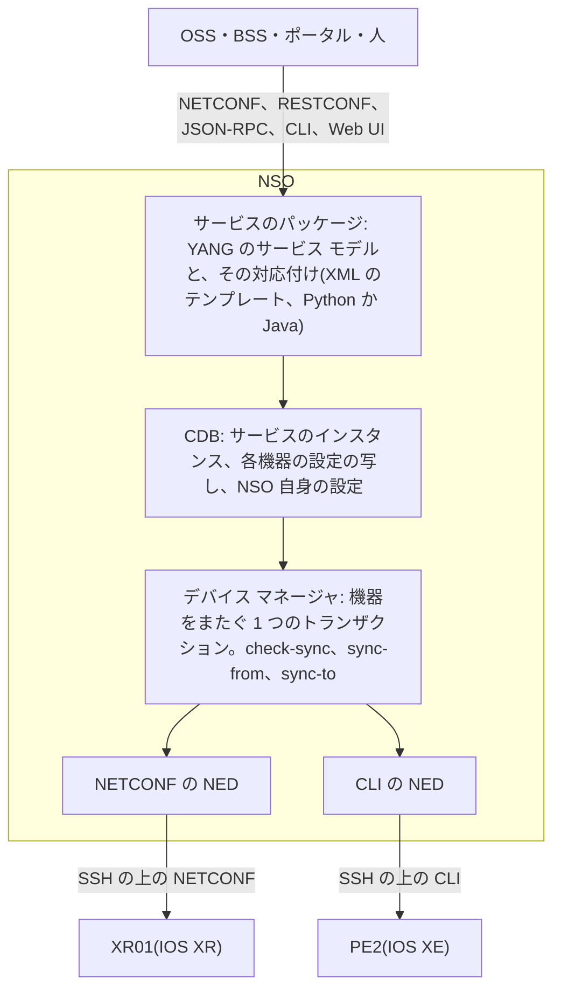
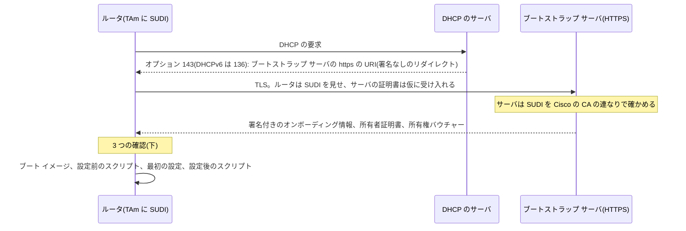

# M13 — 付録

本文で手短にしか、またはまったく扱わなかった、ブループリント 5.0 の項目をまとめます。プログラマブルなインターフェイスの
全体(5.1)、YANG の詳しい話(5.4)、NSO(5.3)、Ansible と Terraform(5.5)、セキュア ZTP(5.6)です。どれもラボでは設定しません。
例は XRT-15 の盤面の上で書いていますが、読むためのものです。最後に、この単元の 4 つの機種で確かめたことと、コマンドの対応を
並べます。

## 1. プログラマブルなインターフェイスの全体

### 1.1 プログラムがルータに求めるもの

CLI は人のために作られました。人は `show interfaces` を読んで欲しい行を見つけますが、プログラムは、目で読むために
並べられたテキストから同じ数字を切り出さなければなりません。その並びは版で変わることがあり、ベンダーごとにも違います。

設定を CLI の行で送るのにも同じ弱さがあり、ルータが何を受け付けたかは、エラーの文を読んで初めて分かります。ASR 9000 の
プログラマビリティのガイドは、はっきり「the general mechanism of CLI scraping is not flexible and optimal」と書いています。

プログラムには、CLI が与えない 4 つのものが要ります。名前と型が前もって決まったデータ(モデル)、いくつもの変更を
1 つの単位として、全部か無しかで当てること(トランザクション)、失敗した要素を指すエラー、そして毎回問い合わせなくても
届く状態(プッシュ)です。モデル駆動のインターフェイスは、これらを与えます。CLI は、人のためと、トラブルシューティングの
ために残ります。

### 1.2 インターフェイスを並べる

| インターフェイス | 運ぶもの | データの書き方 | モデル | 接続を開く側 | 主な用途 | XRT-15 では |
|---|---|---|---|---|---|---|
| CLI | SSH(TCP 22) | 人のためのテキスト | なし(CLI 自身の文法) | クライアント | 人。コマンドを送ってテキストを読むスクリプト | どこでも |
| SNMP | UDP 161(要求)、UDP 162(トラップ) | BER | MIB | 要求は NMS、トラップは機器 | カウンタ、状態、出来事 | XR01(M13-6) |
| NETCONF(RFC 6241) | SSH、TCP 830(RFC 6242) | XML | YANG | クライアント | データストア・ロック・candidate と commit による設定。状態の読み取り | XR01(M13-1) |
| RESTCONF(RFC 8040) | HTTPS、TCP 443 | XML か JSON | YANG | クライアント | 同じ YANG のデータを Web のリソースとして扱う。GET・POST・PUT・PATCH・DELETE | PE2(M13-2) |
| gNMI | HTTP/2 の上の gRPC、TLS 付き | protobuf のメッセージ。値は JSON_IETF などのエンコード | YANG(OpenConfig とネイティブのパス) | クライアント(ダイヤルイン) | Capabilities・Get・Set・Subscribe | XR01(M13-3) |
| テレメトリのダイヤルアウト | gRPC、TCP か UDP | GPB(compact か self-describing)か JSON | YANG(センサー パス) | 機器 | 状態を、時間ごとか変化のたびに収集役へ送る | XR01(M13-4) |
| gNOI | gRPC | protobuf | サービスごとの `.proto` の定義 | クライアント | 運用の操作。ping、traceroute、再起動、ファイル、証明書、ソフトウェア | — |
| gRIBI | gRPC | protobuf | OpenConfig の AFT(転送のエントリ) | クライアント | コントローラが経路のエントリを足し引きする | — |
| P4Runtime | gRPC | protobuf | P4 のプログラムのテーブル | クライアント(コントローラ) | P4 のプログラムが定める転送のテーブルを、コントローラが埋める | — |

上の 2 行は古くからの道です。NETCONF、RESTCONF、gNMI、テレメトリは YANG のデータを運び、本文で扱いました。
gNMI の仕様は、どのセッションにも TLS を求めています(「a target or client MUST NOT fall back to unencrypted sessions」)。
IOS XR の `no-tls` は、仕様の外の選択肢です。

下の 3 行は、同じ gRPC のサーバの上のほかのサービスです。この単元では、どれも使いません。

- **gNOI**(gRPC Network Operations Interface)は「defines a set of gRPC-based microservices for executing operational
  commands on network devices」。たとえば ping・traceroute・時刻・再起動(`system` のサービス)、ファイルの転送(`file`)、
  証明書の管理(`cert`)、ソフトウェアの導入(`os`)です。
- **gRIBI**(gRPC Routing Information Base Interface)は、外のプログラムが、ルータの経路表にエントリを足したり消したり
  できるようにします。エントリは、OpenConfig の AFT のモデルを protobuf にした形で書きます。
- **P4Runtime** は「a control plane protocol for controlling the data plane elements of a device or program defined by a
  P4 program」。P4 のプログラムが宣言したテーブルのエントリを、コントローラが書き込みます。

IOS XR では、どれも gRPC のサーバ(`grpc`)の上で動きます。Cisco 8000 のプログラマビリティのガイドには gRIBI と P4Runtime の
設定の章があり、NCS 5500 と ASR 9000 のガイドは名前を挙げるだけです。リリース 24.1.1 からは、gNMI・gRIBI・P4Runtime が、
IANA が割り当てたそれぞれのポート(9339・9340・9559)でも待ち受けられます。どれを使えるかは、機種とリリースで決まります。

### 1.3 モデル駆動と CLI 駆動

| | CLI 駆動 | モデル駆動 |
|---|---|---|
| プログラムが送るもの | 人が打つのと同じコマンドの行 | YANG のモデルが定める木の形のデータ(XML・JSON・protobuf) |
| 返ってくるもの | 人のために並べたテキスト | 同じ木の形のデータ。名前と型付き |
| 何が正しいかをどう知るか | 試すか、ガイドを読む | モデル。型・範囲・キー・必須のノード。ルータはデータをモデルと照らし合わせる |
| 受け付けられなかったとき | 読み解くべきエラーの文 | 要素を名指しするエラー(NETCONF の `error-path`) |
| いくつもの変更を一度に | 1 行ずつ(IOS XR では CLI のコミットがまとめる) | NETCONF のコミット 1 回、gNMI の SetRequest 1 つ。全部か無しか |
| ベンダーが違うとき | ベンダーごとに違うコマンド | OpenConfig のモデルは共通。各ベンダー独自のモデルは独自のまま |
| 状態 | ポーリングして読み解く | パスで読むか、流してもらう(テレメトリ) |

モデルは、CLI から見た設定を置き換えるわけではありません。IOS XR の統一モデルは CLI から生成されているので、両者は
同じ設定を表しています。NETCONF や gNMI で入れた変更も、ほかの変更と同じように `show running-config` とコミットの一覧に
出ます(本文「モデルで設定する」)。

### 1.4 オンボックスとオフボックス

オフボックスの自動化は、別のマシンで動きます。NMS、NSO のようなオーケストレータ、Ansible のコントロール ノードです。
上のインターフェイスでルータに届き、多くのルータを一度に見渡せますが、それぞれへの道が生きている必要があります。

オンボックスの自動化は、ルータそのものの上で動きます。IOS XR のプログラマビリティのガイドには、Python で書く 4 種類の
自動化スクリプトがあります。

- **config スクリプト**は「are invoked automatically when you change a configuration and commit the changes」。エラーで
  コミットを止める、警告を返す、コミットする設定を書き換える、のいずれもできます。設定の社内規則にあたります。
- **exec スクリプト**:「Automate operational tasks and network troubleshooting.」必要なときに実行します。
- **process スクリプト**:「Monitor the system continuously using daemons.」
- **EEM スクリプト**:「Respond to a predefined set of events.」

IOS XR は、ほかのベンダーのアプリケーションをコンテナで動かすこともできます(アプリケーション ホスティング)。オンボックスの
スクリプトは、NMS への道が落ちていても動き続け、自分のルータで起きたことにすぐ反応しますが、見えるのはそのルータだけです。
ガイドは、オンボックスのスクリプトはオフボックスのものと似ていて、外のコントローラで動くはずの管理のソフトウェアが
ルータの中へ移ったものだと説明しています。

## 2. YANG をもう少し詳しく

### 2.1 モジュールとサブモジュール

YANG の単位は**モジュール**です。名前・名前空間・プレフィックス・改訂日を持つファイルで、ルータは自分のモジュールを、
NETCONF の hello と gNMI の Capabilities で一覧にします。RFC 7950 は、モジュールを自己完結で「compilable」だと書いています。
import と include するものと合わせれば、それだけで読めるということです。

大きなモジュールは**サブモジュール**に分けられます。サブモジュールは部分的な定義です。自分のモジュールを `belongs-to` で
名指しし、それを include できるのは、そのモジュールか、同じモジュールのほかのサブモジュールだけです。IOS XR 向けの Cisco の
モデルの中に例があります。統一モデルが import する `tailf-common` は、2 つのサブモジュールでできています。

```text
module tailf-common {
  namespace "http://tail-f.com/yang/common";
  prefix tailf;
  include tailf-meta-extensions { ... }
  include tailf-cli-extensions { ... }
  ...

submodule tailf-cli-extensions {
  belongs-to tailf-common {
    prefix tailf;
  }
  ...
```

モジュールどうしの参照は 2 通りです。`import` は、ほかのモジュールの型やグルーピングを借り、ほかのモジュールの木を指せる
ようにします(augment と deviation。2.4 節)。`include` は、自分のサブモジュールを取り込みます。統一モデルは、インターフェイス名の
型のような XR 独自の型のために `Cisco-IOS-XR-types` を import しています。

### 2.2 ツリー図を読む

モデルをテキストのまま読むのは大変です。**ツリー図**(RFC 8340)は形だけを、1 つのノードを 1 行で表し、`pyang -f tree` が
モジュールのファイルから書き出します。次は、IOS XR 26.1.1 の名前解決の統一モデル `Cisco-IOS-XR-um-domain-cfg` の一部です
(畳んだ枝は `...` と書いています)。

```text
module: Cisco-IOS-XR-um-domain-cfg
  +--rw domain
     +--rw list
     |  ...
     +--rw lookup
     |  +--rw disable!
     |  +--rw source-interface?   xr:Interface-name
     +--rw name?            xr:Cisco-ios-xr-string
     +--rw ipv4
     |  +--rw hosts
     |     +--rw host* [host-name]
     |        +--rw host-name     string
     |        +--rw ip-address*   inet:ipv4-address-no-zone
     +--rw name-servers
     |  +--rw name-server* [order address]
     |     +--rw order      uint32
     |     +--rw address    inet:ip-address-no-zone
     ...
```

| 記号 | 意味 | 上の木では |
|---|---|---|
| `rw` | 設定(`config true`) | すべてのノード。`-cfg` のモデルなので |
| `ro` | 状態(`config false`)と、操作の出力 | 2.3 節 |
| `?` | 省略できるリーフ | `name?`: ドメイン名は無くてもよい |
| `*` | リストかリーフリスト。エントリをいくつも持てる | `host*` はリスト、`ip-address*` はリーフリスト |
| `[…]` | リストのキー | `host* [host-name]`。`name-server* [order address]` はキーが 2 つ |
| `!` | プレゼンス コンテナ。在ることそのものが設定 | `disable!` |
| `-x`、`-w`、`-n` | 操作(rpc か action)、その入力、通知 | 2.5 節 |
| `プレフィックス:名前` | ほかのモジュールが足したノード(augment) | 2.4 節 |

ノードの種類は次のとおりです。**コンテナ**はほかのノードをまとめ、自分の値は持ちません(`domain`、`ipv4`、`hosts`)。
**リスト**はキーで見分けるエントリを持ちます(`host` のキーは `host-name`)。**リーフ**は 1 つの型の値を 1 つ持ちます
(`name`、`order`)。**リーフリスト**は 1 つの型の値をいくつも持ちます(`ip-address`。1 つのホストはアドレスをいくつも
持てる)。

設定を表すリストには、キーが必須です(RFC 7950 の 7.8.2 節)。

次の CLI の行が、上の木のノードを埋めます。ラボの一部ではなく、モデルと CLI の対応を見せるためだけのものです。

:::config XR01 — 名前解決のエントリ(上の木のノード)
domain name nms.lab                      ## リーフ name。値は 1 つ
domain ipv4 host srv01 10.0.50.10        ## リスト host のエントリ(キー host-name = srv01)。アドレスはリーフリスト ip-address へ
domain lookup disable                    ## プレゼンス コンテナ lookup/disable。行が在るか無いか
:::

同じホストのエントリを、NETCONF が運ぶ XML で書くと次のとおりです。

```text
<domain xmlns="http://cisco.com/ns/yang/Cisco-IOS-XR-um-domain-cfg">
  <ipv4>
    <hosts>
      <host>
        <host-name>srv01</host-name>
        <ip-address>10.0.50.10</ip-address>
      </host>
    </hosts>
  </ipv4>
</domain>
```

### 2.3 設定と状態: config true と false

`config false` は**状態**の印です。ルータが報告するけれど、誰も設定しない値(状態、カウンタ)です。RFC 7950 は「Data nodes
representing state data are not part of configuration datastores.」と書いています。ノードは親の設定を受け継ぎ、`config false`
のノードの下には、設定のノードを置けません。ツリー図では `rw` と `ro` の違いです。

OpenConfig は、2 つを物ごとに並べて置きます。求めたものが `config` に、ルータが実際にしていることが `state` に入ります。
次は IOS XR 26.1.1 に入っている `openconfig-interfaces` です(縮めています)。

```text
module: openconfig-interfaces
  +--rw interfaces
     +--rw interface* [name]
        +--rw name             -> ../config/name
        +--rw config
        |  +--rw name?            string
        |  +--rw type             identityref
        |  +--rw mtu?             uint16
        |  +--rw loopback-mode?   oc-opt-types:loopback-mode-type
        |  +--rw description?     string
        |  +--rw enabled?         boolean
        +--ro state
        |  +--ro name?            string
        |  +--ro type             identityref
        |  ...
        |  +--ro admin-status     enumeration
        |  +--ro oper-status      enumeration
        |  ...
        ...
```

要求への影響: NETCONF の `<get-config>` は設定だけを返し、`<get>` は設定と状態を返します(RFC 6241 の 7.1 節と 7.7 節)。
IOS XR のネイティブのモデルは、2 つを 1 つのモジュールに混ぜず、`-cfg` と `-oper` のモジュールに分けています(本文「モデルで
設定する」)。

この木は、あるエラーの理由も示しています。キーの `name` は `config/name` を指し(`->` は参照)、`config` の `type` には
`?` がありません。必須だということです。IOS XR 26.1.1 では、`config/description` だけを送った
OpenConfig の gNMI の Set は、`config/name` と `config/type` も送るまで拒まれました。

### 2.4 augment と deviation

`augment` は、ほかのモジュールの木にノードを足します。足される側のモジュールは変わらず、両方を実装したルータには 1 本の木に
見えます。ツリー図では、足したノードに、足したモジュールのプレフィックスが付きます。26.1.1 では、NTP のモデルが、SNMP の
モデルの `traps` のコンテナにトラップのスイッチを足しています。

```text
augment "/a1:snmp-server/a1:traps" {          (in Cisco-IOS-XR-um-ntp-cfg)
  container ntp {
    presence "Indicates a ntp node is configured.";
    description "Enable SNMP Cisco Ntp traps";
  }
}

module: Cisco-IOS-XR-um-snmp-server-cfg         (pyang -f tree, with both modules loaded)
  +--rw snmp-server
     +--rw traps
        +--rw snmp
        |  ...
        +--rw um-ntp-cfg:ntp!
```

CLI では、2 つのモジュールで 1 行、`snmp-server traps ntp` になります。XML では、`ntp` の要素が、SNMP のモデルの要素の中で
NTP のモデルの名前空間を持ちます。本文で、インターフェイスのアドレスが自分の名前空間を持っていたのと同じ形です。

`deviation` は、ルータが、モデルのとおりに実装していない所を申告する仕組みです。RFC 7950 はその理由を、アプリケーションは
制限を失敗してから知るより前もって知るほうがよい、と書いています(5.6.3 節)。`deviate` は 4 種類です。`not-supported`
(そのノードがこのルータには無い)と、`add`・`replace`・`delete`(既定値・範囲・`config` などの性質を足す・変える・消す)です。

deviation は専用のモジュールに入れ、hello が、変える相手のモデルの隣でその名前を挙げます。Cisco が公開している XRd 26.1.1 の
一覧から引きます。

```text
http://openconfig.net/yang/system-grpc?module=openconfig-system-grpc&revision=2024-05-29&deviations=cisco-xr-openconfig-system-grpc-deviations

deviation /oc-sys:system/oc-sys-grpc:grpc-servers/oc-sys-grpc:grpc-server/oc-sys-grpc:connections {
  deviate not-supported;
}
```

OpenConfig の gRPC のサーバのモデルには、今の接続の一覧がありますが、IOS XR はそれを報告しません。deviation を読む
プログラムは、問い合わせる前にそれを知ることができます。

### 2.5 操作と出来事: rpc・action・notification

モデルは、データだけでなく、操作と出来事も表します。

- **rpc**: モジュール全体の操作で、`input` と `output` を持ちます。NETCONF 自身の操作(`get-config`、`edit-config`、
  `commit`)も、RFC 6241 の YANG のモジュールでこの形で定義されています。IOS XR の操作のモデルは名前が `-act` で終わり、
  `Cisco-IOS-XR-ping-act` は `ping` を定義しています(下の木)。
- **action**(YANG 1.1 で追加): データの木の 1 つのノードに結び付いた操作で、1 つのエントリに対して呼びます。RFC 7950 の
  例は、サーバの一覧のうち 1 台をリセットするものです。
- **notification**: ルータが、問い合わせを待たずに送る出来事です。NETCONF は、購読したクライアントに通知を届けます。XR01 の
  hello には、`notification` と `interleave` の能力が載っていました。

```text
module: Cisco-IOS-XR-ping-act
  rpcs:
    +---x ping
       +---w input
       |  +---w destination!
       |  |  ...
       |  +---w ipv4* [destination]
       |  +---w ipv6!
       +--ro output
          +--ro ping-response
             ...
```

### 2.6 モデルで得られるもの

- **当てる前に確かめられる。** 型・範囲・キー・必須のノードはモデルにあり、ルータは要求をモデルと照らし合わせて、合わない
  ものを、要素を名指しして拒みます。NETCONF の `validate` は、当てずにデータストアを確かめます(RFC 6241 の 8.6 節)。
- **調べられる。** hello が、すべてのモジュール・改訂・deviation を挙げるので、クライアントは何も送る前に、何を送って
  よいかが分かります。
- **プログラムが読める。** 道具が、モジュールのファイルから木やコードや文書を作ります(上の `pyang`)。
- **ベンダーの間で共通。** OpenConfig のモデルは、それを実装したどのルータでも同じで、deviation が違いを示します。
- **1 つのモデルで、いくつもの道。** 同じ木が、NETCONF では XML で、RESTCONF と gNMI では JSON で運ばれます(RFC 7951)。
- **まとめて変えられる。** NETCONF の candidate と commit、また gNMI の SetRequest 1 つは、変更の全部を当てるか、何も
  当てないかです(RFC 6241 の 8.3 節、gNMI の仕様の 3.4.3 節)。

## 3. NSO(Network Services Orchestrator)

### 3.1 何が嬉しいのか

この盤面で顧客のサイトを 1 つ足すには、PE2(IOS XE)と XR01(IOS XR)に、2 つの文法で、正しい順に行を入れることになります。
顧客が去るときには、その行だけを、ほかには触れずに消すことになります。行を流し込むのはスクリプトでもできます。難しいのは、
後でサービスを変えること、きれいに消すこと、どの行がどの顧客のものかを覚えておくことです。

Cisco Network Services Orchestrator(NSO)は、その層を受け持ちます。文書は NSO を「acting as an interface between people or
software that want to configure the network and the devices in the network」と説明しています。

運用者がサービス(顧客 A、
サイト 2、VLAN、アドレス)を書くと、NSO が、YANG で書いたサービスのモデルを通して、それを各機器の設定に変えます。
ベンダーの違う機器にもです。

### 3.2 部品

NSO がこの盤面を管理するとしたら、次の形になります(NED の種類は一例で、どちらのルータにもどちらの種類も使えます)。



| 部品 | すること |
|---|---|
| CDB | NSO のデータベースで、YANG で定義されています。サービスのインスタンス、管理するすべての機器の設定の写し、NSO 自身の動作の設定を持ちます。入れるものはスキーマと照らし合わせます。どのサービスのインスタンスが、どの機器の設定を生んだかも記録します |
| NED(Network Element Driver) | 1 種類の機器へのつなぎ役で、パッケージとして入れます。機器のインターフェイスで 4 種類: NETCONF(YANG のモデルだけでコードは不要)、CLI(NSO が YANG のモデルから機器の CLI を組み立て、読み解く。SSH か Telnet)、generic(REST・RESTCONF・gNMI などほかのインターフェイス)、SNMP |
| サービスのパッケージ | YANG のサービス モデルと、それを機器のモデルへ対応付けるもの。XML のテンプレート、Python か Java のコード、またはその両方 |
| デバイス マネージャ | NED を通して機器と話し、NSO の外で行われた変更を見つけて直します。`check-sync`、`compare-config`、`sync-from`、`sync-to` |
| ノースバウンドのインターフェイス | 人向けに CLI(Cisco 風か Juniper 風)と Web UI。プログラム向けに NETCONF、RESTCONF、JSON-RPC、Python・Java・Erlang の API。NSO そのものを見守るための SNMP のエージェント |

### 3.3 FASTMAP: 作成を書けば、変更と削除が付いてくる

サービスは「何を作るか」として書きます。NSO の文書は「NSO reduces this problem to a single data-mapping definition for the
'create' scenario.」と書いています。サービスのインスタンスを作ると、NSO は、機器に加えた変更の逆(**逆差分**、reverse diff)を、
インスタンスと一緒にしまっておきます。

| 運用者が | NSO がすること |
|---|---|
| サービスのインスタンスを作る | 入力で対応付け(create)を動かし、機器への変更を送り、その逆差分をインスタンスと一緒にしまう |
| 入力を変える | 切り離したトランザクションで逆差分を当て(前の create を取り消し)、新しい入力で create をもう一度動かし、差し引きの違いだけを機器へ送る |
| インスタンスを消す | 逆差分を当てる。サービスが足したものだけを、正確に消す |
| `re-deploy` | 対応付けをもう一度動かし、今の設定との違いを当てる(誰かが機器を手で変えた後など) |
| `un-deploy` | サービスが入れた機器の設定は消すが、サービスそのものは残し、後でまた当てられるようにする |

そのため NSO の文書には、create のコードは、同じ入力には毎回同じ機器の変更を生まなければならない、という決まりがあります。

### 3.4 機器をまたぐ 1 つのトランザクション

NSO のコミットは、触れるすべての機器を 1 つのトランザクションで変えます。「The changes to the devices are done in a distributed
and atomic transaction across all devices in parallel.」1 台でも失敗すると、すべてを元に戻し、CDB も更新しません。CLI で設定
する機器のように、自分ではトランザクションを持たない機器でも同じです。

NSO はコミットごとにロールバックのファイルを残すので、トランザクション全体を後から取り消すこともできます(`ncs.conf` で
ロールバックを有効にしていれば `rollback-files apply-rollback-file`)。`commit dry-run outformat native` は、各機器が受け取る
はずのコマンドを、送らずに見せます。大きなネットワークでは、コミットのキューが、データベースのロックを外した後で機器へ
変更を送ります。

NSO は、自分の写しを信じる前に、機器が裏で変えられていないかを確かめられます。`check-sync`(手軽。機器が対応していれば、
時刻・トランザクション ID・チェックサムを比べる)、`compare-config`(違いを見せる)、そして `sync-from`(機器の設定を取り込む)か
`sync-to`(NSO の設定を流し込む)です。IOS XR のコミットとロールバック(M1)の考え方を、ネットワーク全体に広げたものです。

### 3.5 XRT-15 での NSO と NMS

この盤面では SRV01 が NMS です。状態(テレメトリ、IPFIX、トラップ)を受け、SNMP で問い合わせ、課題では XR01 と PE2 を直接
設定します。

NSO は収集役の代わりにはなりません。SRV01 の隣で、設定の層として座ります。ポータルや OSS が NSO に「顧客 A、
サイト 2」と頼み、NSO が NED を通して XR01 と PE2 を 1 つのトランザクションで設定し、telegraf・nfcapd・snmptrapd はルータが
送るものを受け続けます。NSO の SNMP のエージェントは NSO を見守るためのもので、ネットワークを見るものではありません。

## 4. 設定管理の道具: Ansible と Terraform

### 4.1 Ansible: コントロール ノードから押し出す、順番のあるタスク

Ansible は 1 台のマシン、**コントロール ノード**の上で動き、**インベントリ**に並べた**管理対象ノード**に働きかけます。相手には
何も入れません(「Agent-less architecture」)。仕事は YAML の**プレイブック**に書きます。プレイブックはプレイを持ち、プレイは
ホストの組に順番のあるタスクの並びを当て、各タスクが**モジュール**を呼びます。モジュールは**コレクション**にまとまっていて、
Cisco のものは `cisco.iosxr` と `cisco.ios` です。

ネットワーク機器では 1 つ違う点があります。モジュールは機器でなくコントロール ノードで動き、接続のプラグインを通して機器と
話します。`ansible_network_os` で機種を指定します(`cisco.iosxr.iosxr`、`cisco.ios.ios`)。

| `ansible_connection` | プロトコル | Cisco のコレクションでは |
|---|---|---|
| `ansible.netcommon.network_cli` | SSH の上の CLI | いちばん多い。`iosxr_config`、`iosxr_command`、リソース モジュールが使う |
| `ansible.netcommon.netconf` | SSH の上の XML(NETCONF) | `cisco.iosxr` では、使うモジュールは少数(banner、system、user) |
| `ansible.netcommon.httpapi` | HTTP か HTTPS の上の API | `cisco.iosxr` にも `cisco.ios` にも無い |

**リソース モジュール**(`iosxr_interfaces`、`iosxr_l3_interfaces` ほか多数)は、設定の一部分をデータとして書き、`state` を
取ります。

| `state` | すること |
|---|---|
| `merged` | 書いた設定を機器の設定に混ぜる(既定) |
| `replaced` | 名指しした物の設定を、書いた設定に置き換える |
| `overridden` | その部分の設定全体を、書いた設定と同じにする。自分の接続まで消すことがある |
| `deleted` | 設定を消し、既定に戻す |
| `gathered` | 機器の設定をデータとして読む |
| `rendered` | 書いた設定のコマンドを、機器なしで出す |
| `parsed` | 設定のテキストを、機器なしでデータに変える |

実行は**冪等**です。「When the system is in the state your playbook describes, Ansible does not change anything, even if the
playbook runs multiple times.」リソース モジュールは、違いからコマンドを計算し、違いが無ければ何も送らず、送ったときだけ
`changed` を返します。

`--check` は機器を変えずに動き、変わるはずのことを報告します。`--diff` は前と後を見せます。生の行を
送る `iosxr_config` は、自分でコミットします。check モードでは、行を candidate に入れて違いを読み、捨てます。

### 4.2 XRT-15 の盤面での Ansible の例

SRV01 に Ansible は入っていないので、この例は読むためのものです。XR01 にループバックを足し、PE2 に説明を付けます。どちらも
SSH の上の CLI を使います。

:::config SRV01 — inventory.ini: 管理対象ノードと、その届き方
[xr]                                              ## ホストの組
XR01 ansible_host=10.0.50.1                       ## NMS の区画の XR01
[xe]
PE2 ansible_host=10.0.50.2                        ## NMS の区画の PE2
[xr:vars]                                         ## 組のすべてのホストへの設定
ansible_connection=ansible.netcommon.network_cli  ## SSH の上の CLI
ansible_network_os=cisco.iosxr.iosxr              ## 機種: IOS XR
[xe:vars]
ansible_connection=ansible.netcommon.network_cli
ansible_network_os=cisco.ios.ios                  ## 機種: IOS と IOS XE
:::

:::config SRV01 — lo210.yml: XR01 にループバック、PE2 に説明
- name: XR01 - a loopback for the NMS tests      ## プレイ
  hosts: XR01                                    ## インベントリのどのホストか
  gather_facts: false                            ## 先に情報を集めない
  tasks:
    - name: Loopback210 and its description
      cisco.iosxr.iosxr_interfaces:              ## リソース モジュール: インターフェイス
        config:
          - name: Loopback210
            description: ANSIBLE-DEMO
            enabled: true                        ## 「no shutdown」になる
        state: merged                            ## 機器の設定に混ぜる
    - name: Its IPv4 address
      cisco.iosxr.iosxr_l3_interfaces:           ## リソース モジュール: インターフェイスの L3 の設定
        config:
          - name: Loopback210
            ipv4:
              - address: 10.255.210.1/32         ## プレフィックスで書く。モジュールがマスクに直す
        state: merged

- name: PE2 - describe the customer port         ## PE2 のための 2 つ目のプレイ
  hosts: PE2
  gather_facts: false
  tasks:
    - name: GigabitEthernet2 description
      cisco.ios.ios_interfaces:                  ## IOS のコレクションの、同じ種類のモジュール
        config:
          - name: GigabitEthernet2
            description: CUSTOMER-A-ACCESS
        state: merged
:::

```console
nms@SRV01:~$ ansible-playbook -i inventory.ini lo210.yml --check --diff
nms@SRV01:~$ ansible-playbook -i inventory.ini lo210.yml
```

1 回目は、変わるはずのことを報告するだけです。機器なしでコマンドを見るには、すべての `state` を `rendered` にして
プレイブックを動かします。結果の例:

```console
TASK [Loopback210 and its description] *****************************************
ok: [XR01] => {"changed": false, "rendered": ["interface Loopback210", "description ANSIBLE-DEMO", "no shutdown"]}

TASK [Its IPv4 address] ********************************************************
ok: [XR01] => {"changed": false, "rendered": ["interface Loopback210", "ipv4 address 10.255.210.1 255.255.255.255"]}

TASK [GigabitEthernet2 description] ********************************************
ok: [PE2] => {"changed": false, "rendered": ["interface GigabitEthernet2", "description CUSTOMER-A-ACCESS"]}
```

同じデータが、XR01 では IOS XR の行(`ipv4 address …`)になりました。モジュールが、機種ごとの文法を知っています。

### 4.3 Terraform: 宣言した最終の形と、計画

Terraform は、手順でなく最終の形を書きます。「Terraform configuration files are declarative, meaning that they describe the
end state of your infrastructure.」ファイルは HCL で書きます。Terraform そのものは機器を知らず、`terraform init` が入れる
プラグインの**プロバイダー**が、種類ごとの相手と話します。

Terraform は**ステート ファイル**(既定は `terraform.tfstate`)を持ち、
ファイルの中の各リソースを、それが管理する機器の上の物に結び付けます。

流れは次のとおりです。`terraform plan` は、物の今の状態を読み、ファイルと比べて、何を作る・変える・壊すかを見せます。
`terraform apply` は、承認の後でそれを実行します。`terraform destroy` は、その設定が管理するものをすべて消します。機器を手で
変えると、次の plan に出てきます。`terraform plan -refresh-only` は、機器を変えずに、ステートを機器に合わせます
(`terraform refresh` は非推奨です)。

Cisco の DevNet が、この盤面の両方の機種のプロバイダーを公開しています。

- **`CiscoDevNet/iosxr`** は **gNMI** で話します(リリース 0.7.1、2026 年 4 月)。ルータには `grpc` が要ります。既定のポートは
  57400 で、TLS は既定で有効ですが、`verify_certificate = true` にしない限り、ルータの証明書は確かめません。リソースは YANG の
  モデルに沿っていて(`iosxr_interface_loopback`、`iosxr_hostname` ほか多数)、`iosxr_gnmi` は任意の 1 つのパスを設定します。
  NETCONF への対応は開発中の枝にはありますが、リリースにはまだありません。
- **`CiscoDevNet/iosxe`** は SSH の上の **NETCONF** で話します(リリース 1.2.0、2026 年 11 月)。機器には `netconf-yang` が
  要ります。以前の版は RESTCONF を使っていました。0.15.0 で NETCONF が既定になり、1.0.0 で RESTCONF が外されました。

どちらのプロバイダーも、ソフトウェアの最低のリリースは書いておらず、試したリリースを挙げています(IOS XR 24.4.2、
IOS XE 17.15)。

### 4.4 XRT-15 の盤面での Terraform の例

SRV01 には Terraform も入っていないので、この例も読むためのものです。

:::config SRV01 — main.tf: gNMI で XR01 にループバックを足す
terraform {
  required_providers {
    iosxr = {
      source  = "CiscoDevNet/iosxr"              ## プロバイダー。Terraform Registry から
      version = "0.7.1"                          ## 版を固定する。リソースは版で変わる
    }
  }
}

provider "iosxr" {
  host = "10.0.50.1"                             ## XR01 の gRPC のサーバ。既定のポート 57400 が付く
}                                                ## ユーザ名とパスワードは IOSXR_USERNAME と IOSXR_PASSWORD から

resource "iosxr_interface_loopback" "nms_lo211" {  ## リソースの種類と、手元での名前
  name         = "211"                           ## Loopback211(番号だけを書く)
  description  = "TERRAFORM-DEMO"
  ipv4_address = "10.255.211.1"
  ipv4_netmask = "255.255.255.255"               ## プレフィックス長でなくマスク
}
:::

```console
nms@SRV01:~$ terraform init                     # install the provider
nms@SRV01:~$ terraform plan                     # what would change
nms@SRV01:~$ terraform apply                    # do it, after approval
nms@SRV01:~$ terraform plan -refresh-only       # has someone changed XR01 by hand?
```

`resource` の塊を消してもう一度 apply すると、Loopback211 が消えます。Terraform が作ったことを、ステート ファイルが覚えて
いるからです。gRPC のサーバがクライアントの証明書を求めるとき(相互 TLS)は、プロバイダーに `certificate` と `key` を渡し、
ルータを確かめるために `ca_certificate` を渡します。

### 4.5 並べる

| | Ansible | Terraform |
|---|---|---|
| 仕事の書き方 | YAML で、順番のあるタスク(リソース モジュールは自分の部分については宣言的) | HCL で、最終の形の全体 |
| 機器と話す手段 | 接続のプラグイン: `network_cli`(SSH の上の CLI)、`netconf`、`httpapi` | プロバイダー: `CiscoDevNet/iosxr`(gNMI)、`CiscoDevNet/iosxe`(NETCONF) |
| 作ったものを覚えるか | ステート ファイルは無い。毎回機器を読み、違う所だけを変える | ステート ファイルが、各リソースをその物に結び付ける |
| 事前の確認 | `--check`、`--diff`、`state: rendered` | `terraform plan` |
| 要らなくなったものを消す | そのためのタスクを書く(`state: deleted` か `overridden`) | ファイルから消す。plan が壊すことを提案する |
| 手で変えられたとき | 次の実行で、プレイブックの形に戻す | 次の plan に出る。`-refresh-only` でステートに取り込む |
| 機器に入れるソフトウェア | なし | なし |
| ほかに得意なこと | 手順のある作業。コマンド、確認、アップグレード | 多くの物の一生の管理。クラウドの基盤 |

## 5. セキュア ZTP

### 5.1 従来の ZTP: DHCP がファイルを指す

ゼロタッチ プロビジョニング(ZTP)は、ルータが最初の起動で自分を設定する仕組みです。IOS XR では「the ZTP process initiates
automatically if the device does not have a prior configuration」。DHCP の要求を、まず管理のポートで、次にデータのポートで、
IPv4 を先に、IPv6 を後に送ります。

要求はルータを名乗り(シリアル番号をクライアント識別子のオプション 61 に、ベンダー・機種・
シリアル番号をオプション 60 と 124 に)、ユーザ クラス `xr-config` を付けます(リリース 7.3.1 までは `exr-config`)。DHCP のサーバは、
ファイルの URL をオプション 67(DHCPv6 ではオプション 59)で返します。

:::config SRV01 — XR01 に ZTP のファイルを渡す ISC DHCP サーバのエントリ(従来の ZTP)
host XR01 {                                                  ## ルータ 1 台
  hardware ethernet 52:54:00:13:00:01;                       ## NMS の区画のポート(例のアドレス)
  fixed-address 10.0.50.1;                                   ## 渡すアドレス
  if exists user-class and option user-class = "xr-config" { ## このユーザ クラスを送るのは IOS XR の ZTP だけ
    filename = "http://10.0.50.10/ztp/xr01.cfg";             ## オプション 67: ファイルの在りか
  }
}
:::

ルータはファイルを取ってきて、1 行目を見ます。`!! IOS XR` で始まるファイルは設定で、当てます。`#! /bin/bash`・`#! /bin/sh`・
`#! /usr/bin/python` で始まるファイルはスクリプトで、実行します。スクリプトは、先にソフトウェアを入れてから設定することも
でき、IOS XR が用意する補助の関数(`/pkg/bin/ztp_helper.sh` と Python のライブラリ)を使えます。

:::config SRV01 — /ztp/xr01.cfg: 1 行目のおかげで設定のファイル
!! IOS XR                                    ## こう始まるファイルを、ZTP は設定として当てる
hostname XR01
interface Loopback0
 ipv4 address 10.255.0.1 255.255.255.255
!
end
:::

`!! IOS XR` は、IOS XR の設定の頭に付く行です(M1 の 3 節の `!! IOS XR Configuration 24.3.1`)。

コマンドは、`ztp initiate` が
ZTP の DHCP のセッションを手で始め、`ztp terminate` が進行中のセッションを止め、`ztp clean` が ZTP の状態のファイルを消し、
`ztp enable` と `ztp disable` が起動時に ZTP を動かすかどうかを決めます。ログは `/var/log/ztp.log` で、写しが
`/disk0:/ztp/ztp.log` にあります。

### 5.2 従来の ZTP が証明できないこと

従来の ZTP は、起動したネットワークを信じます。

- ルータは、答えた DHCP のサーバからファイルを受け取ります。そのサーバがルータの持ち主のものだという証明はありません。
- ファイルには署名がありません。TFTP・FTP・HTTP では途中で書き換えられることがあります。Cisco の TAC の ZTP の文書は、
  iPXE が HTTPS に対応しない理由を「as it cannot predict which signature to verify」と書いています。
- サーバも、どのルータが尋ねているのか確かめられません。DHCP の要求の中のシリアル番号は、どのクライアントでも送れる
  文字列です。

RFC 8572 は、DHCP のサーバ・DNS のサーバ・取り外せるドライブを、ブートストラップのデータの*信頼できない出どころ*と呼んで
います。プロバイダー自身の準備室の中なら許せるかもしれません。遠くの拠点へ送り、プロバイダーが管理しないネットワークを
通してつなぐルータでは、許せません。

### 5.3 セキュア ZTP(RFC 8572)の部品

セキュア ZTP(SZTP)は、ルータがすべてを自分で手に入れるという考え方(「with no installer action beyond physical placement
and connecting network and power cables」)はそのままに、両方向の証明を足したものです。

| 部品 | 何か | 作る人 |
|---|---|---|
| ブートストラップ サーバ | ブートストラップのデータを渡す RESTCONF のサーバ。Cisco は ZTP サーバと呼ぶ(「a RESTCONF or HTTPs server」) | 持ち主(リダイレクトのサーバならメーカー) |
| 伝達情報(conveyed information) | **リダイレクト情報**(ブートストラップ サーバの一覧。それぞれに任意のトラスト アンカー)か、**オンボーディング情報**(ブート イメージ、最初の設定、スクリプト)のどちらか | 持ち主。信頼させる必要があるときは持ち主の鍵で署名する |
| 所有者証明書 | 持ち主の身元を公開鍵に結び付ける X.509 の証明書。ルータは、伝達情報の署名をこれで確かめる | 持ち主 |
| 所有権バウチャー(RFC 8366) | メーカーが署名した、この機器(シリアル番号)はこの持ち主のもの、という言明。持ち主は証明書(pinned-domain-cert)で示され、所有者証明書はそこへつながらなければならない | メーカーの署名機関(MASA)。Cisco は依頼に応じて発行する |
| 機器の身元 | 製造時に入れる証明書と秘密鍵(IDevID、IEEE 802.1AR。RFC 8572 が推奨)。Cisco では、ハードウェアの Trust Anchor module(TAm)にある SUDI | メーカー |
| 機器の中のトラスト アンカー | 所有権バウチャー(とよく知られたブートストラップ サーバ)を確かめるための証明書 | メーカー |

ここで 2 つの証明が出会います。ルータは、メーカーの証明書(SUDI)で、*自分が何者か*を証明します。持ち主は、メーカーにしか
署名できないバウチャーを通して*そのルータが自分のものだ*と証明し、ルータに動かさせるものに署名します。

### 5.4 手順



DHCP は署名付きのデータを運べないので(DHCPv4 のオプションには小さすぎる)、運ぶのは署名なしのリダイレクト、つまり
ブートストラップ サーバの在りかだけです。ルータはそのサーバに「by blindly accepting its TLS server certificate」でつなぎます
(仮の接続)。安全は署名から来ます。ルータは、次の順に確かめます(RFC 8572 の 5.4 節)。

1. **バウチャー**: 署名を、ルータの中のメーカーのトラスト アンカーで確かめ、このルータのシリアル番号を挙げているか、期限が
   切れていないかを見ます。そこから pinned-domain-cert を取り出します。
2. **所有者証明書**: pinned-domain-cert へつながらなければなりません。
3. **伝達情報**: その署名が、所有者証明書のものでなければなりません。

どれかが失敗すれば、ルータはデータを捨てます。すべて通れば、オンボーディング情報を決まった順に処理します。ブート イメージ、
設定前のスクリプト、最初の設定、設定後のスクリプトの順です(RFC 8572 の 5.6 節)。

### 5.5 IOS XR では

- 「The Cisco IOS XR software implements the secure zero touch provisioning capabilities as described in RFC 8572.」
  リリース 7.3.1 で `ztp secure-mode enable` とともに入り(その後ルータを再起動)、7.3.2 で、取り外せる記憶装置の上の署名付きの
  データが加わりました。
- 出どころ: DHCP のサーバ(`OPTION_V4_SZTP_REDIRECT (143)`、`OPTION_V6_SZTP_REDIRECT (136)`。URI は `https://`)と、
  USB のドライブ(署名付きのオンボーディング情報だけで、リダイレクトは置かない)。セキュアのモードの ZTP は「accepts only the
  secure-redirect-URL and ignores the presence of boot file name option」。
- 「Secure ZTP is supported only on platforms that have Hardware TAM support. Routers with HW TAM have the SUDI embedded in
  TAM.」
- ZTP サーバは、SUDI の証明書を確かめるために、Cisco の CA の連なり(ACT2 SUDI CA、Cisco Root CA 2048、High Assurance SUDI CA、
  Cisco Root CA 2099)を持つ必要があります。
- バウチャーは「Contact Cisco Support to obtain a voucher」。pinned domain certificate とシリアル番号を伝えます。`.vcj` の
  ファイルで届きます。
- セキュアのモードを切るには、consent token が要ります(`request consent-token generate-challenge secure-ztp …` の後に
  `accept-challenge`)。

セキュア ZTP は、このラボでは試していません。ZTP の処理そのものは仮想のルータでも動いていて、M1 のコミットの一覧には、
最初の起動のときに `ZTP` が行ったコミットが 2 つ出ていました(何を当てたかは調べていません)。

| | 従来の ZTP | セキュア ZTP |
|---|---|---|
| 在りかを知る手段 | DHCP のオプション 67(DHCPv6 は 59) | DHCP のオプション 143(DHCPv6 は 136)。または USB のドライブ |
| 取ってくるもの | 設定のファイルかスクリプト | 伝達情報、所有者証明書、所有権バウチャー |
| 運び方 | TFTP、FTP、HTTP | HTTPS(RESTCONF) |
| ルータを誰が証明するか | 誰も(シリアル番号はただの文字列) | SUDI(ルータのメーカーの証明書) |
| データを誰が証明するか | 誰も | 持ち主の署名。メーカーのバウチャーでルータと結び付く |
| IOS XR では | このコースのすべてのリリース | 7.3.1 から。ハードウェアの TAm が必須 |

## 6. このラボで確かめたこと

| 項目 | XRd 26.1.1 | XRv 9000 26.1.1 | Catalyst 8000V 17.15 | IOL 17.15 |
|---|---|---|---|---|
| NETCONF | 動く。TCP 830。hello に base 1.1・candidate・confirmed-commit・validate・notification。857 個のモジュール | 同じように動く。1093 個のモジュール | (試していない) | 無い(`netconf-yang` を知らない) |
| confirmed commit の後でセッションを閉じる | (試していない) | セッションが終わって約 4 秒後に取り消し(コミットの一覧に `rollback`)。その間は CLI のコミットが拒まれる | (試していない) | — |
| RESTCONF | 無い(`restconf` を知らない) | 無い | 動く。`ip http secure-server`、`restconf`、権限 15 のユーザ。有効にしてから約 1 分で答える。権限 1 は 403 | 無い |
| gNMI(ダイヤルイン) | 動く。JSON_IETF だけ。Get、Subscribe(ONCE・SAMPLE・ON_CHANGE)、Set。TLS と相互 TLS | 同じ | (試していない) | (試していない) |
| テレメトリのダイヤルアウト: TCP、gRPC、TLS 付きの gRPC | 動く | 動く | (試していない) | (試していない) |
| クライアント証明書を求める収集役へのダイヤルアウト | つながらない(クライアント証明書を見せない) | 同じ | (試していない) | (試していない) |
| NetFlow、IPFIX | 無い(`flow exporter-map` が無い。`flow` は FlowSpec) | 無い | 動く。nfcapd への IPFIX。`cache timeout` は 1〜604800 秒 | 動くが、`cache timeout` が無く、絶対時刻も無い(nfdump では 1970 年) |
| ACL 付きの SNMPv2c | 動く。拒んだ相手には答えず、「Unknown community name」で数える | 同じ | (試していない) | (試していない) |
| SNMPv3 の authPriv(SHA、AES 128) | 動く。コミュニティの ACL は効かない | 同じ | (試していない) | 動く(このコースの別のラボ) |
| SNMPv3 のトラップ | グループに notify のビューが要る。受け手には XR の engine ID が要る | 同じ | (試していない) | (試していない) |
| SNMP が答える所 | MPP を設定しなくても、帯域内のインターフェイスで答える | 同じ | (試していない) | — |
| トラップの宛先を `auth` から `priv` へ変える | running-config は変わるが `show snmp host` は `v3 auth` のまま。消してコミット、入れてコミット | (試していない) | — | — |

2 つの結果は、文書と食い違うか、文書に無いものです。NCS 5500(26.x)の SNMP の章は、SNMP は既定で管理のインターフェイスで
答えると書いていますが、2 つの仮想のルータはどちらも帯域内のインターフェイスで答えました。既定に頼らず、MPP とコミュニティの
ACL で答える所を絞ります。トラップの宛先の振る舞いは文書に無く、このリリースのものかもしれません。`show snmp host` と
running-config を見比べます。どちらも、課題の正しさの根拠には使っていません。

## 7. コマンドの対応(IOS XE と IOS XR)

| すること | IOS XE(Catalyst 8000V 17.15) | IOS XR(26.1.1) |
|---|---|---|
| NETCONF を有効にする | `netconf-yang` | `netconf-yang agent ssh` と `ssh server netconf vrf <vrf>` |
| NETCONF の candidate のデータストア | `netconf-yang feature candidate-datastore` | 設定しなくても提供される |
| NETCONF を使えるユーザ | 権限 15 のユーザ | ローカルか AAA のユーザ。AAA の認可を設定しない限り、CLI が読むだけのユーザにも既定で書き込みを許す |
| NETCONF のセッションを見る | `show netconf-yang sessions` | `show netconf-yang clients` |
| NETCONF の数 | `show netconf-yang statistics` | `show netconf-yang statistics` |
| RESTCONF を有効にする | `ip http secure-server` と `restconf` | 無い |
| RESTCONF のプロセス | `show platform software yang-management process` | — |
| TLS 付きの gNMI のサーバ | `gnxi`、`gnxi secure-trustpoint <tp>`、`gnxi secure-server`(ポート 9339) | `grpc` に `port 57400`(TLS が既定) |
| TLS なしの gNMI | `gnxi server`(ポート 50052) | `grpc` に `no-tls` |
| クライアントに証明書を求める | `gnxi secure-client-auth` | `grpc` に `tls-mutual` |
| gNMI の状態 | `show gnxi state` | `show grpc` |
| テレメトリのダイヤルアウト | `telemetry ietf subscription <id>` に `encoding encode-kvgpb`、`filter xpath …`、`stream yang-push`、`update-policy periodic <センチ秒>`、`receiver ip address <ip> <port> protocol grpc-tcp` | `telemetry model-driven` に `destination-group`、`sensor-group`、`subscription`(`sample-interval` はミリ秒) |
| テレメトリの状態 | `show telemetry ietf subscription all` | `show telemetry model-driven subscription` |
| フローのエクスポート | `flow record`、`flow exporter`(`export-protocol ipfix`)、`flow monitor` | `flow exporter-map`、`flow monitor-map`、`sampler-map`(XRd と XRv 9000 には無い) |
| インターフェイスに当てる | `ip flow monitor <M> input` | `flow ipv4 monitor <M> sampler <S> ingress` |
| フローのキャッシュとテンプレート | `show flow monitor <M> cache`、`show flow exporter <E> templates` | `show flow monitor <M> cache location <loc>`、`show flow exporter-map` |
| ACL 付きのコミュニティ | `snmp-server community <c> RO <acl>` | `snmp-server community <c> RO IPv4 <acl>` |
| v3 のグループ | `snmp-server group <g> v3 priv read <v> notify <v>` | 同じ |
| v3 のユーザ | `snmp-server user <u> <g> v3 auth sha <pw> priv aes 128 <pw>` | `snmp-server user <u> <g> v3 auth sha clear <pw> priv aes 128 clear <pw>`(後で `encrypted` と表示) |
| v3 のトラップの受け手 | `snmp-server host <ip> version 3 priv <u>` | `snmp-server host <ip> traps version 3 priv <u>` |
| リンクのトラップ | `snmp-server enable traps snmp linkdown linkup` | `snmp-server traps snmp linkdown`、`snmp-server traps snmp linkup` |
| インターフェイスの番号を再起動で変えない | `snmp-server ifindex persist` | `snmp-server ifindex persist` |
| engine ID | `show snmp engineID` | `show snmp engineid` |

:::note
出典: RFC 6020(5.6.4 節)、RFC 6241(4.3 節・7.1 節・7.7 節・8.3 節・8.4 節・8.6 節・付録 C)、RFC 6242、RFC 7950(1 節・3 節・5.6.3 節・7.2.2 節・
7.8.2 節・7.15 節・7.17 節・7.20.3 節・7.21.1 節)、RFC 7951、RFC 8040(2.2 節・4 節)、RFC 8340(2.6 節)、RFC 8366、RFC 8572
(1 節・3 節・4 節・5.1 節・5.3〜5.6 節・8 節・9.2 節)、RFC 3417(3.2 節・8 節)、IANA のポート番号と IPFIX の情報要素の登録表。gNMI の仕様 0.10.0(3 節・3.1 節・3.4.3 節・3.5 節)、
GitHub の openconfig/gnoi・openconfig/gribi・p4lang/p4runtime のリポジトリ。IOS XR 26.1.1 の Cisco の YANG のモデル
(github.com/YangModels/yang の vendor/cisco/xr/2611。XRd の能力の一覧を含む)。2 節の木は、これらのファイルから pyang 2.7.1 で
書き出しました。Cisco: ASR 9000 の Programmability Configuration Guide(IOS XR 26.1.x〜26.3.x。データ モデル、自動化スクリプト、
config スクリプト)と Cisco 8000 のもの(gRPC のサービス、IANA のポート)、NCS 540 の System Setup and Software Installation Guide
(25.x の「Zero Touch Provisioning」)と NCS 5500 のもの(25.x と 7.3.x の「Deploy Router Using Secure ZTP」)、TAC の文書 217224
(ZTP の導入とトラブルシューティング)、NCS 5500 の System Management Configuration Guide(26.x の SNMP)、IOS XE 17.15 の
Programmability Configuration Guide(NETCONF・RESTCONF・gNMI・モデル駆動テレメトリ)と Command Reference、IOS XE 17 の Network
Services(Flexible NetFlow)と SNMP の Configuration Guide。NSO: nso-docs.cisco.com の NSO 6.7 の文書(NSO at a Glance、CDB and YANG、
Services、Implementing Services、NEDs and Adding Devices、Basic Operations、Device Manager、Northbound APIs)。Ansible: docs.ansible.com
(introduction、network getting started、IOS XR と IOS の platform のページ、resource modules、check mode)と cisco.iosxr 12.3.1 の
コレクション(モジュールの文書とソース)。Terraform: developer.hashicorp.com(language、plan、apply、state、refresh)と、
CiscoDevNet/iosxr 0.7.1・CiscoDevNet/iosxe 1.2.0 のプロバイダーの文書。いずれも 2026 年 11 月に確認。4.2 節の Ansible の出力は、
ansible-core 2.20.6(cisco.iosxr 12.3.1、cisco.ios 11.4.1)で機器なしに出したもので、プレイブックはラボに対して動かしていません。
6 節の表は、PoC の盤面(XRv 9000 と XRd を並べたもの)と XRT-15 の盤面での実測によるものです。IOL の SNMP の結果は、このコースの
別のラボによるものです。
:::
