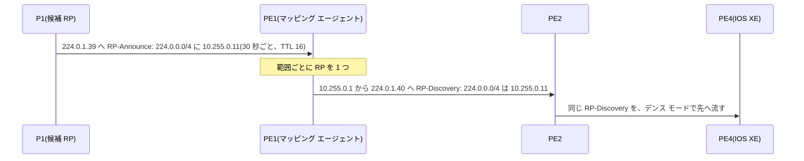

# M14 — RP の見つけ方、IPv6、切り分け

この単元の最初のページでは、RP を手で設定しました。すべてのルータに `rp-address` を 1 行ずつです。このページでは、
ルータに RP を自分で見つけさせます。初めはブートストラップ ルータ(BSR)の仕組みで、次に Auto-RP で。

続いて、同じ PIM スパース モードを IPv6 へ移し(PIMv6 と MLD)、最後に故障の探し方を扱います。受信者からツリーを
上へたどる方法です。ブループリントの 4.4 のうち PIMv6 と MLD の部分と、PIM スパース モードが頼りにしている RP の
見つけ方にあたります。盤面は、これまでのページと同じ XRT-16 です。

## 1. 何が嬉しいのか

### 1.1 困りごと: RP のアドレスを、全部のルータに手で

最初のページでは、5 台のルータのそれぞれに `rp-address 10.255.0.11` を 1 行入れて、P1 の Loopback0 を RP にしました。
全部のルータが、このアドレスで一致している必要があります。グループを別のアドレスにマッピングしたルータは、Join を
その別のアドレスへ向けて送り、その上流の、グループを P1 にマッピングしているルータは、その Join の状態を作りません
(3.4 節)。設定は受け付けられ、チャネルが届かないだけです。

変更はもっと厄介です。RP を P1 から PE3 へ移すには全部のルータを変える必要があり、最後の 1 台が終わるまで、ルータ
どうしの設定が食い違います。P1 が単に止まった場合、5 台の設定はどれも P1 を指したままで、新しい受信者の Join も、
新しい送信元の Register も行き場がありません。設定は一貫しています。一貫して古いのです。

### 1.2 それ以前の手: スタティック RP

- **全グループに 1 つのスタティック RP**: 最初のページのように、一覧なしの `rp-address`。いちばん単純な形で、
  全部のルータが同じ行を持つ必要があります。
- **範囲ごとのスタティック RP**: `rp-address <アドレス> <アクセス リスト>`。前のページの BIDIR の RP のように、
  RP ごとに一覧を 1 つ持ちます。行が増え、それを全部のルータでそろえておきます。
- **2 台に同じスタティック アドレス**(Anycast RP): 片方が止まってもアドレスは変わりません。その代わり、送信元の
  情報を 2 つの RP の間で伝え合うプロトコルが要ります。付録で扱います。

どれもスタティックです。RP が変わるときは人が全部のルータを変え、ルータがそれを知る速さは、その人が打ち込む速さです。

### 1.3 答え: RP をルータどうしで知らせる

- **候補が名乗り出る**: RP になってよいルータが、受け持つグループと priority を添えてそう名乗り、それを繰り返します。
- **1 台が集めて配る**: 名乗りは、誰も RP のアドレスを打ち込まないまま、全部の PIM ルータに届きます。
- **障害は時間で片付く**: 繰り返されない名乗りは期限が切れ、ルータは残ったものから選び直します。
- **2 つの方式**: PIM バージョン 2 の標準の BSR(RFC 5059)と、Cisco 独自の Auto-RP。誰が選ぶかと、メッセージの
  運び方が違います(2.1 節と 2.2 節)。

IPv6 については、この単元ではスタティック RP のままにします(2.4 節)。

## 2. 仕組み

盤面は、これまでのページと同じです。Loopback0 は各ルータで 10.255.0.N です(PE1 .1、PE2 .2、PE3 .3、PE4 .4、
P1 .11)。このページの例では、P1 が RP に名乗り出て、PE1 が集めて配る役に名乗り出ます。後で PE3 も名乗り出ます。
IOS XE の PE4 はどちらの役も設定せず、ほかのルータと同じように学習します。

:::topo
nodes:
  SRC1: {at: [0, 0], kind: host, label: "SRC1"}
  PE1: {at: [1.3, 0], label: "PE1(候補 BSR)"}
  PE2: {at: [3.9, 0], label: "PE2"}
  RCV2: {at: [5.2, 0], kind: host, label: "RCV2"}
  P1: {at: [2.6, 1.1], label: "P1(候補 RP)"}
  PE3: {at: [2.6, 2.4], label: "PE3(2 番目の候補 RP)"}
  PE4: {at: [3.9, 1.3], label: "PE4(IOS XE)"}
  SW1: {at: [3.9, 2.4], label: "SW1"}
  RCV3: {at: [5.2, 2.4], kind: host, label: "RCV3"}
links:
  - [SRC1, PE1, "HEADEND"]
  - [PE1, PE2, "CORE-12"]
  - [PE1, P1, "CORE-1"]
  - [P1, PE2, "CORE-2"]
  - [P1, PE3, "CORE-3"]
  - [PE2, PE4, "CORE-4"]
  - [PE2, RCV2, "ACCESS-2"]
  - {a: PE3, b: SW1, la: ".252", ta: 0.6}
  - {a: PE4, b: SW1, la: ".253"}
  - {a: SW1, b: RCV3, lb: ".1"}
frames:
  - {label: "ACCESS-3 192.168.3.0/24", nodes: [SW1, RCV3]}
:::

### 2.1 BSR: 2 つの選出

BSR には 2 種類の候補があります。**候補 BSR** は、名乗りを集めて配る役に名乗り出ます。**候補 RP** は、ある範囲の
グループの RP に名乗り出ます。2 つの役は互いに関係がなく、1 台のルータが両方を持っても、片方だけでも、どちらも
持たなくてもかまいません。BSR が RP である必要もありません。

**1 つ目の選出: BSR を 1 台。** 候補 BSR はそれぞれ、自分の priority とアドレスを載せたブートストラップ メッセージを
送ります。priority の高いものが勝ち、同じならアドレスの大きいものが勝ちます。勝ったものが BSR です。より良い候補の
メッセージを聞いた候補は、自分のメッセージを送るのをやめ、より良い候補が黙ったら引き継ぎます。

**名乗りは BSR へ。** 候補 RP はそれぞれ、ブートストラップ メッセージから BSR のアドレスを知り、そこへユニキャストで
候補 RP アドバタイズメントを送ります。中身は自分のアドレス、priority、受け持つ範囲、ホールドタイムです。IOS XR と
IOS XE は、既定でこれを 60 秒ごとに繰り返し、ホールドタイムは 150 秒です。

**BSR は RP セットを流す。** BSR は選びません。聞こえた候補をすべて **RP セット** に入れ、ブートストラップ メッセージに
載せて、全 PIM ルータのグループ 224.0.0.13 へ TTL 1 で送ります。各ルータは、BSR へ向かう RPF ネイバーから来た
ブートストラップ メッセージだけを受け取り、RP セットを持ち、自分の PIM ネイバーへ送り出します。ホップ バイ ホップで、
全部の PIM ルータに届きます。

**2 つ目の選出: 全部のルータが、グループごとに。** 各ルータは RP セットから、次の順に絞ります。グループに最も長く
一致する範囲の候補、その中で priority の値が最も小さいもの、同じならハッシュ値の最も大きいもの、最後にアドレスの
最も大きいもの。全部のルータが同じ RP セットを持ち、同じ規則を使うので、全部のルータが同じ RP を選びます。
結果は誰にも知らされず、全員が自分で計算します。

ハッシュは、ハッシュ マスク長で切ったグループ アドレスと、各候補のアドレスを混ぜたものです。priority が同じ候補に
グループを振り分けます。IOS XR の既定のマスク長 30 では、最後の 2 ビットだけが違うグループは同じハッシュになるので、
4 つずつのグループの塊が同じ RP を使います。

| | 候補 BSR | 候補 RP |
|---|---|---|
| 勝つもの | priority の最も高いもの、次にアドレスの最も大きいもの | 最も長い範囲、次に priority の値の最も小さいもの、次にハッシュ、次にアドレスの最も大きいもの |
| IOS XR の既定 | 1(ハッシュ マスク長 30) | 192 |
| IOS XE の既定 | 0(ハッシュ マスク長 0) | 0 |
| RFC 5059 の既定 | 64 | 192 |

2 つの priority は向きが逆で、既定値も機種で違います。両方の機種が加わる所では、既定のまま(0)の IOS XE の候補 RP が、
既定のまま(192)の IOS XR の候補 RP に勝ちます。既定のまま 0 の IOS XE の候補 BSR は、既定のまま 1 の IOS XR の
候補 BSR に負けます。priority は書いておきます。

RP が名乗りを送らなくなると、BSR はホールドタイムが切れた時点でそれを RP セットから外し、全部のルータが残りから
選び直します。BSR が止まると、候補 BSR が別の BSR を選びます。

### 2.2 Auto-RP: 知らせるための 2 つのグループ

Auto-RP は Cisco 独自の方式です。そのために取ってある 2 つのグループを使います。224.0.1.39(CISCO-RP-ANNOUNCE)と
224.0.1.40(CISCO-RP-DISCOVERY)です。

1. 候補 RP はそれぞれ、224.0.1.39 へ **RP-Announce** メッセージを送ります。中身は自分のアドレスと受け持つ範囲です。
2. **マッピング エージェント** は 224.0.1.39 を聞き、範囲ごとに RP を 1 つ選び、結果を **RP-Discovery** メッセージで
   224.0.1.40 へ送ります。IOS と IOS XE では、アドレスの最も大きい候補を選びます。
3. IOS、IOS XE、IOS XR のルータは、既定で 224.0.1.40 を聞き(IOS XR は Loopback0 で)、聞こえたマッピングを
   使います。



BSR と違い、選ぶのは 1 か所、マッピング エージェントだけで、ほかのルータはその結果をそのまま使います。

1 つ問題があります。2 つのグループはふつうのマルチキャスト グループで、スパース モードではグループを転送する前に
RP が要ります。ところが RP こそ、ルータが知ろうとしているものです。Auto-RP はこれを、2 つのグループをデンス モードで
送ることでかわします。すべての PIM インターフェイスへフラッディングし、RP は関わりません。デンス モードを、ちょうど
2 つのグループのためだけに。

IOS XR は既定でこれを行います。グループ マップ(`show pim group-map`)に 224.0.1.39 と 224.0.1.40 が `DM perm` と
載っています。スパース モードの IOS と IOS XE が転送するのは、`ip pim autorp listener`(またはインターフェイスの
スパース デンス モード)があるときだけです。

XRT-16 では、PE4 は PE2 からディスカバリ メッセージを受け取り、何も設定せずに RP を学習します。スパース モードの IOS のルータだけの網でリスナーが無いと、ディスカバリ メッセージは
マッピング エージェントの先へ届きません。

`scope` は、候補 RP とマッピング エージェントがこのパケットに付ける TTL で、届く範囲を決めます。全部のルータに
届く必要があり、XRT-16 には 16 で十分すぎます。BSR にはこの設定がありません。BSR のメッセージは TTL 1 でホップ
バイ ホップに進み、全部のルータが次へ渡します。

どちらのメッセージも繰り返し送られ(このページの例では 30 秒ごと、IOS XE の既定では 60 秒ごと)、更新されない
マッピングは期限が切れます。

### 2.3 スタティックと動的を並べたとき

ルータは、スタティックのマッピングと学習したマッピングを同時に持てます。同じグループについては、スタティックの行に
`override` が無い限り、学習したマッピング(BSR か Auto-RP)が使われます。IOS XE では、スタティックの範囲が学習した
範囲より狭くても同じです。

スタティックのマッピングは期限が切れません(`expires: never`)。学習したマッピングにはタイマーがあり、メッセージが
届くたびに更新されます。候補がいなくなっても、そこから学習したマッピングはタイマーが切れるまで残ります。次は、
BSR の行をすべて外して代わりに Auto-RP を設定してから、2 分たたないうちの PE2 です。BSR のマッピングが 2 つとも、
残り 52 秒で、Auto-RP のマッピングと並んで載っています。

```console
RP/0/RP0/CPU0:PE2#show pim rp mapping
PIM Group-to-RP Mappings
Group(s) 239.2.0.0/16
  RP 10.255.1.11 (?), v2, bidir
    Info source: 0.0.0.0 (?), elected via config
      Uptime: 00:06:46, expires: never
Group(s) 224.0.0.0/4
  RP 10.255.0.11 (?), v2
    Info source: 10.255.0.1 (?), elected via autorp
      Uptime: 00:01:36, expires: 00:01:29
Group(s) 224.0.0.0/4
  RP 10.255.0.3 (?), v2
    Info source: 10.0.12.1 (?), elected via bsr, priority 50, holdtime 150
      Uptime: 00:03:13, expires: 00:00:52
Group(s) 224.0.0.0/4
  RP 10.255.0.11 (?), v2
    Info source: 10.0.12.1 (?), elected via bsr, priority 192, holdtime 150
      Uptime: 00:04:27, expires: 00:00:52
RP/0/RP0/CPU0:PE2#show pim group-map
...
Group Range         Proto Client   Groups RP address      Info
...
224.0.0.0/4*        SM    autorp   2      10.255.0.11     RPF: Gi0/0/0/1,10.0.2.11
224.0.0.0/4         SM    bsr      0      10.255.0.3      RPF: Null,0.0.0.0
224.0.0.0/4         SM    bsr      0      10.255.0.11     RPF: Gi0/0/0/1,10.0.2.11
224.0.0.0/4         SM    static   0      0.0.0.0         RPF: Null,0.0.0.0
```

使われている行は、グループ マップで `*` の付いた行で、ここでは Auto-RP の行です。Cisco の IOS XE のガイドは、
Auto-RP と BSR を同時に動かす構成をサポートしていません。片方からもう片方へ移るときは、両方が表に載っている
数分間があると思っておきます。候補を外して止まるのは更新だけで、マッピングはタイマーの都合で去っていきます。

### 2.4 IPv6: PIMv6 と MLD

IPv6 のマルチキャストは、同じ PIM スパース モードを IPv6 アドレスで使い(PIMv6)、IGMP の代わりに MLD を使います。
MLD(Multicast Listener Discovery)は、IPv6 で IGMP の役をします。MLDv1 が IGMPv2 に、MLDv2 が送信元の一覧を持つ
IGMPv3 にあたります(RFC 3810)。MLD のメッセージは ICMPv6 のメッセージです。

IOS XR では、IPv6 は `multicast-routing` と `router pim` の両方で、別のアドレス ファミリーです。IPv4 に設定したものは、
IPv6 には効きません。インターフェイスも、RP も、SSM の範囲もです。MLD の既定のバージョンは 2 です。

PIMv6 のルータは、リンクローカル アドレスで話します。Hello、ネイバー、RPF ネイバー、DR は、どれもリンクローカル
アドレス(fe80::…)です。DR は今までどおりアドレスの大きい方(priority が同じとき)、MLD のクエリアは小さい方ですが、
比べるのはリンクローカル アドレスです。

リンクローカル アドレスは既定では MAC アドレスから作られ(EUI-64)、仮想のラボでは MAC アドレスは乱数です。
そこで XRT-16 は、ACCESS-3 でこれを固定しています。PE3 が FE80::252、PE4 が FE80::253 です。IPv4 と同じく、PE4 が
DR、PE3 がクエリアです。EUI-64 に任せると、選出はラボが配った MAC アドレスで決まります。

RP は IPv4 と同じように働きます。RP の (*,G) エントリは `Decaps6tunnel0` を指します。Register をほどく所です
(IPv4 では `Decapstunnel…`)。ラスト ホップ ルータは、IPv4 と同じく最初のパケットで最短パス ツリーへ移ります。

IOS XR の IPv6 のグループ マップには、クライアント `embd` の `ff70::/12` も載っています。埋め込み RP(embedded RP)で、
RP のアドレスをグループ アドレスの中に書き込む仕組みです。既定で有効ですが、この単元では使いません。

IOS XE では、`ipv6 multicast-routing` で、IPv6 を持つすべてのインターフェイスに PIMv6 と MLD が有効になり、
インターフェイスごとに足すものはありません。スタティック RP は `ipv6 pim rp-address` です。IPv6 のグループ宛ての
ping は、送る前に出力インターフェイスを尋ねます。

### 2.5 切り分け: 受信者からツリーをたどる

受信者に何も届かないときは、受信者から始めて、RP と送信元へ向かってツリーを上り、一度に 1 つずつ確かめます。
どの段も前の段に頼っています。参加が無ければ Join は無く、Join が無ければ RP に状態はありません。

1. **参加(メンバーシップ)**: 受信者のルータで、`show igmp groups <グループ>`(IOS XE では `show ip igmp groups`)に
   グループが載っているか。共有の LAN では DR で見ます。ACCESS-3 では PE4 で、クエリアの PE3 ではありません。
2. **DR**: 共有の LAN では、Join を送るのは DR だけです。`show pim interface` に載っています。
3. **RP への RPF**: ラスト ホップ ルータで `show pim rpf <RP のアドレス>`。示されたインターフェイスで PIM が動き、
   その先が PIM ネイバーである必要があります。(*,G) エントリの `RPF: Null,0.0.0.0` は、使える道が無いことを表します。
4. **どこでも同じ RP**: 受信者から RP までのどのルータでも、`show pim group-map <グループ>` が同じ RP のアドレスを
   示す必要があります。
5. **RP の状態**: RP で `show pim topology <グループ>` に (*,G) エントリがあり、受信者へ向かうインターフェイスが
   `fwd Join` である必要があります。
6. **Register**: 送信元が送り始めると、RP の (S,G) エントリに `RR`(Register Received)が付きます。ファースト ホップ
   ルータの (S,G) エントリに出力インターフェイスが無く、RP に (S,G) エントリが無ければ、Register は届かなかったか、
   断られています。
7. **最短パス ツリー**: ラスト ホップ ルータの (S,G) エントリが `SPT` で、RPF が送信元を向いている(`spt-threshold
   infinity` などで共有ツリーに留めたグループは別)。

変更のたびに、まだ誰も参加したことのないグループで試します。ルータは前の Join の状態を、そのホールドタイム
(210 秒)が切れるまで持ち続けます。また、下流のルータが、うまく動く道に沿って自分の (S,G) の Join をまだ送って
いるかもしれません。どちらでも古いグループは届き続け、変更と関係のない理由で試験は通ります。古いグループで通った
試験が示すのは、古いグループが動いたことです。

XRT-16 の確認が、課題ごとの範囲の中から乱数でグループを選ぶのも、同じ理由です。

### 2.6 押さえどころ

- BSR: 候補 BSR が BSR を 1 台選ぶ(priority の高い方、次にアドレスの大きい方)。候補 RP はそこへユニキャストで
  名乗り、BSR はそれを全部ホップ バイ ホップで流す。各ルータがグループごとに選ぶ: 長い範囲、priority の小さい値、
  ハッシュ、アドレスの大きい方。
- 既定の priority: IOS XR は候補 RP 192・候補 BSR 1、IOS XE はどちらも 0。書いておく。
- Auto-RP: 候補 RP は 224.0.1.39 で名乗り、マッピング エージェントが選んで 224.0.1.40 で知らせる。IOS XR は 2 つの
  グループをデンス モードで流す。スパース モードの IOS には `ip pim autorp listener` が要る。
- 同じグループでは、`override` が無い限り、学習したマッピングがスタティックに勝つ。学習したマッピングは、候補が
  いなくなってもホールドタイムまで残る。
- IPv6: 別のアドレス ファミリー、既定は MLDv2、ネイバーと DR はリンクローカル、RP では `Decaps6tunnel0`。
- 切り分けは受信者から上へ: 参加、DR、RPF、同じ RP、RP の状態、Register、SPT。誰も使っていないグループで試す。

## 3. IOS XR で組む

### 3.1 BSR

例では、最初のページのスタティック RP を BSR に置き換えます。5 台のルータから `rp-address 10.255.0.11` を外します
(前のページの BIDIR の RP は残します)。P1 を候補 RP に、PE1 を候補 BSR にし、どちらも既定の priority のままに
します。後で PE3 を、priority 50 の 2 番目の候補 RP にします。

`bsr candidate-rp` には `priority`、`interval`、`group-list <アクセス リスト>` を付けられます。グループの一覧が
無ければ、候補は 224.0.0.0/4、つまり全グループを受け持ちます。

図は、2 種類のメッセージを追います。P1 から BSR への名乗りと、PE2 と PE4 へ向かう BSR のブートストラップ メッセージ
です。図の番号にカーソルを置くと(スマホでは押すと)、その設定の行が出ます。

:::walk
legend: "青い番号は、ルータを候補にする行。ほかは設定なしで起きる。"
rows:
  - panel: P1
    sub: 候補 RP
    items:
      - ref: 1
        head: "**RP に名乗り出る** `bsr candidate-rp 10.255.0.11`"
        say: ["priority・interval・group-list を書いていない: 192、60 秒ごと、224.0.0.0/4"]
        then: ["→ ブートストラップ メッセージから BSR のアドレスを知る", "→ そこへユニキャストで名乗りを送る"]
  - {wire: ["[[IP → 10.255.0.1]] [[=C-RP-Adv  10.255.0.11  pri 192  224/4  hold 150]]", "_ユニキャストで BSR へ"]}
  - panel: PE1
    sub: 候補 BSR、そして BSR
    items:
      - ref: 2
        head: "**BSR に名乗り出る** `bsr candidate-bsr 10.255.0.1`"
        say: ["priority 1、ハッシュ マスク長 30(既定)。候補 BSR はこれだけ"]
        match:
          - ["priority の最も高いもの、次にアドレスの最も大きいもの", true, "Elected"]
      - say: ["聞こえた名乗りをすべて RP セットに入れ、どれも選ばない", "~RP セット: 10.255.0.11、priority 192、224/4"]
  - {wire: ["[[IP → 224.0.0.13  TTL 1]] [[=Bootstrap  BSR 10.255.0.1  RP セット]]", "_すべての PIM インターフェイスへ: CORE-12 で PE2 へ、そして P1 へ"]}
  - {node: PE2, say: ["10.255.0.1 へ向かう RPF ネイバー(CORE-12 の PE1)から受け取る", "~RP セットを持ち、224/4 に 10.255.0.11 を選び、次へ送る"]}
  - {wire: "[[IP → 224.0.0.13  TTL 1]] [[=Bootstrap  BSR 10.255.0.1  RP セット]]"}
  - {node: PE4, say: ["IOS XE。BSR の設定は何もない", "~`via bootstrap`: 224.0.0.0/4 → 10.255.0.11"]}
  - aside: "③ PE3 も priority 50 で名乗り出る"
    say: ["~RP セットには 224/4 の名乗りが 2 つ。BSR はやはりどちらも選ばない", "~全部のルータ: 範囲は同じ、値の小さい方が勝つ → 10.255.0.3"]
:::

:::config P1 — 10.255.0.11(Loopback0)を、全グループの候補 RP として名乗らせる
router pim
 address-family ipv4
  bsr candidate-rp 10.255.0.11                ## ① RP に名乗り出る。既定は priority 192、interval 60、224.0.0.0/4
 !
!
:::

:::config PE1 — 10.255.0.1(Loopback0)を、候補 BSR として名乗らせる
router pim
 address-family ipv4
  bsr candidate-bsr 10.255.0.1                ## ② BSR に名乗り出る。既定は priority 1、hash-mask-len 30
 !
!
:::

:::config PE3 — P1 より priority の値が小さい、2 番目の候補 RP
router pim
 address-family ipv4
  bsr candidate-rp 10.255.0.3 priority 50     ## ③ 50 は P1 の 192 より小さいので、全部のルータが PE3 を選ぶ
 !
!
:::

IOS XE では、どちらの役もアドレスの代わりにインターフェイスを指定します。どちらの候補でもないルータには、BSR の
設定は何も要りません。PE4 は何も設定せずに RP を学習しました。

:::config IOS XE — priority 50 の候補 RP と、候補 BSR
ip pim rp-candidate Loopback0 priority 50     ## 候補 RP。priority を書かないと 0 で、XR の既定のどれにも勝つ
ip pim bsr-candidate Loopback0                ## 候補 BSR。priority を書かないと 0 で、XR の既定の 1 に負ける
:::

IOS XR は既定値を running-config に書き込み、各候補が何を名乗っているかを表示します。

```console
RP/0/RP0/CPU0:P1#show running-config router pim
router pim
 address-family ipv4
  rp-address 10.255.1.11 BIDIR-GROUPS bidir
  bsr candidate-rp 10.255.0.11 priority 192 interval 60
  ssm range SSM-RANGE
 !
...
RP/0/RP0/CPU0:P1#show pim bsr candidate-rp
PIM BSR Candidate RP Info 

Cand-RP          mode  scope priority uptime    group-list
10.255.0.11      SM    16    192      00:01:04  224/4
RP/0/RP0/CPU0:PE1#show running-config router pim
router pim
 address-family ipv4
  rp-address 10.255.1.11 BIDIR-GROUPS bidir
  bsr candidate-bsr 10.255.0.1 hash-mask-len 30 priority 1
  ssm range SSM-RANGE
 !
...
RP/0/RP0/CPU0:PE1#show pim bsr election
PIM BSR Election State 

Cand/Elect-State        Uptime   BS-Timer BSR                      C-BSR

Elected/Accept-Pref     00:01:07 00:00:07 10.255.0.1 [1, 30]       10.255.0.1 [1, 30]      
```

候補でない PE2 と PE4 では:

```console
RP/0/RP0/CPU0:PE2#show pim bsr election
PIM BSR Election State 

Cand/Elect-State        Uptime   BS-Timer BSR                      C-BSR

No-Info/Accept-Pref     00:01:08 00:01:16 10.255.0.1 [1, 30]       0.0.0.0 [0, 0]          
RP/0/RP0/CPU0:PE2#show pim rp mapping
PIM Group-to-RP Mappings
Group(s) 239.2.0.0/16
  RP 10.255.1.11 (?), v2, bidir
    Info source: 0.0.0.0 (?), elected via config
      Uptime: 00:03:27, expires: never
Group(s) 224.0.0.0/4
  RP 10.255.0.11 (?), v2
    Info source: 10.0.12.1 (?), elected via bsr, priority 192, holdtime 150
      Uptime: 00:01:09, expires: 00:01:35
RP/0/RP0/CPU0:PE2#show pim group-map 239.1.1.1

IP PIM Group Mapping Table 
(* indicates group mappings being used) 
(+ indicates BSR group mappings active in MRIB) 

Group Range         Proto Client   Groups RP address      Info

224.0.0.0/4*        SM    bsr+     2      10.255.0.11     RPF: Gi0/0/0/1,10.0.2.11
PE4#show ip pim bsr-router
PIMv2 Bootstrap information
  BSR address: 10.255.0.1 (?)
  Uptime:      00:01:10, BSR Priority: 1, Hash mask length: 30
  Expires:     00:01:14
PE4#show ip pim rp mapping
PIM Group-to-RP Mappings

Group(s) 224.0.0.0/4
  RP 10.255.0.11 (?), v2
    Info source: 10.255.0.1 (?), via bootstrap, priority 192, holdtime 150
         Uptime: 00:01:11, expires: 00:01:29
Acl: 20, Static, Bidir Mode
    RP: 10.255.1.11 (?)
```

- **`show pim bsr election`**: BSR は `Elected` と表示します。候補でない PE2 は `No-Info` で、選ばれた BSR の
  メッセージを受け付けます(`Accept-Pref`)。かっこの中は [priority, ハッシュ マスク長] です。
- **`show pim rp mapping`**: 学習したマッピングは `elected via bsr` と priority、ホールドタイムを示し、`expires` が
  減っていきます。スタティックの BIDIR のマッピングは `elected via config` と `expires: never` です。
- **`Info source`**: IOS XR は、ブートストラップ メッセージを渡してきたネイバーを示します(10.0.12.1 は CORE-12 の
  PE1 のアドレス)。BSR から遠いルータでは、手前のルータが出ます。IOS XE は BSR 自身のアドレス 10.255.0.1 を示します。
- **`show pim group-map <グループ>`**: クライアント `bsr`、使われている RP、その RP への RPF。PE4 は、ハッシュ マスク長
  (30)も BSR から受け取っています。

PE3 が priority 50 で名乗り出ると、RP セットには名乗りが 2 つ入り、全部のルータが PE3 を使います。

```console
RP/0/RP0/CPU0:PE2#show pim rp mapping
...
Group(s) 224.0.0.0/4
  RP 10.255.0.3 (?), v2
    Info source: 10.0.12.1 (?), elected via bsr, priority 50, holdtime 150
      Uptime: 00:01:18, expires: 00:02:11
Group(s) 224.0.0.0/4
  RP 10.255.0.11 (?), v2
    Info source: 10.0.12.1 (?), elected via bsr, priority 192, holdtime 150
      Uptime: 00:02:33, expires: 00:02:11
RP/0/RP0/CPU0:PE2#show pim group-map 239.1.1.1
...
224.0.0.0/4*        SM    bsr+     2      10.255.0.3      RPF: Gi0/0/0/1,10.0.2.11
PE4#show ip pim rp-hash 239.1.1.1
  RP 10.255.0.3 (?), v2
    Info source: 10.255.0.1 (?), via bootstrap, priority 50, holdtime 150
         Uptime: 00:01:20, expires: 00:02:09
  PIMv2 Hash Value (mask 255.255.255.252)
    RP 10.255.0.3, via bootstrap, priority 50, hash value 1929039339
    RP 10.255.0.11, via bootstrap, priority 192, hash value 1690851971
```

IOS XR は、どちらの名乗りにも `elected via bsr` と書きます。どちらが使われているかはグループ マップにあり、
10.255.0.3 です。どちらも elected で、使われるのは 1 つです。IOS XE では、`show ip pim rp-hash <グループ>` が、
そのグループに選んだ RP と、比べた値を表示します。

:::drill xr-m14-6

### 3.2 Auto-RP

例では続けて、BSR を Auto-RP に替えます。P1、PE3、PE1 から BSR の行を外し、P1 を Auto-RP の候補 RP、PE1 を
マッピング エージェントにします。どちらも Loopback0 で、scope 16、間隔 30 秒です。PE4 には何も入れません。

:::config P1 — Loopback0 を Auto-RP の候補 RP として名乗らせる
router pim
 address-family ipv4
  auto-rp candidate-rp Loopback0 scope 16 interval 30   ## 224.0.1.39 へ RP-Announce を 30 秒ごと、TTL 16。全グループ
 !
!
:::

:::config PE1 — マッピング エージェント
router pim
 address-family ipv4
  auto-rp mapping-agent Loopback0 scope 16 interval 30  ## 224.0.1.39 を聞き、10.255.0.1 から 224.0.1.40 へ RP-Discovery
 !
!
:::

IOS XE では、2 つの役にそれぞれ専用のコマンドがあり、スパース モードのルータが 2 つのグループを転送するには
リスナーが要ります。

:::config IOS XE — 候補 RP、マッピング エージェント、リスナー
ip pim send-rp-announce Loopback0 scope 16    ## 候補 RP: 224.0.1.39 へ RP-Announce(既定は 60 秒ごと)
ip pim send-rp-discovery Loopback0 scope 16   ## マッピング エージェント: 224.0.1.40 へ RP-Discovery(既定は 60 秒ごと)
ip pim autorp listener                        ## スパース モードのインターフェイスで、224.0.1.39 と 224.0.1.40 をデンス モードで流す
:::

IOS XR では、Auto-RP は `show auto-rp mapping-agent` と `show auto-rp candidate-rp` で表示します。

```console
RP/0/RP0/CPU0:PE1#show auto-rp mapping-agent
Mapping Agent Table
  Maximum number of mapping cache entries 500
  Current number of mapping cache entries 1
10.255.0.11 (expire : 86 secs)
  224.0.0.0/4  SM  *

RP/0/RP0/CPU0:P1#show auto-rp candidate-rp
ACL Name        Group Range        Mode   Candidate RP    TTL   Interval
                224.0.0.0/4        SM     10.255.0.11     16    30

RP/0/RP0/CPU0:PE2#show pim rp mapping
...
Group(s) 224.0.0.0/4
  RP 10.255.0.11 (?), v2
    Info source: 10.255.0.1 (?), elected via autorp
      Uptime: 00:03:55, expires: 00:01:28
RP/0/RP0/CPU0:PE2#show pim group-map

IP PIM Group Mapping Table 
(* indicates group mappings being used) 
(+ indicates BSR group mappings active in MRIB) 

Group Range         Proto Client   Groups RP address      Info

224.0.1.39/32*      DM    perm     1      0.0.0.0         
224.0.1.40/32*      DM    perm     1      0.0.0.0         
224.0.0.0/24*       NO    perm     0      0.0.0.0         
239.100.0.0/16*     SSM   config   0      0.0.0.0         
232.0.0.0/8*        SSM   config   0      0.0.0.0         
239.2.0.0/16*       BD    config   0      10.255.1.11     RPF: Gi0/0/0/1,10.0.2.11
224.0.0.0/4*        SM    autorp   2      10.255.0.11     RPF: Gi0/0/0/1,10.0.2.11
224.0.0.0/4         SM    static   0      0.0.0.0         RPF: Null,0.0.0.0
RP/0/RP0/CPU0:PE2#show pim topology 224.0.1.40
...
(10.255.0.1,224.0.1.40)SPT DM Up: 00:03:56 
JP: Null(never) RPF: GigabitEthernet0/0/0/0,10.0.12.1 Flags: KAT(00:03:27) 
  Loopback0                   00:03:56  fwd 
  GigabitEthernet0/0/0/0      00:03:56  fwd 
  GigabitEthernet0/0/0/1      00:03:56  fwd 
  GigabitEthernet0/0/0/2      00:03:56  fwd 
  GigabitEthernet0/0/0/3      00:03:56  fwd 
PE4#show ip pim rp mapping
PIM Group-to-RP Mappings

Group(s) 224.0.0.0/4
  RP 10.255.0.11 (?), v2
    Info source: 10.255.0.1 (?), elected via Auto-RP
         Uptime: 00:06:49, expires: 00:01:26
Acl: 20, Static, Bidir Mode
    RP: 10.255.1.11 (?)
PE4#show ip mroute 224.0.1.40
...
(10.255.0.1, 224.0.1.40), 00:03:58/00:02:56, flags: PLTX
  Incoming interface: Ethernet0/0, RPF nbr 10.0.4.2
  Outgoing interface list: Null
```

- **`show auto-rp mapping-agent`**: マッピング エージェントのキャッシュ。候補ごとに 1 エントリで、次の名乗りで更新
  されない限り期限が切れるまでの残り時間が付きます。
- **`show auto-rp candidate-rp`**: TTL が `scope`、Interval が設定した間隔です。
- **`elected via autorp`**: `Info source` はマッピング エージェント(10.255.0.1)です。
- **`DM perm`**: Auto-RP の 2 つのグループが、設定なしでデンス モードです。RP が 0.0.0.0 の `static` の行には `*` が
  無く、使われていません。
- **PE2 の (10.255.0.1,224.0.1.40)**: PE1 の Loopback0 からのディスカバリ メッセージで、`DM`、PE4 へ向かう
  Gi0/0/0/2 を含むすべてのインターフェイスへ転送しています。
- **PE4**: リスナーなしで `elected via Auto-RP`。ディスカバリ メッセージは PE2 から Ethernet0/0 に入ってきます。

### 3.3 IPv6 マルチキャスト

例では、P1 の Loopback0(2001:db8:255::11)を、IPv6 の全グループのスタティック RP にします。IOS XR では、
IPv6 のアドレス ファミリーが、`multicast-routing` と `router pim` の両方に要ります。

:::config PE1、PE2、P1、PE3 — 全グループにスタティック RP を使う IPv6 マルチキャスト
multicast-routing
 address-family ipv6
  interface all enable                        ## すべてのインターフェイスで PIMv6 と MLD(バージョン 2)。Loopback0 も
 !
!
router pim
 address-family ipv6
  rp-address 2001:db8:255::11                 ## P1 の Loopback0 を、全グループ(ff00::/8)に
 !
!
:::

:::config IOS XE — 同じもの
ipv6 multicast-routing                        ## IPv6 を持つすべてのインターフェイスで PIMv6 と MLD
ipv6 pim rp-address 2001:DB8:255::11          ## 同じスタティック RP を、全グループに
:::

PE2 で、インターフェイス、ネイバー、RP を見ます:

```console
RP/0/RP0/CPU0:PE2#show running-config multicast-routing
multicast-routing
 address-family ipv4
  interface all enable
 !
 address-family ipv6
  interface all enable
 !
!

RP/0/RP0/CPU0:PE2#show pim ipv6 interface

PIM interfaces in VRF default
Interface                  PIM  Nbr   Hello  DR
                                Count Intvl  Prior

Loopback0                   on   1     30     1     
    Primary Address : fe80::9da8:acff:fe90:c81d
                 DR : this system
...
GigabitEthernet0/0/0/2      on   2     30     1     
    Primary Address : fe80::5054:ff:fe4d:3474
                 DR : fe80::a8bb:ccff:fe00:d00
...
RP/0/RP0/CPU0:PE2#show pim ipv6 neighbor
...
GigabitEthernet0/0/0/2

Neighbor Address                          Uptime    Expires  DR pri  DR  Flags
fe80::5054:ff:fe4d:3474*                  01:24:27  00:01:29 1           B
fe80::a8bb:ccff:fe00:d00                  01:24:25  00:01:17 1      (DR) B
...
RP/0/RP0/CPU0:PE2#show mld interface GigabitEthernet0/0/0/3

GigabitEthernet0/0/0/3 is up, line protocol is up
  Internet address is fe80::5054:ff:fe9d:9a52
...
  Current MLD version is 2
  MLD query interval is 125 seconds
  MLD querier timeout is 255 seconds
  MLD max query response time is 10 seconds
  Last member query response interval is 1 seconds
...
  MLD querying router is fe80::5054:ff:fe9d:9a52 (this system)
...
RP/0/RP0/CPU0:PE2#show pim ipv6 group-map ff0e::1:1

IP PIM Group Mapping Table 
(* indicates group mappings being used) 
(+ indicates BSR group mappings active in MRIB) 

Group Range                                            Proto Client   Groups
ff00::/8*                                              SM    config   0
  RP: 2001:db8:255::11
  RPF: Gi0/0/0/1,fe80::5054:ff:fe18:c53f
```

ACCESS-3 では、固定したリンクローカル アドレスが役を決めます:

```console
RP/0/RP0/CPU0:PE3#show pim ipv6 interface GigabitEthernet0/0/0/1
...
GigabitEthernet0/0/0/1      on   2     30     1     
    Primary Address : fe80::252
                 DR : fe80::253
RP/0/RP0/CPU0:PE3#show mld interface GigabitEthernet0/0/0/1
...
  MLD querying router is fe80::252 (this system)
...
PE4#show ipv6 pim interface Ethernet0/1
Interface          PIM   Nbr   Hello  DR
                         Count Intvl  Prior

Ethernet0/1        on    1     30     1     
    Address: FE80::253
    DR     : this system

PE4#show ipv6 mld interface Ethernet0/1
Ethernet0/1 is up, line protocol is up
  Internet address is FE80::253/10
  MLD is enabled on interface
  Current MLD version is 2
...
  MLD querying router is FE80::252 
```

- **PIMv6 はリンクローカルで話す**: インターフェイスの `Primary Address`、ネイバー、DR、グループ マップの RPF
  ネイバー(P1 を通って RP へ。`fe80::5054:ff:fe18:c53f`)。RP そのものはグローバル アドレスです。
- **Loopback0 は自分を数える**: `Nbr Count 1` と `DR : this system`。IPv4 と同じです。
- **MLD**: バージョン 2、クエリは 125 秒ごと(同じインターフェイスの IGMP は 60 秒)。
- **ACCESS-3**: 両方の側で、PE4(FE80::253)が DR、PE3(FE80::252)がクエリアです。

続いて RCV2 と RCV3 が FF0E::1:1 に参加し(ホストで `ipv6 mld join-group FF0E::1:1`)、SRC1 がグループへ ping を
送ります。IOS XE の ping は、まず出力インターフェイスを尋ねます。SRC1 では Ethernet0/0 です。

```console
SRC1#ping FF0E::1:1 repeat 10 timeout 1
Output Interface: Ethernet0/0
Type escape sequence to abort.
Sending 10, 100-byte ICMP Echos to FF0E::1:1, timeout is 1 seconds:
Packet sent with a source address of 2001:DB8:100:1::1

Request 0 timed out
Request 1 timed out
Reply to request 2 received from 2001:DB8:100:2::1, 8 ms
Reply to request 2 received from 2001:DB8:100:3::1, 28 ms
...
Success rate is 80 percent (8/10), round-trip min/avg/max = 2/6/28 ms
16 multicast replies and 0 errors.
```

その後のツリー(送信元から RCV2 まで。抜粋):

```console
RP/0/RP0/CPU0:PE1#show pim ipv6 topology ff0e::1:1
...
(2001:db8:100:1::1,ff0e::1:1) SPT
SM Up: 00:00:23 JP: Join(never) Flags: KAT(00:03:08) RA 
RPF: GigabitEthernet0/0/0/2,2001:db8:100:1::1* 
  GigabitEthernet0/0/0/0      00:00:21  fwd Join(00:03:08) 
RP/0/RP0/CPU0:P1#show pim ipv6 topology ff0e::1:1
...
(*,ff0e::1:1)
SM Up: 00:03:46 JP: Join(never) Flags: 
RP: 2001:db8:255::11* 
RPF: Decaps6tunnel0,2001:db8:255::11 
  GigabitEthernet0/0/0/1      00:03:46  fwd Join(00:03:06) 

(2001:db8:100:1::1,ff0e::1:1)RPT
SM Up: 00:00:22 JP: Prune(never) Flags: KAT(00:03:08) RA DCC RR (00:04:11) 
RP: 2001:db8:255::11* 
RPF: Decaps6tunnel0,2001:db8:255::11 
  GigabitEthernet0/0/0/1      00:00:22  off Prune(00:03:07) 
...
RP/0/RP0/CPU0:PE2#show mld groups ff0e::1:1 detail

Interface:	GigabitEthernet0/0/0/3
Group:		ff0e::1:1
Uptime:		00:00:15
Router mode:	EXCLUDE (Expires: 00:04:05)
Host mode:	INCLUDE
Last reporter:	::
...
RP/0/RP0/CPU0:PE2#show pim ipv6 topology ff0e::1:1
...
(*,ff0e::1:1)
SM Up: 00:03:49 JP: Join(00:00:30) Flags: LH 
RP: 2001:db8:255::11 
RPF: GigabitEthernet0/0/0/1,fe80::5054:ff:fea6:9eac 
  GigabitEthernet0/0/0/2      00:03:46  fwd Join(00:02:46) 
  GigabitEthernet0/0/0/3      00:03:49  fwd LI LH 

(2001:db8:100:1::1,ff0e::1:1) SPT
SM Up: 00:00:25 JP: Join(00:00:28) Flags: KAT(00:03:06) RA 
RPF: GigabitEthernet0/0/0/0,fe80::5054:ff:fefe:67ea 
  GigabitEthernet0/0/0/2      00:00:25  fwd Join(00:03:04) 
```

- **PE1**: 送信元が自分の LAN にいるので、RPF ネイバーは送信元そのもの(`2001:db8:100:1::1*`)です。
- **P1(RP)**: (*,G) エントリは `Decaps6tunnel0` を指します。(S,G) エントリには `RR` が付き、Register が届いて
  います。(S,G)RPT エントリは、最短パス ツリーへ移った PE2 へ向けて、その送信元を Prune しています。
- **PE2**: (S,G) エントリは `SPT` で、RPF は PE1 との直結の Gi0/0/0/0。IPv4 と同じです。
- **`Last reporter: ::`**: IOS XE のホストの参加を、IOS XR は `::` と表示します。それでもグループは載っています。

### 3.4 故障の見え方

どの行も、ほかは正常な網に故障を 1 つだけ入れ、それまで誰も参加していなかったグループで試したものです(2.5 節)。
IPv4 の例です。`show pim` に `ipv6` を足し、`igmp` を `mld` に替えれば、IPv6 でも同じように読めます。

| 故障 | 見る所 | 表示 | 届いた数(10 発中) |
|---|---|---|---|
| PE2 の RP へ向かうインターフェイスで PIM を止めた(`router pim` → `interface …` → `disable`) | PE2: `show pim interface`、`show pim rpf 10.255.0.11`、`show pim topology <G>` | インターフェイスが `off`、DR が `not elected`。`via Null with rpf neighbor 0.0.0.0`。(*,G) エントリが `RPF: Null,0.0.0.0`。RP に状態なし | 0 |
| 受信者の LAN のインターフェイスでマルチキャストを止めた(`multicast-routing` → `interface …` → `disable`) | `show igmp interface`、`show pim interface`、`show pim topology <G>` | IGMP のバージョンとタイマーの行が消える。PIM は `off`。(*,G) エントリのそのインターフェイスに `LI` が無い | その LAN は 0、ほかの LAN は 10 |
| PE2 がグループを別の RP のアドレスにマッピング | 各ルータで `show pim group-map <G>` | PE2 の (*,G) は別の RP を示し、そちらへ Join を送る。グループを自分にマッピングする P1 は状態を作らない。送信元の側は P1 へ Register(`RR`、出力インターフェイスなし) | 0 |
| PIM を落とす ACL を、CORE-2 の PE2 側の入力だけに | 両端で `show pim neighbor` | PE2 の表から P1 が消える。P1 は PE2 をネイバーのまま持ち、その Join も受け取り続ける | 9 |
| IGMP を落とす ACL を、受信者の LAN の入力に | `show igmp groups <G>` | `No matching entries in IGMP`。そのグループの PIM の状態も無い | 0 |
| RP が送信元を断る: 送信元を拒否する一覧の `accept-register`(`deny ipv4 host 192.168.1.1 any`) | ファースト ホップ ルータと RP で `show pim topology <G>` | ファースト ホップの (S,G) エントリが `JP: Null` で、インターフェイスなし。RP には (*,G) エントリだけ | どの受信者も 0 |
| 受信者の LAN の IOS XE の DR が IGMPv2 のまま。受信者はバージョン 3 の (S,G) の報告を送る | DR: `show ip igmp groups` | (S,G) の報告が DR の表に載らない | 0(`ip igmp version 3` で 10) |
| IOS XE の DR に `ip pim ssm default` が無い(IGMPv3 は有効) | DR: `show ip mroute <G>`、RP: `show pim topology <G>` | DR は (*,232.x.x.x) の Join を RP へ送る。232/8 を SSM とする PE2 は先へ送らない。RP に状態なし。XR のルータの表示は正常に見える | 0(行を足すと 10) |
| PE2 の受信者の LAN を IGMP バージョン 2 にし、3 に戻す | `show igmp groups <G> detail` | ホストがバージョン 2 に落ち、SSM のグループをバージョン 2 で報告し、IOS XR はそれを捨てる。3 に戻しても、ホストが 3 に戻るまでの約 2 分は届かない | 0、その後 10 |
| Auto-RP が動いている所で、PE2 にスタティック RP を足す | `show pim group-map` | Auto-RP の行が `*` のまま。スタティック(`config`)の行に `*` が移るのは `override` のときだけ | — |

`accept-register <アクセス リスト>` は、RP の `router pim` の下に書きます。アクセス リストは、マルチキャストの送信元と
グループに一致させます。リストが拒否した Register には、すぐに Register-Stop が返り、ファースト ホップ ルータは
Register を送るのをやめます。

リストのどの行にも一致しない Register は、別の話です。この盤面の IOS XR では、IPv4 でも IPv6 でも受け付けられます。
Cisco の文書には、この場合どうなるかが書かれていません。結果がこの場合に左右されないよう、リストは末尾の明示の
`deny ipv4 any any`(IPv6 は `deny ipv6 any any`)で閉じます。

紛らわしい行が 2 つあります。片側だけの ACL では、PE2 の表示はネイバーが消えたと言いますが、P1 は PE2 をネイバーの
まま持ち、チャネルは流れ続けます。表示とパケットの言い分が食い違います。IOS XE の DR での SSM の 2 行では、IOS XR の
ルータの表示はどれも正常に見え、故障は IOS XE のルータにしか表れません。

### 3.5 落とし穴

- **IOS XE と IOS XR が混ざる所の既定の priority**: 既定の 0 の IOS XE の候補 RP は、192 の IOS XR の候補 RP の
  どれにも勝ちます。0 の IOS XE の候補 BSR は、IOS XR の 1 に負けます。どちらの priority も書いておきます。
- **向きが逆**: 候補 BSR は priority の高い方が勝ち、候補 RP は値の小さい方が勝ちます。
- **グループの一覧の無い候補 RP** は 224.0.0.0/4 を受け持ちます。スタティック RP に任せるつもりのグループも含めてです。
  そして同じグループでは、学習したマッピングがスタティックに勝ちます(IOS XE では、スタティックの範囲が狭くても)。
  `group-list` で絞るか、`override` を使います。
- **外した候補は残る**: ホールドタイムが切れるまで(既定の間隔で 150 秒)。待つか、試す前に `expires` の列を見ます。
- **Auto-RP と BSR を同時に**: Cisco の IOS XE のガイドではサポートされていません。片方を終えてから、もう片方を
  始めます。
- **スパース モードの IOS のルータの Auto-RP**: `ip pim autorp listener` が無いと、ディスカバリ メッセージは
  マッピング エージェントの先へ届きません。IOS XR は 2 つのグループを自分で流します。
- **`show pim auto-rp`**: IOS XR にはありません。`show auto-rp mapping-agent` と `show auto-rp candidate-rp` を使います。
- **IPv6 は別のアドレス ファミリー**: `multicast-routing` と `router pim` の IPv4 の行は、IPv6 には何もしません。
- **IPv6 の DR はリンクローカル アドレスで決まる**: EUI-64 なら MAC アドレス次第です。DR が大事な所では、ACCESS-3 の
  ように固定します。
- **IOS XE でグループ宛ての IPv6 の ping** は、`Output Interface:` への答えを待ちます。
- **前に使ったグループで試す**: 前の Join は最大 210 秒残ります。新しいグループを使います。
- **`clear igmp groups`** は IOS XR のコマンドではありません。正しくは `clear igmp group` です。
- **RP の状態を clear する** と、次の定期的な Join まで(最大 60 秒)チャネルが止まります。

## 実践

ラボ **XRT-16** で課題 M14-5 と M14-6 に取り組みます。

<p class="tolab"><a href="/_learn?id=XRT-16">ワークスペースでラボ XRT-16 を開く</a> — <a href="f5-m14-practice-3.html">課題 M14-5、M14-6</a></p>

:::note
このページの出力は、このページの値を使って XRT-16 で取得しました。PE1、PE2、P1、PE3 は IOS XRd 26.1.1、PE4 と
ホストは IOS XE 17.15(IOL)です。IPv6 のツリー(参加、SRC1 の ping、その後の PIMv6 のエントリ、IPv6 のグループ マップの
`embd` の行)と、故障の表の振る舞いは、PE1、PE2、P1 とホストが同じ名前とアドレスを持つ試験の盤面で取得しました。そこでは PE1 と PE2 が
IOS XRv 9000 26.1.1、P1 が IOS XRd 26.1.1 で、受信者の LAN の IOS XE のルータ(IOL 17.15)が PE4 の役でした。
その盤面では、BSR から 2 ホップのルータが、`Info source` として手前のルータのアドレスを示しました。IOS のルータだけの
網でのリスナーなしの Auto-RP と、IOS の動的なマッピングがより狭いスタティックに勝つことは、以前に IOL 17.15.1 で
測りました。IOS XRd のマルチキャストの転送は Cisco の文書に記述がありません。この仮想機では転送しました。
文書に記述の無い点: IOS XRd 26.1.1 では、`accept-register` のリストのどの行にも一致しない Register が、IPv4 でも
IPv6 でも受け付けられました。別の送信元の `permit` だけのリストではストリームが届き、末尾に `deny … any any` を足すと
止まりました。コマンド リファレンスは、拒否した送信元に Register-Stop を返すことしか書いていません。
出典: RFC 5059(BSR: 2 つの選出、ユニキャストの候補 RP アドバタイズメント、ブートストラップ メッセージのフラッディング、
既定の priority 192 と 64)、RFC 7761(PIM スパース モード: RP の選び方とハッシュ関数、DR の選出、Join/Prune の
ホールドタイム 210 秒)、RFC 3810(MLDv2)、RFC 3376(バージョン 3 へ戻るまでの約 2 分の元のタイマー)。Cisco 8000 の
Multicast Command Reference(2026-09-11。候補 BSR の既定、`accept-register` と Register-Stop)。Cisco 8000 の
Multicast Configuration Guide、IOS XR 26.1.x〜26.3.x(既定の MLDv2、priority 192 の候補 RP の例)。ASR 9000 の
Multicast Configuration Guide、IOS XR 25.1.x〜25.4.x(Auto-RP と BSR の範囲がスタティックより優先されること、
`override`)。CRS の Multicast Command Reference(2020。Auto-RP の既定の学習、埋め込み RP の既定の有効)。IOS XE は、
IP Multicast Configuration Guide, IOS XE 17.x(候補 RP と候補 BSR の既定の priority 0、リスナーかスパース デンス モードで
動かす Auto-RP、Auto-RP と BSR の同時運用は非サポート〔要約経由で読んだ〕)と、Cisco IOS IP Multicast Command
Reference(ユニキャストの候補 RP アドバタイズメント、224.0.0.13 へ TTL 1 のブートストラップ メッセージ、最長一致 →
priority → ハッシュ → アドレスの順、Auto-RP の 2 つのグループ、マッピング エージェントが最大のアドレスを選ぶこと、
60 秒の既定、ハッシュ マスク長 0)。いずれも 2026 年 11 月に確認。
:::
