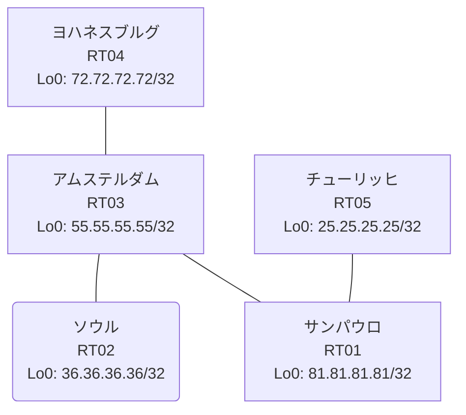

# 問題 20261007-009

> **本問は機器に接続せずに解答すること。追加の show 実行は認めない。**

## トポロジ

あなたは、ネットワークの運用を担当しています。あなたの会社のネットワークは、複数のルーティング ドメインが、境界のルーターによって接続され、そして、すべての拠点の到達可能性が提供されている、というものです。ルーティングの設計の詳細は、示されているところの構成から、読み取られることが、期待されています。各拠点のルーターと、拠点の網との対応は、下記の表に示されているとおりです。



| 拠点 | ルータ | 拠点網 |
|------|--------|----------------------|
| アムステルダム | RT03 | `55.55.55.55/32` |
| サンパウロ | RT01 | `81.81.81.81/32` |
| ソウル | RT02 | `36.36.36.36/32` |
| チューリッヒ | RT05 | `25.25.25.25/32` |
| ヨハネスブルグ | RT04 | `72.72.72.72/32` |

リンク一覧:
```
  RT03:E0/0(.1) ── RT01:E0/0(.2)   10.225.111.0/30
  RT03:E0/1(.1) ── RT02:E0/0(.2)   10.209.50.0/30
  RT03:E0/2(.1) ── RT04:E0/0(.2)   10.20.223.0/30
  RT01:E0/1(.1) ── RT05:E0/0(.2)   10.73.102.0/30
```

## 要件

1. スタティック ルートおよび既定のルートによる迂回は、実施されることはできません。
2. ルートの再配送に対して、フィルタが、適用されることはできません。
3. ルーティング・プロトコルの種別およびプロセスの配置は、変更されてはなりません。
4. redistribute によって参照されるところのプロセス ID / AS 番号は、その境界に実在する隣接のドメインのものと一致させられ、そして、実在しないプロセスへの参照が、残置されてはなりません。
5. 各サイトのネットワークは、ドメインをまたいで、すべてのサイトから、到達されることができること。
6. EIGRP の初期のメトリックは、default-metric `1000000 100 255 1 1500` へ集約される必要があります。

## 現在の状態

一部の通信が、意図されているとおりに動作していない、という報告があります。示されているところの出力および構成に基づいて、要求されているところの動作が得られていない理由が、判断されなければなりません。

```
RT01# show ip route
Gateway of last resort is not set
      10.0.0.0/8 is variably subnetted, 6 subnets, 2 masks
D        10.20.223.0/30 [90/307200] via 10.225.111.1, 00:05:13, Ethernet0/0
C        10.73.102.0/30 is directly connected, Ethernet0/1
L        10.73.102.1/32 is directly connected, Ethernet0/1
D EX     10.209.50.0/30 [170/307200] via 10.225.111.1, 00:05:13, Ethernet0/0
C        10.225.111.0/30 is directly connected, Ethernet0/0
L        10.225.111.2/32 is directly connected, Ethernet0/0
      25.0.0.0/32 is subnetted, 1 subnets
D        25.25.25.25 [90/409600] via 10.73.102.2, 00:04:56, Ethernet0/1
      36.0.0.0/32 is subnetted, 1 subnets
D EX     36.36.36.36 [170/435200] via 10.225.111.1, 00:05:05, Ethernet0/0
      55.0.0.0/32 is subnetted, 1 subnets
D        55.55.55.55 [90/409600] via 10.225.111.1, 00:05:13, Ethernet0/0
      72.0.0.0/32 is subnetted, 1 subnets
D        72.72.72.72 [90/435200] via 10.225.111.1, 00:05:04, Ethernet0/0
      81.0.0.0/32 is subnetted, 1 subnets
C        81.81.81.81 is directly connected, Loopback0
```
```
RT03# show access-lists
Standard IP access list 14
    10 deny   25.25.25.25
    20 permit any
Standard IP access list 22
    10 deny   55.55.55.55
    20 permit any
Standard IP access list SVC
    10 permit 81.81.81.81 (1 match)
```
```
RT05# show ip route
Gateway of last resort is not set
      10.0.0.0/8 is variably subnetted, 5 subnets, 2 masks
D        10.20.223.0/30 [90/332800] via 10.73.102.1, 00:04:42, Ethernet0/0
C        10.73.102.0/30 is directly connected, Ethernet0/0
L        10.73.102.2/32 is directly connected, Ethernet0/0
D EX     10.209.50.0/30 [170/332800] via 10.73.102.1, 00:04:42, Ethernet0/0
D        10.225.111.0/30 [90/307200] via 10.73.102.1, 00:04:42, Ethernet0/0
      25.0.0.0/32 is subnetted, 1 subnets
C        25.25.25.25 is directly connected, Loopback0
      36.0.0.0/32 is subnetted, 1 subnets
D EX     36.36.36.36 [170/460800] via 10.73.102.1, 00:04:42, Ethernet0/0
      55.0.0.0/32 is subnetted, 1 subnets
D        55.55.55.55 [90/435200] via 10.73.102.1, 00:04:42, Ethernet0/0
      72.0.0.0/32 is subnetted, 1 subnets
D        72.72.72.72 [90/460800] via 10.73.102.1, 00:04:42, Ethernet0/0
      81.0.0.0/32 is subnetted, 1 subnets
D        81.81.81.81 [90/409600] via 10.73.102.1, 00:04:42, Ethernet0/0
```
```
RT03# show route-map
route-map RM-SVC, permit, sequence 10
  Match clauses:
    ip address (access-lists): SVC 
  Set clauses:
  Policy routing matches: 0 packets, 0 bytes
route-map RM-STG1, deny, sequence 10
  Match clauses:
    ip address prefix-lists: PL-STG1 
  Set clauses:
  Policy routing matches: 0 packets, 0 bytes
route-map RM-STG1, permit, sequence 20
  Match clauses:
  Set clauses:
  Policy routing matches: 0 packets, 0 bytes
route-map RM-BACKUP2, deny, sequence 10
  Match clauses:
    ip address prefix-lists: PL-BACKUP2 
  Set clauses:
  Policy routing matches: 0 packets, 0 bytes
route-map RM-BACKUP2, permit, sequence 20
  Match clauses:
  Set clauses:
  Policy routing matches: 0 packets, 0 bytes
```
```
RT02# show ip route
Gateway of last resort is not set
      10.0.0.0/8 is variably subnetted, 2 subnets, 2 masks
C        10.209.50.0/30 is directly connected, Ethernet0/0
L        10.209.50.2/32 is directly connected, Ethernet0/0
      36.0.0.0/32 is subnetted, 1 subnets
C        36.36.36.36 is directly connected, Loopback0
      55.0.0.0/32 is subnetted, 1 subnets
D        55.55.55.55 [90/409600] via 10.209.50.1, 00:04:32, Ethernet0/0
      81.0.0.0/32 is subnetted, 1 subnets
D EX     81.81.81.81 [170/435200] via 10.209.50.1, 00:04:31, Ethernet0/0
```
```
RT03# show ip prefix-list
ip prefix-list PL-BACKUP2: 2 entries
   seq 5 deny 55.55.55.55/32
   seq 10 permit 0.0.0.0/0 le 32
ip prefix-list PL-STG1: 2 entries
   seq 5 deny 25.25.25.25/32
   seq 10 permit 0.0.0.0/0 le 32
ip prefix-list SVC: 3 entries
   seq 5 permit 25.25.25.25/32
   seq 10 permit 72.72.72.72/32
   seq 15 permit 81.81.81.81/32
```

## 設定抜粋

```
RT01# show running-config | section router
router eigrp 830
 network 10.73.102.0 0.0.0.3
 network 10.225.111.0 0.0.0.3
 network 81.81.81.81 0.0.0.0
```
```
RT02# show running-config | section router
router eigrp 551
 network 10.209.50.0 0.0.0.3
 network 36.36.36.36 0.0.0.0
 passive-interface Loopback0
```
```
RT03# show running-config | section router
router eigrp 830
 default-metric 1000000 100 255 1 1500
 network 10.20.223.0 0.0.0.3
 network 10.225.111.0 0.0.0.3
 network 55.55.55.55 0.0.0.0
 redistribute eigrp 551
 passive-interface Loopback0
router eigrp 551
 default-metric 1000000 100 255 1 1500
 network 10.209.50.0 0.0.0.3
 network 55.55.55.55 0.0.0.0
 redistribute eigrp 830 route-map RM-SVC
```
```
RT04# show running-config | section router
router eigrp 830
 network 10.20.223.0 0.0.0.3
 network 72.72.72.72 0.0.0.0
```
```
RT05# show running-config | section router
router eigrp 830
 timers active-time 5
 network 10.73.102.0 0.0.0.3
 network 25.25.25.25 0.0.0.0
 passive-interface Loopback0
```

## 設問

次のうち、正しいものは、どれですか。

## 選択肢
A. RT03 の route-map の match が、プレフィックスリストではなく、同じ名前のアクセスリストを参照している

B. RT02 の router eigrp 551 で、上流側インタフェースが passive-interface に設定されている

C. RT03 の redistribute に適用された route-map が特定の拠点網を deny している

D. RT02 と隣接ルータの間で EIGRP のネイバー(隣接関係)が確立していない

E. RT03 の router eigrp 551 配下に redistribute が設定されていない

F. RT02 の router eigrp 551 に Loopback0 の network 文が設定されていない
