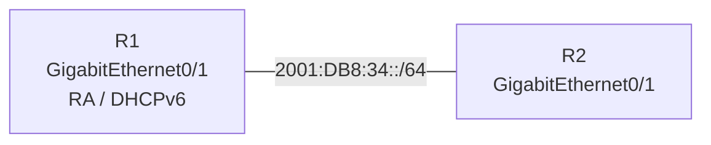

# 問題 20261007-011

> **本問は機器に接続せずに解答すること。追加の show 実行は認めない。**

## シナリオ



R1 は DHCPv6 サーバとしてアドレスと DNS サーバ・ドメイン名を配布し、R2 はアドレスを DHCPv6 で取得します。

```
R1# show running-config | section ipv6|interface GigabitEthernet0/1
ipv6 unicast-routing
ipv6 dhcp pool POOL-IPv6
 address prefix 2001:DB8:34::/64 lifetime infinite infinite
 dns-server 2001:DB8:53::53
 domain-name example.net
!
interface GigabitEthernet0/1
 ipv6 address 2001:DB8:34::1/64
 ipv6 dhcp server POOL-IPv6
 【1】
 no shutdown

R2# show running-config | section interface GigabitEthernet0/1
interface GigabitEthernet0/1
 【2】
 no shutdown
```

## 設問

【1】と【2】に当てはまるコマンドの組合せとして正しいものは、次のうちどれですか。(1つを選択してください)

## 選択肢

A. 【1】ipv6 nd managed-config-flag　【2】ipv6 address autoconfig

B. 【1】ipv6 nd other-config-flag　【2】ipv6 address autoconfig

C. 【1】ipv6 nd managed-config-flag　【2】ipv6 address dhcp

D. 【1】(フラグの設定なし)　【2】ipv6 address dhcp
