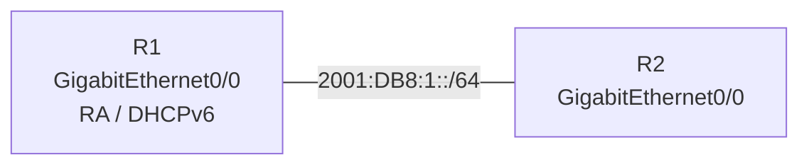

# 問題 20261007-012

> **本問は機器に接続せずに解答すること。追加の show 実行は認めない。**

## シナリオ



R1 は DHCPv6 サーバとしてアドレスと DNS サーバ・ドメイン名を配布し、R2 はアドレスを DHCPv6 で取得します。

```
R1# show running-config | section ipv6|interface GigabitEthernet0/0
ipv6 unicast-routing
ipv6 dhcp pool V6POOL
 address prefix 2001:DB8:1::/64 lifetime infinite infinite
 dns-server 2001:DB8:53::53
 domain-name corp.example.com
!
interface GigabitEthernet0/0
 ipv6 address 2001:DB8:1::1/64
 ipv6 dhcp server V6POOL
 【1】
 no shutdown

R2# show running-config | section interface GigabitEthernet0/0
interface GigabitEthernet0/0
 【2】
 no shutdown
```

## 設問

【1】と【2】に当てはまるコマンドを、次のうちから 2 つ選択してください。

## 選択肢

A. ipv6 address dhcp

B. ipv6 address autoconfig

C. ipv6 nd ra suppress all

D. ipv6 nd other-config-flag

E. ipv6 nd managed-config-flag
