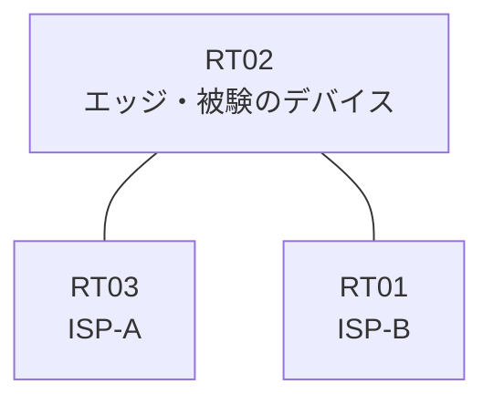

# 問題 20261007-015

> **本問は機器に接続せずに解答すること。追加の show 実行は認めない。**

## トポロジ

あなたは、ネットワークの運用を担当しています。あなたの会社のエッジのルータは、2つのアップリンクによって、2つのサービス プロバイダへ接続されている、というものです。顧客のネットワーク 192.168.85.0/24 および 192.168.155.0/24 は、それぞれのプロバイダを経由して、広告されています。



| 区間 | エッジ側インターフェイス | ネットワーク |
|------|--------------------------|--------------|
| RT02 ⇔ RT03（ISP-A） | Ethernet0/0 | 10.115.12.0/30 |
| RT02 ⇔ RT01（ISP-B） | Ethernet0/1 | 10.115.13.0/30 |

- 監視のためのホスト `192.168.155.20` および `192.168.155.160` は、ISP-B を経由して着信します。

## 要件

1. 着信のインターフェイスと一致しない送信元を持つところのトラフィックは、破棄される必要があります。
2. 管理のための構成に対して、変更が加えられてはなりません。
3. 監視のためのホストである 192.168.155.20 および 192.168.155.160 からの、正規のトラフィックが、破棄されてはなりません。
4. エッジのルータの両方のアップリンクのインターフェイスにおいて、送信元アドレスの検証が、有効にされていなければなりません。
5. 検証に対する例外は、当該のネットワークの単位で、アクセス・リストによって許可されなければなりません。

## 現在の状態

一部の通信が、意図されているとおりに動作していない、という報告があります。あなたは、提示されているところの情報のみを使用して、要求されている状態が満たされていない理由を、特定しなければなりません。

```
RT02# show access-lists
(出力なし)
```
```
RT02# show ip interface Ethernet0/1
Ethernet0/1 is up, line protocol is up
  Internet address is 10.115.13.1/30
  IP verify source reachable-via RX
   20 verification drops
   0 suppressed verification drops
```
```
RT02# show ip route | begin Gateway
Gateway of last resort is not set
      192.168.85.0/24 is subnetted, 1 subnets
O E2     192.168.85.0 [110/20] via 10.115.13.2, Ethernet0/1
      192.168.155.0/24 is subnetted, 1 subnets
O E2     192.168.155.0 [110/20] via 10.115.12.2, Ethernet0/0
```
```
RT02# show ip interface Ethernet0/0
Ethernet0/0 is up, line protocol is up
  Internet address is 10.115.12.1/30
  IP verify source reachable-via RX
   10 verification drops
   0 suppressed verification drops
```

## 設定抜粋

```
RT02# show running-config | section interface
interface Ethernet0/0
 ip address 10.115.12.1 255.255.255.252
 ip verify unicast source reachable-via rx
interface Ethernet0/1
 ip address 10.115.13.1 255.255.255.252
 ip verify unicast source reachable-via rx
```

## 設問

次のうち、正しいものは、どれですか。

## 選択肢
A. ISP-B 向けインターフェイスに検証の構成が適用されていない

B. ISP-B との間のルーティングの隣接関係が確立されていない

C. アクセス・リストが、インターフェイスの in 方向に適用されている

D. アクセス・リストにおいて許可されているホストが、対象のホストと異なっている

E. 検証の構成が参照しているアクセス・リストの番号と、定義されているアクセス・リストの番号とが一致していない

F. ISP-B 向けインターフェイスの検証モードが、非対称に広告されているネットワークに対して厳格すぎる
