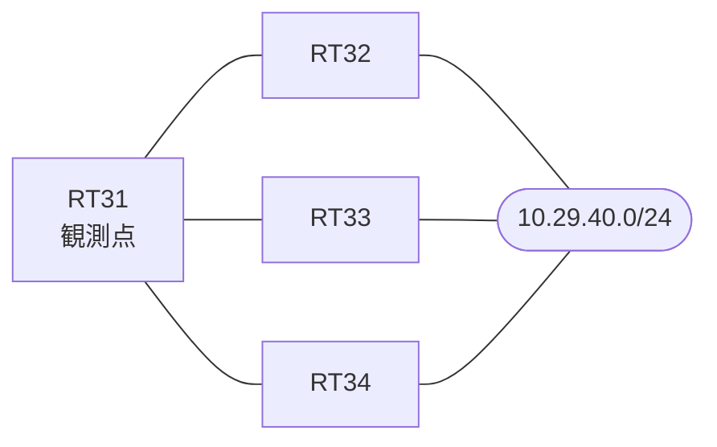

# 問題 20261007-016

> **本問は機器に接続せずに解答すること。追加の show 実行は認めない。**

## 設問

拠点のルーター RT31 は、複数の隣接するルーターを経由して、10.29.40.0/24 への経路を学習しています。ネットワークは単一の EIGRP のオートノマス・システム(200)として運用されており、そして、冗長なパスの活用が検討されています。インタフェースの IP アドレッシングは、変更されず、不等コストのロード・バランシングのために用いられる倍率は、示されている値を超えて拡大されないことが求められます。RT31 における 10.29.40.0/24 への転送のパスは、運用の設計の意図と一致している、かつ、既存の隣接関係は、維持される、かつ、構成の変更は、1 箇所に限られるという条件において、RT31 の EIGRP のプロセスに `variance 3` が構成された場合、10.29.40.0/24 に対して、ルーティング・テーブルに搭載される経路は、どれですか。(1つを選択してください)



| 対象 | 内容 |
|------|------|
| RT31 ⇔ RT32 | Ethernet0/0・10.205.2.0/24（RT31 側の delay = 100） |
| RT31 ⇔ RT33 | Ethernet0/1・10.205.3.0/24（RT31 側の delay = 3600） |
| RT31 ⇔ RT34 | Ethernet0/2・10.205.4.0/24（RT31 側の delay = 300） |
| 宛先 | 10.29.40.0/24（すべての隣接から到達可能） |

```
RT31# show ip eigrp topology all-links
EIGRP-IPv4 Topology Table for AS(200)/ID(44.0.0.1)
Codes: P - Passive, A - Active, U - Update, Q - Query, R - Reply,
       r - reply Status, s - sia Status 

P 10.205.2.0/24, 1 successors, FD is 281600, serno 2
        via Connected, Ethernet0/0
P 10.205.3.0/24, 1 successors, FD is 1177600, serno 3
        via Connected, Ethernet0/1
P 10.29.40.0/24, 1 successors, FD is 435200, serno 7, refcount 1
        via 10.205.2.2 (435200/409600), Ethernet0/0
        via 10.205.4.4 (486400/409600), Ethernet0/2
        via 10.205.3.3 (1331200/409600), Ethernet0/1
```
```
RT31# show running-config | section interface
interface Ethernet0/0
 description === to RT32 ===
 ip address 10.205.2.1 255.255.255.0
 delay 100
interface Ethernet0/1
 description === to RT33 ===
 ip address 10.205.3.1 255.255.255.0
 delay 3600
interface Ethernet0/2
 description === to RT34 ===
 ip address 10.205.4.1 255.255.255.0
 delay 300
```
```
RT31# show running-config | section router eigrp
router eigrp 200
 eigrp router-id 44.0.0.1
 network 10.205.0.0 0.0.255.255
 no auto-summary
```

## 選択肢

A. RT32(10.205.2.2)経由・RT34(10.205.4.4)経由・RT33(10.205.3.3)経由の 3 本が搭載される

B. RT34(10.205.4.4)経由の 1 本が搭載される

C. RT34(10.205.4.4)経由・RT33(10.205.3.3)経由の 2 本が搭載される

D. RT32(10.205.2.2)経由の 1 本が搭載される

E. RT32(10.205.2.2)経由・RT34(10.205.4.4)経由の 2 本が搭載される
