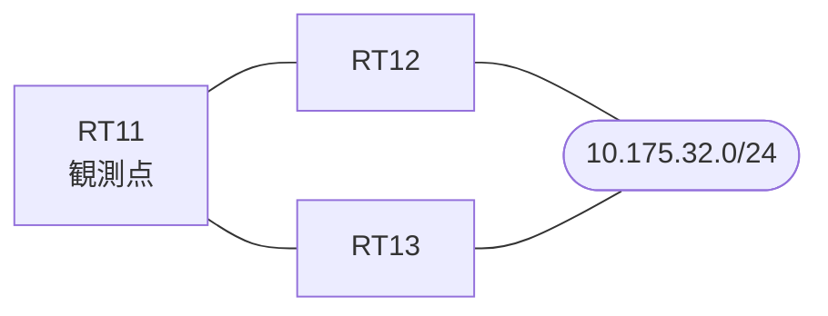

# 問題 20261008-001

> **本問は機器に接続せずに解答すること。追加の show 実行は認めない。**

## シナリオ

あなたは、ネットワークの運用を担当しています。拠点のルータ RT11 は、複数の隣接するルーターを経由して、10.175.32.0/24 への経路を学習しています。ネットワークは単一の OSPF のドメインとして運用されており、そして、RT11 は当該のプレフィックスを複数の経路によって受け取っています。経路の選好に関する挙動のレビューが、実施されています。管理のための構成に対して、変更が加えられてはなりません。エリアの構成は、変更されてはなりません。構成の変更は、1 箇所に限られなければなりません。RT11 における 10.175.32.0/24 への転送のパスは、運用の設計の意図と一致していなければなりません。既存の隣接関係は、維持されなければなりません。



| 対象 | 内容 |
|------|------|
| RT11 ⇔ RT12 | Ethernet0/0・10.248.2.0/24（RT11 側の OSPF のコスト = 30） |
| RT11 ⇔ RT13 | Ethernet0/1・10.248.3.0/24（RT11 側の OSPF のコスト = 50） |
| RT12 における 10.175.32.0/24 | 当該のプレフィックスを持つインタフェースは、エリア 0 に属し、その OSPF のコストは 200 |
| RT13 | エリア 0 と エリア 1 の境界のルータ（ABR）。エリア 1 側にも、同一のプレフィックスが存在する |

## 出力

```
RT11# show ip ospf database summary 10.175.32.0
OSPF Router with ID (1.1.1.1) (Process ID 1)

		Summary Net Link States (Area 0)

  LS age: 641
  Options: (No TOS-capability, DC, Upward)
  LS Type: Summary Links(Network)
  Link State ID: 10.175.32.0 (summary Network Number)
  Advertising Router: 3.3.3.3
  LS Seq Number: 80000009
  Checksum: 0xBD0C
  Length: 28
  Network Mask: /24
	MTID: 0 	Metric: 5
```
```
RT11# show ip ospf border-routers
OSPF Router with ID (1.1.1.1) (Process ID 1)


		Base Topology (MTID 0)

Internal Router Routing Table
Codes: i - Intra-area route, I - Inter-area route

i 3.3.3.3 [50] via 10.248.3.3, Ethernet0/1, ABR, Area 0, SPF 21
```
```
RT11# show running-config | section router ospf
router ospf 1
 router-id 1.1.1.1
 network 10.248.2.0 0.0.0.255 area 0
 network 10.248.3.0 0.0.0.255 area 0
```
```
RT11# show running-config | section interface
interface Ethernet0/0
 description === to RT12 ===
 ip address 10.248.2.1 255.255.255.0
 ip ospf cost 30
interface Ethernet0/1
 description === to RT13 ===
 ip address 10.248.3.1 255.255.255.0
 ip ospf cost 50
```

## 設問

RT11 のルーティング・テーブルに、10.175.32.0/24 の経路として搭載されるものは、どれですか。(1つを選択してください)

## 選択肢
A. RT13(10.248.3.3)経由が、メトリック 5 で、ルーティング・テーブルに搭載される

B. いずれの経路も搭載されず、10.175.32.0/24 はルーティング・テーブルに現れない

C. RT12(10.248.2.2)経由とRT13(10.248.3.3)経由の両方が、等コストのパスとして搭載される

D. RT13(10.248.3.3)経由が、メトリック 55 で、ルーティング・テーブルに搭載される

E. RT12(10.248.2.2)経由が、メトリック 230 で、ルーティング・テーブルに搭載される
