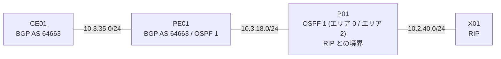

# 問題 20261008-002

> **本問は機器に接続せずに解答すること。追加の show 実行は認めない。**

## トポロジ

あなたは、下記のネットワークの保守を担当する技術者です。CE01 と PE01 は同一の AS(64663)に属し、iBGP でピアリングしています。PE01 は OSPF 1 にも参加し、P01 を経由して、エリア 2 および RIP のドメインへ接続しています。



## 要件

1. CE01 は、P01 配下のすべてのネットワーク(エリア内・エリア間・外部のいずれも)を、BGP によって学習しなければなりません。
2. 変更は PE01 の BGP の構成においてのみ行われ、OSPF 側の構成が変更されてはなりません。
3. BGP のピアリングの構成が変更されてはなりません。

## 現在の状態

ユーザーから、通信に関する事象が、報告されています。あなたは、提示されているところの情報のみを使用して、要求されている状態が満たされていない理由を、特定しなければなりません。

```
CE01# show ip bgp
BGP table version is 7, local router ID is 10.3.35.1
Status codes: s suppressed, d damped, h history, * valid, > best, i - internal, 
              r RIB-failure, S Stale, m multipath, b backup-path, f RT-Filter, 
              x best-external, a additional-path, c RIB-compressed, 
Origin codes: i - IGP, e - EGP, ? - incomplete

     Network          Next Hop            Metric LocPrf Weight Path
 *>i  10.3.18.0        10.3.35.2                0    100      0 ?
 *>i  10.1.96.0        10.3.18.3               21    100      0 ?
 *>i  10.3.85.0        10.3.18.3               31    100      0 ?
```
```
PE01# show ip route ospf
Gateway of last resort is not set

O     10.1.96.0/24 [110/21] via 10.3.18.3, 00:41:12, Ethernet0/1
O IA  10.3.85.0/24 [110/31] via 10.3.18.3, 00:38:04, Ethernet0/1
O E1  10.2.62.0/24 [110/51] via 10.3.18.3, 00:12:37, Ethernet0/1
O E2  10.2.108.0/24 [110/20] via 10.3.18.3, 00:12:37, Ethernet0/1
```
```
PE01# show running-config | section router
router ospf 1
 router-id 10.3.18.2
 network 10.3.18.0 0.0.0.255 area 0
!
router bgp 64663
 bgp log-neighbor-changes
 no bgp default ipv4-unicast
 neighbor 10.3.35.1 remote-as 64663
 !
 address-family ipv4
  redistribute ospf 1
  neighbor 10.3.35.1 activate
 exit-address-family
```

## 設問

次のうち、正しいものは、どれですか。

## 選択肢
**A.**
```
redistribute ospf 1 match internal
```

**B.**
```
redistribute ospf 1 match external 1 external 2
```

**C.**
```
redistribute ospf 1 match internal external 2
```

**D.**
```
redistribute ospf 1 match external 2
```
