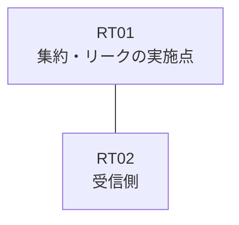

# 問題 20261008-009

> **本問は機器に接続せずに解答すること。追加の show 実行は認めない。**

## 設問

拠点のルータ RT01 は、複数のループバック インターフェイスによって、サービスのためのアドレスのブロック 192.168.22.8/29 を収容しています。RT01 と RT02 は、1本のリンクによって直接に接続されており、そして、EIGRP 100 が構成されています。監視のためのホストである 192.168.22.10 (/32) の明細のルートは、集約とともに、受信される、そして、RT02 に対して、ブロック 192.168.22.8/29 は、集約のルートとして広告される、そして、運用のためのループバック 10.241.234.69 (/32) は、引き続き受信されるという条件において、下記の項目から、正しいものを選択しなさい。ブロックの内部の明細のルートは、広告されず、インターフェイスにおける集約の構成は、過去の障害の経緯という理由により、認められておらず、インタフェースの IP アドレッシングは、変更されないものとします。



| 対象 | 内容 |
|------|------|
| RT01 のループバック | 192.168.22.9, 192.168.22.10, 192.168.22.11 |
| RT01 の運用系ループバック | 10.241.234.69 |
| RT01 ⇔ RT02 のリンク | 10.163.211.0/24（RT01=10.163.211.1 / RT02=10.163.211.2・GigabitEthernet0/1） |

```
RT01# show running-config
Building configuration...
!
interface Loopback0
 ip address 192.168.22.9 255.255.255.255
interface Loopback1
 ip address 192.168.22.10 255.255.255.255
interface Loopback2
 ip address 192.168.22.11 255.255.255.255
interface Loopback10
 ip address 10.241.234.69 255.255.255.255
interface GigabitEthernet0/1
 description === to RT02 ===
 ip address 10.163.211.1 255.255.255.252
 ip summary-address eigrp 100 192.168.22.8 255.255.255.248
!
router eigrp 100
 network 192.168.22.9 0.0.0.0
 network 192.168.22.10 0.0.0.0
 network 192.168.22.11 0.0.0.0
 network 10.241.234.69 0.0.0.0
 network 10.163.211.0 0.0.0.3
!
ip prefix-list PL-MON seq 5 permit 192.168.22.8/29 le 32
ip prefix-list PL01 seq 5 permit 192.168.22.10/32
access-list 15 permit 192.168.22.10
!
route-map LEAK permit 10
 match ip address 15
route-map RMAP01 permit 10
 match ip address prefix-list PL-MON
!
```
```
RT02# show ip route eigrp | begin Gateway
Gateway of last resort is not set
      10.0.0.0/32 is subnetted, 1 subnets
D        10.241.234.69 [90/409600] via 10.163.211.1, 00:17:10, GigabitEthernet0/1
      192.168.22.0/29 is subnetted, 1 subnets
D        192.168.22.8 [90/409600] via 10.163.211.1, 00:17:10, GigabitEthernet0/1
```

## 選択肢

A. ルート・マップの match において、プレフィックス・リストではなく標準のアクセス・リストが使用されている

B. ルート・マップが参照しているところの名前のリストが、定義されていない

C. ルート・マップの permit のエントリに、match のステートメントが存在しない

D. EIGRP の auto-summary が有効にされており、明細の広告に影響している

E. 再配布が参照しているところのリストにおいて、対象のループバックのアドレスが許可されていない

F. 集約の構成において、leak-map のパラメータが指定されていない
