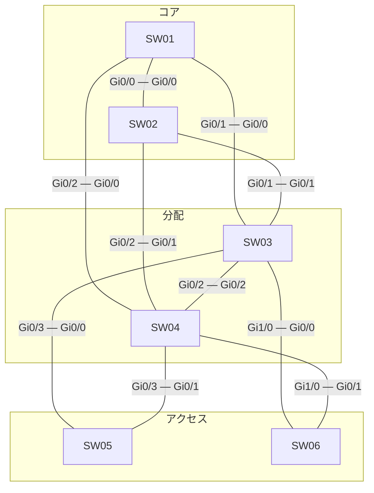

# 問題 20261008-016

> **本問は機器に接続せずに解答すること。追加の show 実行は認めない。**

## シナリオ



| スイッチ | インタフェース(ポート番号) | 対向スイッチ | 対向インタフェース(ポート番号) |
|---|---|---|---|
| SW01 | Gi0/0(1) | SW02 | Gi0/0(1) |
| SW01 | Gi0/1(2) | SW03 | Gi0/0(1) |
| SW01 | Gi0/2(3) | SW04 | Gi0/0(1) |
| SW02 | Gi0/1(2) | SW03 | Gi0/1(2) |
| SW02 | Gi0/2(3) | SW04 | Gi0/1(2) |
| SW03 | Gi0/2(3) | SW04 | Gi0/2(3) |
| SW03 | Gi0/3(4) | SW05 | Gi0/0(1) |
| SW03 | Gi1/0(5) | SW06 | Gi0/0(1) |
| SW04 | Gi0/3(4) | SW05 | Gi0/1(2) |
| SW04 | Gi1/0(5) | SW06 | Gi0/1(2) |

| スイッチ | 役割 | ブリッジ プライオリティ(VLAN 30) | ブリッジ プライオリティ(VLAN 110) | MAC アドレス |
|---|---|---|---|---|
| SW01 | コア CR1 | 36864 | 36864 | a0cf.5b12.a21f |
| SW02 | コア CR2 | 24576 | 24576 | 0023.04a1.8e39 |
| SW03 | 分配 DS1 | 32768 | 32768 | 0019.e8f3.5426 |
| SW04 | 分配 DS2 | 28672 | 28672 | 0019.e8a0.68f4 |
| SW05 | アクセス AS1 | 36864 | 36864 | a0cf.5b7f.f7c9 |
| SW06 | アクセス AS2 | 32768 | 32768 | 001a.a1eb.5881 |

全スイッチで Rapid PVST+ を使用し、パス コストはショート方式にそろえています。スイッチ間のリンクはすべて 1 Gbps・全二重のトランクで、VLAN 30・VLAN 110 を通します。ポート ID はポート プライオリティ(既定 128)とポート番号で構成します。

SW03・SW04 は VLAN 30・VLAN 110 の SVI を持ち、HSRP で既定ゲートウェイを冗長化しています。コアは L2 の中継だけを行います。アクセスのスイッチはルーティングしません。

```
SW03(config)# ip routing
SW03(config)# interface Vlan30
SW03(config-if)# ip address 10.107.30.3 255.255.255.0
SW03(config-if)# standby version 2
SW03(config-if)# standby 30 ip 10.107.30.254
SW03(config)# interface Vlan110
SW03(config-if)# ip address 10.107.110.3 255.255.255.0
SW03(config-if)# standby version 2
SW03(config-if)# standby 110 ip 10.107.110.254
SW03(config-if)# standby 110 priority 110
SW03(config-if)# standby 110 preempt
```

```
SW04(config)# ip routing
SW04(config)# interface Vlan30
SW04(config-if)# ip address 10.107.30.4 255.255.255.0
SW04(config-if)# standby version 2
SW04(config-if)# standby 30 ip 10.107.30.254
SW04(config)# interface Vlan110
SW04(config-if)# ip address 10.107.110.4 255.255.255.0
SW04(config-if)# standby version 2
SW04(config-if)# standby 110 ip 10.107.110.254
SW04(config-if)# standby 110 preempt
```

| 端末 | VLAN | 接続先 | IP アドレス | 既定ゲートウェイ |
|---|---|---|---|---|
| PC-A | 30 | SW05 | 10.107.30.101/24 | 10.107.30.254 |
| PC-B | 110 | SW06 | 10.107.110.102/24 | 10.107.110.254 |

SW03・SW04 は同時に起動し、その後は構成の変更も障害もありません。
ARP と MAC アドレスの学習は完了しているものとします。

## 設問

PC-A から PC-B へ ping を 1 回実行します。エコー要求(往路)とエコー応答(復路)が通るスイッチを、PC 側のアクセス スイッチから順に選んでください。同じスイッチを 2 回通るときはその都度記入し、経路が終わったら残りの欄は「—(ここで終わり)」を選びます。あわせて、往路と復路をそれぞれルーティングする機器を選んでください。**①〜⑱ のすべてを正しく選んだ場合にのみ得点**になります。

### 解答の表

| 項目 | 1 | 2 | 3 | 4 | 5 | 6 | 7 | 8 |
|---|---|---|---|---|---|---|---|---|
| 往路 | ［①］ | ［②］ | ［③］ | ［④］ | ［⑤］ | ［⑥］ | ［⑦］ | ［⑧］ |
| 復路 | ［⑨］ | ［⑩］ | ［⑪］ | ［⑫］ | ［⑬］ | ［⑭］ | ［⑮］ | ［⑯］ |

| 項目 | 選択 |
|---|---|
| 往路でルーティングする機器 | ［⑰］ |
| 復路でルーティングする機器 | ［⑱］ |

## 選択肢

A. SW01

B. SW02

C. SW03

D. SW04

E. SW05

F. SW06

G. —(ここで終わり)
