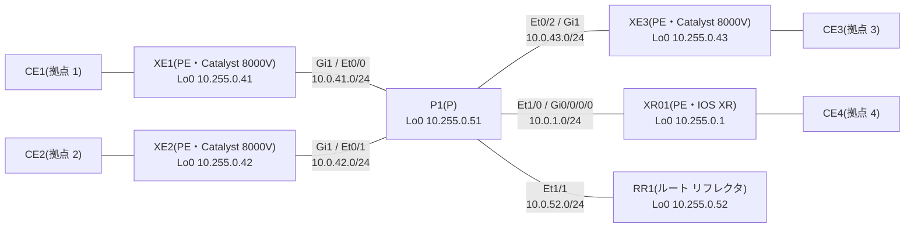

# 問題 20261107-001

> **本問は機器に接続せずに解答すること。追加の show 実行は認めない。**

## シナリオ



コア(PE 4 台・P1・RR1)は AS 65000 で、IS-IS と LDP が動いています。RR1 は VPNv4 と L2VPN EVPN の BGP のルート リフレクタで、各 PE は RR1 とだけ iBGP を張ります。P1 は BGP を持ちません。CE は PE との 1 本のリンクの上に、VLAN でサービスを分けて載せています(PE の CE 側は XE が Gi2、XR01 が Gi0/0/0/1)。

| VLAN | サービス | つなぐ拠点 |
|---|---|---|
| 100 | L3VPN(VRF A・拠点の LAN は 10.100.<拠点>.0/24) | 1、2、4 |
| 130 | VPWS(LDP の疑似回線・pw-id 130) | 1 ⇔ 4 |
| 140 | VPWS(EVPN-VPWS・EVI 140) | 2 ⇔ 3 |
| 200 | EVPN の E-LAN(EVI 200・ブリッジ ドメイン 200) | 1、2、3 |
| 210 | VPLS(VFI VPLS210・ブリッジ ドメイン 210) | 1、2、3 |

CE の MAC アドレスは、CE1 が aabb.cc00.8b00、CE2 が aabb.cc00.8c00、CE3 が aabb.cc00.8d00 です。

CE2 から CE3(192.168.140.3)へ EVPN-VPWS の上で ping を送ります。このとき、次の出力を得ました(一部を省略しています)。

```
XE2#show l2vpn evpn vpws vc id 140 detail
EVPN name: CE2-CE3, state: up, type: point-to-point
  EVPN ID: 140
  VPWS Service Instance ID: Source 2, Target 3
  Labels: Local 26, Remote 25
  Next Hop Address: 10.255.0.43
  Associated member interface Gi2 up, Gi2:140 status is up
```

```
XE2#show mpls forwarding-table
Local      Outgoing   Prefix           Bytes Label   Outgoing   Next Hop
Label      Label      or Tunnel Id     Switched      interface
16         Pop Label  10.255.0.51/32   0             Gi1        10.0.42.51
17         Pop Label  10.0.1.0/24      0             Gi1        10.0.42.51
18         Pop Label  10.0.41.0/24     0             Gi1        10.0.42.51
19         Pop Label  10.0.43.0/24     0             Gi1        10.0.42.51
20         Pop Label  10.0.52.0/24     0             Gi1        10.0.42.51
21         16         10.255.0.52/32   0             Gi1        10.0.42.51
22         17         10.255.0.41/32   0             Gi1        10.0.42.51
23         19         10.255.0.43/32   0             Gi1        10.0.42.51
24         20         10.255.0.1/32    0             Gi1        10.0.42.51
25         No Label   10.100.2.0/24[V] 826           Gi2.100    172.16.2.1
26         No Label   l2ckt(1)         646           Gi2        point2point
27         No Label   l2ckt(2)         708           none       point2point
28         No Label   l2ckt(3)         0             none       point2point
29         No Label   evpn(mc:bd 200)  120           none       point2point
30         No Label   evpn(uc:bd 200)  456           none       point2point
```

```
P1#show mpls forwarding-table
Local      Outgoing   Prefix           Bytes Label   Outgoing   Next Hop
Label      Label      or Tunnel Id     Switched      interface
16         No Label   10.255.0.52/32   18630         Et1/1      10.0.52.52
17         Pop Label  10.255.0.41/32   14277         Et0/0      10.0.41.41
18         Pop Label  10.255.0.42/32   7446          Et0/1      10.0.42.42
19         Pop Label  10.255.0.43/32   6858          Et0/2      10.0.43.43
20         Pop Label  10.255.0.1/32    5610          Et1/0      10.0.1.1
```

## 設問

エコー要求が P1 から XE3 への線の上を運ばれるとき、付いている MPLS のラベルとして正しいものは、次のうちどれですか。ラベルは外側(先頭)から順に、左から書いています。(1つを選択してください)

## 選択肢

A. `25`

B. `0 | 25`

C. ラベルなし(イーサネット フレームのまま)

D. `19 | 25`
