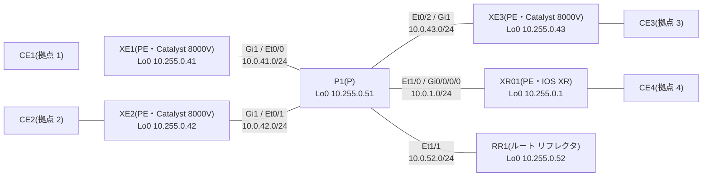

# 問題 20261107-005

> **本問は機器に接続せずに解答すること。追加の show 実行は認めない。**

## シナリオ



コア(PE 4 台・P1・RR1)は AS 65000 で、IS-IS と LDP が動いています。RR1 は VPNv4 と L2VPN EVPN の BGP のルート リフレクタで、各 PE は RR1 とだけ iBGP を張ります。P1 は BGP を持ちません。CE は PE との 1 本のリンクの上に、VLAN でサービスを分けて載せています(PE の CE 側は XE が Gi2、XR01 が Gi0/0/0/1)。

| VLAN | サービス | つなぐ拠点 |
|---|---|---|
| 100 | L3VPN(VRF A・拠点の LAN は 10.100.<拠点>.0/24) | 1、2、4 |
| 130 | VPWS(LDP の疑似回線・pw-id 130) | 1 ⇔ 4 |
| 140 | VPWS(EVPN-VPWS・EVI 140) | 2 ⇔ 3 |
| 200 | EVPN の E-LAN(EVI 200・ブリッジ ドメイン 200) | 1、2、3 |
| 210 | VPLS(VFI VPLS210・ブリッジ ドメイン 210) | 1、2、3 |

CE の MAC アドレスは、CE1 が aabb.cc00.8b00、CE2 が aabb.cc00.8c00、CE3 が aabb.cc00.8d00 です。

XE1 で次の出力を得ました。

```
XE1#show mpls forwarding-table
Local      Outgoing   Prefix           Bytes Label   Outgoing   Next Hop
Label      Label      or Tunnel Id     Switched      interface
16         Pop Label  10.255.0.51/32   0             Gi1        10.0.41.51
17         Pop Label  10.0.1.0/24      0             Gi1        10.0.41.51
18         Pop Label  10.0.42.0/24     0             Gi1        10.0.41.51
19         Pop Label  10.0.43.0/24     0             Gi1        10.0.41.51
20         Pop Label  10.0.52.0/24     0             Gi1        10.0.41.51
21         16         10.255.0.52/32   0             Gi1        10.0.41.51
22         18         10.255.0.42/32   0             Gi1        10.0.41.51
23         19         10.255.0.43/32   0             Gi1        10.0.41.51
24         20         10.255.0.1/32    0             Gi1        10.0.41.51
25         No Label   10.100.1.0/24[V] 2080          Gi2.100    172.16.1.1
26         No Label   l2ckt(1)         606           Gi2        point2point
27         No Label   l2ckt(2)         626           none       point2point
28         No Label   l2ckt(3)         626           none       point2point
29         No Label   evpn(mc:bd 200)  60            none       point2point
30         No Label   evpn(uc:bd 200)  972           none       point2point
```

```
XE1#show l2vpn atom vc
                                       Service
Interface Peer ID         VC ID      Type   Name                     Status
--------- --------------- ---------- ------ ------------------------ ----------
pw100001  10.255.0.1      130        p2p    CE1-CE4                  UP
pw100003  10.255.0.42     210        vfi    VPLS210                  UP
pw100004  10.255.0.43     210        vfi    VPLS210                  UP
```

## 設問

XE1 に、先頭に①〜④のラベルが付いたパケットが届きました。XE1 がそれぞれをどう扱うかを、A〜D から選んでください。

### 対応させる項目

| # | 先頭のラベル |
|---|------|
| ① | 16 |
| ② | 22 |
| ③ | 25 |
| ④ | 29 |

## 選択肢

A. VRF A の拠点 1 の LAN 宛て。ラベルを外し、IP パケットとして Gi2.100 から CE1 へ送る。

B. P1 のループバック宛て。ラベルを外して P1 へ送る。

C. EVPN(EVI 200)で届いたブロードキャストや宛先不明のフレーム。ブリッジ ドメイン 200 で CE1 側へ流す。

D. XE2 のループバック宛て。ラベルを 18 に付け替えて P1 へ送る。
