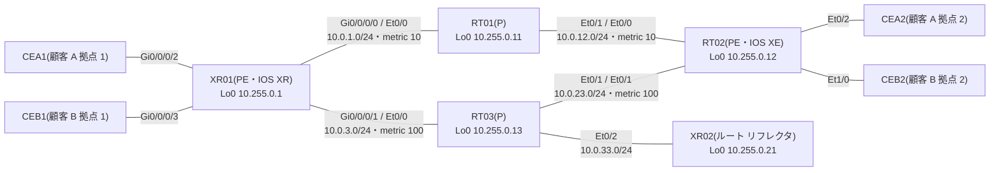

# 問題 20261107-006

> **本問は機器に接続せずに解答すること。追加の show 実行は認めない。**

## シナリオ



コアは AS 65000 で、IS-IS(メトリックは図のとおり)と LDP が動いています。XR02 は VPNv4 のルート リフレクタで、XR01 と RT02 は XR02 とだけ VPNv4 のセッションを張ります。RT01 と RT03 は BGP を持ちません。

| 拠点 | つながる PE | VRF | LAN |
|---|---|---|---|
| 顧客 A 拠点 1(CEA1) | XR01 Gi0/0/0/2 | CUST-A | 10.101.1.0/24(公開セグメント 198.51.100.0/25) |
| 顧客 A 拠点 2(CEA2) | RT02 Et0/2 | CUST-A | 10.101.2.0/24(公開セグメント 198.51.100.128/25) |
| 顧客 B 拠点 1(CEB1) | XR01 Gi0/0/0/3 | CUST-B | 10.102.1.0/24 |
| 顧客 B 拠点 2(CEB2) | RT02 Et1/0 | CUST-B | 10.102.2.0/24 |

XR01 には、共有サービスのサーバ(VRF SVC・Gi0/0/0/4)とインターネット(グローバル テーブル)もつながっています。

CEB1 から CEB2(10.102.2.1)へ L3VPN の上で ping を送ります。このとき、次の出力を得ました(一部を省略しています)。

```
RT02#show ip bgp vpnv4 all labels
   Network          Next Hop      In label/Out label
Route Distinguisher: 10.255.0.1:101
   0.0.0.0          10.255.0.1      nolabel/24009
   10.101.1.0/24    10.255.0.1      nolabel/24004
   198.51.100.0/25  10.255.0.1      nolabel/24005
Route Distinguisher: 10.255.0.1:102
   10.102.1.0/24    10.255.0.1      nolabel/24006
Route Distinguisher: 10.255.0.1:900
   10.99.1.0/24     10.255.0.1      nolabel/24007
Route Distinguisher: 10.255.0.12:101 (CUST-A)
   0.0.0.0          10.255.0.1      nolabel/24009
   10.99.1.0/24     10.255.0.1      nolabel/24007
   10.101.1.0/24    10.255.0.1      nolabel/24004
   10.101.2.0/24    172.16.12.2     22/nolabel
   198.51.100.0/25  10.255.0.1      nolabel/24005
   198.51.100.128/25
                   172.16.12.2     23/nolabel
Route Distinguisher: 10.255.0.12:102 (CUST-B)
   10.99.1.0/24     10.255.0.1      nolabel/24007
   10.102.1.0/24    10.255.0.1      nolabel/24006
   10.102.2.0/24    172.16.22.2     24/nolabel
```

```
RT02#show mpls forwarding-table
Local      Outgoing   Prefix           Bytes Label   Outgoing   Next Hop
Label      Label      or Tunnel Id     Switched      interface
16         Pop Label  10.255.0.13/32   0             Et0/1      10.0.23.13
17         19         10.0.3.0/24      0             Et0/0      10.0.12.11
18         Pop Label  10.0.33.0/24     0             Et0/1      10.0.23.13
19         Pop Label  10.255.0.11/32   0             Et0/0      10.0.12.11
20         Pop Label  10.0.1.0/24      0             Et0/0      10.0.12.11
21         20         10.255.0.21/32   0             Et0/1      10.0.23.13
22         No Label   10.101.2.0/24[V] 5230          Et0/2      172.16.12.2
23         No Label   198.51.100.128/25[V]   \
                                       2280          Et0/2      172.16.12.2
24         No Label   10.102.2.0/24[V] 4788          Et1/0      172.16.22.2
25         22         10.255.0.1/32    0             Et0/0      10.0.12.11
```

```
RT01#show mpls forwarding-table
Local      Outgoing   Prefix           Bytes Label   Outgoing   Next Hop
Label      Label      or Tunnel Id     Switched      interface
16         Pop Label  10.255.0.12/32   12438         Et0/1      10.0.12.12
17         Pop Label  10.0.23.0/24     0             Et0/1      10.0.12.12
18         24001      10.255.0.13/32   0             Et0/0      10.0.1.1
           16         10.255.0.13/32   0             Et0/1      10.0.12.12
19         No Label   10.0.3.0/24      0             Et0/0      10.0.1.1
20         18         10.0.33.0/24     0             Et0/1      10.0.12.12
           No Label   10.0.33.0/24     0             Et0/0      10.0.1.1
21         24000      10.255.0.21/32   0             Et0/0      10.0.1.1
           21         10.255.0.21/32   0             Et0/1      10.0.12.12
22         explicit-n 10.255.0.1/32    13260         Et0/0      10.0.1.1
```

## 設問

エコー応答が RT02 から RT01 への線の上を運ばれるとき、付いている MPLS のラベルとして正しいものは、次のうちどれですか。ラベルは外側(先頭)から順に、左から書いています。(1つを選択してください)

## 選択肢

A. `25 | 24006`

B. `22 | 24006`

C. `22 | 24`

D. `19 | 24006`
