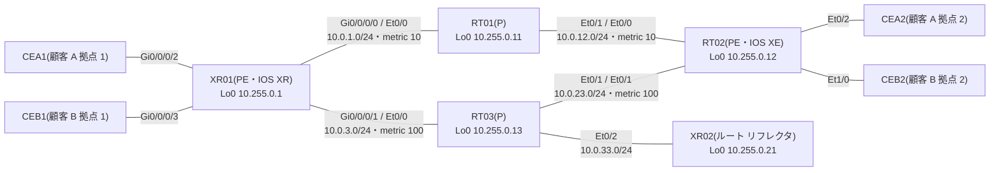

# 問題 20261107-009

> **本問は機器に接続せずに解答すること。追加の show 実行は認めない。**

## シナリオ



コアは AS 65000 で、IS-IS(メトリックは図のとおり)と LDP が動いています。XR02 は VPNv4 のルート リフレクタで、XR01 と RT02 は XR02 とだけ VPNv4 のセッションを張ります。RT01 と RT03 は BGP を持ちません。

| 拠点 | つながる PE | VRF | LAN |
|---|---|---|---|
| 顧客 A 拠点 1(CEA1) | XR01 Gi0/0/0/2 | CUST-A | 10.101.1.0/24(公開セグメント 198.51.100.0/25) |
| 顧客 A 拠点 2(CEA2) | RT02 Et0/2 | CUST-A | 10.101.2.0/24(公開セグメント 198.51.100.128/25) |
| 顧客 B 拠点 1(CEB1) | XR01 Gi0/0/0/3 | CUST-B | 10.102.1.0/24 |
| 顧客 B 拠点 2(CEB2) | RT02 Et1/0 | CUST-B | 10.102.2.0/24 |

XR01 には、共有サービスのサーバ(VRF SVC・Gi0/0/0/4)とインターネット(グローバル テーブル)もつながっています。

XR01 で次の出力を得ました。

```
RP/0/RP0/CPU0:XR01#show mpls forwarding
Local  Outgoing    Prefix             Outgoing     Next Hop        Bytes
Label  Label       or ID              Interface                    Switched
------ ----------- ------------------ ------------ --------------- ------------
24000  20          10.255.0.21/32     Gi0/0/0/1    10.0.3.13       1854
24001  Pop         10.255.0.13/32     Gi0/0/0/1    10.0.3.13       580
24002  16          10.255.0.12/32     Gi0/0/0/0    10.0.1.11       10528
24003  Pop         10.255.0.11/32     Gi0/0/0/0    10.0.1.11       402
24004  Unlabelled  10.101.1.0/24[V]   Gi0/0/0/2    172.16.11.2     0
24005  Unlabelled  198.51.100.0/25[V] Gi0/0/0/2    172.16.11.2     0
24006  Unlabelled  10.102.1.0/24[V]   Gi0/0/0/3    172.16.21.2     0
24007  Unlabelled  10.99.1.0/24[V]    Gi0/0/0/4    172.16.91.2     500
24008  Unlabelled  10.99.2.0/24[V]    Gi0/0/0/4    172.16.91.2     0
24009  Aggregate   CUST-A: Per-VRF Aggr[V]   \
                                      CUST-A                       2000
```

## 設問

XR01 に、先頭に①〜④のラベルが付いたパケットが届きました。XR01 がそれぞれをどう扱うかを、A〜D から選んでください。

### 対応させる項目

| # | 先頭のラベル |
|---|------|
| ① | 24006 |
| ② | 24009 |
| ③ | 24007 |
| ④ | 24004 |

## 選択肢

A. 共有サービスのサーバ(10.99.1.0/24)宛て。ラベルを外し、IP パケットとして SVC へ送る。

B. ラベルを外し、VRF CUST-A の表で宛先を引き直してから送る。

C. 顧客 B の拠点 1 の LAN 宛て。ラベルを外し、IP パケットとして CEB1 へ送る。

D. 顧客 A の拠点 1 の LAN 宛て。ラベルを外し、IP パケットとして CEA1 へ送る。
