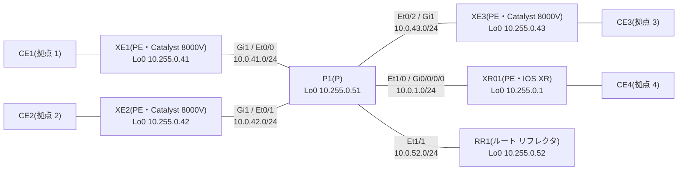

# 問題 20261107-010

> **本問は機器に接続せずに解答すること。追加の show 実行は認めない。**

## シナリオ

コア(PE 4 台・P1・RR1)は AS 65000 で、IS-IS と LDP が動いています。RR1 は VPNv4 と L2VPN EVPN の BGP のルート リフレクタで、各 PE は RR1 とだけ iBGP を張ります。P1 は BGP を持ちません。CE は PE との 1 本のリンクの上に、VLAN でサービスを分けて載せています(PE の CE 側は XE が Gi2、XR01 が Gi0/0/0/1)。

| VLAN | サービス | つなぐ拠点 |
|---|---|---|
| 100 | L3VPN(VRF A・拠点の LAN は 10.100.<拠点>.0/24) | 1、2、4 |
| 130 | VPWS(LDP の疑似回線・pw-id 130) | 1 ⇔ 4 |
| 140 | VPWS(EVPN-VPWS・EVI 140) | 2 ⇔ 3 |
| 200 | EVPN の E-LAN(EVI 200・ブリッジ ドメイン 200) | 1、2、3 |
| 210 | VPLS(VFI VPLS210・ブリッジ ドメイン 210) | 1、2、3 |

CE の MAC アドレスは、CE1 が aabb.cc00.8b00、CE2 が aabb.cc00.8c00、CE3 が aabb.cc00.8d00 です。

CE1 から CE2(10.100.2.1)へ L3VPN の上で ping を送り、XE1 と P1 の間の線でエコー要求を捕まえると、ラベルは外側から順に `18 | 25` でした。

## 設問

この 2 つのラベルについて、正しく述べられているものは、次のうちどれですか。(1つを選択してください)

## 選択肢

A. RR1 は、この経路を反射するときに内側のラベルを自分の決めた番号に付け替えた。

B. 外側の 18 は XE2 が割り当てた番号である。

C. 内側の 25 は XE1 が割り当てた番号である。

D. RR1 は、この経路を反射するときにネクスト ホップも内側のラベルも変えない。
