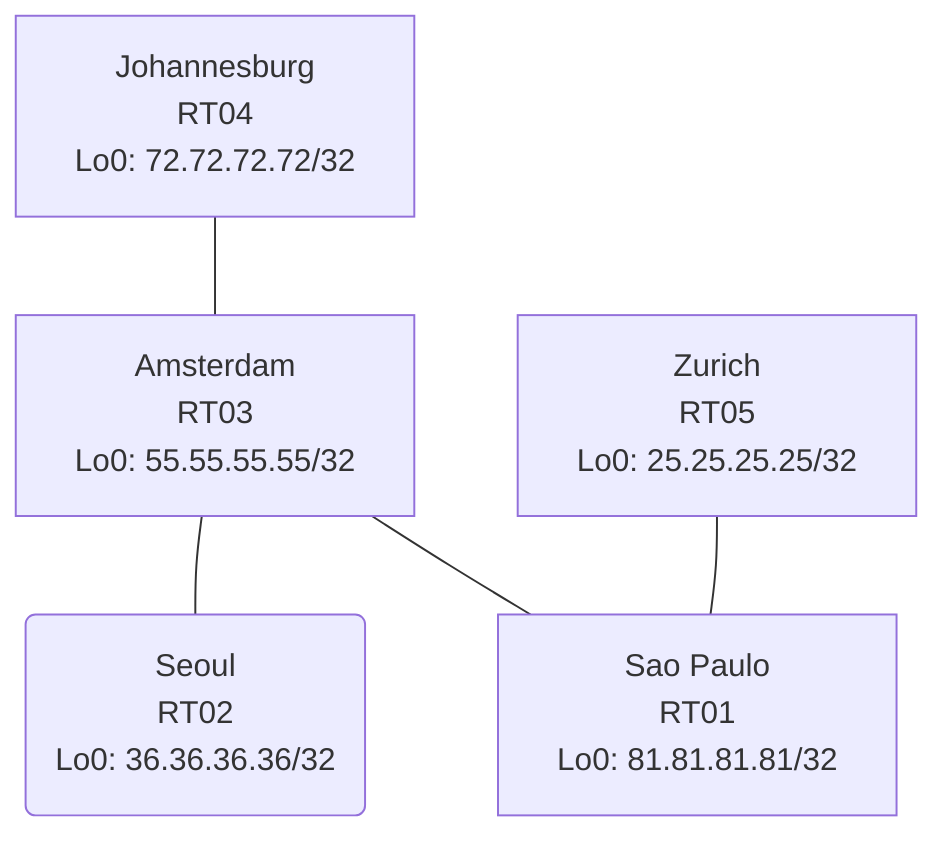

# Question 20261007-009

> **Answer this question without connecting to any device. No additional show commands may be run.**

## Topology

You are in charge of network operations. Your company's network consists of multiple routing domains connected by border routers, and reachability is provided to all sites. The details of the routing design are expected to be inferred from the configuration shown. The correspondence between the router at each site and the network of the site is shown in the table below.



| Site | Router | Site Network |
|------|--------|----------------------|
| Amsterdam | RT03 | `55.55.55.55/32` |
| Sao Paulo | RT01 | `81.81.81.81/32` |
| Seoul | RT02 | `36.36.36.36/32` |
| Zurich | RT05 | `25.25.25.25/32` |
| Johannesburg | RT04 | `72.72.72.72/32` |

Links:
```
  RT03:E0/0(.1) ── RT01:E0/0(.2)   10.225.111.0/30
  RT03:E0/1(.1) ── RT02:E0/0(.2)   10.209.50.0/30
  RT03:E0/2(.1) ── RT04:E0/0(.2)   10.20.223.0/30
  RT01:E0/1(.1) ── RT05:E0/0(.2)   10.73.102.0/30
```

## Requirements

1. Do not use static routes or default routes as a workaround.
2. Do not apply a filter to route redistribution.
3. The routing protocol types and the process placement must not be changed.
4. The process IDs / AS numbers referenced by redistribute must match those of the adjacent domains that actually exist at that border, and references to nonexistent processes must not be left in place.
5. The network of each site should be reachable from all sites across domains.
6. The initial EIGRP metric must be consolidated to default-metric `1000000 100 255 1 1500`.

## Current State

It has been reported that some communication is not working as intended. Based on the output and configuration shown, determine why the required behavior is not being obtained.

```
RT01# show ip route
Gateway of last resort is not set
      10.0.0.0/8 is variably subnetted, 6 subnets, 2 masks
D        10.20.223.0/30 [90/307200] via 10.225.111.1, 00:05:13, Ethernet0/0
C        10.73.102.0/30 is directly connected, Ethernet0/1
L        10.73.102.1/32 is directly connected, Ethernet0/1
D EX     10.209.50.0/30 [170/307200] via 10.225.111.1, 00:05:13, Ethernet0/0
C        10.225.111.0/30 is directly connected, Ethernet0/0
L        10.225.111.2/32 is directly connected, Ethernet0/0
      25.0.0.0/32 is subnetted, 1 subnets
D        25.25.25.25 [90/409600] via 10.73.102.2, 00:04:56, Ethernet0/1
      36.0.0.0/32 is subnetted, 1 subnets
D EX     36.36.36.36 [170/435200] via 10.225.111.1, 00:05:05, Ethernet0/0
      55.0.0.0/32 is subnetted, 1 subnets
D        55.55.55.55 [90/409600] via 10.225.111.1, 00:05:13, Ethernet0/0
      72.0.0.0/32 is subnetted, 1 subnets
D        72.72.72.72 [90/435200] via 10.225.111.1, 00:05:04, Ethernet0/0
      81.0.0.0/32 is subnetted, 1 subnets
C        81.81.81.81 is directly connected, Loopback0
```
```
RT03# show access-lists
Standard IP access list 14
    10 deny   25.25.25.25
    20 permit any
Standard IP access list 22
    10 deny   55.55.55.55
    20 permit any
Standard IP access list SVC
    10 permit 81.81.81.81 (1 match)
```
```
RT05# show ip route
Gateway of last resort is not set
      10.0.0.0/8 is variably subnetted, 5 subnets, 2 masks
D        10.20.223.0/30 [90/332800] via 10.73.102.1, 00:04:42, Ethernet0/0
C        10.73.102.0/30 is directly connected, Ethernet0/0
L        10.73.102.2/32 is directly connected, Ethernet0/0
D EX     10.209.50.0/30 [170/332800] via 10.73.102.1, 00:04:42, Ethernet0/0
D        10.225.111.0/30 [90/307200] via 10.73.102.1, 00:04:42, Ethernet0/0
      25.0.0.0/32 is subnetted, 1 subnets
C        25.25.25.25 is directly connected, Loopback0
      36.0.0.0/32 is subnetted, 1 subnets
D EX     36.36.36.36 [170/460800] via 10.73.102.1, 00:04:42, Ethernet0/0
      55.0.0.0/32 is subnetted, 1 subnets
D        55.55.55.55 [90/435200] via 10.73.102.1, 00:04:42, Ethernet0/0
      72.0.0.0/32 is subnetted, 1 subnets
D        72.72.72.72 [90/460800] via 10.73.102.1, 00:04:42, Ethernet0/0
      81.0.0.0/32 is subnetted, 1 subnets
D        81.81.81.81 [90/409600] via 10.73.102.1, 00:04:42, Ethernet0/0
```
```
RT03# show route-map
route-map RM-SVC, permit, sequence 10
  Match clauses:
    ip address (access-lists): SVC 
  Set clauses:
  Policy routing matches: 0 packets, 0 bytes
route-map RM-STG1, deny, sequence 10
  Match clauses:
    ip address prefix-lists: PL-STG1 
  Set clauses:
  Policy routing matches: 0 packets, 0 bytes
route-map RM-STG1, permit, sequence 20
  Match clauses:
  Set clauses:
  Policy routing matches: 0 packets, 0 bytes
route-map RM-BACKUP2, deny, sequence 10
  Match clauses:
    ip address prefix-lists: PL-BACKUP2 
  Set clauses:
  Policy routing matches: 0 packets, 0 bytes
route-map RM-BACKUP2, permit, sequence 20
  Match clauses:
  Set clauses:
  Policy routing matches: 0 packets, 0 bytes
```
```
RT02# show ip route
Gateway of last resort is not set
      10.0.0.0/8 is variably subnetted, 2 subnets, 2 masks
C        10.209.50.0/30 is directly connected, Ethernet0/0
L        10.209.50.2/32 is directly connected, Ethernet0/0
      36.0.0.0/32 is subnetted, 1 subnets
C        36.36.36.36 is directly connected, Loopback0
      55.0.0.0/32 is subnetted, 1 subnets
D        55.55.55.55 [90/409600] via 10.209.50.1, 00:04:32, Ethernet0/0
      81.0.0.0/32 is subnetted, 1 subnets
D EX     81.81.81.81 [170/435200] via 10.209.50.1, 00:04:31, Ethernet0/0
```
```
RT03# show ip prefix-list
ip prefix-list PL-BACKUP2: 2 entries
   seq 5 deny 55.55.55.55/32
   seq 10 permit 0.0.0.0/0 le 32
ip prefix-list PL-STG1: 2 entries
   seq 5 deny 25.25.25.25/32
   seq 10 permit 0.0.0.0/0 le 32
ip prefix-list SVC: 3 entries
   seq 5 permit 25.25.25.25/32
   seq 10 permit 72.72.72.72/32
   seq 15 permit 81.81.81.81/32
```

## Configuration Excerpt

```
RT01# show running-config | section router
router eigrp 830
 network 10.73.102.0 0.0.0.3
 network 10.225.111.0 0.0.0.3
 network 81.81.81.81 0.0.0.0
```
```
RT02# show running-config | section router
router eigrp 551
 network 10.209.50.0 0.0.0.3
 network 36.36.36.36 0.0.0.0
 passive-interface Loopback0
```
```
RT03# show running-config | section router
router eigrp 830
 default-metric 1000000 100 255 1 1500
 network 10.20.223.0 0.0.0.3
 network 10.225.111.0 0.0.0.3
 network 55.55.55.55 0.0.0.0
 redistribute eigrp 551
 passive-interface Loopback0
router eigrp 551
 default-metric 1000000 100 255 1 1500
 network 10.209.50.0 0.0.0.3
 network 55.55.55.55 0.0.0.0
 redistribute eigrp 830 route-map RM-SVC
```
```
RT04# show running-config | section router
router eigrp 830
 network 10.20.223.0 0.0.0.3
 network 72.72.72.72 0.0.0.0
```
```
RT05# show running-config | section router
router eigrp 830
 timers active-time 5
 network 10.73.102.0 0.0.0.3
 network 25.25.25.25 0.0.0.0
 passive-interface Loopback0
```

## Question

Which of the following is correct?

## Choices
A. The match in the route-map on RT03 references an access list with the same name instead of the prefix list.

B. Under router eigrp 551 on RT02, the upstream interface is configured as passive-interface.

C. The route-map applied to the redistribute on RT03 denies a specific site network.

D. The EIGRP neighbor (adjacency) is not established between RT02 and the neighboring router.

E. No redistribute is configured under router eigrp 551 on RT03.

F. No network statement for Loopback0 is configured in router eigrp 551 on RT02.
