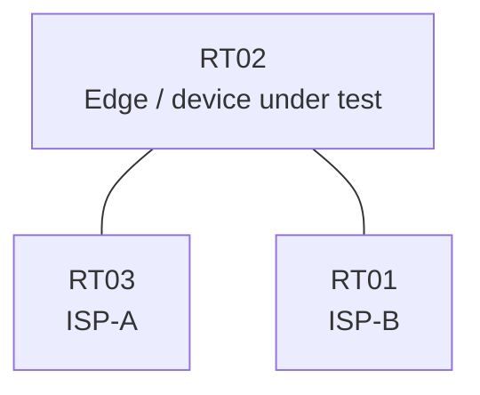

# Question 20261007-015

> **Answer this question without connecting to any device. No additional show commands may be run.**

## Topology

You are responsible for operating the network. The edge router of your company is connected to two service providers through two uplinks. The customer networks 192.168.85.0/24 and 192.168.155.0/24 are advertised through their respective providers.



| Link | Edge-side interface | Network |
|------|--------------------------|--------------|
| RT02 ⇔ RT03 (ISP-A) | Ethernet0/0 | 10.115.12.0/30 |
| RT02 ⇔ RT01 (ISP-B) | Ethernet0/1 | 10.115.13.0/30 |

- The monitoring hosts `192.168.155.20` and `192.168.155.160` come in through ISP-B.

## Requirements

1. Traffic whose source does not match the interface on which it arrives must be dropped.
2. Do not make any changes to the management configuration.
3. Legitimate traffic from the monitoring hosts 192.168.155.20 and 192.168.155.160 must not be dropped.
4. Source address verification must be enabled on both uplink interfaces of the edge router.
5. Exceptions to the verification must be permitted by an access list, on a per-network basis for the network in question.

## Current State

It has been reported that some traffic is not working as intended. Using only the information provided, you must identify why the required state is not being met.

```
RT02# show access-lists
(no output)
```
```
RT02# show ip interface Ethernet0/1
Ethernet0/1 is up, line protocol is up
  Internet address is 10.115.13.1/30
  IP verify source reachable-via RX
   20 verification drops
   0 suppressed verification drops
```
```
RT02# show ip route | begin Gateway
Gateway of last resort is not set
      192.168.85.0/24 is subnetted, 1 subnets
O E2     192.168.85.0 [110/20] via 10.115.13.2, Ethernet0/1
      192.168.155.0/24 is subnetted, 1 subnets
O E2     192.168.155.0 [110/20] via 10.115.12.2, Ethernet0/0
```
```
RT02# show ip interface Ethernet0/0
Ethernet0/0 is up, line protocol is up
  Internet address is 10.115.12.1/30
  IP verify source reachable-via RX
   10 verification drops
   0 suppressed verification drops
```

## Configuration Excerpt

```
RT02# show running-config | section interface
interface Ethernet0/0
 ip address 10.115.12.1 255.255.255.252
 ip verify unicast source reachable-via rx
interface Ethernet0/1
 ip address 10.115.13.1 255.255.255.252
 ip verify unicast source reachable-via rx
```

## Question

Which of the following is true?

## Choices
A. The verification configuration is not applied to the interface facing ISP-B.

B. The routing adjacency with ISP-B is not established.

C. The access list is applied to the interface in the in direction.

D. The hosts permitted in the access list are different from the intended hosts.

E. The access list number referenced by the verification configuration does not match the number of the access list that is defined.

F. The verification mode on the interface facing ISP-B is too strict for a network that is advertised asymmetrically.
