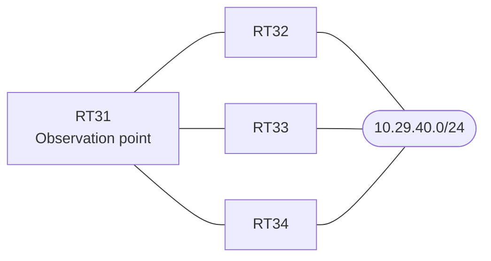

# Question 20261007-016

> **Answer this question without connecting to any device. No additional show commands may be run.**

## Question

The branch router RT31 learns routes to 10.29.40.0/24 through multiple neighboring routers. The network is operated as a single EIGRP autonomous system (200), and the use of the redundant paths is being considered. The IP addressing of the interfaces should not be changed, and the multiplier used for unequal-cost load balancing should not be increased beyond the value shown. Given that the forwarding path to 10.29.40.0/24 on RT31 matches the intent of the operational design, that the existing adjacencies are maintained, and that the configuration change is limited to one place, which route/s are installed in the routing table for 10.29.40.0/24 if `variance 3` is configured under the EIGRP process of RT31? (Choose one.)



| Item | Details |
|------|------|
| RT31 ⇔ RT32 | Ethernet0/0, 10.205.2.0/24 (delay on the RT31 side = 100) |
| RT31 ⇔ RT33 | Ethernet0/1, 10.205.3.0/24 (delay on the RT31 side = 3600) |
| RT31 ⇔ RT34 | Ethernet0/2, 10.205.4.0/24 (delay on the RT31 side = 300) |
| Destination | 10.29.40.0/24 (reachable through all neighbors) |

```
RT31# show ip eigrp topology all-links
EIGRP-IPv4 Topology Table for AS(200)/ID(44.0.0.1)
Codes: P - Passive, A - Active, U - Update, Q - Query, R - Reply,
       r - reply Status, s - sia Status 

P 10.205.2.0/24, 1 successors, FD is 281600, serno 2
        via Connected, Ethernet0/0
P 10.205.3.0/24, 1 successors, FD is 1177600, serno 3
        via Connected, Ethernet0/1
P 10.29.40.0/24, 1 successors, FD is 435200, serno 7, refcount 1
        via 10.205.2.2 (435200/409600), Ethernet0/0
        via 10.205.4.4 (486400/409600), Ethernet0/2
        via 10.205.3.3 (1331200/409600), Ethernet0/1
```
```
RT31# show running-config | section interface
interface Ethernet0/0
 description === to RT32 ===
 ip address 10.205.2.1 255.255.255.0
 delay 100
interface Ethernet0/1
 description === to RT33 ===
 ip address 10.205.3.1 255.255.255.0
 delay 3600
interface Ethernet0/2
 description === to RT34 ===
 ip address 10.205.4.1 255.255.255.0
 delay 300
```
```
RT31# show running-config | section router eigrp
router eigrp 200
 eigrp router-id 44.0.0.1
 network 10.205.0.0 0.0.255.255
 no auto-summary
```

## Choices

A. Three routes are installed: through RT32 (10.205.2.2), through RT34 (10.205.4.4), and through RT33 (10.205.3.3).

B. One route is installed: through RT34 (10.205.4.4).

C. Two routes are installed: through RT34 (10.205.4.4) and through RT33 (10.205.3.3).

D. One route is installed: through RT32 (10.205.2.2).

E. Two routes are installed: through RT32 (10.205.2.2) and through RT34 (10.205.4.4).
