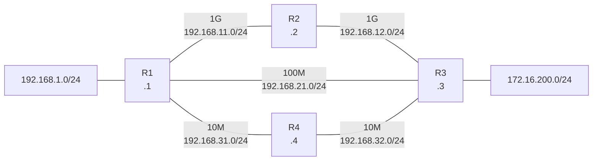

# Question 20261007-017

> **Answer this question without connecting to any device. No additional show commands may be run.**

## Scenario



```
Topology (bandwidth and link addresses):
  R1 — R2: 1G    192.168.11.0/24 (R1 .1 / R2 .2)
  R2 — R3: 1G    192.168.12.0/24 (R2 .2 / R3 .3)
  R1 — R3: 100M  192.168.21.0/24 (R1 .1 / R3 .3)
  R1 — R4: 10M   192.168.31.0/24 (R1 .1 / R4 .4)
  R4 — R3: 10M   192.168.32.0/24 (R4 .4 / R3 .3)
  192.168.1.0/24 is the LAN of R1, and 172.16.200.0/24 is the LAN of R3

Configuration of each router:
  - RIP is enabled on all routers
  - OSPF is enabled on all routers (auto-cost reference-bandwidth 10000)
  - In addition to the above, R1 is configured with ip route 172.16.200.0 255.255.255.0 192.168.31.4 115
```

## Question

Which statement about traffic from 192.168.1.0/24 to 172.16.200.0/24 is true? (Choose one.)

## Choices

A. The traffic is load balanced between the path through R2 and the path through R4.

B. The packets reach R3 through R4.

C. The packets reach R3 directly.

D. The packets reach R3 through R2.
