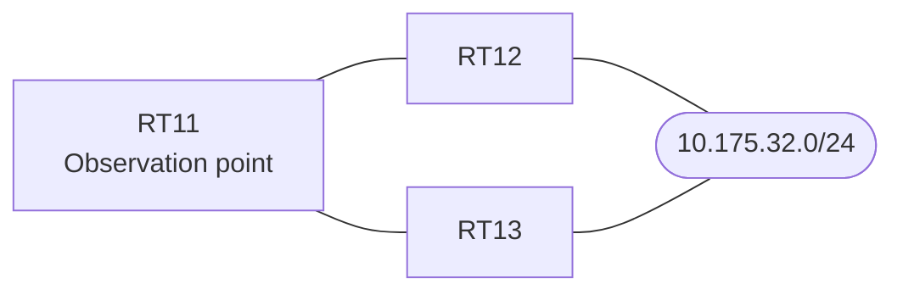

# Question 20261008-001

> **Answer this question without connecting to any device. No additional show commands may be run.**

## Scenario

You are responsible for operating the network. The branch router RT11 learns routes to 10.175.32.0/24 through multiple neighboring routers. The network is operated as a single OSPF domain, and RT11 receives this prefix by way of multiple routes. A review of the route preference behavior is being conducted. Do not make any changes to the management configuration. Do not change the area configuration. The configuration change must be limited to one place. The forwarding path to 10.175.32.0/24 on RT11 must match the intent of the operational design. The existing adjacencies must be maintained.



| Item | Details |
|------|------|
| RT11 ⇔ RT12 | Ethernet0/0, 10.248.2.0/24 (OSPF cost on the RT11 side = 30) |
| RT11 ⇔ RT13 | Ethernet0/1, 10.248.3.0/24 (OSPF cost on the RT11 side = 50) |
| 10.175.32.0/24 on RT12 | The interface that has this prefix belongs to Area 0, and its OSPF cost is 200 |
| RT13 | The border router (ABR) between Area 0 and Area 1. The same prefix also exists on the Area 1 side |

## Output

```
RT11# show ip ospf database summary 10.175.32.0
OSPF Router with ID (1.1.1.1) (Process ID 1)

		Summary Net Link States (Area 0)

  LS age: 641
  Options: (No TOS-capability, DC, Upward)
  LS Type: Summary Links(Network)
  Link State ID: 10.175.32.0 (summary Network Number)
  Advertising Router: 3.3.3.3
  LS Seq Number: 80000009
  Checksum: 0xBD0C
  Length: 28
  Network Mask: /24
	MTID: 0 	Metric: 5
```
```
RT11# show ip ospf border-routers
OSPF Router with ID (1.1.1.1) (Process ID 1)


		Base Topology (MTID 0)

Internal Router Routing Table
Codes: i - Intra-area route, I - Inter-area route

i 3.3.3.3 [50] via 10.248.3.3, Ethernet0/1, ABR, Area 0, SPF 21
```
```
RT11# show running-config | section router ospf
router ospf 1
 router-id 1.1.1.1
 network 10.248.2.0 0.0.0.255 area 0
 network 10.248.3.0 0.0.0.255 area 0
```
```
RT11# show running-config | section interface
interface Ethernet0/0
 description === to RT12 ===
 ip address 10.248.2.1 255.255.255.0
 ip ospf cost 30
interface Ethernet0/1
 description === to RT13 ===
 ip address 10.248.3.1 255.255.255.0
 ip ospf cost 50
```

## Question

Which of the following is installed in the routing table of RT11 as the route to 10.175.32.0/24? (Choose one.)

## Choices
A. The route through RT13 (10.248.3.3) is installed in the routing table with a metric of 5.

B. None of the routes is installed, and 10.175.32.0/24 does not appear in the routing table.

C. Both the route through RT12 (10.248.2.2) and the route through RT13 (10.248.3.3) are installed as equal-cost paths.

D. The route through RT13 (10.248.3.3) is installed in the routing table with a metric of 55.

E. The route through RT12 (10.248.2.2) is installed in the routing table with a metric of 230.
