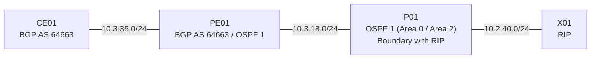

# Question 20261008-002

> **Answer this question without connecting to any device. No additional show commands may be run.**

## Topology

You are the engineer responsible for maintaining the network below. CE01 and PE01 belong to the same AS (64663) and peer with each other using iBGP. PE01 also participates in OSPF 1 and connects to Area 2 and the RIP domain through P01.



## Requirements

1. CE01 must learn all of the networks behind P01 (intra-area, inter-area, and external alike) through BGP.
2. You should make changes in the BGP configuration of PE01 only; do not change the configuration on the OSPF side.
3. Do not change the BGP peering configuration.

## Current State

Users have reported an issue related to their traffic. Using only the information provided, you must identify why the required state is not being met.

```
CE01# show ip bgp
BGP table version is 7, local router ID is 10.3.35.1
Status codes: s suppressed, d damped, h history, * valid, > best, i - internal, 
              r RIB-failure, S Stale, m multipath, b backup-path, f RT-Filter, 
              x best-external, a additional-path, c RIB-compressed, 
Origin codes: i - IGP, e - EGP, ? - incomplete

     Network          Next Hop            Metric LocPrf Weight Path
 *>i  10.3.18.0        10.3.35.2                0    100      0 ?
 *>i  10.1.96.0        10.3.18.3               21    100      0 ?
 *>i  10.3.85.0        10.3.18.3               31    100      0 ?
```
```
PE01# show ip route ospf
Gateway of last resort is not set

O     10.1.96.0/24 [110/21] via 10.3.18.3, 00:41:12, Ethernet0/1
O IA  10.3.85.0/24 [110/31] via 10.3.18.3, 00:38:04, Ethernet0/1
O E1  10.2.62.0/24 [110/51] via 10.3.18.3, 00:12:37, Ethernet0/1
O E2  10.2.108.0/24 [110/20] via 10.3.18.3, 00:12:37, Ethernet0/1
```
```
PE01# show running-config | section router
router ospf 1
 router-id 10.3.18.2
 network 10.3.18.0 0.0.0.255 area 0
!
router bgp 64663
 bgp log-neighbor-changes
 no bgp default ipv4-unicast
 neighbor 10.3.35.1 remote-as 64663
 !
 address-family ipv4
  redistribute ospf 1
  neighbor 10.3.35.1 activate
 exit-address-family
```

## Question

Which of the following is correct?

## Choices
**A.**
```
redistribute ospf 1 match internal
```

**B.**
```
redistribute ospf 1 match external 1 external 2
```

**C.**
```
redistribute ospf 1 match internal external 2
```

**D.**
```
redistribute ospf 1 match external 2
```
