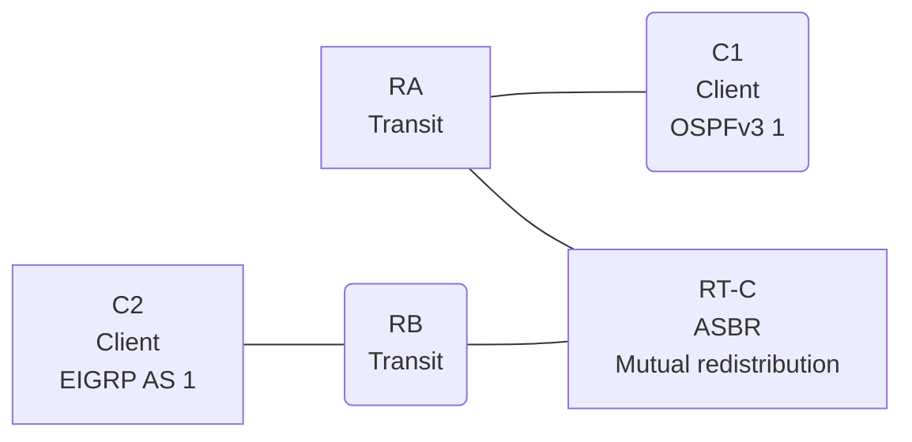

# Question 20261008-008

> **Answer this question without connecting to any device. No additional show commands may be run.**

## Topology

You are responsible for operating the network. The client C1 resides in the OSPFv3 domain, and C2 resides in the EIGRP domain. RT-C is located at the boundary between the two domains, and mutual redistribution is configured.



| Router | Role | Protocols |
|--------|----------|----------------|
| C1 | Client | OSPFv3 1 area 0 |
| RA | Transit | OSPFv3 1 area 0 |
| RT-C | **ASBR (boundary between the two domains)** | Mutual redistribution |
| RB | Transit | EIGRP WAN AS 1 |
| C2 | Client | EIGRP WAN AS 1 |

Links:
```
  (a) C1:Et0/0                ── RA:Et0/1           2001:DB8:1A:2::/64    C1 = 2001:DB8:1A:2::2
  (b) RA:Et0/0                ── RT-C:Ethernet0/0   2001:DB8:B:1:1::/64
  (c) RT-C:GigabitEthernet0/1 ── RB:Et0/0           2001:DB8:C:B::/64
  (d) RB:Et0/1                ── C2:Et0/0           2001:DB8:1:A::/64     C2 = 2001:DB8:1:A::2
```

The OSPFv3 domain contains an external route, `2001:DB8:AA:20::/64`, that is injected by RA.

## Requirements

1. C1 and C2 must be able to communicate with each other.
2. On C1, 2001:DB8:1:A::/64 must be received as a Type 1 external route.
3. Because this work is performed during daytime hours, configuration changes to devices that are out of scope are not permitted.

## Current State

It has been reported that some traffic is not working as intended. Based on the output and configuration shown, you need to determine why the configuration is not working as described below.

```
C1# show ipv6 route ospf | include ^O|via
OE2 2001:DB8:1:A::/64 [110/20]
     via FE80::A8BB:CCFF:FE01:4800, Ethernet0/0
OE2 2001:DB8:C:B::/64 [110/20]
     via FE80::A8BB:CCFF:FE01:4800, Ethernet0/0
OE2 2001:DB8:AA:20::/64 [110/20]
     via FE80::A8BB:CCFF:FE01:4800, Ethernet0/0
```
```
RB# show ipv6 route eigrp | include ^D|^EX|via
(no entries)
```

## Configuration Excerpt

```
RT-C# show running-config
Building configuration...
!
interface Ethernet0/0
 description === to RA ===
 no ip address
 ipv6 address 2001:DB8:B:1:1::1/64
 ipv6 enable
 ipv6 ospf 1 area 0
!
interface GigabitEthernet0/1
 description === to RB ===
 no ip address
 ipv6 address 2001:DB8:C:B::1/64
 ipv6 enable
!
router eigrp WAN
 !
 address-family ipv6 unicast autonomous-system 1
  !
  af-interface Ethernet0/0
   shutdown
  exit-af-interface
  !
  topology base
   redistribute ospf 1 match internal route-map MAP-IN include-connected
  exit-af-topology
  eigrp router-id 5.6.6.7
 exit-address-family
!
router ospfv3 1
 router-id 4.5.4.1
 !
 address-family ipv6 unicast
  redistribute eigrp 1 route-map RM-OSPF include-connected
 exit-address-family
!
ipv6 prefix-list E5400 seq 5 permit ::/0 le 64
ipv6 prefix-list PL-CORE seq 5 permit 2001:DB8:C:B::/64
ipv6 prefix-list PL-CORE seq 10 permit 2001:DB8:1:A::/64
ipv6 prefix-list PL-EIGRP seq 5 permit 2001:DB8:B:1:1::/64
ipv6 prefix-list PL-EIGRP seq 10 permit 2001:DB8:1A:2::/64
ipv6 prefix-list PL-OSPF seq 5 permit 2001:DB8:1A:2::/64
ipv6 prefix-list PL-OSPF seq 10 permit 2001:DB8:1:A::/64
!
route-map MAP-IN permit 10
 match ipv6 address prefix-list PL-EIGRP
route-map RM-OSPF permit 10
 match ipv6 address prefix-list PL-CORE
!
```

## Question

Which of the following is correct?

## Choices
**A.**
```
C1# ping 2001:DB8:1:A::2
Type escape sequence to abort.
Sending 5, 100-byte ICMP Echos to 2001:DB8:1:A::2, timeout is 2 seconds:
.....
Success rate is 0 percent (0/5)

C2# ping 2001:DB8:1A:2::2
Type escape sequence to abort.
Sending 5, 100-byte ICMP Echos to 2001:DB8:1A:2::2, timeout is 2 seconds:

% No valid route for destination
Success rate is 0 percent (0/1)
```
**B.**
```
C1# ping 2001:DB8:1:A::2
Type escape sequence to abort.
Sending 5, 100-byte ICMP Echos to 2001:DB8:1:A::2, timeout is 2 seconds:
!!!!!
Success rate is 100 percent (5/5), round-trip min/avg/max = 1/1/2 ms

C2# ping 2001:DB8:1A:2::2
Type escape sequence to abort.
Sending 5, 100-byte ICMP Echos to 2001:DB8:1A:2::2, timeout is 2 seconds:
!!!!!
Success rate is 100 percent (5/5), round-trip min/avg/max = 1/1/2 ms
```
**C.**
```
C1# ping 2001:DB8:1:A::2
Type escape sequence to abort.
Sending 5, 100-byte ICMP Echos to 2001:DB8:1:A::2, timeout is 2 seconds:

% No valid route for destination
Success rate is 0 percent (0/1)

C2# ping 2001:DB8:1A:2::2
Type escape sequence to abort.
Sending 5, 100-byte ICMP Echos to 2001:DB8:1A:2::2, timeout is 2 seconds:
.....
Success rate is 0 percent (0/5)
```
**D.**
```
C1# ping 2001:DB8:1:A::2
Type escape sequence to abort.
Sending 5, 100-byte ICMP Echos to 2001:DB8:1:A::2, timeout is 2 seconds:
.....
Success rate is 0 percent (0/5)

C2# ping 2001:DB8:1A:2::2
Type escape sequence to abort.
Sending 5, 100-byte ICMP Echos to 2001:DB8:1A:2::2, timeout is 2 seconds:
.....
Success rate is 0 percent (0/5)
```
