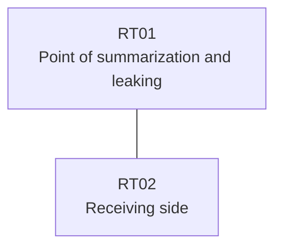

# Question 20261008-009

> **Answer this question without connecting to any device. No additional show commands may be run.**

## Question

The branch router RT01 hosts the service address block 192.168.22.8/29 by means of multiple loopback interfaces. RT01 and RT02 are directly connected by one link, and EIGRP 100 is configured. Given that the specific route for the monitoring host 192.168.22.10 (/32) is received along with the summary, that the block 192.168.22.8/29 is advertised to RT02 as a summary route, and that the operations loopback 10.241.234.69 (/32) continues to be received, select the correct item from those below. Assume that the specific routes inside the block are not advertised, that the summarization configuration on the interface is not permitted because of the history of a past failure, and that the IP addressing of the interfaces is not changed.



| Item | Details |
|------|------|
| Loopbacks of RT01 | 192.168.22.9, 192.168.22.10, 192.168.22.11 |
| Operations loopback of RT01 | 10.241.234.69 |
| Link RT01 ⇔ RT02 | 10.163.211.0/24 (RT01=10.163.211.1 / RT02=10.163.211.2, GigabitEthernet0/1) |

```
RT01# show running-config
Building configuration...
!
interface Loopback0
 ip address 192.168.22.9 255.255.255.255
interface Loopback1
 ip address 192.168.22.10 255.255.255.255
interface Loopback2
 ip address 192.168.22.11 255.255.255.255
interface Loopback10
 ip address 10.241.234.69 255.255.255.255
interface GigabitEthernet0/1
 description === to RT02 ===
 ip address 10.163.211.1 255.255.255.252
 ip summary-address eigrp 100 192.168.22.8 255.255.255.248
!
router eigrp 100
 network 192.168.22.9 0.0.0.0
 network 192.168.22.10 0.0.0.0
 network 192.168.22.11 0.0.0.0
 network 10.241.234.69 0.0.0.0
 network 10.163.211.0 0.0.0.3
!
ip prefix-list PL-MON seq 5 permit 192.168.22.8/29 le 32
ip prefix-list PL01 seq 5 permit 192.168.22.10/32
access-list 15 permit 192.168.22.10
!
route-map LEAK permit 10
 match ip address 15
route-map RMAP01 permit 10
 match ip address prefix-list PL-MON
!
```
```
RT02# show ip route eigrp | begin Gateway
Gateway of last resort is not set
      10.0.0.0/32 is subnetted, 1 subnets
D        10.241.234.69 [90/409600] via 10.163.211.1, 00:17:10, GigabitEthernet0/1
      192.168.22.0/29 is subnetted, 1 subnets
D        192.168.22.8 [90/409600] via 10.163.211.1, 00:17:10, GigabitEthernet0/1
```

## Choices

A. A standard access list, not a prefix list, is used in the match of the route map.

B. The list with the name that the route map references is not defined.

C. There is no match statement in the permit entry of the route map.

D. EIGRP auto-summary is enabled, and it affects the advertisement of the specific routes.

E. The address of the target loopback is not permitted in the list that the redistribution references.

F. The leak-map parameter is not specified in the summarization configuration.
