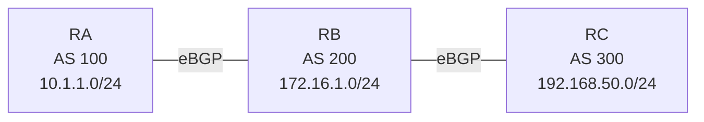

# Question 20261008-010

> **Answer this question without connecting to any device. No additional show commands may be run.**

## Scenario



RA (AS 100), RB (AS 200), and RC (AS 300) are connected by eBGP in this order. RA advertises 10.1.1.0/24, RB advertises 172.16.1.0/24, and RC advertises 192.168.50.0/24. An attempt was made to make AS 200 a non-transit AS, but AS 100 and AS 300 are exchanging their routes.

```
RA# show ip bgp | begin Network
     Network          Next Hop            Metric LocPrf Weight Path
 *>  10.1.1.0/24      0.0.0.0                  0         32768 i
 *>  172.16.1.0/24    198.51.100.2             0             0 200 i
 *>  192.168.50.0/24  198.51.100.2                           0 200 300 i

[Configuration to be added on RB]
RB(config)# [?]
RB(config)# router bgp 200
RB(config-router)# neighbor 198.51.100.1 filter-list 50 out
RB(config-router)# neighbor 198.51.100.6 filter-list 50 out
```

## Question

Which configuration belongs in [?], which is required on RB so that the routes of AS 300 do not reach AS 100 and the routes of AS 100 do not reach AS 300? Note that RA and RC must dynamically learn the routes of AS 200, and RB must dynamically learn the routes of AS 100 and AS 300. (Choose one.)

## Choices

**A.**

```
ip as-path access-list 51 permit ^$
```

**B.**

```
ip as-path access-list 50 permit ^100$
ip as-path access-list 50 permit ^300$
```

**C.**

```
ip as-path access-list 50 deny ^$
ip as-path access-list 50 permit .*
```

**D.**

```
ip as-path access-list 50 permit ^$
```
