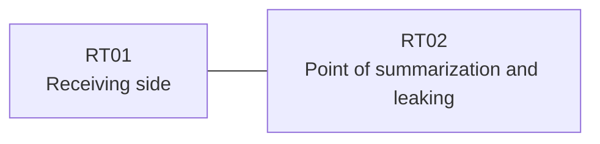

# Question 20261008-015

> **Answer this question without connecting to any device. No additional show commands may be run.**

## Topology

Your organization operates the network shown below. The branch router RT02 hosts the service address block 172.30.247.4/30 by means of multiple loopback interfaces. RT02 and RT01 are directly connected by one link, and EIGRP 65100 is configured.



| Item | Details |
|------|------|
| Loopbacks of RT02 | 172.30.247.5, 172.30.247.6, 172.30.247.7 |
| Operations loopback of RT02 | 10.224.162.188 |
| Link RT02 ⇔ RT01 | 10.63.90.0/24 (RT02=10.63.90.1 / RT01=10.63.90.2, GigabitEthernet0/1) |

## Requirements

1. The loopback interfaces of the block are not permitted to participate in EIGRP by means of network statements.
2. However, the specific route for the monitoring host 172.30.247.5 (/32) must be received along with the summary.
3. The operations loopback 10.224.162.188 (/32) must continue to be received.
4. The routing protocol types and the placement of the processes cannot be changed.
5. The specific routes inside the block must not be advertised.
6. The block 172.30.247.4/30 must be advertised to RT01 as a summary route.

## Current State

It has been reported that some traffic is not working as intended. Using only the information provided, you must identify why the required state is not being met.


## Configuration Excerpt

```
RT02# show running-config
Building configuration...
!
interface Loopback0
 ip address 172.30.247.5 255.255.255.255
interface Loopback1
 ip address 172.30.247.6 255.255.255.255
interface Loopback2
 ip address 172.30.247.7 255.255.255.255
interface Loopback10
 ip address 10.224.162.188 255.255.255.255
interface GigabitEthernet0/1
 description === to RT01 ===
 ip address 10.63.90.1 255.255.255.252
 ip summary-address eigrp 65100 172.30.247.4 255.255.255.252 leak-map LEAK
!
router eigrp 65100
 network 172.30.247.5 0.0.0.0
 network 172.30.247.6 0.0.0.0
 network 172.30.247.7 0.0.0.0
 network 10.224.162.188 0.0.0.0
 network 10.63.90.0 0.0.0.3
!
ip prefix-list MON32 seq 5 permit 172.30.247.4/30 le 32
access-list 30 permit 172.30.247.6
!
route-map LEAK permit 10
!
```

## Question

Which of the following is correct?

## Choices
**A.**
```
RT01# show ip route eigrp | begin Gateway
Gateway of last resort is not set
      10.0.0.0/32 is subnetted, 1 subnets
D        10.224.162.188 [90/409600] via 10.63.90.1, 00:19:38, GigabitEthernet0/1
      172.30.0.0/16 is variably subnetted, 2 subnets, 2 masks
D        172.30.247.4/30 [90/409600] via 10.63.90.1, 00:19:38, GigabitEthernet0/1
D        172.30.247.5/32 [90/409600] via 10.63.90.1, 00:19:38, GigabitEthernet0/1
```
**B.**
```
RT01# show ip route eigrp | begin Gateway
Gateway of last resort is not set
      10.0.0.0/32 is subnetted, 1 subnets
D        10.224.162.188 [90/409600] via 10.63.90.1, 00:19:38, GigabitEthernet0/1
      172.30.0.0/16 is variably subnetted, 4 subnets, 2 masks
D        172.30.247.4/30 [90/409600] via 10.63.90.1, 00:19:38, GigabitEthernet0/1
D        172.30.247.5/32 [90/409600] via 10.63.90.1, 00:19:38, GigabitEthernet0/1
D        172.30.247.6/32 [90/409600] via 10.63.90.1, 00:19:38, GigabitEthernet0/1
D        172.30.247.7/32 [90/409600] via 10.63.90.1, 00:19:38, GigabitEthernet0/1
```
**C.**
```
RT01# show ip route eigrp | begin Gateway
Gateway of last resort is not set
      10.0.0.0/32 is subnetted, 1 subnets
D        10.224.162.188 [90/409600] via 10.63.90.1, 00:19:38, GigabitEthernet0/1
      172.30.0.0/16 is variably subnetted, 2 subnets, 2 masks
D        172.30.247.4/30 [90/409600] via 10.63.90.1, 00:19:38, GigabitEthernet0/1
D        172.30.247.6/32 [90/409600] via 10.63.90.1, 00:19:38, GigabitEthernet0/1
```
**D.**
```
RT01# show ip route eigrp | begin Gateway
Gateway of last resort is not set
      10.0.0.0/32 is subnetted, 1 subnets
D        10.224.162.188 [90/409600] via 10.63.90.1, 00:19:38, GigabitEthernet0/1
      172.30.0.0/30 is subnetted, 1 subnets
D        172.30.247.4 [90/409600] via 10.63.90.1, 00:19:38, GigabitEthernet0/1
```
